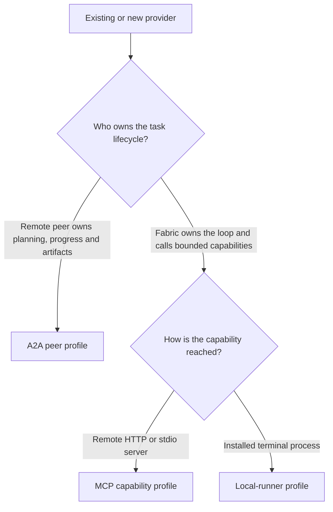
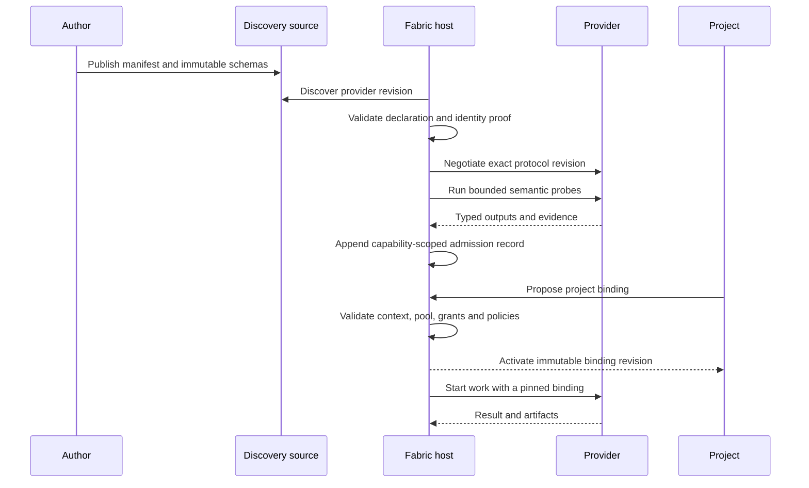
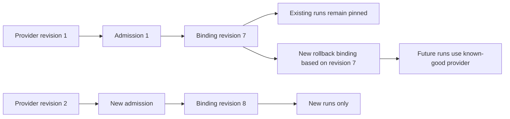

# Creating and connecting compatible agents

This guide is the practical entry point for an agent author and a Fabric project operator. It is organised by the
kind of agent you build. The normative rules stay in the linked specification pages and JSON Schemas; every example
below is a minimal document that `test/guide-examples.test.ts` validates against its schema, so a copied example is
a correct starting point.

> **Words used here.** The full definitions are in [CONTEXT.md](../../CONTEXT.md).
>
> - **Provider**: anything that offers capabilities through a declared profile.
> - **Agent**: a provider that accepts an outcome and owns the work needed to reach it.
> - **Capability**: one named, versioned thing a provider does, with an input and an output schema.
> - **Profile**: how a capability is reached: `mcp`, `a2a` or `local-runner`, as the manifest names it.
> - **Manifest**: `fabric-agent.json`, the document that declares a provider and its capabilities.
> - **Service**: a long-running agent process that follows `fabric-service/0.1`.
> - **Descriptor**: the file an installer writes to announce one installed service instance.
> - **Provider entry**: the file an installer writes to announce an agent that is not a service.
> - **Runner**: an installed coding agent (Claude Code, Codex, Cursor Agent and others) a host can drive. The
>   **local-runner profile** is how a manifest declares a capability that such a runner serves; the runner is the
>   program, the profile is the declaration.

## What compatibility means

A compatible integration has four independent proofs:

1. its documents validate against their schemas and pass the semantic rules;
2. its declared MCP, A2A or local-runner revision negotiates successfully;
3. safe semantic probes prove each advertised capability;
4. a project creates an immutable binding that supplies the allowed execution context, account pool, grants and
   policies.

The first proof is a command, `pnpm validate`, run from a checkout of this repository. Passing it proves declaration
shape only. Discovery, admission and project authorization are separate states
([registry, admission and binding](../specification/registry.md)).

## Pick your kind

| You are building | Section | Documents you write | The kit |
|---|---|---|---|
| A long-running process on the operator's machine with an MCP surface and usually a dashboard | [a local MCP service](#a-local-mcp-service) | a service descriptor and the well-known document it serves; a manifest when it offers capabilities | the Fabric Agent Adapter's service kits |
| A CLI or a stdio MCP server that a host starts when it needs it | [an agent that is not a service](#an-agent-that-is-not-a-service) | a provider entry and its manifest | the Fabric Agent Adapter's provider bundle scaffold |
| A coding agent that a host drives as a terminal process | [a coding agent as a local runner](#a-coding-agent-as-a-local-runner) | a manifest with a `local-runner` capability | the Fabric Agent Adapter's provider bundle scaffold, with the `local-runner` profile |

The [Fabric Agent Adapter](https://github.com/passioncode-ai/fabric-agent-adapter) is the kit that scaffolds each kind
and probes it: its service kits write a descriptor and serve the well-known document, and its `check_service.py`
probe checks a live service against these rules.

### Choose one profile per capability



Each profile names its revision in its own member. A manifest that writes the revision under another profile's member
name is refused.

| Profile | Use when | Version member | Provider must expose |
|---|---|---|---|
| `mcp` | Fabric owns the loop and calls bounded tools, resources or prompts | `protocolRevision`: `2026-07-28` | streamable HTTP or stdio connection, exact feature names and probes |
| `a2a` | the remote agent accepts an outcome and owns its opaque task lifecycle | `protocolVersion`: `1.0` | HTTPS Agent Card, skill IDs, REST, JSON-RPC or gRPC binding, task and cancel behaviour, probes |
| `local-runner` | Fabric starts an installed terminal agent | `profileVersion`: `fabric-local-runner/0.1` | runner kind, executable reference, argument array, input mode, result location, cancellation, heartbeat and probes |

One provider may offer several capabilities with different profiles. One capability cannot switch profile inside a
run; a new binding revision is required ([profiles](../specification/profiles.md)).

## A local MCP service

A service runs once on the machine, under its supervisor (launchd, systemd, the Task Scheduler or Project
Observatory's node), and answers on `http://127.0.0.1:<port>`. Its installer writes the descriptor into the services
folder; the running process serves the well-known document. A service with no capabilities needs no manifest.

The descriptor, `<id>.<instance>.json` in the services folder:

<!-- example: service-descriptor.schema.json kind=service-descriptor pair=service -->

```json
{
  "protocol": "fabric-service/0.1",
  "id": "example-agent",
  "instance": "default",
  "name": "Example Agent",
  "origin": "http://127.0.0.1:47195",
  "auth": { "tokenFile": "~/.config/example-agent/service.token" },
  "lifecycle": {
    "manager": "launchd",
    "label": "com.example.example-agent",
    "plist": "~/Library/LaunchAgents/com.example.example-agent.plist"
  },
  "paths": {
    "data": "~/Library/Application Support/example-agent",
    "logs": ["~/Library/Logs/example-agent/service.log"]
  },
  "installedAt": "2026-10-21T09:00:00Z",
  "installedBy": "example-agent service install 0.1.0"
}
```

The answer to `GET /.well-known/fabric-service`, with an MCP surface:

<!-- example: service-well-known.schema.json kind=service-well-known pair=service -->

```json
{
  "protocol": "fabric-service/0.1",
  "service": {
    "id": "example-agent",
    "instance": "default",
    "name": "Example Agent",
    "version": "0.1.0",
    "build": { "commit": "8b80be9" }
  },
  "process": { "pid": 51234, "startedAt": "2026-10-21T09:00:05Z" },
  "status": "ready",
  "degraded": [],
  "surfaces": {
    "mcp": { "path": "/mcp", "transport": "streamable-http", "capabilities": ["reports.draft"] },
    "events": { "path": "/fabric/v1/events" }
  }
}
```

The manifest, `fabric-agent.json`, when the service offers capabilities. It names its descriptor, and the MCP tool it
serves has the capability's name ([interop C3.1](../specification/interop.md#c31-capabilities)):

<!-- example: manifest.schema.json kind=manifest pair=service -->

```json
{
  "contractVersion": "0.1.0",
  "provider": {
    "id": "https://agents.example/providers/example-agent",
    "revision": 1,
    "contentHash": "sha256:0000000000000000000000000000000000000000000000000000000000000000",
    "createdAt": "2026-10-21T09:00:00Z",
    "createdBy": "https://agents.example/authors/team",
    "name": "Example Agent",
    "identity": { "subject": "https://agents.example/providers/example-agent", "method": "local-install" },
    "supportedContractVersions": ["0.1.0"],
    "extensions": {
      "https://fabric.passioncode.ai/agent-contract/extensions/service/0.1": { "descriptor": "example-agent.default" }
    }
  },
  "capabilities": [
    {
      "id": "https://agents.example/capabilities/reports-draft",
      "name": "reports.draft",
      "inputSchema": "https://agents.example/schemas/report-request.json",
      "outputSchema": "https://agents.example/schemas/report.json",
      "effect": "draft",
      "idempotency": "supported",
      "dataClasses": ["project-internal"],
      "profile": {
        "kind": "mcp",
        "protocolRevision": "2026-07-28",
        "connection": { "mode": "streamable-http", "url": "http://127.0.0.1:47195/mcp" },
        "requiredFeatures": ["tool:reports.draft"],
        "probes": [
          {
            "id": "draft-shape",
            "inputFixture": "https://agents.example/fixtures/report-request.json",
            "outputSchema": "https://agents.example/schemas/report.json",
            "timeoutMs": 30000,
            "sideEffectCeiling": "draft",
            "assertions": ["returns a draft report without sending it"]
          }
        ]
      }
    }
  ]
}
```

Check the folder that holds the three files; the checker reads a descriptor and a well-known document as a pair:

```bash
pnpm validate ./fabric/
```

Read next: [services](../specification/service.md) (the token, the events feed, the usage report, lifecycle),
[profiles](../specification/profiles.md), [interop](../specification/interop.md) when a capability runs as a job,
and [embedded dashboard](../specification/embedded-dashboard.md) when the dashboard opens inside a host. The
Fabric Agent Adapter's Python, Node and dashboard kits serve these documents for you.

## An agent that is not a service

A CLI or a stdio MCP server has no long-running process to answer a well-known document. Its installer writes a
provider entry into the providers folder of the fabric home ([provider entries](../specification/provider.md)),
and the entry points at the manifest. The entry's `providerId` is the manifest's `provider.id`.

The provider entry, `<id>.json` in the providers folder:

<!-- example: provider.schema.json kind=provider-entry pair=stdio -->

```json
{
  "protocol": "fabric-provider/0.1",
  "id": "example-reports",
  "providerId": "https://agents.example/providers/example-reports",
  "name": "Example Reports",
  "manifest": "~/.local/share/example-reports/fabric-agent.json",
  "run": {
    "mcp": {
      "stdio": {
        "command": ["~/.local/bin/example-reports", "mcp"],
        "env": { "EXAMPLE_API_KEY": "secret-ref:example-reports/EXAMPLE_API_KEY" }
      }
    }
  },
  "installedAt": "2026-10-21T09:00:00Z",
  "installedBy": "example-reports install 1.0.0"
}
```

Leave `run.mcp.stdio.scope` out for now: Fabric's registry does not accept it yet (CT-27), and its absence means `on-demand`
([provider entries](../specification/provider.md)). An `env` value is always a `secret-ref:`, never the key; no
argument carries a credential.

Its manifest, with the same server as a stdio connection:

<!-- example: manifest.schema.json kind=manifest pair=stdio -->

```json
{
  "contractVersion": "0.1.0",
  "provider": {
    "id": "https://agents.example/providers/example-reports",
    "revision": 1,
    "contentHash": "sha256:0000000000000000000000000000000000000000000000000000000000000000",
    "createdAt": "2026-10-21T09:00:00Z",
    "createdBy": "https://agents.example/authors/team",
    "name": "Example Reports",
    "identity": { "subject": "https://agents.example/providers/example-reports", "method": "local-install" },
    "supportedContractVersions": ["0.1.0"]
  },
  "capabilities": [
    {
      "id": "https://agents.example/capabilities/reports-summarize",
      "name": "reports.summarize",
      "inputSchema": "https://agents.example/schemas/summary-request.json",
      "outputSchema": "https://agents.example/schemas/summary.json",
      "effect": "none",
      "idempotency": "supported",
      "dataClasses": ["project-internal"],
      "profile": {
        "kind": "mcp",
        "protocolRevision": "2026-07-28",
        "connection": { "mode": "stdio", "executableRef": "urn:executable:example-reports", "args": ["mcp"] },
        "requiredFeatures": ["tool:reports.summarize"],
        "probes": [
          {
            "id": "summary-shape",
            "inputFixture": "https://agents.example/fixtures/summary-request.json",
            "outputSchema": "https://agents.example/schemas/summary.json",
            "timeoutMs": 30000,
            "sideEffectCeiling": "none",
            "assertions": ["returns a summary with its sources"]
          }
        ]
      }
    }
  ]
}
```

The entry and the manifest both describe the server today; keep them the same command. Check the folder that holds
both; the checker reads the documents of a folder together:

```bash
pnpm validate ./fabric/
```

Read next: [provider entries](../specification/provider.md),
[where a stdio server is declared](../specification/profiles.md#where-a-stdio-server-is-declared) and
[no secret in a command line](../specification/profiles.md#no-secret-in-a-command-line). A server that holds no
per-session state is better run once as a service (the section above).

## A coding agent as a local runner

A host starts an installed coding agent as a terminal process, gives it an input file and reads a result envelope
back. The manifest declares the capability with the `local-runner` profile. `runnerKind` should be one of the shared
kind names on the [runners](../specification/runners.md) page (`claude-code`, `codex`, `cursor-agent`, `gemini-cli` and
others), which are also the ids of [`catalogue/coding-agents.json`](../../catalogue/coding-agents.json); a namespaced
extension is allowed, but routes and events then match on no other host.

<!-- example: manifest.schema.json kind=manifest -->

```json
{
  "contractVersion": "0.1.0",
  "provider": {
    "id": "urn:fabric:provider:codex-local",
    "revision": 1,
    "contentHash": "sha256:0000000000000000000000000000000000000000000000000000000000000000",
    "createdAt": "2026-10-21T09:00:00Z",
    "createdBy": "urn:fabric:operator:local",
    "name": "Codex local runner",
    "identity": { "subject": "urn:fabric:provider:codex-local", "method": "local-install" },
    "supportedContractVersions": ["0.1.0"]
  },
  "capabilities": [
    {
      "id": "urn:fabric:capability:software-development",
      "name": "development.repository-change",
      "inputSchema": "https://fabric.example/schemas/work-node.json",
      "outputSchema": "https://fabric.example/schemas/result.json",
      "effect": "draft",
      "idempotency": "none",
      "dataClasses": ["project-internal"],
      "profile": {
        "kind": "local-runner",
        "profileVersion": "fabric-local-runner/0.1",
        "runnerKind": "codex",
        "executableRef": "urn:executable:codex",
        "args": ["exec", "{inputFile}"],
        "inputMode": "file-json",
        "resultUriTemplate": "file:{worktree}/.fabric/result.json",
        "cancellation": "signal",
        "heartbeatSeconds": 30,
        "probes": [
          {
            "id": "dry-run-result",
            "inputFixture": "urn:fixture:local-runner:dry-run",
            "outputSchema": "https://fabric.example/schemas/result.json",
            "timeoutMs": 120000,
            "sideEffectCeiling": "draft",
            "assertions": ["writes a valid result envelope without external effects"]
          }
        ]
      }
    }
  ]
}
```

The host replaces `{inputFile}` and `{worktree}` when it starts the run; the contract does not yet list these
placeholders in one table. Check the manifest:

```bash
pnpm validate ./fabric-agent.json
```

Read next: [the local-runner profile](../specification/profiles.md#local-runner-profile),
[runners](../specification/runners.md) (the catalogue, runner routes, runner and model profiles) and
[results and evidence](../specification/results-and-evidence.md) for the envelope the runner writes.

## The checker

`pnpm validate <file|dir> [--schema <name>] [--kind <kind>] [--json]` reads a document or a folder, run from a
checkout of this repository at the commit you pin. It infers the schema from the document, or takes `--schema`; runs
the schema and then the semantic rules; checks a folder's descriptors, well-known documents, provider entries and
manifests as pairs; and prints one line per problem with its path, its rule and a link to the rule. It exits 0 when
everything is clean, 1 when a document has a problem, and 2 on a usage error. A hint, such as an extension key one
letter away from the contract's, is printed as a note and does not fail the run. `--json` prints the same findings
as JSON for a script or a CI step.

## Map an existing system

| Existing surface | Compatible path | Boundary |
|---|---|---|
| Native A2A agent | declare an A2A capability directly | Fabric observes protocol-visible task state, messages, evidence and artifacts, not private reasoning |
| Native MCP server | declare each host-shaped capability through MCP; run it as a service when it holds no per-session state | the server is a capability provider, not automatically an autonomous peer |
| Claude Code (`claude-code`), Codex (`codex`), Cursor Agent (`cursor-agent`) or another runner the runners page lists | a local-runner declaration and a result adapter | the project chooses the runtime; the provider chooses the model within the project's classes |
| Ordinary HTTP API with bounded operations | wrap it with an MCP adapter | Fabric remains responsible for the task loop |
| Ordinary HTTP API that starts and owns long-running autonomous jobs | wrap it with an A2A peer adapter | the adapter maps the service job lifecycle to A2A tasks |
| Web application with no stable API or CLI | not directly compatible | add a supported API or CLI first; browser automation is not a Fabric base profile |

The protocol choice is made per capability, not per vendor. An external product may expose research as an A2A peer
and a deterministic lookup as MCP.

## Inputs, outputs and evidence

Provider-specific input and output schemas describe the capability payload. Fabric also normalises every completed
or stopped invocation into the common [result envelope](../../schemas/result.schema.json):

| Collection | Meaning |
|---|---|
| `done` | atomic claims about work completed |
| `proof` | resolvable evidence supporting those claims |
| `scope` | project, run, node, binding and allowed write scopes |
| `notVerified` | claims or surfaces that were not independently checked |
| `artifacts` | immutable typed outputs |

A2A artifacts map into Fabric artifacts. MCP and local-runner outputs are wrapped by their host adapter. A successful
transport response is not proof that the semantic task succeeded
([results and evidence](../specification/results-and-evidence.md)).

## Discovery, admission and binding



1. **Publish:** expose a manifest, referenced schemas, protocol endpoint or local executable reference, and
   admission fixtures.
2. **Discover:** a host finds the manifest through a descriptor, a provider entry, direct configuration, a private
   registry, an A2A Agent Card or a local catalogue.
3. **Validate declaration:** compile the JSON Schemas and reject invalid or unsupported revisions before credentials
   or project data are supplied.
4. **Verify identity:** prove the provider subject through the method declared in the manifest.
5. **Negotiate protocol:** connect using exactly MCP `2026-07-28`, A2A `1.0` or `fabric-local-runner/0.1` for
   contract `0.1.0`.
6. **Probe semantics:** run bounded, non-publishing fixtures and evaluate declared result assertions.
7. **Admit capability:** append an immutable admission record for every capability whose independent gates passed.
8. **Bind project:** pin the admitted provider together with project execution, account, data, coordination, grant
   and checker policies ([binding schema](../../schemas/binding.schema.json)).
9. **Run:** resolve the active binding once and keep the run pinned to it.

A binding lets the same provider serve several projects without sharing their accounts, filesystem, data or grants.
A provider is never trusted because another project admitted or bound it. The normative lifecycle and failure states
are in [registry, admission and binding](../specification/registry.md).

## Replacement and rollback



Every revision changes the manifest revision and content hash. Replacement never mutates an active run: a new
provider revision receives a new admission decision and project binding. Rollback is also a new revision based on a
known-good earlier payload; it does not reactivate or edit history
([immutable configuration versioning](../specification/versioning.md)).

## Author checklist

- [ ] Provider ID is stable and every published revision is immutable.
- [ ] Each capability has one semantic name and one selected profile.
- [ ] Protocol revision exactly matches the contract or is rejected explicitly.
- [ ] Input and output schemas resolve without credentials.
- [ ] Effects, idempotency and data classifications are honest.
- [ ] Admission probes are bounded, repeatable and cannot publish, charge or
  message real recipients.
- [ ] Results separate completed claims, proof and unverified claims.
- [ ] Cancellation, timeout and partial results preserve useful artifacts.
- [ ] No chain-of-thought, ambient environment or secret enters a contract field.

## Operator checklist

- [ ] Manifest shape, identity, protocol and semantic probes have separate verdicts.
- [ ] Admission applies only to the capabilities that passed.
- [ ] Binding references belong to the selected project and are immutable.
- [ ] Execution context exposes allowlisted secret references, not secret values.
- [ ] Account overrides stay inside the project's pinned account pool.
- [ ] External effects have matching scoped grants.
- [ ] Checker and coordination policies are pinned before the run starts.
- [ ] Replacement or rollback creates a new binding and leaves existing runs pinned.
