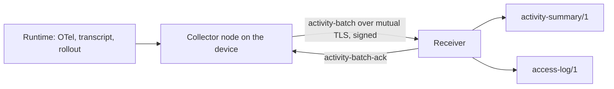

# Activity telemetry `fabric-activity/0.1`

DEC-0030, amended by DEC-0052, DEC-0068, DEC-0082 and DEC-0090; its transport by DEC-0056 · rule codes `FAC-SEM-037`…`FAC-SEM-040`, `FAC-SEM-067`, `FAC-SEM-100`, `FAC-SEM-123` (and `FAC-SEM-045`,
[devices](devices.md#attribution)) · schemas [`telemetry-event`](../../schemas/telemetry-event.schema.json),
[`activity-batch`](../../schemas/activity-batch.schema.json),
[`activity-batch-ack`](../../schemas/activity-batch-ack.schema.json),
[`activity-summary`](../../schemas/activity-summary.schema.json),
[`access-log`](../../schemas/access-log.schema.json),
[`activity-notice`](../../schemas/activity-notice.schema.json), shared definitions in
[`activity-common`](../../schemas/activity-common.schema.json)

Activity telemetry records **when an agent session worked, waited or idled, and what each model
call used** — for debugging, for memory of how work went, and for spend reconciliation. A collector
on a device reads what coding-agent runtimes already emit (OpenTelemetry exports, transcripts,
rollout files, the desktop switchboard, process sampling). It turns that into telemetry events of
this shape and sends them in batches to an organization server (the **receiver**). Only a receiver
builds summaries.

The contract names every field it defines and closes every object it defines. A collector MUST NOT
add content or person attributes: no prompt, response, command line, window title or diff, and no
name, address, team or rank. A person appears only as an opaque `user.id`, in raw events only;
summaries have no person dimension. `FAC-SEM-037` is a **best-effort key filter** — a deny-list of
names checked in every spelling, plus a refusal of home paths in values — and not a proof that no
content passes. The schema's bounds on extension data (two levels, short tokens without whitespace)
are the stronger guard.

The key words MUST, MUST NOT, SHOULD and MAY are used as in RFC 2119. The protocol is its own
(`protocol: "fabric-activity/0.1"`), beside `fabric-service/0.1`; a manifest declares nothing for
it. The device side — enrollment, signed policy, check-in, health and attribution — is
[`fabric-device/0.1`](devices.md).

## Personal data and purpose

Telemetry events and check-ins that carry a `user.id`, or come from a device bound to a person, are
**personal data**. A receiver:

- MUST process them only for the purposes, and keep them only for the retention, that the
  organization's notice or policy states to the people concerned. The device policy carries the raw
  retention (`retention.raw_days`, [devices](devices.md#policy)).
- MUST record every read of a person's raw data in that person's [access log](#access-log) and MUST
  let the person read it.
- MUST **delete** raw events when `retention.raw_days` expires. Only summaries already built from
  them remain, and a summary has no person dimension. Raw events are not kept under any other scope
  past their retention (operator decision 2026-10-08, DEC-0030).

The operator confirmed this shape on 2026-10-08 (DEC-0030): per-person presence estimates, labelled
by `method`; every read in the person's access log; and no scoring of persons.

**Notice, consent and what reaches another person** (DEC-0052, the operator's OD-1 in neutral form).

- The device policy names the `noticeVersion` it is issued under ([devices](devices.md#policy)). A person
  acknowledges that notice with a `notice.acknowledgement` message (`noticeVersion`, the `purposeIds` it
  names, `at`), and gives or withdraws consent to one purpose with a `consent` message (`purposeId`,
  `state` `given` or `withdrawn`, `at`) — schema
  [`activity-notice`](../../schemas/activity-notice.schema.json). Neither carries the person: the
  receiver takes them from the authenticated session, as enrollment takes the user from its proof. How a
  receiver stores consent records is its own business and not part of this contract.
- A receiver serves **another person** — an owner, an administrator, support — a person's time and
  presence (raw events, intervals, `attended`) only under a `purposeId` that person confirmed: the latest
  `consent` for it at the time of the read says `given`. It serves a person's **usage and cost** only as
  sums per UTC day or billing period. The access log records the read's `purposeId` and `step`, and
  `FAC-SEM-067` refuses a log entry that breaks either ([`confirmedPurposes`](../../src/activity-rules.ts)).
  The person reading their own data, and a service that serves nobody (a summary build), are not narrowed. A partner
  organization (DEC-0090) reads only usage sums per agent and UTC day or period, logged in each contributing member's
  access log; the organization server's notice names that reader before its first read (DEC-0090).
- This narrows what DEC-0030's presence ruling lets a receiver serve, not the schema: the per-person
  estimates still exist, and reach an owner or administrator only through a purpose the person
  confirmed.

The contract defines no score, rank or comparison of persons, and no field for one. Presence-derived
values are **estimates**, not observations of a person:

- an interval's `state` (each of `agent_working`, `awaiting_input` and `idle`);
- its `attended` flag;
- the durations a summary sums from them.

Each one comes from the `method` the event names, with the `idleThresholdSeconds` it used. The
[kinds](#kinds) below use the same wording.

## Telemetry event

Schema: [`telemetry-event.schema.json`](../../schemas/telemetry-event.schema.json). Fields are
`camelCase`, as in the rest of the contract; dots appear only inside identifiers (`kind`, `source`,
policy key names).

### Envelope

| Field | Meaning |
|---|---|
| `eventId` | The idempotency key ([below](#event-id)). |
| `kind` | `session.interval`, `usage.line`, `session.annotation`, `buffer.overflow`, `policy.violation`, `grant.usage`, `result`, an extension `x-<namespace>.<kind>`, or a kind a later revision adds. |
| `source` | Where the collector read it. Open vocabulary; known: `claude_code.otel`, `claude_code.transcript`, `codex.otel`, `codex.rollout`, `switchboard`, `process`. |
| `sourceKey` | Present exactly when `eventId` is derived. Either the source's own id of the record (a request id, a line uuid) or, for a key derived from a file, `hmac-sha256:` under the device's telemetry key ([below](#event-id)). Never a path: the schema refuses a slash and an encoded home-directory fragment, the dashed form at the start or after any character that is not an ASCII letter or digit (DEC-0105). |
| `collector.id`, `collector.epoch`, `seq` | The stream position ([below](#streams)). |
| `occurred` | The device's wall clock when it happened. |
| `bootId`, `monotonicNs` | A monotonic reading ([below](#clocks)). |
| `received` | Set by the receiver when it stores the event. A device never sends it (the batch schema refuses it). |
| `user.id` | Optional and opaque: an organization membership id or a local profile id. The receiver sets it from the binding recorded for the event's epoch ([attribution](devices.md#attribution)). The pattern refuses `@` and spaces, so an e-mail address does not fit; a name-like id does, so issuing opaque values is the issuer's duty. |
| `account.class`, `account.tenantRef` | The account the session ran on (DEC-0052): `organization`, `personal` or `unknown` — a statement about an account, never a person. An organization account carries the `tenantRef` its tenant has in the policy's `accounts.tenants` ([devices](devices.md#policy)): `sha256:` of the RFC 8785 form of `{provider, tenant}` ([`tenantRef`](../../src/activity-rules.ts)). A personal or unknown account carries none (schema), so no hash of a person's own tenant leaves the device. |
| `session.id`, `session.parent` | The runtime's session, and the session that launched it when one agent started another. |
| `project.id` | The project the session worked in, as the organization names it. |
| `runtime.name`, `runtime.version` | The runtime (open vocabulary: `claude_code`, `codex`, …). |
| `skill` | The skill the work ran under, when the runtime reports one (Claude Code's `skill.name`). |
| `launch.via` | How the session was started: `fabric`, `terminal`, `ide`, `desktop`, `switchboard`, `cron`, `agent`, `other`. |
| `git.branch` | The branch, at most 100 characters from `[A-Za-z0-9._/-]`. When the policy key `telemetry.git_branch` says `hash`, it is `hmac-sha256:` of the name under the device's telemetry key, so a dictionary of common branch names cannot reverse it. When the key says `omit`, the field is absent. |
| `task.ref.system`, `task.ref.key` | The task the session served, in the tracker that owns it. |
| `run.root`, `run.task` | `run.root`: the root run id every hop of one execution carries (DEC-0052) — a random per-run id, so a usage line and a `result` join on the device without naming a person. `run.task`: the host's run or work-graph node, when a host launched the session. At least one of the two. |
| `data` | The kind's own fields. |

### Clocks

Three clocks are kept apart on purpose, and a reader never replaces one with another:

- `occurred` orders events for a person reading them;
- `monotonicNs` orders events of one boot on one device across wall-clock changes. It is the
  nanoseconds of a monotonic clock **that keeps counting during sleep** — `CLOCK_BOOTTIME` on Linux,
  `mach_continuous_time` on macOS, `QueryInterruptTimePrecise` on Windows — so interval durations do
  not shrink across a sleep. Readings compare only within one `bootId`. It is a decimal string, as
  OTLP's JSON encoding writes 64-bit times, because it passes 2^53 after about 104 days of uptime.
  It is at most 2^64 − 1 (`FAC-SEM-039`);
- `received` is the receiver's own.

### Kinds

**`session.interval`** — a stretch of one session in one state. It requires `session`, `project`
and `runtime`. `data`:

- `start` and `end` (`end` ≥ `start`, `FAC-SEM-039`);
- `state`: `agent_working`, `awaiting_input` or `idle` — an estimate by `method`
  ([purpose](#purpose));
- `method`: what produced the estimate (open vocabulary: `otel`, `hook`, `transcript`, `rollout`,
  `process`, `switchboard`);
- optional `idleThresholdSeconds`: the silence after which `agent_working` becomes `idle`;
- optional `attended`: an estimate by `method` of whether the session's interface reported a person
  present, sent only when the method can tell;
- optional `outcome`, on the last interval of a session: how it ended (open vocabulary: `completed`,
  `failed`, `abandoned`, `interrupted`, `unknown`).

**`usage.line`** — one model call. It requires `session`, `project` and `runtime`. `data`: `model`,
`tokens` (`input`, `output`, optional `cacheRead`, `cacheWrite`), `cost`, and `dedupeKey`.

- **An unknown cost is `null`, never `0`** (as in the service usage report, DEC-0021). `cost.usd` is
  either a number with a `cost.basis`, or `null` with no basis. The bases are:
  - `provider`: the provider charged it;
  - `price-list`: computed from a published list;
  - `client-estimate`: the runtime's own estimate, such as Claude Code's `cost_usd`.

  A zero client estimate for a call that used tokens is an unknown cost, so it is reported `null`
  (`FAC-SEM-038`). A zero from a price list that says the model is free stands.
- `dedupeKey` names the call itself — the provider's request id when the source has one — so the
  same call read from two sources is counted once. Lines that share a `dedupeKey` agree on model,
  tokens and cost (`FAC-SEM-038`).

**`buffer.overflow`** — the collector dropped events it could not keep. `data.dropped`:

- `ranges`: disjoint, non-touching ranges of this stream, all below this event's own seq;
- `events`: their total length (`FAC-SEM-039`);
- optional `byKind`: a list of `{kind, count}`. It is a list, so a kind name is a value and never
  read as a key by `FAC-SEM-037`.

A collector never drops an overflow event without carrying its ranges into the next one.

**`policy.violation`** — the device saw work that breaks the organization's policy, counted per **UTC
day** (DEC-0052). It requires `project`. `data`: `day`, `provider`, `accountClass`, `reason` (open
vocabulary: `personal_account_in_work_folder`, `unknown_account`, `personal_key_shared`) and an optional
`count`. It carries a day and **no finer time**: `occurred` is that day's midnight UTC
(`FAC-SEM-039` checks it is the same day), `monotonicNs` is `"0"`, and it carries no `session`, `run`,
`task`, `git`, `skill` or `launch` that would tie it to a timed interval (schema). A collector emits a
day's violations after the day ends, so the stream position tells no more than the day.

**`grant.usage`** — one grant's metered usage for one **UTC day** (DEC-0082, [contexts](contexts.md#usage-per-grant)).
`data`: `day`, `grantId` (the share grant's `meta.id`, `urn:fabric:share:` and 32 lower-case hex digits, compared as
written, DEC-0086), `context` (the grant's own `org:<orgId>`, DEC-0086), `calls` (at least 1),
`unpricedCalls` (never more than `calls`) and `costUsd`, a number of at least 0 or `null` when no call was priced — an
unknown cost is `null`, never `0` (`FAC-SEM-038`). Like `policy.violation` it carries a day and no finer time:
`occurred` is that day's midnight UTC (`FAC-SEM-039`), `monotonicNs` is `"0"`, and it carries no `session`, `user`,
`run`, `task`, `git`, `skill` or `launch` (schema). `calls` and `unpricedCalls` count calls. Its source is the meter's
settled grant-check receipts (DEC-0037), each counted once and assigned to the UTC day of its `allowed` answer's
`checkedAt`; `unpricedCalls` counts the calls of receipts whose cost is unknown. A service's `byGrant` row is used only
when it lists `receipts`, the meter holds none of them and the report's `days` hold one date; otherwise it is not used,
and the collector reports what the meter holds ([contexts](contexts.md#usage-per-grant)). It holds sums and states only, never a per-call
line, because usage under a share grant is data about a person (CX-VES-08). A collector emits it after the day ends, one
per (day, `grantId`) per stream (`FAC-SEM-039` refuses a second in one batch, the ids compared by normal form; a share grant id is its own normal form, so the two comparisons agree), and
sends it only to the organization server of the grant's own context ([routing](contexts.md#routing),
`routeGrantUsage`). A receiver counts the first per (stream, day, `grantId`) and ignores later ones. It rejects one whose
`context` is not `org:` and its certificate's `org.id` as `attribution` (`FAC-SEM-045`), and joins it to an agent by the
share registration it holds for the device's bound user ([share registration](share-registration.md#the-join),
DEC-0086). A collector sends one only behind the sender gate there.

**`result`** — a run met, or did not meet, the result signal its agent declares (DEC-0052, the first
organization server's target architecture v4 §12). It requires `run.root`, and carries **no `user` and no
`session`** (schema): results leave a device as counts and enums joined to cost by the run. The event arrives on
the device's stream, which the receiver attributes to a user by certificate (`FAC-SEM-045`), and a usage line with a
`user` carries the same `run.root`, so keeping results from being read per person is the **receiver's restraint**:
it never attaches a user to a result and serves results only as project or agent cells of at least 3
(`activity.results`, `FAC-SEM-067`). `data`: `signal` (the declared signal's name),
`outcome` (`met`, `not_met`) and an optional `count`. A summary gains no person dimension from it.

**`session.annotation`** — what a surface reported about a session, read by the device's collector (DEC-0068): Fabric's
`session.ended` or `terminal.opened`, Switchboard's `journal_launch`. It requires `session` and `runtime`. `data`: `by`
(the surface), `label` (what it reported) and `at`. It carries no start, end, tokens or cost, and no `user` (schema):
it is never counted ([one writer per session](#one-writer-per-session)), adds no subject to a summary cell's
population ([`population`](../../src/activity-rules.ts)), and is a raw event served to another person only under
`activity.raw` with a confirmed purpose.

**One writer per session** (DEC-0068, CON-OE-08). The runtime's `session.id` is the key that joins every event about
a session. On one device the collector is the one writer of a session's `session.interval` and `usage.line` events:
every counted event of one `session.id` carries one `collector.id`, and the session's intervals do not overlap, since a
session is in one state at a time (`FAC-SEM-100`, kind `session-join`). A surface's own events about the session —
Fabric's, Switchboard's — are annotations, never counters: when the collector reads them it writes
`session.annotation`. A reader counts interval seconds by state and one usage line per `dedupeKey`, and nothing else
([`sessionTotals`](../../src/session-join.ts); one call once by its `dedupeKey` across sessions, as `FAC-SEM-038`
reads it, credited to the first session that reports it), so a session seen by three writers totals as its collector
wrote it
(`fixtures/semantic/session-join-three-writers.json`).

**Extension and unknown kinds.** A collector MAY emit its own kinds as `x-<namespace>.<kind>`. Any
kind a reader does not know — an extension, or a core kind a later revision of this protocol adds —
carries bounded `data`: at most two levels, scalar values, strings of at most 64 characters with no
whitespace and no absolute path (schema `activity-common#/$defs/extData`). A receiver MUST accept
and store an event of an unknown kind, count it in its stream, and never reject the batch for it.
It MUST NOT interpret the event's `data`. A new core kind is therefore an additive change within
`0.1`: a receiver pinned before `grant.usage` (DEC-0082) reads it as an unknown kind, so it accepts one whose
`grantId` satisfies `extScalar`'s string branch and rejects any other as that event's `schema` rejection
([contexts → compatibility](contexts.md#compatibility)).

**Routing by context** (DEC-0082). No event carries the context of its session: the receiver knows its organization
from the device certificate ([attribution](devices.md#attribution)), and a context field could leak `personal` or
another organization's id. A collector sends a session's events only to the organization server of the one enrollment
whose organization is the session's `org:<orgId>`, compared as written, and never an event of a `personal` session
(`routeTarget`); it sends `grant.usage` by the grant's own context (`routeGrantUsage`), which the event carries
(DEC-0086); and the device sends each
enrollment's check-ins to that enrollment's server ([devices → check-in](devices.md#check-in)). The shared vectors are
[`fixtures/vectors/context-route.json`](../../fixtures/vectors/context-route.json) ([contexts → routing](contexts.md#routing)).

### No content, no person

`FAC-SEM-037` applies to every telemetry event, and to every event in a batch. Each key at any
depth is split into words — at `camelCase` boundaries, `_`, `-` and `.` — and refused when:

- a word, or a pair of adjacent words, names content (`prompt`, `response`, `text`, `message`,
  `command`, `diff`, `title`, `cwd`, `tool_input`, `window_title`, …);
- a word or a pair names a person (`email`, `team`, `manager`, `author`, `rank`, `review`,
  `display_name`, …);
- a word starts with a prefix that ranks a person's standing or output;
- the key is `user` anywhere but the event's own `/user`.

A value that holds a home directory is refused too. `HOME_PATH` in the same module matches the
**user-name segment form**: a home root (`Users`, `users`, `home`) between two separators of the same
kind, followed by a name. The forms it covers:

- slash forms, absolute or relative: `/Users/<name>`, `users/<name>`, `home/<name>`,
  `C:\Users\<name>`;
- URL-encoded slash forms, once or twice: `%2FUsers%2F<name>`, `%252FUsers%252F<name>`;
- the dash forms runtimes write into file names: `-Users-<name>-`, `C--Users-<name>`,
  `-home-<name>-`, at the start or after any character that is not an ASCII letter or digit (`x.-Users-<name>`,
  `p@-Users-<name>`, DEC-0105);
- tilde forms: `~/` and `~<name>/`.

`Users-guide`, `/Users-guide`, `feature/home-page` and `homework` have no such segment and are not
refused.

**Its scope** (CT-109): `HOME_PATH` is the value scanner of `FAC-SEM-037`, `FAC-SEM-040`, `FAC-SEM-128`
([node summary](node-summary.md)) and `FAC-SEM-138`; it reads values that may hold ordinary words, so it refuses the
dash form only after a character that is not an ASCII letter or digit and `my-users-list` passes, while a device's
one-line `detail` refuses the dash form after any character ([devices](devices.md#check-in)) and `FAC-SEM-103` matches
only a home folder that starts a path in slash form ([proposals](proposals.md)); the `sourceKey` pattern repeats its
dash clause over the key's alphabet, and `test/activity-rules.test.ts` pins that the two refuse the same keys.

**`HOME_PATH` is defence in depth, not the control.** A path wrapped in base64, hashed without a key,
or encoded in any other way is undetectable by design; no pattern can find a name it cannot read. The
control is the rule that **no field carries a path, and a path-derived key is `hmac-sha256:` under
the device's telemetry key** ([event id](#event-id)). A collector that sends an encoded path breaks
that rule whether or not `HOME_PATH` notices. The word lists live in [`src/activity-rules.ts`](../../src/activity-rules.ts)
(`CONTENT_WORDS`, `PERSON_WORDS`, `PERSON_PAIRS`, `PERSON_PREFIXES`). A receiver MUST refuse such an
event (`rejected[].reason` `content-field` or `person-field`) rather than strip it, so the collector
that produced it is fixed.

A collector MUST drop content and person attributes at the source. Claude Code's export carries
`user.email` when available, and can be configured to log prompt text, tool input and raw API bodies
([monitoring](https://code.claude.com/docs/en/monitoring-usage)). None of these reaches an event.

### Event id

`eventId` makes delivery idempotent: a receiver keeps one event per (`device.id`, `eventId`).

- An event read from a source that can be read again — an export that is retried, a transcript that
  is re-scanned after a restart — MUST carry a **derived** id, so a second read yields the same id.
  The id is `sha256:` followed by the hex SHA-256 of the canonical JSON of
  `{"key": <sourceKey>, "source": <source>}`, using the canonical form of
  [settings backups](service.md#settings-backup), not RFC 8785
  ([canonical forms](conformance.md#canonical-forms), DEC-0043). The event carries that `sourceKey` (schema).
  `FAC-SEM-039` checks the derivation ([`activityEventId`](../../src/activity-rules.ts)).
- When the source has no id of its own, the record is identified by its place in a file. A
  **path-derived key MUST be hashed**: the `sourceKey` is `hmac-sha256:` and the hex HMAC-SHA-256 of
  the settings-form canonical JSON `{"offset": <byte offset>, "path": <path relative to the runtime's own
  directory>}`. A plain relative path leaks the person: Claude Code's project directories encode
  the home directory into the name (`-Users-<name>-…`).
- The HMAC key is the device's **telemetry key** ([`pathSourceKey`](../../src/activity-rules.ts),
  [`hashedBranch`](../../src/activity-rules.ts)): 32 random bytes the collector generates once per
  device, keeps beside its stream state, and never sends. A re-read on the same device yields the
  same key. The same telemetry key hashes `git.branch`. A collector that loses its telemetry key has
  lost its stream state too, and re-enrolls. Usage lines it reads again are still counted once by
  their `dedupeKey`.
- An event the collector originates itself — an interval it computed, an overflow — carries a ULID
  ([spec](https://github.com/ulid/spec)) and no `sourceKey`. The ULID is persisted with the event
  before the first send.

### Streams

A **collector node** is one sequence-emitting collector instance on a device; a device hosts one or
more. A stream is (`device.id`, `collector.id`, `collector.epoch`): a collector id is unique only
within its device, so every receiver keys streams by device as well. `seq` numbers a stream from 1,
by 1, with no reuse.

**The epoch is issued by the organization server**, never chosen by the collector. Each enrollment
returns a `streamEpoch` greater than every epoch issued to that device before
([devices](devices.md#enrollment)), and every collector on the device uses it from then on. A
collector that loses its persisted counter — a reinstall, a reset — MUST re-enroll the device. It
then starts again at seq 1 under the new epoch, which is not evidence of tampering. A collector that
still holds buffered events of an earlier epoch may finish sending them.

**A batch carries a contiguous slice of each stream, oldest first.** A collector buffers events in
seq order, drops only from the head (the oldest), and sends from the head. So within one batch the
seqs of a stream are consecutive (`FAC-SEM-039`). A gap can open only between what the receiver
already holds and the first seq of a batch — the events the collector dropped. The overflow event
that accounts for them is newer than every event still buffered, so it can arrive several batches
later.

## Batch and acknowledgement

Schemas: [`activity-batch.schema.json`](../../schemas/activity-batch.schema.json),
[`activity-batch-ack.schema.json`](../../schemas/activity-batch-ack.schema.json).

A device sends `{protocol, device.id, batchId?, sent, events[1..1000]}` over its enrolled
mutual-TLS channel, signed with an HTTP message signature that a receiver behind a TLS-terminating host verifies
instead ([devices, transport](devices.md#transport), DEC-0056). **The receiver attributes the batch to the client
certificate** — or to the certificate the verified signature names — not to the body:

- `device.id` MUST equal the certificate's device;
- every event's `user.id` MUST equal the user bound when the event's epoch was issued, or be absent
  when that epoch was issued with no user — so events of an earlier epoch stay with the person they
  belong to after the device is re-enrolled to someone else.

A mismatch is refused (`FAC-SEM-045`, [devices](devices.md#attribution)). The receiver answers:

- `accepted`, `duplicates`, `rejected[]` — one of the three for every event, so
  `accepted + duplicates + rejected.length` equals the batch's event count (`FAC-SEM-039`). A
  duplicate (`device.id`, `eventId`) is accepted again and counted, never an error. A retried batch
  is harmless.
- `rejected[]` — `eventId` and `reason`: `schema`, `content-field`, `person-field`, `stream`,
  `attribution`, `purpose`, `before-purpose`. **A rejected event is consumed with a rejection.** The collector does not resend
  it, and the stream does not stall on it. `purpose` (DEC-0100) says the receiver does not collect that event for that
  person now, under the notice they acknowledged ([notice](#notice)): a receiver answers it only when the purpose is not
  collected for that person when it answers (DEC-0102); the collector then sends no event of that kind for
  that person until the device's policy names a later `noticeVersion`, or a check-in response names an `acknowledgedNoticeVersion` other than the one it held at the rejection (the person acknowledged the notice in force, [devices](devices.md#check-in)), never on a timer (DEC-0100, DEC-0102). Only a present value that differs from the one held at the rejection resumes, absence at the rejection included (a first acknowledgement is a change, as on a managed machine whose collection started at the deadline); a value that becomes absent is no signal. `before-purpose` (DEC-0102) says the event occurred before its purpose was collected for that person (their acknowledgement of the notice naming it, or the mdm deadline where the organization collects under it; a device bound to no person collects only from that deadline, its `collectionStart`), and that purpose is collected now: a receiver may keep such an event, and when it does not (a buffered event from before that start) it answers `before-purpose`, never `purpose`; the event is consumed and the collector holds nothing. A receiver sends it to every collector, whatever its pin: a rejection is consumed whatever its reason (DEC-0100), so a collector consumes each `rejected[]` entry by its `eventId` and never refuses an acknowledgement for a reason it does not know. A held collector whose server starts stating `acknowledgedNoticeVersion` late resumes once and may be refused again: one extra round, consumed, never a stall. A device bound to no person never receives the member and resumes on a later `noticeVersion`. An event from before `collectionStart` is not this case: it is never uploaded (`FAC-SEM-068`, [devices](devices.md#collection-start)), and one that is uploaded is the device's fault. An `attribution` rejection stays what it was:
  the event names another organization, device or user than its certificate.
- `acks[]` — for every stream the batch carried, `seq` and optional `held`, both computed over
  **everything the receiver holds for the stream across batches** — the same state it judges tamper
  evidence from ([`mergeStreams`](../../src/activity-rules.ts),
  [devices](devices.md#tamper-evidence)):
  - `seq` is the highest seq up to which every seq is **consumed**: held, rejected, or accounted for
    by an overflow event, whichever batch brought it. Seq 0 means nothing yet. A check-in's `dropped`
    ranges are not consumed: they are the device's word until the overflow event arrives, and they
    count for [tamper evidence](devices.md#tamper-evidence) only (DEC-0052, F-B-108).
  - `held` lists the consumed ranges above `seq`.

  An ack names no more and no less (`FAC-SEM-039`; [`contiguousAcks`](../../src/activity-rules.ts),
  which merges ranges and never walks seq by seq). Example: a receiver holds 5…1004 from earlier
  batches and receives the overflow at 1005 that accounts for 1…4. The ack is 1005, not 4.

**What the device keeps, and where the next batch starts.**

- A device keeps every event above `seq` that is not in a `held` range, and MAY drop the rest.
- A batch answered **410 `organization-closed`** (DEC-0103, [devices](devices.md#organization-closed)) is not consumed
  event by event: the organization ended, and the device drops every event it holds for it and sends it nothing again.
- The next batch starts at the device's oldest kept event that it has not yet sent on this
  connection. Events already in flight are not sent again until their batch fails or goes
  unacknowledged; then the device sends again from its oldest kept event.
- So a gap at the head of a stream, whose overflow is still buffered behind newer events, does not
  stall delivery: the device keeps sending forward, and the ack jumps when the overflow arrives.
- When its buffer fills, a device drops the oldest kept events and emits one `buffer.overflow`
  naming them. It never renumbers.
- The check-in reports dropped ranges whose overflow is not yet acknowledged, so a receiver can tell
  a pending overflow from a hidden gap ([devices](devices.md#tamper-evidence)).

## Summary

Schema: [`activity-summary.schema.json`](../../schemas/activity-summary.schema.json), format
`activity-summary/1`.

**A summary is built by a receiver, from many devices' events; a device never produces one** (the
schema has no producer kind, and `FAC-SEM-040` refuses one). A device sends events. A summary is a
set of **cells** between `from` and `to` inclusive, one per combination of:

- **agent** (`runtime.name`);
- **skill** (`skill`, optional);
- **project** (`project.id`);
- **UTC day**;
- **outcome** (the session's last `outcome`, else `unknown`).

A cell carries:

- `counts`: `population`, `sessions`, `intervals`, `usageLines`, `unpricedLines`;
- `durations`, each an estimate under the cell's `method` and the summary's `idleThresholdSeconds`:
  - `agentSeconds`: time spent `agent_working`;
  - `waitHumanSeconds`: time spent `awaiting_input`;
  - `waitAgentSeconds`: time a session waited on a session it launched, joined by `session.parent`;
  - `attendedSeconds`: time covered by `attended` intervals;
- `usage`: `tokens` and `cost`.
  - A cell whose every line is unpriced costs `null`.
  - A cell with some priced lines carries the known part, which a reader shows as a lower bound.
  - A known cost names its basis (schema). The basis is `mixed` when its lines differ; that is the
    receiver's duty, since a summary does not carry its lines and no rule can check it (F-B-107).

**There is no person dimension.** The schema names every field a cell may carry. `FAC-SEM-040`
refuses a person key anywhere, two cells for one dimension tuple, and a day outside the range.

**Minimum cell: k = 3** (operator decision 2026-10-08). A cell's **population** is the number of
distinct subjects among its events. An event's subject is its `user.id` when it carries one, and its
`session.id` otherwise ([`population`](../../src/activity-rules.ts)). So a cell counts distinct
people where events name them, and distinct sessions where they do not; a population never exceeds
the cell's sessions.

- A cell is published only when its population is at least the summary's `minPopulation`. The
  schema holds `minPopulation` at 3 or more.
- A receiver folds every cell of a day that falls below the minimum into **one other cell** for that
  day (`other: true`). The other cell carries counts, durations, method and usage, but no agent,
  skill, project or outcome.
- If the other cell is itself below the minimum, it is not published either. The summary counts
  what it withheld in `suppressedCells`.
- `FAC-SEM-040` refuses a published cell below the minimum, a population above the session count,
  and two other cells for one day.

This keeps a project that one person works on alone from identifying them through the project
dimension.

## Access log

Schema: [`access-log.schema.json`](../../schemas/access-log.schema.json), format `access-log/1`.

Every read of a subject's data is recorded. That covers raw activity keyed by their `user.id`, and
anything keyed by **a device bound to them**: health, check-ins and policy, which reveal for example
that the device is `logging_disabled`. Each entry records:

- `at`: when the read happened;
- `reader`: an opaque `user.id` or a `service`, and its `role`;
- `scope`: what was read. The `activity.*` scopes are closed: `activity.raw`, `activity.presence`,
  `activity.usage` and `activity.results`; `device.*` stays open (`device.health`, `device.check_in`,
  `device.policy`). Served to a person other than the subject (`FAC-SEM-067`): another `activity.*` scope is
  refused; `activity.results` is refused, since results are read only as project or agent cells of at least 3;
  `activity.usage` only per UTC day or billing period; `activity.raw` and `activity.presence` only under a purpose the
  subject confirmed — and `activity.raw` served to another person never includes `usage.line` events or cost, which
  reach another person only as `activity.usage` sums;
- `device`: the device, when the read was keyed by one;
- `range`: the time range read;
- `purpose`: a sentence, and `purposeId`: the purpose as the notice names it (DEC-0052);
- `step`: how finely the rows served were resolved — `event`, `hour`, `day` or `period`;
- `requestId`: the receiver's own request id.

A read served to another person carries the `purposeId` and `step` the [notice rules](#notice) require
(`FAC-SEM-067`).

A reader whose `role` is `partner` is a partner organization reading its agents' usage (DEC-0090): its entry is a
service's read (no `user`), of `activity.usage`, per UTC day or billing period, keyed by no device (`FAC-SEM-123`,
[the partner channel](partner-channel.md)).

A receiver that stores activity telemetry MUST record these reads and MUST let the subject read
their own log. Reads of summaries, which carry no person, are not logged per subject; a partner's read is the exception, logged in
every contributing member's log (DEC-0090).

## Mapping to OpenTelemetry

**OTLP intake** (operator decision 2026-10-08). Beside HTTPS batches, a receiver MAY accept the same
events as OTLP logs, mapped by the table below. The second intake changes no rule:

- events arrive over the same enrolled mutual-TLS channel, signed as every device request is
  ([devices, transport](devices.md#transport), DEC-0056), attributed by certificate and epoch
  ([devices](devices.md#attribution));
- each log record is mapped back to a telemetry event and checked against the same schema and the
  same `FAC-SEM-037`…`039` rules;
- deduplication is the same: on (`device.id`, `eventId`), and on `dedupeKey` for usage lines, across
  both intakes;
- an OTLP record that does not map to a valid event is refused, as in a batch.

OTLP's own acknowledgement carries no stream position, so a collector that sends over OTLP still
learns its acks from batches or check-ins.

A collector that also exports events as OpenTelemetry log records
([log data model](https://opentelemetry.io/docs/specs/otel/logs/data-model/), stable) maps them as
below. Names outside OpenTelemetry's conventions take the `fabric.` prefix. This is a mapping step,
not an identity: the runtimes' own exports use other names (Claude Code: `input_tokens`, `cost_usd`,
`cache_creation_tokens`).

| JSON path | OpenTelemetry |
|---|---|
| `occurred` | LogRecord `Timestamp` |
| `kind` | LogRecord `EventName` (`fabric.activity.` + kind) |
| `received` | not exported: the receiver's own |
| `eventId`, `source`, `sourceKey` | attributes `fabric.event_id`, `fabric.source`, `fabric.source_key` |
| `collector.id`, `collector.epoch`, `seq` | attributes `fabric.collector.id`, `fabric.collector.epoch`, `fabric.seq` |
| `bootId`, `monotonicNs` | attributes `fabric.boot_id`, `fabric.monotonic_ns` |
| `user.id` | attribute `user.id` |
| `session.id`, `session.parent` | attributes `session.id`, `fabric.session.parent` |
| `project.id`, `skill`, `launch.via`, `task.ref.*`, `run.root`, `run.task` | attributes `fabric.project.id`, `fabric.skill`, `fabric.launch.via`, `fabric.task.system` / `fabric.task.key`, `fabric.run.root`, `fabric.run.task` |
| `runtime.name`, `runtime.version` | resource `service.name`, `service.version` |
| `git.branch` | attribute `vcs.ref.head.name` |
| `data.model` | attribute `gen_ai.request.model` |
| `data.tokens.input`, `.output` | attributes `gen_ai.usage.input_tokens`, `gen_ai.usage.output_tokens` |
| `data.tokens.cacheRead`, `.cacheWrite` | attributes `gen_ai.usage.cache_read.input_tokens`, `gen_ai.usage.cache_creation.input_tokens` |
| `data.cost.usd`, `data.cost.basis`, `data.dedupeKey` | attributes `fabric.cost.usd`, `fabric.cost.basis`, `fabric.dedupe_key` |
| other `data.*` | attributes `fabric.data.*` |

## Semantic rules

| Code | Kind | Rule |
|---|---|---|
| `FAC-SEM-037` | `activity-batch`, `telemetry-event` | no key whose words name content or a person, in any spelling, at any depth, extension data included; `user` only as the event's own `/user`; no home directory, plain or encoded, in any value |
| `FAC-SEM-038` | `activity-batch`, `activity-summary`, `telemetry-event` | an unknown cost is `null`, never `0`: no zero client estimate for a call that used tokens; one `dedupeKey`, one model, tokens and cost; a summary cell's cost is `null` exactly when every line is unpriced; a `grant.usage` has no more unpriced calls than calls, and its cost is `null` exactly when every call is unpriced (DEC-0082) |
| `FAC-SEM-039` | `activity-ack`, `activity-batch`, `telemetry-event` | `monotonicNs` fits in 64 bits; an interval ends after it starts; a policy violation's and a `grant.usage`'s `occurred` is the day it names; one stream of a batch carries one `grant.usage` per (day, `grantId`), the ids compared by normal form (DEC-0082, DEC-0076); an overflow's ranges are disjoint, precede it and add up to its count; a `sourceKey` derives the `eventId`, and one with no canonical form is refused; each stream in a batch is consecutive with no repeated id; an ack's counts add up to the batch, it names the batch's device, each stream's ack is its highest consumed seq over all batches, and `held` names only consumed seqs above it |
| `FAC-SEM-040` | `activity-summary` | no person dimension, content key or path; no producer kind; no published cell whose population is below `minPopulation` (at least 3) or above its sessions; one cell per agent × skill × project × day × outcome, and at most one other cell per day; every day inside `from`…`to` |
| `FAC-SEM-067` | `access-log-disclosure` | a read served to a person other than the subject shows the subject's time or presence only under a `purposeId` the subject confirmed, and the subject's usage and cost only per UTC day or billing period |
| `FAC-SEM-100` | `session-join` | every `session.interval` and `usage.line` of one `session.id` carries one `collector.id`, and the intervals of one session do not overlap; annotations are not counted (DEC-0068) |
| `FAC-SEM-123` | `access-log-disclosure` | an entry whose reader's `role` is `partner` is a service's read (no `user`) of `activity.usage`, per UTC day or billing period, keyed by no device ([the partner channel](partner-channel.md), DEC-0090) |

`activity-ack` checks `{known?, batch, ack}`: `known` is the receiver's stream state before the
batch (`[{collector, held, accounted, pending?}]`; `pending`, a check-in's dropped ranges, never moves
an ack), then the batch, then the answer. `access-log-disclosure` checks `{log, consents?}`: an
access log and the subject's `consent` messages.

- Fixtures: `fixtures/positive/telemetry-event-*`, `activity-*` and `access-log.json`;
  `fixtures/negative/telemetry-event-*`, `activity-*` and `access-log-*`.
- Rule inputs: `fixtures/semantic/telemetry-event-*`, `activity-*` and `access-log-*`.
- Tests: `test/activity-rules.test.ts`.

## Decided after the first draft

OQ-0009 is resolved by the operator's decisions of 2026-10-08, recorded in DEC-0030:

- (a) the [minimum cell](#minimum-cell) is k = 3;
- (b) raw events are [deleted](#purpose) when their retention expires;
- (c) [OTLP](#otlp-intake) is a permitted second intake.
