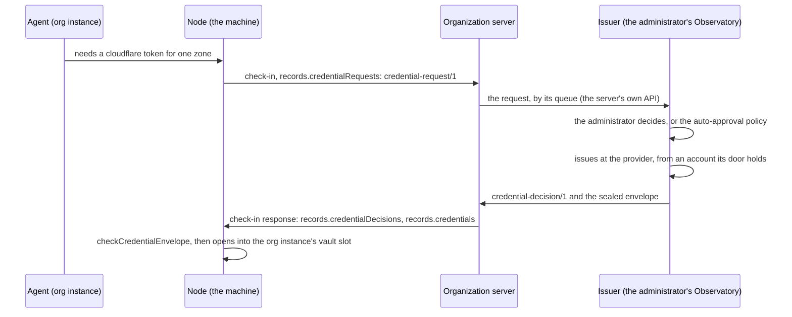

# Credentials on request, and the call record

DEC-0111 (CT-86, S5 and S6 of the agent network) · rule codes `FAC-SEM-138` to `FAC-SEM-140` · schemas
[`credential-request.schema.json`](../../schemas/credential-request.schema.json),
[`credential-decision.schema.json`](../../schemas/credential-decision.schema.json),
[`credential-envelope.schema.json`](../../schemas/credential-envelope.schema.json),
[`credential-revocation.schema.json`](../../schemas/credential-revocation.schema.json),
[`call-record.schema.json`](../../schemas/call-record.schema.json), and their members in
[`device-check-in.schema.json`](../../schemas/device-check-in.schema.json) · code
[`src/credentials.ts`](../../src/credentials.ts) · vectors
[`fixtures/vectors/credential-envelope.json`](../../fixtures/vectors/credential-envelope.json), written by
[`tools/vectors/credential-envelope.ts`](../../tools/vectors/credential-envelope.ts) · tests
[`test/credential-envelope.test.ts`](../../test/credential-envelope.test.ts)

An agent that works for an organization sometimes needs a credential of its own: a token for one DNS zone, a model key
with a spend ceiling. S5 asks that it request one, that the organization decide, and that the value arrive sealed into
that organization's context on the machine that runs the agent, never into the person's own context, with every request,
decision and issue recorded (board thread `ba63565c` item 5; `b2511678`, with the operator's addition of 2026-10-22 that
OpenRouter keys for people and agents follow the same flow). S6 asks that every call between agents leave one record
(item 6). One envelope profile also moves a credential between one person's own machines, and carries the estate key the
machines' keyed digests use (Project Observatory OBS-194 step 2). This page decides all four.

## The flow

The contract defines what crosses the machine's check-in in both directions and what the node verifies. How the issuer
reads the server's queue, which presets an organization offers and how an administrator decides are the organization
server's and the issuer's (the first organization server, Project Observatory OBS-191).

## The request

`credential-request/1` travels in a check-in's `records.credentialRequests` inside the signed device request, so the
device and its organization come from the transport, never from the request. It names:

- `requestId`, a UUID the node chooses; the decision and the envelope name it.
- `agentRef`: the agent instance asking, and `context`, its organization's `org:<id>`.
- `provider` (a slug: `cloudflare`, `openrouter`), `preset` (a preset the issuer lists, by name), and optionally
  `scope` (what the credential reaches, by name: a zone, an account) and `limit` (`usd`, `reset`: daily, weekly,
  monthly or never).
- `expiresAt`, when the credential should end, and `requestedAt`.
- `reason`: one line the administrator reads.

It names no person and carries no value. `FAC-SEM-138` (kind `credential-request` on `{request, org}`) holds that the
context is the enrollment's own organization, that the credential is asked for after the request and for at most 30
days, and that the reason and the scope carry no path and no word shaped like a credential (kind
`credential-request-document` checks a request alone). A node sends a request in every check-in until a decision other
than `pending` answers it.

## The decision

`credential-decision/1` travels in a check-in response's `records.credentialDecisions`. `outcome` is `issued`, `refused`
or `pending`; `by` is `administrator` or `policy` (absent while pending); `issued` names the `credential` it issued by
`slot`, `provider`, `preset` and `expiresAt`, never its value; `refused` names a `reason` (`not-allowed`,
`preset-unknown`, `expiry-too-long`, `scope-too-wide`, `provider-unavailable`, `withdrawn`, `unanswered`).
`FAC-SEM-138` (kind `credential-decision` on `{request, decision}`) holds that the decision answers its request, that an
issued credential is the request's provider and ends no later than the request asked, and that each outcome carries
exactly its own members.

The organization server records every request, decision, issue and revocation by name, in its own ledger: the
administrator sees all of the organization's, a person sees those of the agents in their own enrollment. A value is in
no record.

## The envelope

`fabric-credential-envelope/1` is `{header, ct, sig}`: the value sealed with HPKE (RFC 9180) base mode, suite
`[16, 1, 1]` as the [secret envelope](relay.md#the-secret-envelope), to the target machine's `#kem`, `info` the ASCII
`fabric-credential-envelope/1`, the additional data the RFC 8785 bytes of the header; `sig` is over the RFC 8785 bytes of
`{header, ct}`. The header names `alg`, `suite`, `recipient` (`#kem`), `signer`, `context`, `agentRef`, `slot`,
`provider`, `sequence` (the sealer's for `(context, agentRef, slot)`), `iat`, `exp` (a life of at most 24 hours) and
`enc`, and, in an organization's context only, `requestId` and `credentialExpiresAt`.

Two profiles, told apart by `context`:

| | Organization's context | Personal context |
|---|---|---|
| `context` | `org:<id>` | `personal` |
| Signed by | a key of the organization's current policy key set ([devices](devices.md#key-sets)), `alg: EdDSA` | the sending machine's `#sig`, `alg: ES256`, low-S |
| Admitted when | the node sent that request (`requestId`, `agentRef`, `slot`) and has no decision closing it | the sender is a machine of the estate record the target applied, not revoked by the record or the delta, neither machine is `view`, and it is not the target itself |
| Ends | at `credentialExpiresAt`, at most 30 days after `iat`; the node deletes the value then | when a later envelope replaces it |
| Lands in | the organization instance's vault slot for `agentRef` and `slot` | the personal vault slot for `agentRef` and `slot` |

`checkCredentialEnvelope(envelope, context)` runs every check short of decryption, in this order; the first that fails
names the refusal:

1. `malformed`: not the schema's shape (`credentialEnvelopeShape`, held equal to the schema over every vector), or a
   clock that does not read.
2. `unsupported-alg`: `EdDSA` outside an organization's context, `ES256` outside the personal one.
3. `wrong-recipient`: another `#kem`.
4. `wrong-context`: an organization this machine is not enrolled in, or a personal envelope on a machine that holds no
   estate record.
5. `bad-key`: an `enc` that is no point of the curve; a policy key the set does not list, or outside its window at `iat`
   (an unreadable bound closes the window); a signer that is no `#sig` of an admitted machine (`relayAdmissionSet` over
   the applied record and the delta's revocations).
6. `bad-signature`.
7. `sender-not-allowed` (personal) or `not-requested` (organization).
8. `replayed` (a sequence below the target's mark for `(context, agentRef, slot)`) and `sequence-reused` (another
   envelope at the mark's sequence); the same envelope again passes, a repeat delivery.
9. `not-yet-valid` (`iat` more than 60 s ahead), `lifetime-too-long` (more than 24 hours), `expired`.
10. `credential-expired`: `credentialExpiresAt` already past, or more than 30 days after `iat`.

`openCredential` then opens the ciphertext (`cannot-open` when it does not). The target writes the value and the mark
`{context, agentRef, slot, sequence, digest}` in one transaction, and stores nothing after a refusal. `FAC-SEM-139`
(kind `credential-envelope-check`) holds a target's answer to `checkCredentialEnvelope`'s. A sealer that cannot produce
an envelope a target opens refuses before it signs (`sealCredential`), so no sequence is spent on it.

An envelope never carries a value into the other context's vault: an organization's key cannot sign into the personal
context, and a machine's key cannot sign into an organization's.

## Revocation

`credential-revocation/1` travels in a check-in response's `records.credentialRevocations`, signed like a policy layer
by a key of the organization's current policy key set (as a [repair request](node-summary.md#repairs)). When
`credentialRevocationStands` accepts it (the signature, the key's window at `revokedAt`, this device, this
organization's context) the node deletes the value and its mark. The issuer revokes the credential at its provider too;
a credential the provider cannot revoke ends at its `credentialExpiresAt`. When a member leaves, the organization revokes
every credential issued to the agents of their enrollment.

## The estate's digest key

The machines of one estate compare credential values without moving them (a key two slots share, a key a vault holds
twice) by a keyed digest: `keyedDigest(key, value)` is `kd1:<keyId>:<hex>`, the HMAC-SHA256 under the estate's digest key
of the label `fabric-keyed-digest/1`, a zero byte and the value; `keyId` is `ekd-` and the first 16 hex digits of the
key's SHA-256 (`estateDigestKeyId`). Digests under two keys never compare equal. The key is 32 random bytes, generated
once on the hub's machine and delivered to every other machine of the estate by a personal envelope with
`agentRef: urn:fabric:agent:fabric:estate` and `slot: ESTATE_DIGEST_KEY`; a new key is a new sequence, and digests are
compared only under the same `keyId`.

## The call record

`call-record/1` is one call between two agents: `callId` (a UUID both ends use), `traceId` (W3C Trace Context, linking
the calls of one task) and optionally `parentCallId`, `caller` and `callee` (`agentRef`), `context`, `capability`,
`transport` (`local`, `relay`, `http`, `a2a`), `startedAt`, `endedAt`, `outcome` (`completed`, `failed`, `cancelled`,
`refused`, `timeout`, `unknown`), `code` (a DL-19 code or the callee's own; absent exactly when completed), `cost`
(`usd`, a decimal string or `null` when unknown, and its `route` as a usage row's, [DEC-0110](service.md#usage-report))
and `recordedBy`.

- The callee's node writes one for each call it answered or refused; the caller's node writes one for a call that got
  no answer (`unknown` or `timeout`). Both use the call's `callId`, so a reader joins them.
- It names agents, never a person, an argument, an output or a token (DL-22), and it never enters a usage report.
  `FAC-SEM-140` (kind `call-record`) holds that it ends no earlier than it starts, that a completed call names no code
  and every other outcome names one, that its trace id is not all zeros, that caller and callee differ, and that no
  member carries a path or a credential.
- An organization reads the records of its own context in a check-in's `records.callRecords`, and only while the notice
  its member acknowledged names agent calls ([activity](activity.md)); a node never sends another context's. The hub
  keeps the personal estate's records for the person's own network view.

## Semantic rules

| Code | Kind | Rule |
|---|---|---|
| `FAC-SEM-138` | `credential-request`, `credential-request-document`, `credential-decision` | a request names its enrollment's organization, asks for a credential after it and for at most 30 days, and carries no path or credential in its reason or scope; a decision answers its request, an issued credential is the request's provider and ends no later than asked, and each outcome carries exactly its members (DEC-0111) |
| `FAC-SEM-139` | `credential-envelope-check` | a target's answer to a credential envelope is `checkCredentialEnvelope(envelope, context)`'s (DEC-0111) |
| `FAC-SEM-140` | `call-record` | a call ends no earlier than it starts; a completed call names no code and every other outcome names one; its trace id is not all zeros; caller and callee differ; no member carries a path or a credential (DEC-0111) |

## Compatibility

Additive. Five new protocols in the register (`credential-request/1`, `credential-decision/1`,
`fabric-credential-envelope/1`, `credential-revocation/1`, `call-record/1`) and five new members of a check-in's
`records`. A server pinned before DEC-0111 refuses a check-in that carries the new request members, and a node pinned
before it refuses a response with the new response members (both objects are closed), so each side sends them only to a
peer that lists the protocol in its `protocols` (as `node-summary/1` and `repair-request/1` are gated, DEC-0101).
`fabric-secret-envelope/1` is unchanged: a placed package's personal secret still moves by it. `contractVersion` stays
`0.1.0`.

## Who adopts it

Each party moves at its next pin (CT-117).

| Party | Does |
|---|---|
| Project Observatory (the issuer, OBS-191 parts 2 and 3; OBS-194 step 2) | reads the organization's request queue, issues from a door with an expiry, seals `fabric-credential-envelope/1` under the organization's policy key, revokes at the provider; generates the estate's digest key and delivers it by the personal profile; computes `keyedDigest` |
| Project Observatory's node | sends `credentialRequests` and `callRecords`; opens envelopes only as `checkCredentialEnvelope` allows, into the context's vault slot, and deletes at `credentialExpiresAt` or on a revocation that stands |
| The first organization server | queues requests for the issuer, keeps the ledger by name, relays decisions, envelopes and revocations in check-in responses, and reads call records of its context under the notice's purpose (VES-CREDS-ISSUED) |
| Fabric | the hub keeps the personal estate's call records and shows them in the network view (S7); its nodes write call records for calls they answer |
| Fabric Switchboard | reads a delivered OpenRouter key from its vault slot by name into the project's key slot, so one key is never issued twice (SB-167) |

## Not decided here

- The issuer's queue API on the organization server, its presets and its auto-approval policy (the first organization
  server's defaults: allowlisted presets, at most 7 days, linked organizations only).
- A credential for a person rather than an agent instance (the same flow with a person's own instance as `agentRef` is
  the default; a person-level holder is open).
- How the hub exports personal call records beyond the network view, and their retention.
