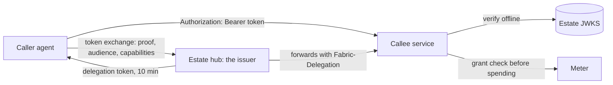

# Delegation `fabric-delegation/0.1`

DEC-0039, DEC-0041 · implements Fabric [ADR-0144](https://github.com/passioncode-ai/fabric/blob/agent/release-040-wave1/docs/adr/0144-one-delegation-model-fabric-issues-the-chain-the-callee-checks-it-observatory-meters-it.md)
· schemas [`delegation-token`](../../schemas/delegation-token.schema.json),
[`delegation-jwks`](../../schemas/delegation-jwks.schema.json), [`approval`](../../schemas/approval.schema.json),
[`delegation-refusal`](../../schemas/delegation-refusal.schema.json),
[`grant-check-request`](../../schemas/grant-check-request.schema.json), the grant's `audience`, `capabilities` and
`effectCeiling` in [`governance`](../../schemas/governance.schema.json), `auth.delegation` in the
[well-known document](../../schemas/service-well-known.schema.json) · rule codes `FAC-SEM-049`…`FAC-SEM-051` ·
verifier [`src/delegation.ts`](../../src/delegation.ts) · the meter's grant read
[`src/grant-projection.ts`](../../src/grant-projection.ts)

When one agent calls another, the callee needs to know three things: who is calling, on whose behalf, and
whether that call is allowed. This profile answers them with one signed document. The estate's hub (Fabric)
is the only **issuer**: it signs a short **delegation token** naming the person the work is for, the chain of
agents acting, the one callee, the capabilities and the effect ceiling, and the grant the call is under. The
callee checks the token **offline** against the estate's published keys, acts for that person, names its
caller, and asks the meter before it spends. An operator's approval of one action is a second signed document,
`approval/1`, that any callee can check the same way. Every refusal uses one set of codes.

The key words MUST, MUST NOT, SHOULD and MAY are used as in RFC 2119. Times are JWT NumericDates: whole
seconds since the epoch (RFC 7519 §2). The external specifications are pinned in the
[source ledger](../evidence/sources.md).

## Roles

| Role | Who | What it does here |
|---|---|---|
| **Issuer** | the estate's Fabric hub | holds the estate signing key, decides grants with the operator, mints tokens and approvals, publishes the keys |
| **Principal** | a person: the operator, or an external person under a share grant | the token's `sub`; the work runs on their behalf |
| **Actor** | an agent, or an agent's session | the token's `act` chain; the outermost actor is the agent calling now |
| **Callee** | the agent whose capability is called | the token's `aud`; it verifies the token and acts |
| **Meter** | the registry that answers `grant-check` ([spend policy](spend-policy.md#checking)) | reserves spend against the grant's windows and the estate total; it issues no identity |

## The delegation token

**DL-1 — Form.** A delegation token is a JWT (RFC 7519) in JWS compact serialization (RFC 7515), signed with
an Ed25519 key of the estate (`alg: EdDSA`, RFC 8037). Its protected header is exactly
`{"alg": "EdDSA", "typ": "fabric-delegation+jwt", "kid": "<key id>"}` (`delegation-token.schema.json#/$defs/header`).
The explicit `typ` keeps a token from being read as an approval and the other way round (RFC 8725 §3.11). A
header carrying `crit`, `jku`, `jwk`, `x5u` or `x5c` is refused: a callee takes keys only from the estate's
published set, never from the token.

**DL-2 — Claims.** The payload is valid against [`delegation-token.schema.json`](../../schemas/delegation-token.schema.json),
in the shape of OAuth 2.0 Token Exchange (RFC 8693):

| Claim | Required | Value |
|---|---|---|
| `iss` | yes | the estate hub, a URI stable across key rotation and port changes (`urn:fabric:estate:<estate id>`) |
| `sub` | yes | the principal, a URI naming a person |
| `act` | yes | the actor chain (RFC 8693 §4.1): `{sub: <agent id>, session?: <id>, act?: {…}}`, the agent calling now outermost, each earlier actor nested inside; at most **four** deep |
| `aud` | yes | exactly **one** callee agent id, a string, never an array |
| `scope` | yes | the callee's capability names, space-delimited (RFC 8693 §4.2) |
| `effect` | yes | the effect ceiling: an array of [governance](governance-and-roles.md#external-effects) effect classes (DL-3) |
| `grant` | yes | the references of the grant(s) the call is under; the issuer forms a reference as `<meta.id>#<meta.revision>` of the standing grant, and a callee and a usage reader treat it as opaque |
| `spend` | no | what the grant had left when the token was minted: `{mode: unlimited}` or `{mode: limited, remaining: [{window, remainingUsd}], perCallMaxUsd?}` |
| `project` | no in the schema | the grant's project; every standing grant names one, so a token minted under a grant always carries it (`FAC-SEM-050`) |
| `task` | no | the issuing host's task the work runs under, set by the hub when the session or run has one (DEC-0041): an opaque id in the session id's grammar, 1–128 characters of `[A-Za-z0-9._:-]`; the meter keys the `task` window on it (DL-24) |
| `iat`, `exp` | yes | issued and expiry times; `exp` is after `iat` and **at most 600 seconds** after it (`FAC-SEM-049`) |
| `jti` | yes | a unique id, 16–128 characters of `[A-Za-z0-9._~-]` |

An agent id is the hub's registry id (`common.schema.json#/$defs/agentId`): a service id, optionally
followed by `.instance`. A verifier honours an `nbf` it finds (RFC 7519 §4.1.5) although the issuer does not
emit one. The issuer emits exactly these claims; a verifier ignores a claim it does not know
(RFC 7519 §4), so a newer issuer does not break an older callee. `spend` informs and never authorizes: the
meter's check decides.

**DL-3 — The effect ceiling.** `effect` lists the classes a call under the token may have. A read (`none`) is
below every class, and `draft` is below every external class (`publish`, `send`, `reply`, `charge`, `delete`,
`merge`, `deploy`, `change-policy`). The external classes are not ordered against each other: a ceiling of
`delete` admits no `charge`. A capability's effect is the one its manifest entry declares
([interop C3.1](interop.md#c31-capabilities)); it is within the ceiling when it is listed, or is `none` under a
non-empty ceiling, or is `draft` under a ceiling holding any class but `none`. `effectClosure` and
`effectWithin` in [`src/delegation.ts`](../../src/delegation.ts) are this rule. A **read-only door** — a
surface or route that serves only `effect: none` capabilities — refuses, with `effect-above-ceiling`, a call
whose capability is not declared read-only, whatever the token's ceiling (the verifier's `readOnly` option).

## Minting and attenuation

The hub mints by **token exchange**. The caller presents what proves it — a binding credential of an agent
registered with the hub, a session bearer of a session the hub started or enrolled, or a delegation token it
received and now calls onward under — and asks for one audience and some capabilities. The issuer, never the
callee, enforces attenuation:

- **DL-4 — Within a grant.** A token is minted only under an active **delegation grant** (a standing grant
  with an `audience`, [below](#grants-for-delegation)), and its `grant` claim names that grant as
  `<meta.id>#<meta.revision>`. Its `aud` is the grant's `audience`; every scope name is among the grant's
  `capabilities`; every effect is within the closure of the grant's `effectCeiling`; it is minted no earlier
  than the grant's `startsAt` and expires no later than its `expiresAt`; its `project` is the grant's. Under a
  limited grant (`spend.mode: limited`) the token is limited too and carries what remains. **Who acts:** a
  grant whose `principalKind` is `agent` names its principal `urn:agent:<agent id>`, and the token's outermost
  actor is that agent id; `session` names it `urn:session:<agent id>:<session id>`, and the outermost actor is
  that agent with that `session`; for both, `sub` is the person who issued the grant (`issuer`). Under a share
  grant (`external`) `sub` is the grant's principal, the outside person.
- **DL-5 — Narrower than its parent.** A token minted for an onward call keeps the parent's `iss`, `sub` and
  `project`; its outermost actor is the parent's `aud` (the agent calling onward is the one the parent was
  for), and the rest of its chain is exactly the parent's `act`, so the chain grows by one actor per hop. Its
  effects are within the closure of the parent's `effect`; it expires no later than the parent; and for every
  window the parent's `spend` limits, its remaining amount is no larger. The parent's `scope` names another
  callee's capabilities, so the child's scope is checked against the child's own grant (DL-4), not against
  the parent's scope. It keeps the parent's `task` or none, never another (DEC-0041); a token for the meter
  keeps it, because the meter keys the `task` window on it.
- **DL-6 — Depth.** A token whose chain would exceed four actors is not minted; the caller is refused
  `chain-too-deep`.
- **DL-7 — Short and revocable.** There is no long-lived token between agents. Revoking a grant stops minting
  at once; tokens already issued end within their lifetime. A callee MAY follow the hub's `grant.revoked` event
  or ask the hub about one `jti` (RFC 7662's shape) before an irreversible effect.
- **DL-8 — No hub, no token.** A caller without a valid token asks the lifecycle broker to ensure the hub runs,
  then mints. With no hub it is refused `issuer-unavailable` and does nothing; it never falls back to a borrowed
  credential.

`FAC-SEM-050` checks DL-4 and DL-5 on `{grant, token, parent?}`; the hub's own tests run it on every mint path.

## Carrying the token

- **DL-9 — Direct calls.** A call carrying a delegation token goes straight from caller to callee; the hub is
  the only issuer, not the only route ([interop C3.5](interop.md#c35-the-hub), amended). Over HTTP — an MCP
  `streamable-http` surface, an A2A endpoint, a plain route — the token travels as
  `Authorization: Bearer <token>` (RFC 6750 §2.1). A stdio MCP server has no header and receives no token.
- **DL-10 — Forwarded calls.** Where the hub forwards a call because it holds the product's credential itself,
  the product's credential stays in its own header and the hub attaches the delegation token as
  `Fabric-Delegation: <token>`, so the callee sees the chain whichever way the call came. A present but invalid
  `Fabric-Delegation` is refused, never ignored.
- **DL-11 — Never elsewhere.** A token never travels in a URL, an argument vector, a tool's arguments, a log
  line or a usage report. `readDelegationToken` reads the two headers, `Fabric-Delegation` first.
- **DL-12 — The descriptor token is the host's.** A service's descriptor token
  ([service](service.md#mcp-credentials)) is the host's credential for the well-known document, the events
  feed, the usage report and the login code. It is not presented to call a capability once the caller can
  mint: calling a service's capability with that service's own descriptor token is retired by this profile
  (existing callers switch when the issuer exists). A service that accepts delegation tokens issues no
  per-agent token of its own to an agent of the estate; its own credentials remain for people and for callers
  outside the estate.

## The verifier

**DL-13 — The callee's check.** A callee checks a token for each call, offline, in this order, and refuses with
the first code that applies. Nothing about a token is believed before its signature is, so an unsigned token
learns only `unauthenticated`.

| # | Check | Refusal |
|---|---|---|
| 1 | the estate's key set is available and has a key | `issuer-unavailable` |
| 2 | three base64url segments of JSON objects with no member named twice (a duplicate is refused, never resolved: RFC 7515 §5.2, RFC 8725 §3.2); the DL-1 header | `unauthenticated` |
| 3 | `kid` names a published Ed25519 key whose `use`, when present, is `sig` and whose `alg`, when present, is `EdDSA`; a published key that cannot be used, or a `kid` published twice, is the issuer's fault | `unauthenticated`; `issuer-unavailable` |
| 4 | the Ed25519 signature over the first two segments | `unauthenticated` |
| 5 | the claims have the DL-2 types; `iss` is the issuer the callee trusts | `unauthenticated` |
| 6 | `exp` after `iat` and at most 600 seconds after; `iat`, and `nbf` when present, not later than now + 60 s | `unauthenticated` |
| 7 | now not later than `exp` + 60 s | `token-expired` |
| 8 | `aud` equals the callee's own agent id | `wrong-audience` |
| 9 | the chain is at most four actors | `chain-too-deep` |
| 10 | the called capability is a whole name in `scope` | `scope-not-granted` |
| 11 | the capability's declared effect is within `effect`; at a read-only door, it is `none` (DL-3) | `effect-above-ceiling` |

The clock leeway is **60 seconds** both ways. Then the callee acts for `sub`, names the outermost actor as its
caller, and records the chain with the work. Attenuation is not the callee's check: it never sees the parent
of the token it holds (DL-5 is the issuer's).

The kit's verifier is `verifyDelegation(token, {audience, jwks, now, capability, effect, issuer?, readOnly?})` in
[`src/delegation.ts`](../../src/delegation.ts), using Node's built-in Ed25519. It returns
`{ok: true, claims, principal, caller, chain, kid}` or `{ok: false, code, detail}`; `detail` is a short
machine word for `error.data.detail`, never the token. A verifier in another language follows the same table.

## Keys: publication and rotation

- **DL-14 — The key set.** The estate publishes its public keys as a JWK Set (RFC 7517) of Ed25519 keys
  (`kty: OKP`, `crv: Ed25519`, RFC 8037), valid against
  [`delegation-jwks.schema.json`](../../schemas/delegation-jwks.schema.json), which refuses any private member.
  The hub serves it at its `/.well-known/jwks.json` and in its hub document, and Fabric publishes the same set
  where an online service can read it without reaching the operator's computer. The private key never leaves
  the issuer (Fabric keeps it in the estate's vault and holds it in memory).
- **DL-15 — Rotation.** The issuer publishes a new key before it signs with it. It keeps the previous key
  published for at least one token lifetime plus the leeway after the last token it signed (660 s), and for 24
  hours plus the leeway when the key signed an approval, because an approval lives up to 24 hours. A callee
  caches the set for at most 10 minutes and, on an unknown `kid`, re-reads it at most once a minute before
  refusing.

## Declaring acceptance

**DL-16 — `auth.delegation`.** A service that accepts delegation tokens says so in its
[well-known document](service.md#well-known-document): `auth.delegation: {issuer, jwks}` — the `iss` it trusts
and where it reads the keys. Its MCP surface then accepts `Authorization: Bearer <delegation token>` beside
what `surfaces.mcp.auth` names; `surfaces.mcp.auth: "delegation"` means it accepts **only** delegation tokens,
and then (as with `own`) a host and a probe MUST NOT call it with the descriptor token, and `auth.delegation`
is required. A bearer value is a delegation token when it is a JWT whose header `typ` is
`fabric-delegation+jwt`; anything else is the service's other credential.

## Approval `approval/1`

**DL-17 — The document.** An approval is a JWS compact document by the estate key with the header
`{"alg": "EdDSA", "typ": "fabric-approval+jwt", "kid"}` and a payload valid against
[`approval.schema.json`](../../schemas/approval.schema.json):

| Claim | Value |
|---|---|
| `iss` | the estate hub |
| `actionDigest` | `sha256:` and the lowercase hex SHA-256 of the RFC 8785 canonical JSON (JCS) of the action the callee will take. The action is JSON values only — objects, arrays, strings, finite numbers, booleans, `null`; `jcs` refuses a date, a map, a class instance or an `undefined` member, which would otherwise read as `{}` and let two actions share a digest |
| `aud` | the one callee that may act on it |
| `approver` | the person of the estate who approved |
| `method` | `prompt` (in Fabric), `operator-channel` (the [operator channel](operator-channel.md)'s confirm token, OC-6) or `device` (a device check) |
| `iat`, `exp` | `exp` after `iat` and at most **24 hours** after it (`FAC-SEM-051`) |
| `jti` | consumed once by the callee |

**DL-18 — Asking and checking.** A callee whose action needs an approval refuses `approval-required` with the
action's digest in `error.data.actionDigest`. The caller asks the hub, which asks the operator and returns the
document; the caller repeats the call carrying it. The callee checks it with
`verifyApproval(approval, {audience, jwks, now, actionDigest, issuer?, jtiStore})`: the signature and header as
DL-13 steps 1–4, the lifetime, the 60 s leeway, its own agent id in `aud`, the digest of the action it is about
to take, and finally that the `jti` was not consumed — recording it in a store that survives a restart for the
approval's lifetime. Any fault of the document is `approval-invalid`; a second use is `approval-reused`. The store
is required: without one the answer is `unknown-state`, and a callee that truly wants no replay protection
passes `UNSAFE_NO_JTI_STORE` by name. **The order** is: the delegation token, then the grant check, then `verifyApproval`, which consumes the `jti` last, then the action (DL-13, DL-21) — so an approval is not
spent when the meter refuses, and stays usable until its `exp`.
`actionDigest(action)` computes the digest; `jcs` is the canonical form. Products keep their own gates for
people who use them directly; between agents this document replaces shared signing keys, plan-hash rows and
confirm codes.

## Refusal codes

**DL-19 — One set.** For authorisation refusals only — who may make this call, on whose behalf, within which
grant and limit, with which approval — a callee, the hub and the meter refuse with these codes only, kebab-case, in `error.code`,
with product detail in `error.data` ([`delegation-refusal.schema.json`](../../schemas/delegation-refusal.schema.json)).
An MCP tool returns the refusal as the `structuredContent` of a result with `isError: true`; an HTTP route as
the JSON body with the status below. DEC-0037's grant-check codes are a subset and keep their meaning.

| Code | Means | Refused by | HTTP |
|---|---|---|---|
| `unauthenticated` | no token, or one not signed by a published key or not of this profile | callee (verifier) | 401 |
| `token-expired` | past `exp` by more than the leeway; mint a new one | callee (verifier) | 401 |
| `wrong-audience` | the token is for another callee | callee (verifier) | 403 |
| `scope-not-granted` | the called capability is not in `scope` | callee (verifier) | 403 |
| `effect-above-ceiling` | the capability's effect is above `effect` | callee (verifier) | 403 |
| `no-grant` | no live grant covers this actor, audience and capability; carries the ready request where one is filed | hub, meter | 403 |
| `grant-expired` | the grant has expired | hub, meter | 403 |
| `grant-revoked` | the grant was revoked | hub, meter | 403 |
| `limit-reached` | a spend window is exhausted; `error.data.window` names it, `level` where it was; window `call` (DEC-0041) is a grant's `perCallMaxUsd` exceeded, always at level L3 | meter, callee | 403 |
| `approval-required` | this action needs an approval; `error.data.actionDigest` carries its digest | callee (verifier) | 403 |
| `approval-invalid` | the approval is not valid for this action, callee or time | callee (verifier) | 403 |
| `approval-reused` | the approval's `jti` was already consumed | callee (verifier) | 403 |
| `principal-unproven` | the caller's proof to the hub is missing or stale | hub, meter | 401 |
| `credential-source-refused` | the grant names a credential source that is not the project's own key or another agent's capability | meter | 403 |
| `chain-too-deep` | the chain would exceed four actors | hub, callee (verifier) | 403 |
| `issuer-unavailable` | no hub to mint, or no usable published keys | caller, callee (verifier) | 503 |
| `unknown-state` | the refusing side cannot establish the state; an unknown state is a denial | any | 503 |

A product maps its own authorisation codes onto these and keeps its words in `error.data`. Fabric's hub maps
`hub-unavailable` → `issuer-unavailable`, `binding-revoked` → `grant-revoked`, and `access-required` and `needs-grant` → `no-grant`
(still carrying the ready request). Transport and product errors — a malformed argument, an unknown job, a
failed upstream — are not refusals: they keep the interop error shape `{code, message, data?}`
([interop C3.2](interop.md#c32-jobs)) and their own codes. An HTTP `401` carries
`WWW-Authenticate: Bearer error="invalid_token"` (RFC 6750 §3).

## Grants for delegation

**DL-20 — A delegation grant.** A standing grant ([governance](governance-and-roles.md#external-effects),
[spend policy](spend-policy.md#grants)) that names an `audience` is a delegation grant: one grant per
principal, actor and audience. It then MUST carry `capabilities` (the audience's tool names a token may name)
and `effectCeiling` (the effects a token may carry) and `principalKind`; the schema requires all three with
`audience` (`dependentRequired`). `effectCeiling` may hold `none` and `draft`; every other member is one of the
grant's `effects` (`FAC-SEM-050`). A delegation grant MAY omit `effects`: it then authorises reads and drafts
only, and a **read-only grant** has `effectCeiling: ["none"]`. A grant without `audience` stays valid and authorizes what it authorized
before; no token is minted under it. The payer is the owner (DEC-0038).

## Spend and usage

- **DL-21 — The meter decides.** Before a call that spends, the callee asks the meter. The token it was called
  with names the callee as its audience, and a token never travels in arguments (DL-11), so it cannot hand
  that token over. Instead:
  1. the callee exchanges its token at the hub for an **onward token for the meter**: `aud` the meter's agent
     id, the callee added as outermost actor to the chain, `scope` exactly the meter's grant-check capability
     (named in the meter's manifest; `grant.check` in the examples), `effect: ["none"]`, the same `grant`,
     `sub`, `project` and remaining `spend`, expiring no later than the callee's token. It is minted under the
     parent's grant, not under a grant of its own: every holder of a valid token may ask the meter about its
     own call (`FAC-SEM-050` with `meter`);
  2. the callee calls the meter directly with that token in `Authorization: Bearer` and a request valid against
     [`grant-check-request.schema.json`](../../schemas/grant-check-request.schema.json): the amount, and the
     `jti` of its own token for attribution — never a token in a field;
  3. the meter verifies the onward token with `verifyDelegation` (audience itself, capability its grant-check
     capability, effect `none`, as a read-only door) and maps **any** verifier refusal to `principal-unproven`
     (`verifyMeterToken` in [`src/delegation.ts`](../../src/delegation.ts)); then it reserves against the
     grant's windows and every level above, and answers a [`grant-check`](../../schemas/grant-check.schema.json)
     document.

  4. the meter finds the grant the token names in the hub's projection (DL-23, DL-24) before it reserves.

  The token's `spend` claim is what was left at mint, not a reservation.
- **DL-22 — Usage stays opaque.** A usage report attributes spend by grant reference only (`byGrant`,
  [service](service.md#usage-report)), the value of the token's `grant` claim. It never carries the principal,
  the chain or a caller's identity; the mapping from grant to chain lives in the issuer's journal.

## The hub's grant projection

This is the contract's **local-placement profile** for how the meter reads a grant (DEC-0041, Fabric ADR-0144
amendment 1): a meter on the same computer as the hub reads the hub's own record of the grant, not a second
store and not a call to the hub, so a check within a token's lifetime still works while the hub is closed.

- **DL-23 — The projection.** A hub MAY project each grant it holds to a directory it names in its hub
  document as `grantsDir`. Each grant is one file, `<meta.id>.json`, holding the grant in the
  [standing-grant](../../schemas/governance.schema.json) shape at its latest revision with its `state`. The
  files are 0600 in a 0700 directory, both owned by the operator's account, and each is written atomically (a
  temporary file in the same directory, then a rename) on every issue, revision, revocation and expiry. A grant
  whose `meta.id` is not a file name — outside `^[A-Za-z0-9][A-Za-z0-9._:-]{0,199}$` — is not projected. Where
  the files live on Windows is not decided here.
- **DL-24 — The meter's read.** After the onward token is verified (DL-21), the meter looks up each grant
  reference `<meta.id>#<meta.revision>` the token names and MUST deny, with `level: null`, when:

  | The projection | Refusal | `detail` |
  |---|---|---|
  | the reference names no projectable grant | `no-grant` | `malformed-reference` |
  | the directory is missing, unreadable, or not the owner's alone | `unknown-state` | `no-projection`, `unreadable`, `loose-permissions`, `foreign-owner` |
  | the file is missing | `no-grant` | `not-projected` |
  | the file is unreadable, malformed, too large, not a regular file, not the owner's alone, or for another grant | `unknown-state` | `unreadable`, `malformed-file`, `not-a-file`, `loose-permissions`, `foreign-owner`, `another-grant` |
  | the file is at an earlier revision than the token's | `unknown-state` | `projection-behind` |
  | the grant is `revoked` | `grant-revoked` | `revoked` |
  | the grant is `expired`, or `active` and past its `expiresAt` | `grant-expired` | `expired` |
  | the grant is in any other state but `active` | `unknown-state` | `unknown-grant-state` |
  | the file is at a later revision than the token's | `no-grant` | `revised` |
  | the grant is `active` and before its `startsAt` | `no-grant` | `not-started` |

  The rows are checked in this order. The file authorises nothing without the verified onward token: it says
  what the grant is, the token says who is asking under it. The meter keys the grant's `task` window on the
  onward token's `task`; else on the `session` of the agent that called the callee (the onward token's
  `act.act`, since its outermost actor is the callee); else on the `jti` of the callee's own token, the
  request's `tokenJti`. `readProjectedGrant(grantsDir, ref, {now})` and `projectionDenial` in
  [`src/grant-projection.ts`](../../src/grant-projection.ts), and `taskWindowKey` in
  [`src/delegation.ts`](../../src/delegation.ts), are this rule.

## The boundary

A token file or a binding credential readable by the operator's account is readable by any process of that
account ([service](service.md#authentication-and-network), "Loopback reachability is not authorization"). This
profile does not lift that floor. It removes accidental and confused borrowing, gives every hop an attributable
name, and lets a limit hold per caller. A product that needs protection from a hostile local process adds an
approval (DL-17) or a device check.

## Semantic rules

| Code | Kind | Rule |
|---|---|---|
| `FAC-SEM-049` | `delegation-claims` | a delegation token expires after it was issued and at most 600 seconds after; its scope names each capability once; its spend names each window once |
| `FAC-SEM-050` | `delegation-mint` | a token is minted under an active delegation grant that its `grant` claim names: its audience, its capabilities, its effect ceiling (itself within the grant's effects), its start and expiry, its project, a limited spend under a limited grant, and the actor and person the grant names; a token for the meter reads only its grant-check capability under the parent's grant; an onward token keeps the parent's issuer, principal and project, adds one actor (the parent's audience) to the parent's chain, and carries no wider effect, no later expiry and no more remaining spend than its parent; it keeps the parent's `task` or none, and the meter's token keeps it (DEC-0041) |
| `FAC-SEM-051` | `approval-claims` | an approval expires after it was issued and at most 24 hours after |

Fixtures: the `delegation-*`, `approval-*` and `governance-grant-delegation*` entries of
[`fixtures/catalogue.json`](../../fixtures/catalogue.json) and `fixtures/semantic/delegation-*`, `approval-*`;
tests: [`test/delegation.test.ts`](../../test/delegation.test.ts), [`test/delegation-seams.test.ts`](../../test/delegation-seams.test.ts),
[`test/meter-grant.test.ts`](../../test/meter-grant.test.ts) (DEC-0041).

## Not decided here

- The hub's token-exchange and introspection tools, their names and arguments (`fabric.delegation.mint`,
  `fabric.delegation.introspect`, `fabric.approval.request` in Fabric ADR-0144): Fabric's surface, not the
  wire a callee reads.
- How the hub proves a caller (binding credential, session bearer): Fabric's ADR-0115 and ADR-0134.
- Delegation across estates (one estate's agent calling another's): a later revision; today a share grant
  covers an outside person calling into the estate.
- Proof of possession (DPoP, mutual TLS) binding a token to its caller's key.
