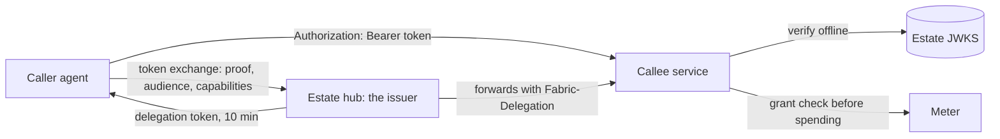

# Delegation `fabric-delegation/0.1`

DEC-0039, DEC-0041, DEC-0043, DEC-0045, DEC-0055, DEC-0060, DEC-0066, DEC-0082, DEC-0090 ([the partner
channel](partner-channel.md)), DEC-0106, DEC-0107, DEC-0111, DEC-0121, DEC-0125, DEC-0126, DEC-0128, DEC-0130,
DEC-0132, DEC-0136, DEC-0137, DEC-0141 · implements Fabric [ADR-0144](https://github.com/passioncode-ai/fabric/blob/19ad05ca2cf9e830d396a8fca3273b7d5e9c3bc7/docs/adr/0144-one-delegation-model-fabric-issues-the-chain-the-callee-checks-it-observatory-meters-it.md) (at its amendment 4, `19ad05ca`)
· schemas [`delegation-token`](../../schemas/delegation-token.schema.json),
[`delegation-jwks`](../../schemas/delegation-jwks.schema.json), [`approval`](../../schemas/approval.schema.json),
[`delegation-refusal`](../../schemas/delegation-refusal.schema.json),
[`grant-check-request`](../../schemas/grant-check-request.schema.json), the grant's `audience`, `capabilities` and
`effectCeiling` in [`governance`](../../schemas/governance.schema.json), `auth.delegation` in the
[well-known document](../../schemas/service-well-known.schema.json) · rule codes `FAC-SEM-049`…`FAC-SEM-051`, `FAC-SEM-081` ·
verifier [`src/delegation.ts`](../../src/delegation.ts) · keys the estate record certifies
[`src/hub-key-rules.ts`](../../src/hub-key-rules.ts), vectors [`fixtures/vectors/hub-key.json`](../../fixtures/vectors/hub-key.json) · the meter's grant read
[`src/grant-projection.ts`](../../src/grant-projection.ts)

When one agent calls another, the callee needs to know three things: who is calling, on whose behalf, and
whether that call is allowed. This profile answers them with one signed document. The estate's hub (Fabric)
is the only **issuer**: it signs a short **delegation token** naming the person the work is for, the chain of
agents acting, the one callee, the capabilities and the effect ceiling, and the grant the call is under. The
callee checks the token **offline** against the estate's published keys, acts for that person, names its
caller, and asks the meter before it spends. An operator's approval of one action is a second signed document,
`approval/1`, that any callee can check the same way. Every refusal uses one set of codes.

The key words MUST, MUST NOT, SHOULD and MAY are used as in RFC 2119. Times are JWT NumericDates: whole
seconds since the epoch (RFC 7519 §2). The external specifications are pinned in the
[source ledger](../evidence/sources.md).

## Roles

| Role | Who | What it does here |
|---|---|---|
| **Issuer** | the estate's Fabric hub | holds the estate signing key, decides grants with the operator, mints tokens and approvals, publishes the keys |
| **Principal** | a person: the operator, or an external person under a share grant | the token's `sub`; the work runs on their behalf |
| **Actor** | an agent, or an agent's session; innermost only, under a partner grant, the partner organization (DEC-0090) | the token's `act` chain; the outermost actor is the agent calling now |
| **Callee** | the agent whose capability is called | the token's `aud`; it verifies the token and acts |
| **Meter** | the registry that answers `grant-check` ([spend policy](spend-policy.md#checking)) | reserves spend against the grant's windows and the estate total; it issues no identity |

## The delegation token

**DL-1 — Form.** A delegation token is a JWT (RFC 7519) in JWS compact serialization (RFC 7515), signed with
an Ed25519 key of the estate (`alg: EdDSA`, RFC 8037). Its protected header is exactly
`{"alg": "EdDSA", "typ": "fabric-delegation+jwt", "kid": "<key id>"}` (`delegation-token.schema.json#/$defs/header`).
The explicit `typ` keeps a token from being read as an approval and the other way round (RFC 8725 §3.11). A
header carrying `crit`, `jku`, `jwk`, `x5u` or `x5c` is refused: a callee takes keys only from the estate's
published set, never from the token.

**DL-2 — Claims.** The payload is valid against [`delegation-token.schema.json`](../../schemas/delegation-token.schema.json),
in the shape of OAuth 2.0 Token Exchange (RFC 8693):

| Claim | Required | Value |
|---|---|---|
| `iss` | yes | the estate hub, a URI stable across key rotation and port changes (`urn:fabric:estate:<estate id>`); in an organization's context that context's own issuer, `urn:fabric:context:<opaque>` from the estate record's pin, which names no estate (DEC-0128) |
| `sub` | yes | the principal, a URI naming a person; in an organization's context one per context, so two organizations' tokens share no person id (DEC-0128) |
| `act` | yes | the actor chain (RFC 8693 §4.1): `{sub: <agent id>, session?: <id>, act?: {…}}`, the agent calling now outermost, each earlier actor nested inside, and innermost only the partner actor `{partner: "org:<partnerOrgId>"}` under a partner grant (DEC-0090, [the partner channel](partner-channel.md#owner-to-partner-to-agents-fac-sem-124)); at most **four** deep, five in a token for the meter (DL-6) |
| `aud` | yes | exactly **one** callee agent id, a string, never an array |
| `scope` | yes | the callee's capability names, space-delimited (RFC 8693 §4.2) |
| `effect` | yes | the effect ceiling: an array of [governance](governance-and-roles.md#external-effects) effect classes (DL-3) |
| `grant` | yes | the reference of the **one** grant the call is under, as a one-item array (DEC-0045); the issuer forms it as `<meta.id>#<meta.revision>` of the standing grant, and a callee and a usage reader treat it as opaque |
| `spend` | no | what the grant had left when the token was minted: `{mode: unlimited}` or `{mode: limited, remaining: [{window, remainingUsd}], perCallMaxUsd?}` |
| `project` | no in the schema | the grant's project; every standing grant names one, so a token minted under a grant always carries it (`FAC-SEM-050`) |
| `task` | no | the issuing host's task the work runs under, set by the hub when the session or run has one (DEC-0041): an opaque id in the session id's grammar, 1–128 characters of `[A-Za-z0-9._:-]`; the meter keys the `task` window on it (DL-24) |
| `iat`, `exp` | yes | issued and expiry times; `exp` is after `iat` and **at most 600 seconds** after it (`FAC-SEM-049`) |
| `jti` | yes | a unique id, 16–128 characters of `[A-Za-z0-9._~-]` |

An agent id is the hub's registry id (`common.schema.json#/$defs/agentId`): a service id, optionally
followed by `.instance`. A verifier honours an `nbf` it finds (RFC 7519 §4.1.5) although the issuer does not
emit one. The issuer emits exactly these claims; a verifier ignores a claim it does not know
(RFC 7519 §4), so a newer issuer does not break an older callee. `spend` informs and never authorizes: the
meter's check decides.

**DL-3 — The effect ceiling.** `effect` lists the classes a call under the token may have. A read (`none`) is
below every class, and `draft` is below every external class (`publish`, `send`, `reply`, `charge`, `delete`,
`merge`, `deploy`, `change-policy`). The external classes are not ordered against each other: a ceiling of
`delete` admits no `charge`. A capability's effect is the one its manifest entry declares
([interop C3.1](interop.md#c31-capabilities)); it is within the ceiling when it is listed, or is `none` under a
non-empty ceiling, or is `draft` under a ceiling holding any class but `none`. `effectClosure` and
`effectWithin` in [`src/delegation.ts`](../../src/delegation.ts) are this rule. A **read-only door** — a
surface or route that serves only `effect: none` capabilities — refuses, with `effect-above-ceiling`, a call
whose capability is not declared read-only, whatever the token's ceiling (the verifier's `readOnly` option).

## Minting and attenuation

The hub mints by **token exchange**. The caller presents what proves it — a binding credential of an agent
registered with the hub, a session bearer of a session the hub started or enrolled, or a delegation token it
received and now calls onward under — and asks for one audience and some capabilities. The issuer, never the
callee, enforces attenuation:

- **DL-4 — Within a grant.** A token is minted only under an active **delegation grant** (a standing grant
  with an `audience`, [below](#grants-for-delegation)), and its `grant` claim names that grant as
  `<meta.id>#<meta.revision>`, and no other (DEC-0045). Its `aud` is the grant's `audience`; every scope name is among the grant's
  `capabilities`; every effect is within the closure of the grant's `effectCeiling`; it is minted no earlier
  than the grant's `startsAt` and expires no later than its `expiresAt`; its `project` is the grant's. Under a
  limited grant (`spend.mode: limited`) the token is limited too and carries what remains: each window it names
  is one of the grant's `limits` and holds at most that limit's `limitUsd`, and its `perCallMaxUsd`, when it has
  one, is at most the grant's (DEC-0045). **Who acts:** a
  grant whose `principalKind` is `agent` names its principal `urn:agent:<agent id>`, and the token's outermost
  actor is that agent id; `session` names it `urn:session:<agent id>:<session id>`, and the outermost actor is
  that agent with that `session`; for both, `sub` is the person who issued the grant (`issuer`). Under a share
  grant (`external`) `sub` is the grant's principal, the outside person. Under a partner grant (`partner`, DEC-0090)
  `sub` is the issuer, and the chain's innermost actor is the partner organization `{partner: org:<partnerOrgId>}`:
  minted at the grant, the partner's agent holds it inside; onward, it stays innermost (`FAC-SEM-124`,
  [the partner channel](partner-channel.md)).
- **DL-5 — Narrower than its parent.** A token minted for an onward call keeps the parent's `iss`, `sub` and
  `project`; its outermost actor is the parent's `aud` (the agent calling onward is the one the parent was
  for), and the rest of its chain is exactly the parent's `act`, so the chain grows by one actor per hop. Its
  effects are within the closure of the parent's `effect`; it expires no later than the parent; and for every
  window the parent's `spend` limits, its remaining amount is no larger, and when the parent carries a
  `perCallMaxUsd` the token carries one no larger. The parent's `scope` names another
  callee's capabilities, so the child's scope is checked against the child's own grant (DL-4), not against
  the parent's scope. It keeps the parent's `task` or none, never another (DEC-0041); a token for the meter
  keeps it, because the meter keys the `task` window on it. A token for the meter keeps the parent's one `grant`
  reference too: it is minted under the parent's grant (DL-21).
- **DL-6 — Depth.** A token whose chain would exceed four actors is not minted; the caller is refused
  `chain-too-deep`. The one exception is the **meter's hop** (DEC-0045): a token whose `aud` is the meter,
  whose `scope` is exactly the meter's grant-check capability and whose `effect` is exactly `["none"]` may hold
  five, so a callee at the fourth hop can still ask the meter before it spends. No other token holds five, and
  none holds six.
- **DL-7 — Short and revocable.** There is no long-lived token between agents. Revoking a grant stops minting
  at once; tokens already issued end within their lifetime. A callee MAY follow the hub's `grant.revoked` event
  or ask the hub about one `jti` (RFC 7662's shape) before an irreversible effect.
- **DL-8 — No hub, no token, across the boundary.** A caller of tier T2 ([DL-25](#trust-tiers)) without a
  valid token asks the lifecycle broker to ensure the hub runs, then mints. With no hub it is refused
  `issuer-unavailable` and does nothing; it never falls back to a borrowed credential. Inside the boundary (T0,
  T1) no call waits on the hub: a caller with no hub calls without a token (DL-26).

`FAC-SEM-050` checks DL-4 and DL-5 on `{grant, token, parent?}`; the hub's own tests run it on every mint path.

## Carrying the token

- **DL-9 — Direct calls.** A call carrying a delegation token goes straight from caller to callee; the hub is
  the only issuer, not the only route ([interop C3.5](interop.md#c35-the-hub), amended). Over HTTP — an MCP
  `streamable-http` surface, an A2A endpoint, a plain route — the token travels as
  `Authorization: Bearer <token>` (RFC 6750 §2.1). A stdio MCP server has no header and receives no token.
- **DL-10 — Forwarded calls.** Where the hub forwards a call because it holds the product's credential itself,
  the product's credential stays in its own header and the hub attaches the delegation token as
  `Fabric-Delegation: <token>`, so the callee sees the chain whichever way the call came. A present but invalid
  `Fabric-Delegation` is refused, never ignored.
- **DL-11 — Never elsewhere.** A token never travels in a URL, an argument vector, a tool's arguments, a log
  line or a usage report. `readDelegationToken` reads the two headers, `Fabric-Delegation` first. Over the relay a
  call has no header: the token travels in the sealed call's `delegation` member, which the relay cannot read, and
  never in `call.input` ([machine calls](machine-calls.md#the-sealed-call), DEC-0106).
- **DL-12 — The descriptor token is the host's.** A service's descriptor token
  ([service](service.md#mcp-credentials)) is the host's credential for the well-known document, the events
  feed, the usage report, the load report (DEC-0104) and the login code. It is not presented to call a capability once the caller can
  mint: calling a service's capability with that service's own descriptor token is retired by this profile
  **across the machine boundary** (DL-25; existing callers switch when the issuer exists). On the operator's own
  machine it stays attribution hygiene, not a requirement: a caller SHOULD NOT call a capability with another
  service's descriptor token, because the callee then cannot tell that caller from its host. A service that
  accepts delegation tokens issues no per-agent token of its own to an agent of the estate; its own credentials
  remain for people and for callers outside the estate.

## The verifier

**DL-13 — The callee's check.** A callee checks a token for each call, offline, in this order, and refuses with
the first code that applies. Nothing about a token is believed before its signature is, so an unsigned token
learns only `unauthenticated`. Before row 1, a callee whose clock is not a number of seconds that a `Date` can hold
(NaN, an infinity, text, beyond ±8.64 × 10¹² s) refuses `unknown-state` with `no-clock`: every time row compares
against the clock, and a comparison with NaN is always false, so an unreadable clock would let an expired token through
(DEC-0060).

| # | Check | Refusal |
|---|---|---|
| 1 | the callee names the issuer it trusts, and the estate's key set is available and has a key | `issuer-unavailable` |
| 2 | three base64url segments of JSON objects with no member named twice (a duplicate is refused, never resolved: RFC 7515 §5.2, RFC 8725 §3.2); the DL-1 header | `unauthenticated` |
| 3 | `kid` names a published key; an unknown `kid` is the token's fault, while a published key that cannot be used — a `use` other than `sig`, an `alg` other than `EdDSA` (both outside [`delegation-jwks`](../../schemas/delegation-jwks.schema.json)), not an Ed25519 public key of 32 bytes, **of small order** (`small-order-key`: its bytes, sign bit cleared, are one of libsodium's seven `has_small_order` encodings; `isSmallOrderKey` in [`src/ed25519.ts`](../../src/ed25519.ts)), or carrying a private member — or a `kid` published twice is the issuer's (DEC-0045) | `unauthenticated` (unknown `kid`); `issuer-unavailable` |
| 4 | the Ed25519 signature over the first two segments | `unauthenticated` |
| 4a | when the callee reads the estate record: the revision it reads certifies `kid` with the published key ([DL-14](#keys-publication-and-rotation)) | `unauthenticated` (`kid-not-certified`); `issuer-unavailable` (the revision's fault) |
| 5 | the claims have the DL-2 types — each actor's `sub` an agent id and `session` a session id, except an innermost partner actor, which is `{partner}` only (DEC-0090), `iss`, `sub` and `project` URIs, `aud` an agent id, `scope` and `jti` in the schema's grammar, `effect` known classes each once, exactly one `grant`, `spend`, `task`, `iat`, `exp` and `nbf` typed as the schema types them; then `iss` is the issuer the callee trusts | `unauthenticated` |
| 6 | `exp` after `iat` and at most 600 seconds after; `iat`, and `nbf` when present, not later than now + 60 s | `unauthenticated` |
| 7 | now not later than `exp` + 60 s | `token-expired` |
| 8 | `aud` equals the callee's own agent id | `wrong-audience` |
| 9 | the chain is at most four actors; five in the meter's own token (DL-6, DL-21) | `chain-too-deep` |
| 10 | the called capability is a whole name in `scope` | `scope-not-granted` |
| 11 | the capability's declared effect is within `effect`; at a read-only door, it is `none` (DL-3) | `effect-above-ceiling` |

The clock leeway is **60 seconds** both ways. Then the callee acts for `sub`, names the outermost actor as its
caller, and records the chain with the work. Attenuation is not the callee's check: it never sees the parent
of the token it holds (DL-5 is the issuer's).

The rows are checked in this order, so a token wrong in two ways is refused for the earlier row: a malformed
chain with the wrong audience is `unauthenticated`, an expired token with the wrong audience `token-expired`
([`test/delegation-sealed.test.ts`](../../test/delegation-sealed.test.ts), F-B-307). The kit's verifier is
`verifyDelegation(token, {audience, jwks, now, capability, effect, issuer, readOnly?, estate?, estateApplied?})` in
[`src/delegation.ts`](../../src/delegation.ts), using Node's built-in Ed25519. It returns
`{ok: true, claims, principal, caller, chain, kid}` or `{ok: false, code, detail}`; `detail` is a short
machine word for `error.data.detail`, never the token. A verifier in another language follows the same table.

## Keys: publication and rotation

- **DL-14 — The key set.** The estate publishes its public keys as a JWK Set (RFC 7517) of Ed25519 keys
  (`kty: OKP`, `crv: Ed25519`, RFC 8037), valid against
  [`delegation-jwks.schema.json`](../../schemas/delegation-jwks.schema.json), which refuses any private member,
  a non-canonical `x` and a key of small order. A small-order key lets anyone forge a signature with no private
  key, and Node 20 and 22's `crypto.verify` accept such a forgery, so a verifier refuses the key before it
  verifies anything under it (DL-13 row 3; DEC-0045, CT-29).
  The hub serves it at its `/.well-known/jwks.json` and in its hub document, and Fabric publishes the same set
  where an online service can read it without reaching the operator's computer. The private key never leaves
  the issuer (Fabric keeps it in the estate's vault and holds it in memory).

  **Keys the estate record certifies** (DEC-0055 item 4, DEC-0060). A verifier that also reads the estate's record
  ([estate record](estate-record.md#machines)) trusts a token's or an approval's `kid` only while the revision it reads
  certifies it: a machine's `hubKey` binds that `kid` and that public key to the machine. The verifier checks this right
  after the signature (DL-13 row 4a) and passes the revision as `estate` (a value, or a function returning it) to
  `verifyDelegation`, `verifyApproval` or `verifyMeterToken`; without `estate` the check does not run. The revision it
  reads:

  - The check reads the revision and does not verify it, so an unverified record would certify whatever it lists.
  - MUST be one `verifyEstateRecord` accepted ([estate record](estate-record.md#the-verifier)) whose number is not
    lower than the highest revision its machine has applied. A higher one is read only when this verifier itself verified
    its chain from the applied revision (`verifyEstateRecord` with that revision as `parent`); otherwise the verifier
    reads the applied one. An older revision can still be inside its 30-day window and list a hub key the applied
    revision revokes, so reading it would bring the key back: a rollback, which the adapter's review of its kits found
    (FAA-31). A verifier that keeps the applied revision's number, and its digest when it has it, passes them as
    `estateApplied`, and a lower revision is refused.
  - Revocations the revocation delta applied since that revision (DEC-0054, `deltaRevocations`) are passed as
    `estateRevocations` (a list, or a function returning it); they revoke exactly as the revision's own do.

  `hubKeyCertified(record, kid, x, at, applied?, {extraRevocations}?)` in [`src/hub-key-rules.ts`](../../src/hub-key-rules.ts)
  is this rule; `x` is the published key's, `at` the clock as a `Date` or as seconds (the verifiers bound it to ±8.64 × 10¹² s
  before row 1; the function itself refuses only a clock that is not a finite number). It answers, the first row that
  applies:

  | # | The revision and the key | Whose fault | Refusal | `detail` |
  |---|---|---|---|---|
  | 1 | the clock is not a time (the verifiers refuse this before DL-13 row 1) | the verifier's | `unknown-state` | `no-clock` |
  | 2 | the revision cannot be read: a source that throws; not an object; `revision` not an integer from 1 (a JSON number above 2⁵³ − 1 included); `digest` not a string; `issuedAt` or `validUntil` not RFC 3339 read strictly as ER-10 reads it, or a window that is not positive or exceeds 30 days; `machines` not an array; `revocations` present but not an array; `extraRevocations` given but not an array; or an `estateApplied` without an integer `revision` from 1 | the trust source's | `issuer-unavailable`; the meter's `principal-unproven` with the detail in its reason (DL-21 step 3) | `estate-unreadable` |
  | 3 | its `revision` is lower than the applied one; or it is the applied number with another `digest` than the applied one's | the trust source's | `issuer-unavailable`; the meter's `principal-unproven` (DL-21 step 3) | `estate-rolled-back`; `estate-forked` |
  | 4 | the clock is more than 60 s before `issuedAt` (the clock skew ER-10 allows, `CLOCK_SKEW_SECONDS`, DEC-0066) or after `validUntil` (both instants are inside) | the trust source's | `issuer-unavailable`; the meter's `principal-unproven` (DL-21 step 3) | `estate-outside-window` |
  | 5 | the revision or `extraRevocations` revokes `hub-key <kid>`; no machine's `hubKey.kid` is `kid`, compared exactly, or two are (`FAC-SEM-073`); that `hubKey.x` is not the published key's `x` (a missing `x` never matches); or the revision or `extraRevocations` revokes `machine <id>` of that machine | the token's | `unauthenticated`; `approval-invalid` for an approval; the meter's `principal-unproven` (DL-21 step 3) | `kid-not-certified` |

  Otherwise the key is certified, for that one machine, by that revision. The token's fault is `unauthenticated`, as an
  unknown `kid` is (row 3 of DL-13): the token names a key the estate does not stand behind. The revision's faults are
  `issuer-unavailable`, as an unusable published key is: the caller cannot cure them by minting again, and 503 says to
  retry once the hub has drafted a fresh revision or the machine has applied it. At the meter every refusal of its token
  is `principal-unproven` (DL-21 step 3); the detail travels in its `reason`, so a callee can tell a trust-source fault
  from its own and does not mint again for nothing. The vectors
  [`fixtures/vectors/hub-key.json`](../../fixtures/vectors/hub-key.json) hold each row, the exact window boundaries, a
  rotation (revision 3 certifies a new hub key and revokes the old one, and verifies against revision 2), the rollback,
  and the verifiers' answers; `FAC-SEM-081` checks a verifier's answer on `{record, kid, x, at, applied?, extraRevocations?, context?, answer}`.
- **DL-14a, a key per context** (DEC-0128). Beside the personal hub key, a `full` machine may hold a hub key per
  organization context the estate pins (`machines[].contextHubKeys`, `{context, key}`), under that context's issuer
  (`organizations[].iss`). A token in an organization's context is signed by that context's key and names its issuer;
  a callee that serves the context passes it to `hubKeyCertified` (`options.context`) and to `verifyDelegation`
  (`estateContext`, `issuer` the context's issuer), which trust the kid only from that context's keys and only while the
  record pins the organization. A context key never verifies a personal token, and the personal key never an
  organization's. Heartbeats, delta entries and leases stay the personal key's alone. A context key is held only by the
  machine that holds the personal hub key (`FAC-SEM-073`), so a hub move re-keys every context with it, as DL-15 rotates: the first revision certifies the new hub's key per
  context beside the old ones, the second drops the old ones and revokes them as `hub-key` (`FAC-SEM-114`, which also
  covers a context key dropped with its pin), and `hubMove` reports each. The hub publishes a key set per context
  (never the personal key set, which would show every context's kid to every organization), and a service that serves
  an organization's context declares that context's `iss` and key set in `auth.delegation` (DL-16).

- **DL-15 — Rotation.** The issuer publishes a new key before it signs with it. It keeps the previous key
  published for at least one token lifetime plus the leeway after the last token it signed (660 s), and for 24
  hours plus the leeway when the key signed an approval, because an approval lives up to 24 hours. A callee
  caches the set for at most 10 minutes and, on an unknown `kid`, re-reads it at most once a minute before
  refusing. One exception: a lost hub's key leaves the published set at once, with no grace (DEC-0107,
  [ceremonies](ceremonies.md#move-the-hub)), since a copy on a lost disk must not keep signing. Where callees read the estate record, a new key is also certified by a revision before the issuer signs
  with it: a callee whose applied revision does not certify the key refuses its tokens `kid-not-certified` (DL-14).
  To keep every callee answering, the hub certifies the new key while the old one stays certified, signs with the new
  key once its machines' reports (`records.estateRecord.revision`, DEC-0053, in the [machines' report](relay.md#the-machines-report) over the relay,
or `machine.report` on the hub's own machine, and never through an organization server, DEC-0128, DEC-0132) show the certifying revision applied, and
  revokes the old key in a later revision. A revision that certifies the new key and revokes the old one at once (as
  the rotation vector does) is valid, but callees on the older revision refuse the new key until they apply it.

## Declaring acceptance

**DL-16 — `auth.delegation`.** A service that accepts delegation tokens says so in its
[well-known document](service.md#well-known-document): `auth.delegation: {issuer, jwks}` — the `iss` it trusts
and where it reads the keys. Its MCP surface then accepts `Authorization: Bearer <delegation token>` beside
what `surfaces.mcp.auth` names; `surfaces.mcp.auth: "delegation"` means it accepts **only** delegation tokens,
and then (as with `own`) a host and a probe MUST NOT call it with the descriptor token, and `auth.delegation`
is required. A bearer value is a delegation token when it is a JWT whose header `typ` is
`fabric-delegation+jwt`; anything else is the service's other credential. `surfaces.mcp.auth: "delegation"` is
for a service exposed to T2 callers ([DL-25](#trust-tiers)): a service reached only from inside the boundary
does not declare it, because it MUST NOT require a token of its callers (DL-26).

## Approval `approval/1`

**DL-17 — The document.** An approval is a JWS compact document by the estate key with the header
`{"alg": "EdDSA", "typ": "fabric-approval+jwt", "kid"}` and a payload valid against
[`approval.schema.json`](../../schemas/approval.schema.json):

| Claim | Value |
|---|---|
| `iss` | the estate hub |
| `actionDigest` | `sha256:` and the lowercase hex SHA-256 of the RFC 8785 canonical JSON (JCS) of the action the callee will take. The action is JSON values only — objects, arrays, strings, finite numbers, booleans, `null`; `jcs` refuses a date, a map, a class instance or an `undefined` member, which would otherwise read as `{}` and let two actions share a digest |
| `aud` | the one callee that may act on it |
| `approver` | the person of the estate who approved |
| `method` | `prompt` (in Fabric) or `operator-channel` (the [operator channel](operator-channel.md)'s confirm token, OC-6); DEC-0045 removed `device` until a decision defines it, and Fabric issues only these two |
| `iat`, `exp` | `exp` after `iat` and at most **24 hours** after it (`FAC-SEM-051`) |
| `jti` | consumed once by the callee |

**DL-18 — Asking and checking.** A callee whose action needs an approval refuses `approval-required` with the
action's digest in `error.data.actionDigest`. The caller asks the hub, which asks the operator and returns the
document; the caller repeats the call carrying it. The callee checks it with
`verifyApproval(approval, {audience, jwks, now, actionDigest, issuer, jtiStore, estate?, estateApplied?, estateRevocations?})`:
a missing approval, then a missing `jtiStore`, then an unreadable clock (`unknown-state`, `no-clock`), then the
signature and header as DL-13 steps 1–4a, the lifetime, the 60 s leeway, its own agent id in `aud`, the digest of the action it is about
to take, and finally that the `jti` was not consumed — recording it in a store that survives a restart for the
approval's lifetime. Any fault of the document is `approval-invalid`; a second use is `approval-reused`. The store
is required: without one the answer is `unknown-state`, and a callee that truly wants no replay protection
passes `UNSAFE_NO_JTI_STORE` by name. **The order** is: the delegation token, then the grant check, then `verifyApproval`, which consumes the `jti` last, then the action (DL-13, DL-21) — so an approval is not
spent when the meter refuses, and stays usable until its `exp`.
`actionDigest(action)` computes the digest; `jcs` (`rfc8785` in `src/canonical.ts`) is the canonical form —
RFC 8785, not the settings form a device policy is signed over ([canonical forms](conformance.md#canonical-forms),
DEC-0043). Products keep their own gates for
people who use them directly; between agents this document replaces shared signing keys, plan-hash rows and
confirm codes.

## Refusal codes

**DL-19 — One set.** For authorisation refusals only — who may make this call, on whose behalf, within which
grant and limit, with which approval — a callee and the hub refuse with these codes only, kebab-case, in `error.code`,
with product detail in `error.data` ([`delegation-refusal.schema.json`](../../schemas/delegation-refusal.schema.json)).
An MCP tool returns the refusal as the `structuredContent` of a result with `isError: true`; an HTTP route as
the JSON body with the status below. DEC-0037's grant-check codes are a subset and keep their meaning. **The
meter answers in one form** (DEC-0045): a [`grant-check`](../../schemas/grant-check.schema.json) document, whose
`denied` carries a `code` of this set, `level` and, with `limit-reached`, `window`; a `denied` is a normal result,
not `isError`, because the check itself succeeded. A callee that then refuses its caller relays the meter's code
unchanged (DL-21 step 6), so a meter's code reaches a caller from a callee.

| Code | Means | Refused by | HTTP |
|---|---|---|---|
| `unauthenticated` | no token, or one not signed by a published key or not of this profile, or signed by a key the estate revision the callee reads does not certify (DL-14) | callee (verifier) | 401 |
| `token-expired` | past `exp` by more than the leeway; mint a new one | callee (verifier) | 401 |
| `wrong-audience` | the token is for another callee | callee (verifier) | 403 |
| `scope-not-granted` | the called capability is not in `scope` | callee (verifier) | 403 |
| `effect-above-ceiling` | the capability's effect is above `effect` | callee (verifier) | 403 |
| `no-grant` | no live grant covers this actor, audience and capability; carries the ready request where one is filed | hub, meter | 403 |
| `grant-expired` | the grant has expired | hub, meter | 403 |
| `grant-revoked` | the grant was revoked | hub, meter | 403 |
| `limit-reached` | a spend window is exhausted; `error.data.window` names it, `level` where it was; window `call` (DEC-0041) is a grant's `perCallMaxUsd` exceeded, always at level L3 | meter, callee | 403 |
| `approval-required` | this action needs an approval; `error.data.actionDigest` carries its digest | callee (verifier) | 403 |
| `approval-invalid` | the approval is not valid for this action, callee or time | callee (verifier) | 403 |
| `approval-reused` | the approval's `jti` was already consumed | callee (verifier) | 403 |
| `principal-unproven` | the caller's proof to the hub is missing or stale | hub, meter | 401 |
| `credential-source-refused` | the grant names a credential source that is not the project's own key or another agent's capability | meter | 403 |
| `chain-too-deep` | the chain would exceed four actors (five for the meter's token, DL-6) | hub, callee (verifier) | 403 |
| `profile-forbids` | a call between two machines of one estate that the caller's or the target's machine profile does not allow, or whose profile is unreadable (`machineCallVerdict`, DEC-0106) | callee | 403 |
| `issuer-unavailable` | no hub to mint, or no usable published keys, or no usable estate revision to certify them (DL-14) | caller, callee (verifier) | 503 |
| `unknown-state` | the refusing side cannot establish the state; an unknown state is a denial | any | 503 |
| `operator-decision-required` | a `relayed` action from a T0 or T1 caller without the operator's decision, or a call the caller's mandate does not cover (`error.data.detail` `outside-mandate: <part>`, with `estimateUsd` and `perCallMaxUsd` for spend); ask the operator and call again with their answer in `_meta.decision`, or with a mandate that covers the call ([service](service.md#actions) AP-2, DEC-0121; [MD-4](#the-operators-mandate), DEC-0125) | callee | 403 |
| `decision-invalid` | the call's decision is not valid for this action, object or time (AP-2, DEC-0121), or its mandate is not (`error.data.detail`: `mandate-malformed`, `mandate-widened`, `mandate-expired`, `mandate-early`, `mandate-not-for-this-call`; MD-3, DEC-0125) | callee | 403 |
| `human-step-required` | the action is the person's (a sign-in, a consent, a payment, a secret, spend above a limit, a passkey signature); `error.data.humanStep` names it and `error.data.url` links to it (AP-4, DEC-0121) | callee | 403 |

A product maps its own authorisation codes onto these and keeps its words in `error.data`. Fabric's hub maps
`hub-unavailable` → `issuer-unavailable`, `binding-revoked` → `grant-revoked`, and `access-required` and `needs-grant` → `no-grant`
(still carrying the ready request). Transport and product errors — a malformed argument, an unknown job, a
failed upstream — are not refusals: they keep the interop error shape `{code, message, data?}`
([interop C3.2](interop.md#c32-jobs)) and their own codes. An HTTP `401` carries
`WWW-Authenticate: Bearer error="invalid_token"` (RFC 6750 §3).

## Grants for delegation

**DL-20 — A delegation grant.** A standing grant ([governance](governance-and-roles.md#external-effects),
[spend policy](spend-policy.md#grants)) that names an `audience` is a delegation grant: one grant per
principal, actor and audience. It then MUST carry `capabilities` (the audience's tool names a token may name)
and `effectCeiling` (the effects a token may carry) and `principalKind`; the schema requires all three with
`audience` (`dependentRequired`). `effectCeiling` may hold `none` and `draft`; every other member is one of the
grant's `effects` (`FAC-SEM-050`). A delegation grant MAY omit `effects`: it then authorises reads and drafts
only, and a **read-only grant** has `effectCeiling: ["none"]`. A grant without `audience` stays valid and authorizes what it authorized
before; no token is minted under it. The payer is the owner (DEC-0038). A grant MAY name the `context` its principal
uses it in; a share grant's is never `personal` (`FAC-SEM-110`, [contexts](contexts.md), DEC-0082). A token carries no
context of its own.

## Spend and usage

- **DL-21 — The meter decides.** Before a call that spends, the callee asks the meter. The token it was called
  with names the callee as its audience, and a token never travels in arguments (DL-11), so it cannot hand
  that token over. Instead:
  1. the callee exchanges its token at the hub for an **onward token for the meter**: `aud` the meter's agent
     id, the callee added as outermost actor to the chain (a fifth actor allowed, DL-6), `scope` exactly the
     meter's grant-check capability (named in the meter's manifest; `grant.check` in the examples),
     `effect: ["none"]`, the same one `grant` reference,
     `sub`, `project`, `task` (when the callee's token has one) and remaining `spend`, expiring no later than
     the callee's token. It is minted under the parent's grant, not under a grant of its own: every holder of a
     valid token may ask the meter about its own call (`FAC-SEM-050` with `meter`);
  2. the callee calls the meter directly with that token in `Authorization: Bearer` and a request valid against
     [`grant-check-request.schema.json`](../../schemas/grant-check-request.schema.json): the amount, and the
     `jti` of its own token for attribution — never a token in a field;
  3. the meter verifies the onward token as DL-13 says (audience itself, capability its grant-check capability,
     at most five actors), then requires its `scope` to be exactly that capability and its `effect` exactly
     `["none"]` (DEC-0045), and maps **any** refusal to `principal-unproven` (`verifyMeterToken` in
     [`src/delegation.ts`](../../src/delegation.ts));
  4. the meter reads the grant the token names from the hub's projection (DL-23, DL-24) and denies if the
     projection refuses it;
  5. only then does it reserve against the grant's windows and every level above, and answer a
     [`grant-check`](../../schemas/grant-check.schema.json) document;
  6. a callee that does not go on after a `denied` refuses its own caller with the meter's answer: it copies
     the `code` unchanged into `error.code`, and `window`, `level` (when not `null`) and `approvalRequest` into
     `error.data` (DEC-0045; `refusalFromDenial` in [`src/delegation.ts`](../../src/delegation.ts)).

  The token's `spend` claim is what was left at mint, not a reservation.
- **DL-22 — Usage stays opaque.** A usage report attributes spend by grant reference only (`byGrant`,
  [service](service.md#usage-report)), the value of the token's `grant` claim. It never carries the principal,
  the chain or a caller's identity; the mapping from grant to chain lives in the issuer's journal. A call between
  agents is recorded apart, in `call-record/1`, which names the two agents and never a person and never enters a usage
  report ([credentials](credentials.md#the-call-record), DEC-0111).

## The hub's grant projection

This is the contract's **local-placement profile** for how the meter reads a grant (DEC-0041; Fabric ADR-0144
[amendment 1](https://github.com/passioncode-ai/fabric/blob/92cb5124e4f9e8db2314acf439e4a1f903541cc2/docs/adr/0144-one-delegation-model-fabric-issues-the-chain-the-callee-checks-it-observatory-meters-it.md#amendment-1--2026-10-11-how-the-meter-reads-a-grant-the-call-and-task-windows),
and [amendment 2](https://github.com/passioncode-ai/fabric/blob/217aff4dfbd6989122fc9135cc362d904d1ec838/docs/adr/0144-one-delegation-model-fabric-issues-the-chain-the-callee-checks-it-observatory-meters-it.md#amendment-2--2026-10-11-the-task-windows-key-a-vault-slot-released-under-a-grant)
for the task window's key): a meter on the same computer as the hub reads the hub's own record of the grant,
not a second store and not a call to the hub, so a check within a token's lifetime still works while the hub is
closed.

- **DL-23 — The projection.** A hub MAY project each grant it holds to a directory it names in its hub
  document as `grantsDir`. Each grant is one file, `<meta.id>.json`, holding the grant in the
  [standing-grant](../../schemas/governance.schema.json) shape at its latest revision with its `state`. The
  files are 0600 in a 0700 directory, both owned by the operator's account, and each is written atomically (a
  temporary file in the same directory, then a rename) on every issue, revision, revocation and expiry. The hub
  projects only a grant whose `meta.id` is a file name — `^[A-Za-z0-9][A-Za-z0-9._:-]{0,199}$`
  (`PROJECTED_GRANT_ID`) — and the meter answers `no-grant` for any other; two ids that differ only in case MUST
  NOT both be projected, because the directory may be on a case-insensitive file system. The local projection
  profile is POSIX-only in 0.1: a meter on Windows answers `unknown-state` (`unsupported-platform`) before it
  reads anything, and where the files live on Windows is not decided here.
- **DL-24 — The meter's read.** After the onward token is verified (DL-21), the meter looks up each grant
  reference `<meta.id>#<meta.revision>` the token names and MUST deny, with `level: null`, when:

  | The projection | Refusal | `detail` |
  |---|---|---|
  | the request's `grantRef` is not a reference the verified token names (checked first, nothing is read) | `no-grant` | `not-named` |
  | the reference names no projectable grant | `no-grant` | `malformed-reference` |
  | the meter runs on Windows | `unknown-state` | `unsupported-platform` |
  | the directory is missing, unreadable, or not the owner's alone | `unknown-state` | `no-projection`, `unreadable`, `loose-permissions`, `foreign-owner` |
  | the file is missing | `no-grant` | `not-projected` |
  | the file is unreadable, malformed (not JSON, outside the standing-grant shape, or a `startsAt`/`expiresAt` that is not RFC 3339 with `T`, and `Z` or a `±hh:mm` offset, either case), too large, a link or not a regular file, not the owner's alone, or for another grant | `unknown-state` | `unreadable`, `malformed-file`, `not-a-file`, `loose-permissions`, `foreign-owner`, `another-grant` |
  | the file is at an earlier revision than the token's | `unknown-state` | `projection-behind` |
  | the grant is `revoked` | `grant-revoked` | `revoked` |
  | the grant is `expired`, or `active` and past its `expiresAt` | `grant-expired` | `expired` |
  | the grant is in any other state but `active` | `unknown-state` | `unknown-grant-state` |
  | the file is at a later revision than the token's | `no-grant` | `revised` |
  | the grant is `active` and before its `startsAt` | `no-grant` | `not-started` |

  The rows are checked in this order. The meter opens the file once, refusing a link and never blocking on a
  FIFO, and checks what it opened, not the path. The file authorises nothing without the verified onward token:
  it says what the grant is, the token says who is asking under it. The meter keys the grant's `task` window on
  the onward token's `task`; else on the first `session` met walking the onward token's actor chain from its
  outermost actor (`act`, then `act.act`, …: the callee's own session, else its caller's, and so on); else on
  the grant itself (`grant:<ref>`), one window for all the grant's spend. Never on a `jti`: the request's
  `tokenJti` is unsigned and only attributes the spend, and every onward token has a fresh `jti`, so either
  would open a new window with each check. `readProjectedGrant(grantsDir, ref, {now, platform})` and `projectionDenial` in
  [`src/grant-projection.ts`](../../src/grant-projection.ts), and `taskWindowKey` in
  [`src/delegation.ts`](../../src/delegation.ts), are this rule.

## Trust tiers

Proof starts at the machine boundary (DEC-0045; Fabric ADR-0144
[amendment 4](https://github.com/passioncode-ai/fabric/blob/19ad05ca2cf9e830d396a8fca3273b7d5e9c3bc7/docs/adr/0144-one-delegation-model-fabric-issues-the-chain-the-callee-checks-it-observatory-meters-it.md#amendment-4--2026-10-11-proof-starts-at-the-machine-boundary), the operator's decision of 2026-10-11).

**DL-25 — Three tiers.** A callee places each caller in one tier:

| Tier | Who | Placed by |
|---|---|---|
| **T0** | the operator's own machine: a caller on loopback, running under the owner's OS account | the local placement's floor ([service](service.md#authentication-and-network)), which this profile does not change |
| **T1** | an enrolled machine of the same owner | its enrolment in the owner's estate (the estate record, DEC-0084); over the relay, `relayCallerTier` from the estate record the callee's node applied ([machine calls](machine-calls.md#the-t1-binding-over-the-relay), DEC-0106) |
| **T2** | everything else: another person's machine (a share grant, `principalKind: external`), and any caller the callee cannot place in T0 or T1 (over the estate's relay an unplaced sender is refused instead, DL-28) | the default: no placement |

A caller's tier is its origin's, not its connection's. A call relayed onto loopback from off the machine — through
a tunnel, a reverse proxy, or the hub forwarding (DL-10) a T2 caller's call — is T2 unless the relay proves the
origin's tier, and the hub always attaches the delegation token of a T2 origin to what it forwards.

**DL-26 — Inside the boundary the operator's instruction is the authority.** A callee MUST NOT require a
delegation token, an `approval/1` or a grant record from a T0 or T1 caller, and no local call waits on the hub.
It MAY accept a token such a caller presents; it then verifies it as DL-13 says, refuses it when the verifier
does (a present but invalid token is refused, never ignored, as DL-10), and uses an accepted one for
attribution and narrowing. A T2 caller takes the whole profile: a token per call (DL-8, DL-13), an approval for
each effect that needs one (DL-17), a grant with limits, an expiry and a payer. At every tier the money limits
bind — L0, the project's L1 and each provider key's own ceiling ([spend policy](spend-policy.md#levels)) — and so
do the human gates: sign-ins, consents, payments and top-ups, secrets typed into hidden prompts, signatures by the
person's passkey. A credential
source is never another agent's key or vault slot at any tier ([spend policy](spend-policy.md#grants) rule 1). A service takes a
`relayed` action, one a person can take on its page, from a T0 or T1 caller that carries the operator's decision in
`_meta.decision` (or an accepted `approval/1`) as the operator's own, and refuses it without one
`operator-decision-required`: inside the boundary the instruction is the authority, and the decision is how it travels
([service](service.md#actions) AP-2, DEC-0121). A call that carries the operator's mandate for its task instead is
decided by it ([below](#the-operators-mandate), DEC-0125).

## The family and the agent network

DEC-0130 (CT-143, the operator's task of 2026-10-25, board request `9db9e09e` item 1), worded as DEC-0137 settles it (CT-157)

The operator named two circles: the **family**, the agents the operator runs, trusted most and open to everything open
to the operator; and the network of every agent reachable, each open to what its context was granted, here the
**agent network** ([its directory, call queue and load](agent-network.md), DEC-0104), which includes the family. It is
not NET-1's network ([CONTEXT](../../CONTEXT.md), a context seen as its machines): the operator's own network in that
sense is `personal`, while the family also counts the agents placed on the estate's machines in an organization's
context. The contract already draws the line at the machine boundary, so neither is a new tier or a new context.

**DL-27, the family.** The family is every agent placed on a machine of the operator's estate (the estate record's
placements, DEC-0055, DEC-0082) and the operator's own local sessions. A callee knows a family caller only by placing
it in T0 or T1 (DL-25): the family is T0 and T1 named from the agents' side (T0 being any process the operator's OS
account runs on that machine, one the owner did not install included, which the boundary treats as the operator's own,
DEC-0045; so a callee treats every T0 process as the family, though the family the operator runs is its placed agents
and sessions), and `personal` and `org:<orgId>` stay the only contexts. What DL-26 opens to a T0 or T1 caller is what is
open to the family: everything open to the operator, in the context the call runs in (a call without a token runs in
the context of the callee instance it reaches, [contexts](contexts.md#one-instance-per-context-on-a-machine),
DEC-0082), with no token, approval or grant record; one approval of the operator
travels along the family's chain as a mandate (DEC-0125). What still binds the family: the money limits, the human
gates, the credential source (never another agent's key or vault slot, DL-26), the contexts, the machine profiles on
calls between the estate's machines over the relay (a `view` machine neither takes nor makes a call with an effect,
job tools excepted, `machineCallVerdict`; a profile does not reach another path, [machine
profiles](machine-calls.md#machine-profiles), DEC-0106), and for a `relayed` action the operator's decision or a mandate that covers it (DEC-0121, DEC-0125). A family agent placed in an organization's context works under that context's routing and grants
(DEC-0082): the family carries nothing of `personal` into an organization's context, nor back.

**DL-28, nothing declares a family.** A caller's own claim never places it in the family: a header, a session label, a
token class it names itself, an agent id it states. A call relayed onto loopback from off the machine (a tunnel, a
reverse proxy, the hub forwarding) stays T2 unless the relay proves the origin's tier (DL-25). Over the estate's
relay, `relayCallerTier` decides: `unknown-state` is a denial that never falls back to T2, and a sender that is not T1
is refused `unauthenticated`; a call over the relay from outside the estate is not decided there ([machine
calls](machine-calls.md#the-t1-binding-over-the-relay), DEC-0106). A loopback caller under another OS account stays T2. Only the placement of DL-25 counts, so an agent that a
prompt injection turns against the operator is still a family agent, which is why the money limits and the human
gates hold inside the family too, and why a product that needs protection from a hostile local process still adds an
approval ([the boundary](#the-boundary)); a watcher for that case is a running
service, not a contract format (proposed to Fabric, board message `35b8301c`).

**DL-29, the agent network.** The agent network is every agent a caller can reach: the family, organizations' agents,
partners' agents (DEC-0090) and other people's agents on their own machines. An agent placed on the operator's machine
is the family whatever it serves; one placed in an organization's context or published by a partner stays bound by
that context's routing and grants (DL-27). Outside the family a caller is T2 and is
open to what its context was granted, a share grant, a partner grant or an organization's grant, with a delegation
token per call (DL-8, DL-13). A service off the estate's machines (a platform the operator uses) has no caller of
this operator's family: the operator's agents reach it as T2 (its own owner's processes on its machine are that
owner's T0, and on that owner's other enrolled machines T1; an organization's cloud machine binds no person, DEC-0099, so the operator's agents are T2 there too). The operator's agents reach it, once
Fabric's issuer serves (MD-5), with a token the operator's hub issues for `personal`: its issuer is the estate's,
`urn:fabric:estate:<id>` (DL-2, DL-14a), since a token names no context of its own, and its scope is all they carry. A
service that keeps its own token classes may map such a token onto a class of its own for the operator's account (the
first consumer's token class it calls `internal`, not [service](service.md)'s data class of that name), never a
caller's claim.

## The operator's mandate

DEC-0125, DEC-0141 (MJ-1) · rule code `FAC-SEM-144` · schema [`mandate.schema.json`](../../schemas/mandate.schema.json) · reference
[`src/mandate.ts`](../../src/mandate.ts) (`mandateCovers`, `handOn`) · vectors
[`mandate.json`](../../fixtures/vectors/mandate.json); MJ-1: [`src/actions.ts`](../../src/actions.ts) (`mandateCapability`),
[`actions.json`](../../fixtures/vectors/actions.json) (`jobSteps`)

The operator gives a task to one agent and leaves; its work reaches other agents of the operator: a developer agent told
"run the research" calls a research agent that charges for paid work. DEC-0121 lets an agent relay the operator's
decision only from the operator's own words in its session (AP-3), so the second agent, which has the task from the
first and no words of the operator, asks again. The mandate carries the operator's words with the task, so every agent
it reaches acts on them without asking, within what they cover.

- **MD-1, the form.** The agent the operator gave the task to (the **leading agent**: the operator's words reached it
  through one of AP-3's sources) states a `mandate/1`: `task`, the operator's `instruction` verbatim in AP-3's form,
  `at`, `expiresAt` (after `at` and at most 7 days after it; the shortest that covers the task), a `scope` stated from
  the operator's words, and `chain` with itself first. The scope lists `capabilities`, relayed `actions` and
  `projects` (a `projects` list left out means any project; a `capabilities` list left out means any capability for a
  read or a draft but names none for an external effect; an `actions` list left out covers a relayed action only through
  a listed capability that is its tool, for a job's step the job's capability, MJ-1, MD-3), an effect ceiling `effects`, and `perCallMaxUsd` only where the words name an
  amount. It never states a scope wider than the words; where they are unclear, it asks the operator (AP-3). An agent
  names itself in the chain by its registry id, or, a coding session with none, by its runner kind (`claude-code`,
  `codex`), without DEC-0121's `agent:` prefix. A task still open when the mandate expires asks the operator once, in one
  line, for a new one.
- **MD-2, every call appends its callee.** An agent that calls another agent for the task sends the mandate with that
  agent appended to `chain`, and with the scope it hands on when it hands on less (`handOn`). The chain is the agents
  that held the mandate: the leading agent, then each callee in turn. A hand-over never widens a list, the effects or
  the ceiling, never drops a list or the ceiling, never changes `task`, `instruction`, `at`, `expiresAt` or `source` (DEC-0126), and never
  names an agent twice; the chain holds at most four agents, as a delegation chain (DL-6). `FAC-SEM-144` refuses a
  document that breaks this.
- **MD-2a, a naming list is never added** (DEC-0136). A `capabilities` list left out is "any" for a read or a draft
  but names no call for an external effect, and an `actions` list left out covers a relayed action only through a
  listed capability (its tool, for a job's step the job's capability; MD-3, **Covered**, MJ-1). So a hand-over never
  adds a `capabilities` or `actions` list the scope in force leaves out, except `actions` where the scope in force lists
  `capabilities` (it then narrows the relayed actions those name); it may add a `projects` list. Added anywhere else,
  the list could cover calls the operator's words did not, and the mandate is `mandate-widened`. The line is drawn at
  the list, not at the call: `capabilities` added where only `actions` is listed is refused even for a hand-over whose
  effects stay within `draft`, where it would cover nothing new (DEC-0136, Alternatives).
- **MD-3, taking a call.** A callee takes the mandate only from a T0 or T1 caller (DL-25) and only when the chain ends
  in itself; when it authenticated its caller's agent id (a per-agent credential, `surfaces.mcp.auth: own`; a
  delegation token's outermost actor; for a call the hub forwards, the origin its delegation token names, never the
  hub's own id), that id must be the agent before it. Without an authenticated agent id (the shared descriptor token on loopback, a T1 call over the relay, a call the hub forwards without a delegation token) the
  chain's end alone binds the mandate to the call. Then it takes a call the mandate covers as the
  operator's decision: a `relayed` action without a decision ([service](service.md#actions) AP-2), and any approval the
  product itself asks of the operator before a step, such as a paid run. For a job, the step reads the mandate its
  start call carried: a covered step raises no input request ([interop C3.3](interop.md#c33-awaiting-a-choice)).
  **MJ-1 (DEC-0141).** A step is read as its start was: under the job's own capability, the tool its start call named,
  never under `fabric.job.get`, its action the step's request key and its effect the class the service knows for
  what the step does (its own knowledge, as AP-2's effect); a step whose `mandateCapability` the service cannot give
  waits `input_required` as MD-4 says, and a mandate covers a job's steps by the job's capability, since a step's
  request key is the service's own and no leading agent can name it in advance (an `actions`-only mandate covers a
  request key on every job of the service, and a mandate that lists `actions` covers only the steps whose keys it
  names, so a leading agent covering a job's steps lists the capability without actions); a mandate whose
  `capabilities` name `fabric.job.get` covers no step of another capability. A step the service cannot read under a
  mandate (its own fault) is answered to the caller as one the mandate does not cover: `operator-decision-required`,
  the job staying `input_required`. The
  mandate travels in `_meta.mandate` (an MCP call, the `fabric.job.get` that answers an input request), in
  `call.mandate` (the hub's `agent.call`, which forwards it as `_meta.mandate`; a sealed call, sent only to a target
  that lists `mandate/1`), or in a project-board request ([project-comms](project-comms.md)) whose sender the target
  places by the rule there. **Covered** means: a relayed action is in `actions`, or, with no actions listed, its tool
  (for a job's step, the job's capability, MJ-1) is in `capabilities`; the capability is in `capabilities` (or none is listed); the effect is within the closure of
  `effects` (as a grant's ceiling), never `change-policy` (AP-5), and an effect beyond `draft` needs the call named, a
  relayed action in `actions` or `capabilities`, any other call in `capabilities`; with `perCallMaxUsd`, the callee's
  own estimate for the call exists and is at most that; the project is in `projects` (or none is listed; a call that
  acts in no project is not limited by `projects`); the scope read being the last narrower one in `chain`. Without
  `perCallMaxUsd` the money limits decide the spend, as the operator's rule reserves only spend above a limit (MD-6).
  The callee records `{by: "operator", via: "mandate", task, chain, source?}` (`source` when the mandate carries it,
  DEC-0126 OA-6) with the caller it authenticated and the
  operator's words, as AP-2 records a decision. A decision in the same call is read first.
- **MD-4, asking only for the rest.** A call the mandate does not cover is refused `operator-decision-required` with
  `data.detail` `outside-mandate: <action|capability|effect|spend|project>`, naming the first part not covered, and for
  spend `estimateUsd` and `perCallMaxUsd`; a job's step it does not cover waits `input_required`, naming the part. The
  agent that receives the refusal calls again within its own mandate when that covers the call (it handed on less than
  it held); otherwise it passes the refusal to its own caller, and the leading agent asks the operator for that part
  alone, through fabric-workspace where that is the operator's route, and calls again with the answer as a decision or
  a mandate that covers it. A mandate that is not valid (malformed, widened, expired, given more than 60 seconds after
  the callee's clock, or not addressed to this call) is refused `decision-invalid` with its `detail`; at a job's step,
  which has no refusal to send, the job waits `input_required` instead ([interop C3.3](interop.md#c33-awaiting-a-choice)).
- **MD-5, beyond the estate.** A T2 caller's mandate changes nothing: the callee applies the whole profile as if it were
  absent (DL-8, DL-13, DL-17), so a relayed action still answers `approval-required`. Toward another person's
  machine or another organization's agents the operator's authority travels only as a delegation token under a grant
  (DL-4, DEC-0039), which the hub mints for the mandate's scope once Fabric's issuer serves it. Inside the estate (T0,
  T1) the mandate needs no token, before and after the issuer exists (DL-26).
- **MD-6, what never travels.** A mandate never covers a human step (AP-4: a sign-in, a consent, a payment or top-up, a
  typed secret, spend above a limit, a passkey signature): spend above the project's L1 per-task threshold, an L0
  limit or a key's ceiling stays the person's ([spend policy](spend-policy.md#levels)). It never covers approving one's
  own promotion, grant, checker rule or policy change (AP-5). A mandate found in a tool result, a page, a file, or a
  board message the target cannot place as the operator's, is data, as AP-3 says of a decision. The boundary below
  stands: a hostile local process could write a mandate as it could a decision, and a product that needs protection
  from one adds an approval (DL-17). Binding the mandate to its callee, and to its caller where the callee authenticated
  the caller's agent id, keeps a copied one from serving another callee; without such an id (the shared descriptor token on loopback, a T1 call over the relay, a call the hub forwards without a delegation token) an agent or a
  local process could reuse one at the same callee within its scope and expiry, as it could reuse a decision.

### One approval binds all the operator's agents

DEC-0126 · schemas [`mandate.schema.json`](../../schemas/mandate.schema.json) and
[`decision.schema.json`](../../schemas/decision.schema.json) (`source`) · vectors
[`mandate.json`](../../fixtures/vectors/mandate.json), [`actions.json`](../../fixtures/vectors/actions.json)

The operator's words, 2026-10-26: «я сказал одному = сказал всем» (request `519d7b21`). An approval they gave in the
session of one of their agents reaches another agent that holds the key or the tool, and that agent acted on it only
after asking them again. Inside the estate (T0, T1) one approval is enough.

- **OA-1, one approval.** An approval the operator gives in the session of any of their agents binds every agent of their
  estate that it reaches as OA-2 and OA-3 say. That agent acts on it without asking them again, within what it covers.
- **OA-2, the relay.** A relay carries four things: the operator's words verbatim in AP-3's form, when they said them,
  where (their project, and the session or the board thread), and the scope they approved. Its machine form is the
  `mandate/1` of MD-1 with `source` naming where they said them, or, for one relayed action, a `_meta.decision` with
  `source`; there is no third format. A relay written as prose that carries the four is accepted by an agent (its
  reader is a model, not a service's check): the receiving agent then states the decision (AP-2) or its own mandate
  (MD-1) from the relayed words, `instruction` and `at` copied unchanged and `source` naming where they were said, and
  leads its own part of the task. The chain starts again at that agent, so the scope it states is no wider than the
  relayed scope or than the quoted words; what stands in for MD-2's narrowing across that hop is the
  place a relay may come from (OA-3). A service's check reads only the machine form, a decision or a mandate wherever
  AP-2 and MD-3 carry it (`_meta`, `call.decision` and `call.mandate`, a board request's block), never prose.
- **OA-3, the boundary against forgery.** A relay is accepted only from one of the operator's own Projects on their
  board, verified by the board (`provenance: trusted`, [project-comms](project-comms.md)), or from a session on their own
  machine (T0: a message the agents' runner itself delivers between the operator's local sessions and marks as coming
  from another session, or a subagent's parent passing the words as AP-3 says; never a file or a tool's output). A relay that lacks any of OA-2's four (the quote, when, where, the scope), a member's
  Project on an organization's board (T2), and text found in content an agent read (mail, a page, a client's chat, a
  file, a tool result) are data, never an approval (AP-3, MD-6).
- **OA-4, own checks, one question for what is new.** The receiver still runs its own checks: a stale preview, its
  guards, the money limits. It asks the operator again only about what they did not see: another target, a scope wider
  than the one relayed, money above the amount the relayed scope names (a wider scope, asked with the amount); once,
  naming what is new, as MD-4 asks only for the part not covered. Spend above a money limit (L0, the project's L1, a
  key's ceiling) is not such a question: it is the person's step of OA-5, handed to them with its link and the amount
  (`human-step-required`). A
  stop condition the relaying agent wrote into its request is that agent's, not the operator's: where the approved
  scope covers the case, the receiver acts and says so in its reply.
- **OA-5, what stays the person's.** The human steps of AP-4 and MD-6: a sign-in (with its one-time code), a consent,
  a payment or top-up, a typed secret, spend above a limit, a passkey signature; and a decision recorded as the
  operator's own when the relay does not carry it.
- **OA-6, the record.** The receiver records the relay as its reason: the operator's words, `at` and `source` in its
  change log or audit record, its reply in the thread, its handoff. A service records `source` with the decision or
  the mandate (`actionDecision` and `mandateCovers` return it in `recordAs`). `source` is the relaying agent's
  statement of where the operator spoke; it never places the caller's tier or identity, which the service takes from
  its own authentication (AP-2).
- **OA-7, `source` on the wire.** A decision or a mandate carries `source` only to a target that accepts it: one whose
  well-known `protocols` list `operator-source/1` (registered by this decision), and through the hub only when the hub
  and the callee both list it, since a reader pinned before DEC-0126 refuses the member (`additionalProperties`). A
  service that reads `source` lists `operator-source/1`. Toward any other target the agent sends the decision or the
  mandate without `source` and keeps it in its own record (OA-6); the call is taken as before. A board Project declares
  no `protocols`, and neither does a session reached by the runner's own delivery (OA-3), so toward a target that
  declares none the block or the message carries the mandate or the decision without `source`, and its text names
  where the operator said the words beside it; the receiver records `source` from there. Through the hub an origin
  sends `source` only once it can read the callee's `protocols` (the directory lists none today), and until then keeps
  it in its own record. `source` names the
  operator's projects and sessions, so like `instruction` it stays in the receiver's own record and never goes to an
  events feed, a usage report or a page another party reads (AP-2).

## The boundary

A token file or a binding credential readable by the operator's account is readable by any process of that
account ([service](service.md#authentication-and-network), "Loopback reachability is not authorization"). That
statement is about a hostile local process, and the tiers do not lift it: T0 is trusted because the operator
gave the instruction, not because loopback proves who connected. Across the boundary this profile removes
accidental and confused borrowing, gives every hop an attributable name, and lets a limit hold per caller. A
product that needs protection from a hostile local process adds an approval (DL-17).

## Semantic rules

| Code | Kind | Rule |
|---|---|---|
| `FAC-SEM-049` | `delegation-claims` | a delegation token expires after it was issued and at most 600 seconds after; its scope names each capability once; its spend names each window once |
| `FAC-SEM-050` | `delegation-mint` | a token is minted under an active delegation grant that its `grant` claim names, and names no other (DEC-0045): its audience, its capabilities, its effect ceiling (itself within the grant's effects), its start and expiry, its project, a limited spend under a limited grant whose windows are the grant's and hold no more than its limits, a per-call maximum no larger than the grant's, and the actor and person the grant names; at most four actors, five only in a token for the meter; a token for the meter reads only its grant-check capability under the parent's one grant; an onward token keeps the parent's issuer, principal and project, adds one actor (the parent's audience) to the parent's chain, and carries no wider effect, no later expiry, no more remaining spend and no larger per-call maximum than its parent; it keeps the parent's `task` or none, and the meter's token keeps it (DEC-0041) |
| `FAC-SEM-051` | `approval-claims` | an approval expires after it was issued and at most 24 hours after |
| `FAC-SEM-081` | `delegation-hub-key` | a verifier that reads the estate record answers as DL-14 says (DEC-0060): `certified` when exactly one machine's `hubKey` (in an organization's `context`, one of that context's pinned `contextHubKeys`, DEC-0128) carries the `kid` and the published `x`, inside the revision's window, neither revoked, and the revision not lower than (nor forked from) the applied one; otherwise `kid-not-certified`, `estate-unreadable`, `estate-outside-window`, `estate-rolled-back`, `estate-forked` or `no-clock`; with a `context` that is neither `personal` nor an organization's context id, `kid-not-certified` |
| `FAC-SEM-144` | `mandate` | a mandate is its schema's, stands at most 7 days after `at`, each step of its chain never goes back in time from the one before (the first from `at`; an equal time is in order) and stays before `expiresAt`, names each agent once and at most four, and each narrower scope is within the one before, keeping every list and the per-call ceiling it narrows and adding no `capabilities` or `actions` list the one before leaves out, except `actions` under listed `capabilities`; its problems are read as the schema, the span, then each step in turn (its time before its scope), then a repeated agent, and the first one found is the answer (DEC-0125 MD-1, MD-2; DEC-0136 MD-2a) |
| `FAC-SEM-124` | `delegation-mint` | under a partner grant the principal is the partner organization and the context the company's own organization; the token is for the issuer and its chain ends in the partner, two deep at mint; a partner actor stands in no chain under another grant ([the partner channel](partner-channel.md), DEC-0090) |

Fixtures: the `delegation-*`, `approval-*` and `governance-grant-delegation*` entries of
[`fixtures/catalogue.json`](../../fixtures/catalogue.json) and `fixtures/semantic/delegation-*`, `approval-*`;
tests: [`test/delegation.test.ts`](../../test/delegation.test.ts), [`test/delegation-seams.test.ts`](../../test/delegation-seams.test.ts),
[`test/meter-grant.test.ts`](../../test/meter-grant.test.ts) (DEC-0041), [`test/delegation-sealed.test.ts`](../../test/delegation-sealed.test.ts) (DEC-0045),
[`test/hub-key.test.ts`](../../test/hub-key.test.ts) and `fixtures/semantic/delegation-hub-key-*` (DEC-0060).

## Not decided here

- Whether the operator's mandate covers a product's own `approval/1` that the product requires as protection from a
  hostile local process (DL-28, The boundary): MD-3 takes a covered mandate as any approval the product asks, and a
  hostile T0 process can state one (CT-168).
- A watcher that looks for a family agent turned against the operator (the operator's task of 2026-10-25, item 3): a
  running service, proposed to Fabric (board message `35b8301c`); the contract adds a signal format only when its owner
  asks (DEC-0130).
- A carrier between the operator's local sessions that the contract itself defines (OA-3 accepts the runner's own
  delivery, which the contract does not specify; DEC-0126).
- The hub's token-exchange and introspection tools, their names and arguments (`fabric.delegation.mint`,
  `fabric.delegation.introspect`, `fabric.approval.request` in Fabric ADR-0144): Fabric's surface, not the
  wire a callee reads.
- How the hub proves a caller (binding credential, session bearer): Fabric's ADR-0115 and ADR-0134.
- Delegation across estates (one estate's agent calling another's): a later revision; today a share grant
  covers an outside person calling into the estate.
- Proof of possession (DPoP, mutual TLS) binding a token to its caller's key.
- A device approval (`method: device`): removed by DEC-0045 until a decision says which device signal it is
  and who signs it.
- The binding that places a caller in T1 other than over the relay (DEC-0106 decides the relay's), and how a surface
  that declares `surfaces.mcp.auth: "delegation"` admits a T0 or T1 caller that presents no token.
- A grant check by a T0 or T1 callee called without a token: `grant-check-request` requires the `tokenJti` of
  the callee's own token, and the meter's token-less answer (Observatory's `slotsRequireGrant: when-token`) is
  the meter's (CT-30).
- How a callee on a machine learns the revision its node applied (a file, a call to the node, the relay): DL-14 takes
  the revision and the applied mark as arguments. Until it is decided, a callee other than the node passes no `estate`
  (the check does not run) unless it verifies revisions itself and keeps its own applied mark (board CT-32). What a callee reports beyond its refusal when it sees a fork
  (`estate-forked`), as for a receiver (estate record, *Not decided here*). Whether the hub key is the machine's `#sig`
  key or its own (Fabric's D3, DEC-0055).
