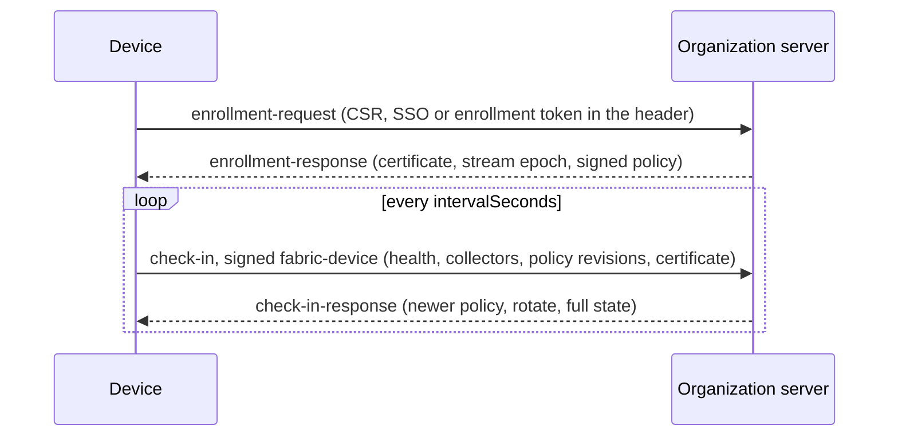

# Devices `fabric-device/0.1`

DEC-0031, amended by DEC-0052, DEC-0053, DEC-0056, DEC-0082 (one enrollment per organization, `org.id` for contexts) and DEC-0094 (a key in a file, idempotent rotation) · rule codes `FAC-SEM-041`…`FAC-SEM-046`, `FAC-SEM-068`,
`FAC-SEM-069`, `FAC-SEM-077`, `FAC-SEM-125` · schemas
[`device-enrollment`](../../schemas/device-enrollment.schema.json),
[`device-policy`](../../schemas/device-policy.schema.json),
[`device-check-in`](../../schemas/device-check-in.schema.json),
[`device-health`](../../schemas/device-health.schema.json),
[`device-key-set`](../../schemas/device-key-set.schema.json),
[`device-root-certification`](../../schemas/device-root-certification.schema.json), shared definitions in
[`device-common`](../../schemas/device-common.schema.json)

A **device** is a computer on which collector nodes send [activity telemetry](activity.md) to an
organization server. This protocol covers three things:

- how a device is enrolled;
- how it receives policy the organization signed;
- how it checks in, so the server can tell whether its telemetry is complete;
- how every request after enrollment proves the device's key ([transport](#transport)).

Its shapes follow OpenTelemetry's agent-management protocol
([OpAMP](https://opentelemetry.io/docs/specs/opamp/)):

- a sequence-numbered status report;
- a remote configuration the agent acknowledges by revision;
- a request for full state after a gap;
- certificate rotation through a certificate signing request.

The key words MUST, MUST NOT, SHOULD and MAY are used as in RFC 2119. Every document carries
`protocol: "fabric-device/0.1"` and a `kind`. Fields are `camelCase`; policy key names are dotted
identifiers. Check-ins and health of a device bound to a person are personal data, under the
[purpose rules](activity.md#purpose) of activity telemetry.



<a id="enrollment"></a>

## Enrollment

Schema: [`device-enrollment.schema.json`](../../schemas/device-enrollment.schema.json).

This is an organization server's enrollment. A machine joins its owner's personal estate by the estate ceremonies
instead — a comparison code nearby or through a relay rendezvous, or an `enroll-token/1` without a screen — and a
passkey-signed estate revision, with no certificate ([ceremonies](ceremonies.md), DEC-0084). Each organization
enrollment of a machine gets keys of its own (the operator's NET-2); the contract's per-context `kid` and `iss`
(CX-CON-06) are not decided yet.

1. The device generates a key pair in a hardware or platform store that does not export it, or, without one, in a file
   (DEC-0094, below), and a PKCS#10 certificate signing request (RFC 2986) signed by that key. In a store, the key's
   `storage` is `secure-enclave`, `tpm` or `platform-keystore`, it is `exportable: false`, and it MAY carry a platform
   `attestation`. The first
   organization server's target architecture v4 makes a non-extractable `ecdsa-p256` key in the
   `platform-keystore`, held by a signed key helper, the device key; DEC-0031 already admits it, and
   DEC-0053 records it as the target without changing the schema. A node without such a store MAY hold the key in a
   file (DEC-0094): `storage: "file"`, an owner-only PKCS#8 file, with `exportable: true`, so a verifier always knows
   the key can be copied; the schema ties `file` to `exportable: true` and every other store to `false`, and a file key
   carries no `attestation`. The listed `deviceKeys` (`#sig`, `#kem`) live in the same store `key.storage` names, so a
   file-key node holds them in owner-only files too and a verifier reads `key.storage` for all of them. A server MAY
   refuse a file-held key by policy; the contract defines no refusal code for it, so the server answers its own error.
   A node so refused shows that the server refused the enrollment and never retries claiming a store it lacks; a
   server pinned before DEC-0094 refuses `file` at its schema. How the file is protected is the node's.
   `publicKeySha256` is the SHA-256 of the DER SubjectPublicKeyInfo in the CSR; the server checks it
   against the CSR and records it as the device's key on record.
2. It sends an `enrollment-request` with `org.id`, `device.id` and `platform`, the key
   description, the CSR, and `auth.method`:
   - `sso` — a person signs in through the organization's single sign-on; the server binds the
     certificate to the `user.id` the sign-in proves, never another (`FAC-SEM-044`, F-B-105);
   - `enrollment-token` — unattended creation by device management (MDM); `tokenId` names the
     token. The certificate binds a `user.id` only when the token names the person the device is
     assigned to, and then that person (`FAC-SEM-044`). Otherwise the device is enrolled unassigned
     until an SSO sign-in re-enrolls it. **An organization's cloud machine** (its `org-cloud` or `enterprise-cloud`
     hosting: a VM run for the organization, on PassionCode's hosting as `processor-hosted` or on its own, that no
     person uses) enrolls with a token of role `org-cloud` (DEC-0099): its
     certificate's binding says `role: "org-cloud"` and binds no person, so a receiver shows it as the organization's
     cloud and attributes nothing it sends to a member. Only such a token gives the role (and a renewal by the key on
     record keeps it, DEC-0100), and a certificate issued on one always says it (`FAC-SEM-044`). How the server issues and records the token's role is its own.
   - `key-on-record` (DEC-0100): a device on record renews within 30 days of its last certificate's end, below
     (*Renewal after a short absence*): the proof is the CSR's own signature by the key
     on record, and the binding is the one on record.

   **The proof — the SSO session or the token's secret — travels in the `Authorization` header,
   never in the body** (the schema refuses any other `auth` field). The server takes the user from
   the proof, not from the request; for `key-on-record` there is no header proof, and the user and role are the record's.
3. The server answers an `enrollment-response`:
   - the certificate: `der`, `serial`, `notBefore`, `notAfter`, `issuer`, and the `binding` to
     `org.id`, `device.id` and, when known, `user.id`, or `role: "org-cloud"` and no `user` for an organization's cloud
     machine (DEC-0099);
   - **`streamEpoch`**: the epoch every collector on the device uses from now on, greater than every
     epoch issued to this device before (`FAC-SEM-044`);
   - **`policyRootKey`**: the organization's root key (`keyId`, `alg` and the public key), which signs
     [policy key sets](#key-sets) and nothing else, and optionally the current key set. Its `alg` is
     `ed25519` (the default, a raw 32-byte key) or `es256` (a raw 65-byte P-256 point), DEC-0053;
   - when the installer pinned an offline root, its `rootCertification` and the current
     `delegationRevocations` ([root certification](#root-certification));
   - the check-in interval;
   - optionally the current signed server policy (never a `user` layer, schema).

An organization server that takes part in [contexts](contexts.md) (DEC-0082) MUST issue `org.id` within
`[A-Za-z0-9][A-Za-z0-9_-]{0,127}`, the pattern of a context's `orgId`: an `org.id` outside it can be enrolled but no
context names it, so nothing of a context is routed to it.

The certificate is **short-lived**: at most 30 days (`FAC-SEM-044`), and SHOULD be 7. Its binding
names the organization and device of the request, and the signed-in user for an SSO enrollment
(`FAC-SEM-044`). Every later request (batches, check-ins, rotation and share registrations) is made over mutual TLS with it and carries an
HTTP message signature made with the device's key, which a receiver behind a host that terminates TLS verifies instead
([transport](#transport), DEC-0056).

**An enrolled device id is proven, not claimed.** A request for a `device.id` the server already
has on record is a re-enrollment. The server accepts it only with one of two proofs
(`FAC-SEM-044`):

- a CSR from the **key on record**: `publicKeySha256` equals the recorded key, and the CSR's own
  signature proves the device holds it;
- an **enrollment token issued by device management for that `device.id`**, for a device that lost
  its key (a wipe, a replaced board).

An SSO sign-in alone is not proof. Without this rule any member of the organization could enroll as
another person's device and make it look `tampered`. A file-held key (DEC-0094) can be copied, and a copy passes the
key-on-record proof; that is why the enrollment states `exportable`. An administrator who retires a device removes
its record, and the next enrollment of that id is a first enrollment.

**Rotation and re-enrollment.** Before expiry, and SHOULD at two thirds of the lifetime, a check-in
response asks for `certificate.action: "rotate"`. The device then sends a new CSR from the same
key, the key on record, and receives a new certificate under the same epoch; the rotation request is signed like every other,
under the current certificate's serial ([transport](#transport)). **Rotation is idempotent** (DEC-0094): a rotation
request whose CSR key (`publicKeySha256`) and current serial equal one the server already answered gets the same new
certificate again, and the old certificate stays valid until the new serial is first presented, at most until its own
expiry. A response lost after the server committed the rotation then costs a repeat, not a new enrollment while the old
certificate is valid. Once it holds the new certificate the device switches every sender to the new serial at once and
re-signs any request still in flight under the old one. The device enrolls again from
step 2 when any of these happens:

- its certificate expired (within 30 days of its end it renews instead, below);
- a response says `re-enroll`;
- a collector on it lost its persisted counter ([streams](activity.md#streams)).

**Re-enrollment issues a new epoch and resets the device's policy-revision baseline**: a reinstalled
collector starts again at seq 1 and reports the policy revisions it holds now, and neither is
evidence of tampering. Nothing is renewed silently past `notAfter`.

**Renewal after a short absence** (DEC-0100). A device that was offline past its certificate's end (a holiday, a laptop
left in a drawer) enrolls again with `auth.method: "key-on-record"` and no other proof, within **30 days** of its last
certificate's `notAfter`, judged by the server's clock: the new certificate's `notBefore`, never the device's own
`requestedAt` (DEC-0102). Before that end the same request is also taken: a re-enrollment by the key on record with a new epoch, unlike a
rotation, which keeps the epoch; the old certificate ends when the new one is issued, and a node whose certificate is
still valid rotates instead: the CSR is from its key on record, and that CSR's own signature is the proof. The server
takes it only for a device on record that is not revoked (`FAC-SEM-044`), keeps the binding it holds (the same user,
or none, and the same `role`), issues a new epoch as every re-enrollment does, and records the renewal in the device's
audit; it is never silent. Past the 30 days, or for a revoked device, a token or an SSO sign-in is needed as before.
A server MAY refuse a renewal by policy (a file-held key, which can be copied, DEC-0094; a device it wants an
administrator to see again), with its own error. A server pinned before DEC-0100 refuses `key-on-record` at its schema;
the node then enrolls with a token or SSO as before. No `protocols` entry tells either side the other's pin (CT-67), so a
server issues `role: "org-cloud"` (DEC-0099) only to a node whose product and version it knows reads it (DEC-0102).

<a id="device-keys"></a>

### Device keys by role

DEC-0053 admits, beside the Ed25519 device key DEC-0031 already allowed, P-256 device keys held in the
platform keystore (or, from DEC-0094, wherever `key.storage` names, a file included), listed by role in the enrollment request's `deviceKeys`:

- **`<device.id>#sig`** signs: ES256 (P-256) or Ed25519;
- **`<device.id>#kem`** agrees keys: ECDH over P-256 only. The relay protocol ([relay](relay.md), DEC-0047) seals
  secrets to it, and admits a relay participant on an ES256 `#sig` only: an Ed25519 `#sig` stays valid for a device
  and is `unsupported-alg` at a relay.

An enrollment that lists `deviceKeys` lists **exactly one `#sig` and at most one `#kem`** (`FAC-SEM-044`, DEC-0056), the
counts the estate record holds per machine (`FAC-SEM-073`), so there is the one key that signs a device's requests,
and the one key a sender seals to. One key is never used for the other role, and each kid names the
enrolling device (`FAC-SEM-044`). A
P-256 public key — a device key, a policy root key, an offline root or delegation key — is validated by
SEC 1 §3.2.2 before use: not the point at infinity, coordinates in range, on the curve
([`isValidP256Key`](../../src/p256.ts), vectors `fixtures/vectors/p256.json`). Every Ed25519 key still
passes the small-order check (DEC-0045).

<a id="transport"></a>

## Transport

DEC-0056, agreed with the first organization server (its ADR-0007, amended 2026-10-12 at its commit `7a47447`). A host
that terminates TLS — a platform's load balancer — never sees a client certificate, so mutual TLS alone cannot prove
the device's key there. **A device signs every batch, check-in, rotation and share-registration request with an HTTP message signature**
([RFC 9421](https://www.rfc-editor.org/rfc/rfc9421), a subset), beside mutual TLS, not instead of it. Enrollment is
unchanged: its proof travels in `Authorization` ([enrollment](#enrollment)).

The same `#sig` key also signs a machine's relay requests (`relay-auth/1`, `relay-blob/1`,
[relay](relay.md#blobs), DEC-0047). The two bindings cannot be confused: those sign RFC 8785 JSON, which starts with
`{`, while this signature base starts with `"@method"`. They differ on purpose: the relay's are bound to their content
within 60 s and need no nonce, while a device request is a side effect a nonce must keep from repeating within 300 s.
A relay admits only an ES256 `#sig` key; this binding also admits Ed25519.

**Mutual TLS and the signature on one request** (DEC-0056 item 1, the owner session's ruling):

- A signature that is present is always verified, whatever else the request carries.
- When a client certificate is also present, `keyid` MUST equal that certificate's serial; otherwise the answer is 401
  `certificate-unknown`.
- An invalid signature over a valid mutual-TLS session is refused with the signature step's code: the session does not
  excuse it.
- An unsigned request — no `fabric-device` member in either field — is accepted only by a receiver that sees the client
  certificate, and only while that certificate is known, not revoked and valid; a receiver behind a TLS-terminating host
  refuses it as `signature-missing`.

| Part | Value |
|---|---|
| Label | `fabric-device`: the member of `Signature-Input` and `Signature` a receiver reads (RFC 9421 §4.1, §4.2); other labels beside it are ignored, the same label twice is refused |
| Repeats | a parameter named twice on the `fabric-device` member is refused; on any other member RFC 8941's rule holds (the last value wins), so another party's signature never hides this one |
| Covered components | `("@method" "@target-uri" "content-digest")`, in this order, with no component parameters |
| Parameters | `created`, `nonce`, `keyid`, `alg`, in this order, and no other (RFC 9421 §2.3) |
| `created` | Unix time in seconds, an Integer; within 300 seconds of the receiver's clock, either way |
| `nonce` | 22–64 base64url characters (`[A-Za-z0-9_-]`), fresh for each request: 16 random bytes encode to 22. Required |
| `keyid` | the certificate's `serial` (`device-common#/$defs/serial`) |
| `alg` | `ecdsa-p256-sha256` (RFC 9421 §3.3.4) for an `es256` signing key, `ed25519` (§3.3.6) for an `ed25519` one |
| `Content-Digest` | exactly one member, `sha-256=:<base64>:`: SHA-256 of the body's bytes as sent ([RFC 9530](https://www.rfc-editor.org/rfc/rfc9530) §2) |

The fields are Structured Fields ([RFC 8941](https://www.rfc-editor.org/rfc/rfc8941) Dictionaries, parsed by its §4.2,
with [RFC 9651](https://www.rfc-editor.org/rfc/rfc9651)'s Date and Display String items admitted on other members);
the signature base is RFC 9421 §2.5's, with §2.3's signature parameters as its last line and no newline after it
([`deviceSignatureBase`](../../src/http-signature.ts)). For a check-in (the path is an example; the contract names
none):

```text
Content-Digest: sha-256=:bcQgchKmtFToGclM0KEWux+drDCNmKqVlOFEJcn9I4Q=:
Signature-Input: fabric-device=("@method" "@target-uri" "content-digest");created=1791795598;nonce="Qm9hcmQtcnVuLXdhdmUtNC1QNA";keyid="7b6578616d706c65";alg="ecdsa-p256-sha256"
Signature: fabric-device=:thW6jbfdp53+WsnK47qgmn5s6XTzu78X8CA1Gp2rHotzHuS9exh9C+VmSZvFDav25DrSoU9mAZ9FF0OeiKVc3w==:

"@method": POST
"@target-uri": https://org.example/v1/devices/check-in
"content-digest": sha-256=:bcQgchKmtFToGclM0KEWux+drDCNmKqVlOFEJcn9I4Q=:
"@signature-params": ("@method" "@target-uri" "content-digest");created=1791795598;nonce="Qm9hcmQtcnVuLXdhdmUtNC1QNA";keyid="7b6578616d706c65";alg="ecdsa-p256-sha256"
```

- **The signing key** is the `#sig` key of the enrollment whose epoch the certificate carries — rotation keeps it
  ([device keys](#device-keys)) — or, for an enrollment that listed no `deviceKeys`, the certified key itself (DEC-0031's
  key on record). Which of the two it is, the receiver's data model records with the certificate. Its algorithm decides
  `alg`. An ES256 signature is SHA-256 then r ‖ s, 32 octets each (§3.3.4); an
  Ed25519 signature is over the base itself, 64 octets (§3.3.6). A P-256 key on record passes SEC 1 §3.2.2
  (`isValidP256Key`) and an Ed25519 key the small-order check (DEC-0045) before anything is verified under it.
- **The target URI** (`@target-uri`, RFC 9421 §2.2.2) is the receiver's public base URL — `https://` and the authority
  the device enrolled with, host in lower case, no default port, no path — followed by the request target as received,
  its path and query. A receiver builds it from its own configuration, **never from the `Host` header**, which a proxy
  may rewrite ([`deviceTargetUri`](../../src/http-signature.ts)).
- **Serials** are unique among the certificates one receiver accepts, so `keyid` names one certificate.
- **A retry is signed afresh**, with a new `nonce` and a new `created`: a resent signature is a replay. A device that
  receives `signature-stale` checks its clock before it signs again.
- **Attribution is unchanged** ([below](#attribution)): the certificate the verified signature's `keyid` names stands
  where the client certificate stands — it gives the device and organization; each event's person comes from its
  epoch's binding (`FAC-SEM-045`).

**What a receiver checks**, in this order ([`checkDeviceSignature`](../../src/http-signature.ts), then
[`verifyDeviceRequest`](../../src/http-signature.ts)); each refusal is HTTP 401 with the code:

| Step | Refused when | Code |
|---|---|---|
| 0 | the receiver's context is not usable — not an object, an unreadable clock, a public base URL that is not `https://` and an authority alone, a certificate lookup or nonce store that is not a function | nothing is accepted: the fault is the receiver's (`context-invalid`, `clock-unreadable`, `base-url-invalid`), not a 401, and the verifier answers rather than throws |
| 1 | no `fabric-device` member in either field: unsigned. Accepted on a mutual-TLS client certificate that passes steps 4–6; without one | `signature-missing` |
| 1 | a `fabric-device` member present, but not in both fields, the label twice, a parameter repeated, or a member not exactly the shape above — a missing or malformed `nonce` among them | `signature-missing` |
| 2 | `Content-Digest` is not exactly `sha-256` of the body as received | `digest-mismatch` |
| 3 | `created` is more than 300 seconds from the receiver's clock | `signature-stale` |
| 4 | a client certificate is present and `keyid` is not its serial, or no certificate has the serial `keyid` names | `certificate-unknown` |
| 5 | the certificate is revoked (a record's `revoked` present and not `false`) | `certificate-revoked` |
| 6 | the receiver's clock is not in `notBefore` ≤ t < `notAfter`, each read as RFC 3339 with `T` and an offset | `certificate-expired` |
| 7 | `alg` is not the signing key's, the key is not usable, the signature base cannot be built, or the signature does not verify | `signature-invalid` |
| 8 | the pair (serial, `nonce`) is already held | `signature-replayed` |

**The nonce store.** Only after step 7 passes does the receiver record the pair (serial, `nonce`), atomically, and keep it
at least while its clock is at or before `created + 300` s — as long as `created` could still pass step 3. A refused
request records nothing, so a forgery cannot burn a device's nonce. The store is an interface
([`NonceStore`](../../src/http-signature.ts) `recordOnce`): a database implements it as an insert on a unique key. The
nonce is what makes a replay visible: a check-in's `sequenceNum` drives the full-state request on a gap, not a refusal,
so a check-in replayed inside the window would be read again and could bring back an old posture and hide `tampered`;
batches are idempotent by event id as well. An ECDSA signature can be re-encoded as (r, n − s); the store is keyed on the
nonce, not on the signature's bytes, so that changes nothing. **The store detects repeats and nothing else** (J10): a pair
SHOULD be deleted once the clock passes its `keepUntil`, and the store is never read as a record of a device's or a
person's activity.

The vectors a receiver or a collector runs are [`fixtures/vectors/http-signature.json`](../../fixtures/vectors/http-signature.json):
a good request with each key, the window's edges, an altered body and target, a lower-case method signed as sent, a
stale `created`, a missing and a malformed `nonce`, a repeated one, a foreign key, the wrong `alg` for the key, unknown,
revoked and expired certificates, unusable keys (a small-order forgery among them), another party's members, mutual TLS
with and without a signature, and RFC 9421's own Ed25519 example with RFC 9530's digest. `FAC-SEM-077` holds a receiver's
answer to them.

<a id="attribution"></a>

## Attribution

**A receiver takes the device from the client certificate — or from the certificate a verified request signature
names ([transport](#transport)) — and the user from the binding recorded for each epoch — never from the body.** The server records, for every epoch it issues, the binding of
that enrollment (`org`, `device`, `user` when one was bound). For a batch or a check-in:

- `device.id` in the body MUST equal the certificate's device;
- every event's `user.id` MUST equal the user bound to **the event's epoch**, or be absent when that
  epoch was issued with no user;
- an event of an epoch with no recorded binding for this device is refused;
- a `grant.usage`'s `data.context` MUST be `org:` followed by the certificate's `org.id` as written: it is the grant's
  own context (DEC-0086), and another organization's usage, or one whose context differs only in case, is refused.

So when a device is re-enrolled to another person:

- events of the earlier epoch, still in the buffer, stay attributable to the person they belong to;
- events of an unassigned period carry no user;
- only events of the new epoch belong to the new person.

A mismatch is refused (`attribution` in the batch ack). A receiver that stores `user.id` writes the
epoch's bound value (`FAC-SEM-045`). So one device can never make another look `tampered`, or
attribute events to another person, unless it holds a copy of that device's file-held key (DEC-0094).

<a id="policy"></a>

## Policy

Schema: [`device-policy.schema.json`](../../schemas/device-policy.schema.json).

A policy document is one **layer**, with a `revision`, `issuedAt`, `keys` and optionally the
`noticeVersion` of the organization's notice it is issued under ([notice](activity.md#notice),
DEC-0052). Each key is `{value, locked?}`. The layer's `source` is one of:

- `mdm`: delivered by device management;
- `server`: delivered by the organization server;
- `user`: set on the device by the person using it.

| Key | Value | Meaning |
|---|---|---|
| `logging.required` | boolean | Activity telemetry must be on. Usually locked. |
| `build_channel.allowed` | `any`, `official`, `attested` | Which collector builds may run: any build, the organization's official build, or a build whose platform attestation verifies. |
| `telemetry.endpoint` | `https://` URL | Where batches go. Optional; when it is absent, batches go to the endpoint the device enrolled with. |
| `telemetry.git_branch` | `omit`, `hash`, `plain` | `omit`: events carry no `git.branch`; `hash`: `hmac-sha256:` of the name under the device's telemetry key ([activity](activity.md#event-id), F-B-103); `plain`: the name. |
| `retention.raw_days` | integer, 1…3650 | How long raw events are kept before only summaries remain. |
| `accounts.tenants` | list of `{provider, tenantRef, accountClass: "organization"}` | The organization's provider tenants. A session on one is an organization session, labelled `account.class` with the tenant's `tenantRef` ([activity](activity.md#envelope), DEC-0052); any other is personal or unknown. |
| `models.credentials` | list of `{credentialRef, provider, credentialKind: "api-org", fingerprint, callers?, quota?, dataClasses}` | The organization's API keys a device may use — never a subscription, a seat or a person's own key (schema). `fingerprint` is `hmac-sha256:` of the key under the organization's salt, so a node recognises the slot that holds it, and so its provenance, without the policy carrying the key. `quota.usd` is a decimal string. |
| `models.personal_key_sharing` | `allowed`, `forbidden` | Whether a person's own key may serve someone else's call. **Absent means forbidden** (`FAC-SEM-068`). |
| `workspace.folders` | list of folder patterns | The organization's work folders, relative to the person's home directory, so a value never names a user (schema: no leading `/`, `\`, `~` or drive letter, no `..`); `*` matches one segment. |
| `machine.mode` | `A`, `C` | `C`, the default: the organization manages only its own work on the machine. `A`: it administers the whole machine — taken only from an `mdm` layer; a `server` or `user` layer's `A` is ignored (`FAC-SEM-042`). |
| `harness.baseline` | `{items: [{kind, name, minVersion?, digest?}]}`: `minVersion` only for a coding agent or a plugin, `digest` only for a skill or a plugin | DEC-0101: what every enrolled machine is expected to run, read only from the `mdm` and `server` layers (a `user` layer's value is ignored, DEC-0102); a node reports its drift from it in `node-summary/1` ([node summary](node-summary.md#the-baseline-and-the-drift)). Absent: no drift is reported. |
| `repair.packages` | list of `{agentRef, digest}` | DEC-0101: the packages a `repair-request/1` may name, read only from the `mdm` and `server` layers (a `user` layer's value is ignored, DEC-0102). **Absent means no repair runs** (`FAC-SEM-129`). |

Key names are dotted `snake_case` identifiers, so the `models.personalKeySharing` of the organization
edition's plan is spelled `models.personal_key_sharing` here. **A key no layer sets resolves to a
default** (DEC-0053, [`POLICY_DEFAULTS`](../../src/device-rules.ts)): `build_channel.allowed` to
`official` — an organization's device runs only the official build — `machine.mode` to `C`, and
`models.personal_key_sharing` to `forbidden`.

**Unknown keys are kept and ignored**: a device that does not know a key MUST NOT reject the policy
for it. Extension keys are spelled `x-<namespace>.<key>`. A value has no fraction (schema). A
fraction is written as a string, because a signature covers the settings form of canonical JSON, which has no
form for fractions ([settings backups](service.md#settings-backup)).

**Signature.** A `server` policy MUST be signed. An `mdm` policy MAY be, since its channel is the
operating system's managed preferences. A `user` layer is never signed and never delivered. The
signature is Ed25519 (RFC 8032) over the UTF-8 canonical JSON of the document without `signature`
([`policySigningInput`](../../src/device-rules.ts)), named by `keyId`. The canonical JSON is the settings form,
not RFC 8785: the two give different bytes ([canonical forms](conformance.md#canonical-forms), DEC-0043).
The trusted keys are those of the device's current [key set](#key-sets) that are valid **when the device
verifies** — on its own clock, never at the `issuedAt` the signer chose — and a policy is never issued before
the one the device holds for its layer (DEC-0053, F-B-106). Judged at `issuedAt`, a leaked key past its
`notAfter` that is still in the set would sign a backdated policy with a higher revision. So a policy signed
by a key that has since expired is refused too, and the server signs again under a current key. A policy
signed by the root key, or by a key outside its window, is refused (`FAC-SEM-041`).

**Revision.** A device applies a delivered policy only when all hold:

- its signature verifies under a trusted key;
- its revision is greater than the one the device holds for the same organization and layer;
- its `issuedAt` is not before the held policy's (`FAC-SEM-041`).

It reports the revision it holds for each delivered layer in every check-in.

**Expiry** (DEC-0053). A delivered layer MAY carry `expiresAt`. After the earliest one passes, and until
a newer policy arrives, the device keeps every lock in force but stops honouring grants, stops remote
execution, and lets no person's key serve someone else ([`expectedDecision`](../../src/device-rules.ts),
`FAC-SEM-068`). Expiry never loosens a device: what was locked stays locked.

<a id="collection-start"></a>

**Collection start** (DEC-0053). A device collects for the organization only from its
`collectionStart`: the time the person acknowledged the notice ([activity](activity.md#notice)) or,
under device management, the earlier of that and the `mdm` layer's `noticeDeadline`
([`collectionStart`](../../src/device-rules.ts)). The server states it in the enrollment and check-in
responses. Without either, nothing is collected. An event that occurred before it is never uploaded,
even after it passes: it stays on the device (`FAC-SEM-068`).

**Precedence and locks.** Precedence is `mdm` > `server` > `user`. The effective value of a key is
([`resolvePolicy`](../../src/device-rules.ts)):

1. if any layer **locks** the key, the value of the highest layer that locks it;
2. otherwise, the `user` layer's value, when it sets one;
3. otherwise, the value of the highest layer that sets it.

An unlocked value above the user layer is therefore a default the person may change; a locked one is
never overridden by a lower layer. A device MUST refuse a local change to a locked key and show the
key as locked. The `user` layer cannot lock (schema, `FAC-SEM-042`).

<a id="key-sets"></a>

### Key sets

Schema: [`device-key-set.schema.json`](../../schemas/device-key-set.schema.json). Operator decision
2026-10-08 (DEC-0031, closing OQ-0010 b).

- The enrollment response carries the organization's **root key** (`policyRootKey`). It signs policy
  key sets only, never a policy.
- A **key set** (`kind: "policy-key-set"`) lists the policy signing keys, each with `keyId`,
  `publicKey`, `notBefore` and `notAfter`, under a monotonic `revision`. It is signed by the root key
  over its canonical JSON without `signature`, as a policy is. It arrives in an enrollment or
  check-in response.
- A device applies a key set only when it verifies under the root key, stays in its organization
  and moves its revision forward.
- **Rotation overlaps.** A new key is added before the old one expires, so policies signed by either
  verify during the window. A key of the current set that is still valid at the next set's
  `issuedAt` stays until its `notAfter`, unless the next set names it in `revoked`.
- A key set always holds a key valid at its `issuedAt`, names each key once, never lists the root
  key, and gives each key a window that ends after it starts (`FAC-SEM-046`).
- **No key of small order** (DEC-0045, CT-29). A root key, a policy signing key and a trusted key are never
  one of libsodium's seven small-order encodings, with the sign bit ignored: such a key lets anyone forge a
  signature, and Node 20 and 22 accept the forgery. The schema refuses one, `FAC-SEM-046` refuses one in a key
  set, and a device never verifies a policy or a key set under one (`verifyPolicySignature`,
  [`src/ed25519.ts`](../../src/ed25519.ts) `isSmallOrderKey`).
- How a root key itself is replaced is a re-enrollment: the enrollment response carries the new one.
- **A root key names its algorithm** (DEC-0053): `ed25519` (the default) or `es256`, ECDSA over P-256
  with a 64-byte R ‖ S signature (RFC 7518 §3.4). The key set's `signature.alg` is the root's, and a
  device verifies it only in that algorithm ([`verifyWith`](../../src/device-rules.ts), `FAC-SEM-046`).
  Policy signing keys in a set stay Ed25519. This is the contract's own decision: Fabric's ES256 ruling
  (its D2, ADR-0144) covers delegation tokens, not device policy.

<a id="root-certification"></a>

### Root certification

Schema: [`device-root-certification.schema.json`](../../schemas/device-root-certification.schema.json).
Operator decision 2026-10-08 (the organization edition's N7, R10-M3), as the first organization server's
target architecture v4 narrowed it: a vendor's offline root counter-signs only the organizations it hosts,
and a self-hosted organization's root is its own (DEC-0053).

- When the device's installer **pins offline root keys**, the enrollment response carries a
  `rootCertification` of the organization's root key, checked at enrollment time (`FAC-SEM-069`).
- It is signed by a pinned key, or by a **delegation key** whose certificate (`delegation`) a pinned key
  signed. A delegation certificate lives at most 30 days, is valid at enrollment, and its key is not on the
  pinned key's `delegationRevocations` list. A delegated certification **must** carry that list, issued at most 7 days
  before enrollment (TUF: metadata expires); without it, or with an older one, a compromised delegation key could
  certify until its own certificate expires.
- Each of the three documents is signed over the RFC 8785 form of itself without `signature`
  ([`certificationSigningInput`](../../src/device-rules.ts); [canonical forms](conformance.md#canonical-forms)),
  and names its algorithm, `ed25519` or `es256` ([`verifyWith`](../../src/device-rules.ts)): a verifier
  accepts only the algorithm the key names.
- Nothing pinned: no certification is required, and the root key from enrollment is the organization's
  own.

This follows The Update Framework's delegation from an offline root to short-lived online keys
([TUF](https://theupdateframework.github.io/specification/v1.0.37/), pinned in the source ledger).

<a id="check-in"></a>

## Check-in

Schema: [`device-check-in.schema.json`](../../schemas/device-check-in.schema.json). It refers to other files; a consumer
that vendors it copies its `$ref` closure ([adoption → Vendoring schemas](adoption.md#vendoring-schemas)).

Every `intervalSeconds` the device sends a `check-in` (OpAMP `AgentToServer`):

- `protocols` MAY list the revisions the node reads; the receiver sends each record and the policy in the newest
  revision that list and its own writer share, and the server's `protocols` lists what it accepts from the device:
  the latest list the node received, from its enrollment response or a later check-in response (DEC-0094). A document in a revision the other side does not accept is refused with
  `schema-unsupported` ([versioning](versioning.md#protocol-revisions), DEC-0067) — after the request signature's steps
  0–8 hold, before the body is read. An enrollment request, which authenticates by its `Authorization` proof instead,
  is refused with `schema-unsupported` after that proof is checked and before the CSR is read.
- `sequenceNum` increases by one per check-in. On a gap the server answers with the flag
  `report_full_state`, and the next check-in carries `fullState: true`. A gap in check-ins is lost
  synchronisation, not tampering.
- `agent.version` and `agent.buildChannel` (`official`, `attested`, `unofficial`), and optionally
  `components[]`: each component's `name` and `version` — collector, node, key helper (DEC-0053).
- `health.state` as the device sees itself, and `logging.enabled`.
- `collectors[]`, one per collector node:
  - `collector.id` and `collector.epoch`;
  - `lastSeq`: the highest seq assigned;
  - **`bufferedFrom`**: the lowest seq still buffered, or `lastSeq + 1` when the buffer is empty —
    every seq below it was sent or dropped;
  - **`dropped`**: the ranges dropped whose `buffer.overflow` event is not yet acknowledged;
  - `healthy`, and an optional `error`.
- `policy.layers[]`: for each delivered layer (`mdm`, `server`), the revision held (0 for none) and
  its `status` (`applied`, `applying`, `failed`). This is OpAMP's remote configuration status. The
  `server` layer is always reported, revision 0 when none arrived (schema), so a device cannot hide a
  revision by omitting the layer.
- `certificate.serial` and `notAfter`.
- optionally `records`, what the device holds of the records the relay protocol carries (DEC-0053):
  the `estateRecord.revision` it applies ([estate record](estate-record.md), DEC-0055) and optionally that revision's
  `digest` (`sha256:` and 64 hex), so a receiver tells two revisions with one number apart (DEC-0056; a device omits it
  toward a receiver pinned before DEC-0056, whose schema refuses an unknown member), the latest
  `heartbeat` (`sequence`, `at`), the head of the
  `revocationDelta` it applied (`sequence`, `sha256`) and the `leases` its meter holds (`leaseId`,
  `expiresAt`). The heartbeat and the revocation delta are DEC-0054's ([revocation delta](revocation-delta.md)):
  `heartbeat` is the accepted `heartbeat/1`'s own `sequence` and `at`, `revocationDelta` the head applied (the last
  entry's sequence and hash, `0` and the estate's genesis before any). The leases are the window lease's decision (not
  yet taken). The relay ([DEC-0047](relay.md#revocation-and-heartbeat)) carries heartbeats and pages of the delta
  unchanged, and a check-in response carries a heartbeat and a page (both typed by DEC-0054's schemas) and leases in
  `records` unchanged. A relay's `welcome.deltaHead` has the `revocationDelta` shape, so a node reports it as it came.

**One enrollment per organization** (DEC-0082). A device enrolled in several organizations holds one enrollment,
certificate and stream epoch in each. It sends each enrollment's check-ins to that enrollment's own server, on that
enrollment's interval, reporting only that enrollment's streams; a check-in carries no context but its `node-summary/1`
record's own `org:<org.id>` (DEC-0102), and the organization is
the one its certificate binds ([attribution](#attribution)). A check-in has no session, so no session's context routes
it. A session's events go where `routeTarget` answers, and a grant's daily usage where `routeGrantUsage` answers
(`src/context-route.ts`, the shared vectors
[`fixtures/vectors/context-route.json`](../../fixtures/vectors/context-route.json), [contexts](contexts.md#routing)).
Share registrations go to each enrollment's own server, signed as its other requests are
([share registration](share-registration.md#transport), DEC-0086).
Until a key per context exists (CX-CON-06), the device shows both organizations the same device key and reports the same
`records` to each, so the two can link it ([contexts → linkability](contexts.md#linkability)).

The server answers a `check-in-response` (OpAMP `ServerToAgent`): `nextCheckInSeconds`, `flags`, the
device's [`collectionStart`](#collection-start) once it is known, a newer [key set](#key-sets) and a
newer signed `policy` when there are some (never a `user` layer), and a `certificate.action` (`rotate`
or `re-enroll`) when one is due. The response MAY carry `protocols` (DEC-0094), the revisions the server accepts from the device (DEC-0067's list), so a
node learns them at check-in; the latest list the node received is the server's current one. The response is a closed
object, so a server sends it only to a node pinned at or after DEC-0094 or one that ignores unknown members;
`fabric-device/0.1` carries no in-band sign of a node's pin, so the server knows it from the node's product and version
(a revision that carries it is board row CT-67).

**Free text stays bounded.** Every `detail` and `error` string is one line of at most 200
characters with no path in it (schema `device-common#/$defs/detail`, F-B-104): no slash, backslash or
tilde at the start of a word anywhere in the line, no drive letter, no URL-encoded slash, and no home
directory in its slash or dash form (`Users/<name>`, `-Users-<name>-`), before or after a line or paragraph separator
(U+2028, U+2029; DEC-0097). It MUST NOT name a username or carry content.

<a id="health"></a>

**A node's summary and repairs** (DEC-0101). A check-in MAY carry `records.nodeSummary`, the node's `node-summary/1`
for this organization, and `records.repairResults`, its answers to repairs; a check-in response MAY carry
`records.repairs`, signed `repair-request/1` documents. The policy keys `harness.baseline` and `repair.packages` state
what the organization expects the harness to be and which packages a repair may run. All of it is on
[node summary](node-summary.md).

## Health

Schema: [`device-health.schema.json`](../../schemas/device-health.schema.json).

The server judges each device's health from check-ins, batches and the effective policy. The state is
an open vocabulary; known states:

| State | When |
|---|---|
| `healthy` | Checking in, logging on, every collector healthy, no tamper evidence. |
| `degraded` | Checking in, but a collector reports an error or a policy failed to apply. |
| `offline` | No check-in for more than three intervals. |
| `inactive` | Checking in, but the collectors have produced no events for a period: by default **7 days** (operator decision 2026-10-08); a server MAY set another period. This says the collector is quiet; it says nothing about a person. |
| `logging_disabled` | The device reports logging off. When the effective policy requires logging, the state is at least this (`FAC-SEM-043`). |
| `tampered` | Evidence of tampering ([below](#tamper-evidence)). |
| `never_installed` | Enrolled or assigned, but no check-in ever. |
| `outdated` | The collector's version or build channel is not allowed by policy. |

`reasons[]` names what the judgement rests on (`code`, bounded `detail`). A reader shows an unknown
state as it is. **`re_enrolled`** is posture, not tamper evidence (DEC-0052): it carries `gapSeconds`,
the time between the last check-in under the earlier epoch and the re-enrollment, and `count`, the
re-enrollments in the server's window. A re-enrollment resets the baseline and so hides nothing from
the rules above, but a device that re-enrolls often, or after long gaps, is visible. Reads of a device's health are logged in its person's
[access log](activity.md#access-log).

<a id="tamper-evidence"></a>

### Tamper evidence

The server keeps, per stream and across batches, the seq ranges it **holds** (received, accepted or
rejected), the ranges **accounted for** by overflow events, and the ranges **pending**: a check-in's
`dropped` whose overflow event has not arrived. Pending ranges count here and never in an ack, which
moves only over what the receiver holds or an overflow accounts for ([activity](activity.md), DEC-0052,
F-B-108). All coverage is
computed by merging ranges, never seq by seq ([`tamperEvidence`](../../src/device-rules.ts),
[`mergeDeviceState`](../../src/device-rules.ts)). Evidence is:

- **a hole inside one batch**: a batch carries a contiguous slice of each stream;
- **a gap below `bufferedFrom`**: once a check-in says every seq below `bufferedFrom` was sent or
  dropped, a seq there that is neither held, nor accounted for, nor pending. Before that, a gap
  between batches is pending — its overflow may still be buffered;
- **an epoch the server never issued** to the device;
- **a collector counter that went back**: a `lastSeq` below a seq already held;
- **a buffer floor that went back**: a `bufferedFrom` below one the device reported before. Events
  leave a buffer only by acknowledgement or by an overflow, so the floor only rises;
- **a policy revision that went back**: a revision below one the device acknowledged since it last
  enrolled.

A reinstall re-enrolls, takes a new epoch, starts at seq 1 and resets the policy baseline, so it
produces none of these. When any of them is present, the state is `tampered` (`FAC-SEM-043`). The
server MAY reach `tampered` from other evidence too, such as an attestation that fails.

## Semantic rules

| Code | Kind | Rule |
|---|---|---|
| <a id="fac-sem-041"></a>`FAC-SEM-041` | `device-policy-update` | a delivered policy is signed when it is a server policy, verifies under a key of the current set that is valid when the device verifies, stays in its organization and layer, moves its revision forward and is not issued before the held one; a user layer is never delivered |
| <a id="fac-sem-042"></a>`FAC-SEM-042` | `device-policy-resolution` | the effective settings are the resolution of the layers: lock first, then the user's value, then the highest default, then the contract's default for an unset key, with one layer per source, no lock in the user layer, and `machine.mode` `A` only from an mdm layer |
| <a id="fac-sem-043"></a>`FAC-SEM-043` | `device-health-observation` | a health state is `tampered` when there is tamper evidence, and is `logging_disabled` or `tampered` when required logging is reported off |
| <a id="fac-sem-044"></a>`FAC-SEM-044` | `device-enrollment` | re-enrolling a device on record needs a CSR from its key on record or a device-management token for that device; the certificate binds the request's organization and device, the user the sign-in proves for SSO, and for a token enrollment a user only when the token names that person; `role: "org-cloud"` exactly when an `org-cloud` token enrolled it, and then no user (DEC-0099); a renewal by the key on record only for a device on record, not revoked, within 30 days of its last certificate's end, from that key, keeping its user and role (DEC-0100); it lives at most 30 days; each device key is listed as `<device.id>#sig` or `#kem` in its role's algorithm, valid (SEC 1 §3.2.2 for P-256, not small-order for Ed25519) and never in both roles, and listed keys hold exactly one `#sig` and at most one `#kem` (DEC-0056); the stream epoch is above every epoch issued before |
| <a id="fac-sem-045"></a>`FAC-SEM-045` | `device-attribution` | a batch's or check-in's device is the client certificate's device (or the certificate a verified request signature names, DEC-0056); every event's user is the user bound to its epoch, or absent when that epoch has none; an event of an epoch with no recorded binding is refused; a `grant.usage`'s `data.context` is `org:` and the certificate's `org.id`, as written (DEC-0086) |
| <a id="fac-sem-046"></a>`FAC-SEM-046` | `device-key-set` | a key set is signed by the root key from enrollment in that key's algorithm, moves its revision forward in its organization, names each key once with a window that ends after it starts and none of small order (DEC-0045), holds a key valid at its `issuedAt`, and keeps every key of the current set that is still valid unless it revokes it by name |
| <a id="fac-sem-068"></a>`FAC-SEM-068` | `device-action` | a device's decision is the one its policy gives: after expiry no grant, remote execution or person's key for others, and every lock kept; a person's key serves others only when sharing is `allowed`; nothing that occurred before the collection start is uploaded |
| <a id="fac-sem-069"></a>`FAC-SEM-069` | `device-root-certification` | when the installer pinned offline root keys, the root key from enrollment is certified at enrollment time by a pinned key, or by a delegation key whose certificate of at most 30 days a pinned key signed and whose id the pinned key's revocation list does not name |
| <a id="fac-sem-077"></a>`FAC-SEM-077` | `device-request-signature` | a receiver that requires the signature, or that sees a client certificate, answers a device request as the transport binding does: it accepts a `fabric-device` signature of the required shape whose digest, window, certificate, algorithm, key and signature all hold and whose (serial, nonce) it does not hold (naming the client certificate's serial when there is one) accepts an unsigned request only on a valid client certificate, and otherwise answers the 401 code of the first step that fails |
| <a id="fac-sem-125"></a>`FAC-SEM-125` | `device-rotation` | a rotation request whose CSR key (`publicKeySha256`) and current certificate serial equal a rotation the server already answered gets that answer's certificate again, byte for byte, never a new one (DEC-0094) |

Each kind checks one input:

| Kind | Input |
|---|---|
| `device-policy-update` | `{current?, next, trustedKeys[{keyId, publicKey, notBefore?, notAfter?}], rootKeyId?, at}`; `publicKey` is the raw 32-byte Ed25519 key in base64; `at` is the device's clock when it verifies |
| `device-key-set` | `{root: {keyId, alg?, publicKey}, current?, next}` |
| `device-policy-resolution` | `{layers, effective}` |
| `device-health-observation` | `{known: {deviceId, epochs, policyBaseline, streams[{collector, held, accounted, pending?, bufferedFrom?}]}, batch?, checkIn?, effective?, health}` |
| `device-enrollment` | `{request, response, issuedEpochs?, enrolled?: {keySha256}, token?: {tokenId, deviceId?, userId?}, proof?: {userId?}}`; `proof` is what the `Authorization` proof names |
| `device-attribution` | `{binding, epochs: [{epoch, binding}], batch?, checkIn?}` |
| `device-action` | `{layers, at, acknowledgedAt?, action: {kind, key?, occurred?}, decision}`; `kind` is `grant`, `remote-execution`, `personal-key-call`, `local-change` or `upload`, and `decision` is `allow` or `refuse` |
| `device-root-certification` | `{pinned?: [{keyId, alg?, publicKey}], root, certification?, revocations?, at}`; `at` is the enrollment time |
| `device-request-signature` | `{request: {method, target, headers, body}, publicBaseUrl, certificates: [{serial, notBefore, notAfter, revoked?, key: {alg, publicKey}}], at, clientCertificateSerial?, seen?: [{serial, nonce, keepUntil}], answer}`; `body` is the body as a UTF-8 string, `at` the receiver's clock, `clientCertificateSerial` a mutual-TLS session's client certificate, `seen` its nonce store before the request, `answer` `accepted` or a code (`src/device-transport-rules.ts`) |
| `device-rotation` | `{answered: [{publicKeySha256, serial, certificate}], request: {publicKeySha256, serial}, response: {certificate}}`; `answered` the rotations the server already answered, at most one per (`publicKeySha256`, `serial`), `request` the CSR's key and the current certificate's serial; an entry or a request whose key or serial is not a string matches nothing |

Fixtures are `fixtures/positive/device-*` and `fixtures/negative/device-*`; the rule inputs are
`fixtures/semantic/device-*`; the transport's vectors `fixtures/vectors/http-signature.json`. Tests:
`test/device-rules.test.ts`, `test/http-signature.test.ts`.

## Not decided here

- Whether a server records and shows a device's `key.storage` (an administrator's posture view), and a policy key that
  requires a hardware key (DEC-0094). A file-key device carries no `attestation`, so if `attested` is proved
  by the enrollment's attestation (OQ-0010), it cannot meet it.
- (OQ-0010) Which attestation formats a server accepts for `build_channel.allowed: attested`.
  Deferred by the operator on 2026-10-08: `attestation` stays an opaque field until the first real
  organization server adopts DEC-0031.
- A response signature: the server signing its answers (DEC-0056). A device trusts the TLS channel and the signed policy
  and key sets.
- How a receiver behind a TLS-terminating host learns of a certificate's revocation beyond its own records (DEC-0056).
- What a receiver does when a check-in's `records.estateRecord.digest` shows a fork of the estate record (DEC-0056).
- RFC 9421's successor drafts and its `Accept-Signature` field (DEC-0056).
- Clock skew: whether a device reports a `signature-stale` refusal in a later check-in, and how a receiver tells skew from
  replay (DEC-0056).
- Several certificate issuers behind one receiver, whose serials could collide; `keyid` assumes serials unique per
  receiver (DEC-0056).
