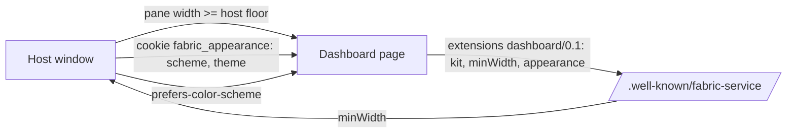

# Embedded dashboard `fabric-dashboard/0.1`

DEC-0036 · declaration schema [`service-dashboard-extension.schema.json`](../../schemas/service-dashboard-extension.schema.json)
· builds on [`fabric-service/0.1`](service.md) (`surfaces.dashboard`, [Operator login](service.md#operator-login))

A service's dashboard is a web page, and a host shows it **inside** its own window: Fabric
Dashboards puts the page in a pane beside its sidebar and the agent console, and the operator
drags that console wider whenever they need it. The page cannot know how much room it will get,
and it must not break when the room changes. This profile is what a page promises about width,
navigation, scrolling and appearance, and what a host promises in return. It is a layout and
appearance contract only; how the page is reached and signed in stays in
[`fabric-service/0.1`](service.md).

The key words MUST, MUST NOT, SHOULD and MAY are used as in RFC 2119. A *CSS pixel* is the page's
own `px`, after any zoom the host applies. *Viewport width* is `document.documentElement.clientWidth`.

## The page

**ED-1 — The floor.** A page MUST be fully usable at every viewport width from its *floor* up: 360
CSS pixels, or the larger `minWidth` it declares (ED-9). At and above the floor the document MUST
NOT scroll horizontally: `document.documentElement.scrollWidth` ≤ viewport width + 1. Text keeps a
readable measure; no column is squeezed to a word per line.

**ED-2 — Below the floor.** A page MUST keep its floor layout when the viewport is narrower than
its floor, and let the document scroll horizontally (for example `min-width: 360px` on its root
element), instead of collapsing further. A host never relies on this (ED-7); a plain browser
window might.

**ED-3 — Navigation is always reachable.** Every primary destination of the page MUST be reachable
at every width at or above the floor without horizontal scrolling: the navigation wraps, or the
destinations that do not fit move into a visible *More* menu, or the navigation becomes one
labelled control (a menu button or a select). A strip of tabs that only scrolls sideways does not
satisfy this: on macOS and in many embedded views its scrollbar is hidden until it is used, so the
destinations past the edge cannot be discovered.

**ED-4 — Wide content scrolls in its own box.** A table, a calendar, a log, a code block or a chart
wider than the viewport MUST scroll inside its own container, never the document. The container
MUST show that it scrolls (an edge shade on the side that has more content, or an always-visible
scrollbar) and MUST be reachable by keyboard (`tabindex="0"` with an accessible name when it holds
no focusable element).

**ED-5 — One vertical scroller.** The document MUST be the page's only full-height vertical
scroller; a nested container that takes the whole viewport height and scrolls on its own MUST NOT
be used. Sticky chrome (a header and a navigation bar together) MUST NOT take more than 120 CSS
pixels or a quarter of the viewport height, whichever is less. A jump to an anchor MUST land below
the sticky chrome (for example `scroll-margin-top` equal to its height). A data refresh MUST keep
the scroll position and the focus.

**ED-6 — Appearance follows the host.** A page MUST follow `prefers-color-scheme` when nothing else
is set, and MUST render correctly with neither a cookie nor a stored preference. When the cookie
`fabric_appearance` (ED-8) is present, its values take precedence over the page's own stored
preference, and the page MUST hide its own scheme and theme controls while it is: the host owns
appearance then. An unknown `theme` is ignored and the page's default theme is used. Meaning is
never carried by colour alone, in any theme.

## The host

**ED-7 — The host floor.** A host that shows a dashboard beside other panes MUST give the page at
least `max(480, minWidth)` CSS pixels whenever its window allows it: the other panes (a console, a
sidebar) stop growing at that limit, or shrink to their own minimum first. When the window cannot
fit both the page's floor and the panes' minimums, the host keeps the panes' minimums and the page
falls back to ED-2. A host MUST NOT scale or zoom a page to make it fit. The 480 applies to every
dashboard, declared or not: a page built before this profile was never told it could be narrower.

**ED-8 — The appearance carrier.** A host that offers the operator a colour scheme or a theme MUST
carry the choice to the page as the cookie `fabric_appearance`, set in the page's own storage
partition on the service origin, with path `/`, `SameSite=Strict`, not `HttpOnly` (the page's
script reads it) and `Secure` on an `https` origin. Its value is form-encoded:

| Field | Value | Meaning |
|---|---|---|
| `v` | `1` | the carrier version; a page ignores a cookie whose `v` it does not know |
| `scheme` | `light` or `dark` | the colour scheme the operator chose in the host |
| `theme` | a theme id, `^[a-z][a-z0-9-]{0,31}$` | the operator's theme; open vocabulary, the reference set is below |

Example: `fabric_appearance=v=1&scheme=dark&theme=ocean`. The cookie carries no secret and no
identity; a host MUST NOT put anything else in it. A host that also controls the page's
`prefers-color-scheme` (Electron `nativeTheme`, for example) SHOULD keep the two in agreement.
When the operator changes the choice, the host rewrites the cookie; a page SHOULD apply the change
without a reload when the cookie changes (`cookieStore` `change` where it exists) or when it
becomes visible again, and a host MAY reload a page that does not declare `appearance` (ED-9).

## The declaration

**ED-9 — Declaring the profile.** A service whose dashboard meets ED-1…ED-6 SHOULD say so in its
[well-known document](service.md#well-known-document), under `extensions`, with the key
`https://fabric.passioncode.ai/agent-contract/extensions/dashboard/0.1` and a value valid against
[`service-dashboard-extension.schema.json`](../../schemas/service-dashboard-extension.schema.json):

| Field | Required | Meaning |
|---|---|---|
| `minWidth` | yes | the page's floor in CSS pixels, 360…1280; a host floor of `max(480, minWidth)` follows from it |
| `appearance` | no | which carrier fields the page applies: any of `scheme`, `theme` |
| `themes` | no | the theme ids the page ships, so a host can offer only those |
| `kit` | no | the dashboard kit the page is built from, `name@semver` (`fabric-dashboard-kit@1.0.0`), so a host or an agent can tell a page built from an older kit |

`extensions` is preserved and ignored by a reader that does not know the key
([Descriptor](service.md#descriptor)), so a host built before this profile is unaffected. A
service that does not declare the key is a *legacy dashboard*: ED-7's 480 still protects it, and a
host promises it nothing else.

**ED-10 — Reference themes.** The theme ids `graphite` (the default), `fabric`, `paper`, `forest`,
`ocean`, `ember` and `contrast` are the reference set; each has a light and a dark variant. A page
that ships a theme with one of these ids MUST keep its character (graphite: neutral grey with one
blue accent; fabric: the PassionCode.ai violet; paper: warm cream; forest: green; ocean: teal and
blue; ember: warm orange; contrast: maximum contrast, no tints) and MUST meet WCAG 2.2 AA in both
variants: 4.5:1 for body text and 3:1 for large text, borders that carry meaning and focus rings,
against the surfaces they sit on. Other ids are free for a page to define.

## How a page shows that it holds

The rules are checked by measuring a rendered page, not by reading its source. The adapter's
`check_dashboard_layout.mjs` (fabric-agent-adapter, `building-fabric-services`) loads the dashboard
at 360, 480, 768 and 1280 CSS pixels and reports ED-1 (document overflow), ED-3 (every navigation
link visible or inside an open-able menu), ED-4 (overflowing boxes that are not scroll containers)
and ED-5 (sticky chrome height); its `check_service.py` checks the ED-9 declaration against the
schema. A rule a tool cannot measure is reported `NOT_RUN` with its reason, never as a pass.

## Not decided here

- The host's picker: where a host lets the operator choose a scheme and a theme, and whether a
  choice can be made per service. Fabric Dashboards owns that screen.
- Themes defined by the operator (their own colours) beyond choosing an id; a later revision may
  add an `accent` field to the carrier.
- A dashboard that wants a fixed width, or several panes of its own inside the host's pane.
- Zoom: a host's zoom control, if it ever has one, changes the CSS pixel and nothing here.
