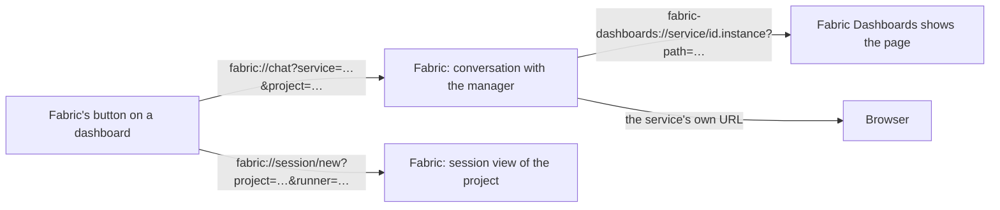

# Fabric's button and `fabric://` links

DEC-0040 · Fabric 0.4.0 REQ-42 · schema [`fabric-link.schema.json`](../../schemas/fabric-link.schema.json) · rule code
`FAC-SEM-052` · parser and builder [`src/fabric-links.ts`](../../src/fabric-links.ts) · builds on
[`fabric-dashboard/0.1`](embedded-dashboard.md) and [`fabric-service/0.1`](service.md)

A product's dashboard MAY show **Fabric's button**: one floating button that opens Fabric, the CEO agent, on
that product. It opens a conversation with Fabric about the service and its project, or a coding-agent session
in the project. Fabric opens the product back through Fabric Dashboards or the product's own address. This
profile says what the button is, what its links look like, what opening one may do, and what happens when
Fabric is not installed. The button and its links carry ids only; following a link opens a view and starts
nothing by itself.

The key words MUST, MUST NOT, SHOULD and MAY are used as in RFC 2119. A *CSS pixel* is as in
[`fabric-dashboard/0.1`](embedded-dashboard.md).



## The button

**FB-1 — Optional, one per view.** A dashboard MAY show Fabric's button. At most one is visible in a view: a
host that draws its own Fabric button beside a page it embeds tells the page so with the cookie
`fabric_button` (FB-6), and the page then hides its own.

**FB-2 — Placement.** The button is fixed to the bottom-right corner of the viewport (bottom-left in a
right-to-left document), 16 CSS pixels from both edges plus the safe-area insets. It sits above the page's
content and sticky chrome and below the page's own dialogs and the host's. It MUST NOT hide content for good:
the page leaves the button's height plus 16 CSS pixels free at the end of its scroll, so the last row scrolls
clear of it. It holds at the page's floor (ED-1) and does not count as sticky chrome (ED-5).

**FB-3 — Label and name.** The button shows the Fabric mark and the word **Fabric**; below a 480 CSS pixel
viewport it MAY show the mark alone. Its accessible name is **Open Fabric** in every case, and its target is at
least 44 × 44 CSS pixels. Its colours come from the page's theme tokens and follow the host's appearance
(ED-6, ED-8); its text meets 4.5:1 and its boundary 3:1 against the page (WCAG 2.2 AA), and its meaning is
never carried by colour alone.

**FB-4 — A menu of two actions.** The button is a menu button (`<button type="button" aria-haspopup="menu"
aria-expanded>`). Pressing it, or Enter or Space on it, opens a menu:

| Item | Shown when | Opens |
|---|---|---|
| **Chat with Fabric about** *the service's name* | always | the chat link of the service, with the project when the page knows it |
| **Open a coding session in** *the project's name* | the page knows its project | the session link of the project |

The first item takes focus when the menu opens; arrow keys move between items; Escape closes the menu and
returns focus to the button. With reduced motion requested, the menu appears without animation. A page with
only the first item MAY open the chat link directly from the button (then without `aria-haspopup`).

**FB-5 — When Fabric is not installed.** When the page knows Fabric is absent, or after following a link the
page is still visible and focused 1 500 ms later, the button's menu shows, instead of the actions or under
them, exactly:

> Fabric is not installed — get it at passioncode.ai/fabric

where *passioncode.ai/fabric* links to `https://passioncode.ai/fabric`, opened in a new browsing context with
`rel="noopener"`. The page never downloads anything by itself and never retries a link in a loop. A page knows
Fabric is absent from the host's `fabric_button` cookie (FB-6) or, for a local service, from its own server,
which MAY check whether the hub document of [Fabric's lifecycle](https://github.com/passioncode-ai/fabric/blob/main/AGENTS.md#lifecycle)
exists. A web page cannot see which URL schemes a computer handles, so without either signal it falls back to
the 1 500 ms test.

**FB-6 — The host's cookie.** A host that embeds a dashboard MAY set the cookie `fabric_button` on the page's
origin, with the attributes of the appearance carrier (ED-8: path `/`, `SameSite=Strict`, not `HttpOnly`,
`Secure` on `https`). Its value is form-encoded:

| Field | Value | Meaning |
|---|---|---|
| `v` | `1` | the version; a page ignores a cookie whose `v` it does not know |
| `owner` | `host` or `page` | `host`: the host draws Fabric's button itself, and the page hides its own; `page`: the page may show its own |
| `fabric` | `present` or `absent` | whether Fabric is installed on this computer, when the host knows |

It carries no secret and no identity. The appearance cookie `fabric_appearance` is unchanged and carries
nothing of this.

**FB-7 — The kit ships it.** The dashboard kit (fabric-agent-adapter, `fabric-dashboard-kit`) ships one
component that implements FB-1…FB-6 and builds its links with the grammar below. A page that shows the button
SHOULD use it rather than draw its own.

**FB-8 — A press opens a view, nothing more.** Any page can emit a `fabric://` link, so following one MUST NOT
send a message, start a process, start a runner or spend money. Fabric opens the view and the person acts inside
it. Opening the view of a session that is already running is opening a view.

## Deep links

The grammar, after RFC 3986:

```text
fabric-link = "fabric://" action [ "/" ] [ "?" query ] [ "#" fragment ]
action      = "chat" / "session/new"
query       = param *( "&" param )      ; application/x-www-form-urlencoded
param       = name "=" value
```

| Action | Parameter | Required | Value |
|---|---|---|---|
| `chat` | `service` | `service`, `project` or both | an agent id: a service id, optionally `.instance` (`^[a-z][a-z0-9-]{1,62}(\.[a-z][a-z0-9-]{0,31})?$`) |
| `chat` | `project` | | a project id or slug (`^[A-Za-z0-9][A-Za-z0-9._:-]{0,127}$`: no slash, no space) |
| `session/new` | `project` | yes | a project id or slug |
| `session/new` | `runner` | no | a runner kind from the [runner catalogue](runners.md) (`^[a-z][a-z0-9-]{1,62}$`) |

Examples: `fabric://chat?service=example-agent.default&project=project-a`,
`fabric://session/new?project=project-a&runner=claude-code`.

**FL-1 — Shape.** The scheme is case-insensitive (RFC 3986 §3.1); the action is lowercase and exact. A trailing
slash and a fragment are ignored, except that a fragment carrying a credential refuses the link (FL-4). A link is at most 2 048 characters.

**FL-2 — Unknown parameters are ignored.** A parameter the action does not define is ignored, so a newer page
works with an older Fabric. The parser lists what it ignored.

**FL-3 — Known parameters are validated.** Each known parameter is percent-decoded and then checked against its
grammar. A repeated known parameter, a value outside its grammar, a missing required parameter or an unknown
action refuses the whole link: Fabric comes to the front, says the link was refused and why, and does nothing
else.

**FL-4 — Never a secret, never words to act on.** A link carries ids only: never a token, a login code, a key,
a password, a cookie or a session id, and never a prompt or an instruction. The whole link is refused, even
when the action does not define the parameter (`FAC-SEM-052`), when:

- a parameter's name can only carry a credential, in snake_case, kebab-case or camelCase (`api_key`,
  `authToken`, `clientSecret`, `privateKey`, `refreshToken`, `sessionToken`);
- a parameter's name carries words to act on (`prompt`, `message`, `text`, `instruction`, `initialPrompt`);
- a value is shaped like a credential (a JWT or JWS, `Bearer …`, a provider key);
- the fragment carries a credential (`#access_token=…`, a JWT). The fragment is otherwise ignored.

`SECRET_NAME`, `PROMPT_NAME` and `SECRET_VALUE` in [`src/fabric-links.ts`](../../src/fabric-links.ts) are the
names and shapes refused.

**FL-5 — What Fabric opens.**

- `chat`: the conversation with Fabric, the manager session, scoped to that service, that project or both;
  created empty when none exists. Nothing is sent.
- `session/new`: the project's coding-agent session view with that runner chosen, or the project's live
  session in that runner. An unknown or uninstalled runner falls back to the project's default runner, and
  Fabric says so. The runner starts only when the person starts it (FB-8).
- A service or project Fabric does not know is named as unknown with a choice of the known ones; Fabric never
  guesses.

**FL-6 — Built by the kit.** `buildFabricLink` refuses to produce a link the grammar refuses, and
`parseFabricLink` is the reader Fabric applies. Both are in [`src/fabric-links.ts`](../../src/fabric-links.ts).

## The link back

**FL-7 — Fabric opens a product's page** through Fabric Dashboards when it is installed:
`fabric-dashboards://service/<id>.<instance>?path=<percent-encoded path>`, the `open_link` that Fabric
Dashboards' `link` tool returns, which shows the page inside Fabric Dashboards, signed in by the host. Otherwise
Fabric opens the service's own address — its `https` origin, or `http://127.0.0.1:<port>`, with the path — in
the browser. Neither carries a token or a login code: signing in is the host's
([Operator login](service.md#operator-login)). The `fabric-dashboards://` grammar is Fabric Dashboards'; this
profile only uses it.

## Hosts

Fabric Dashboards is the first host (its row FD-45). It draws Fabric's button over the service page it shows
and sets `fabric_button` with `owner=host`, so the page hides its own.

## Semantic rules

| Code | Kind | Rule |
|---|---|---|
| `FAC-SEM-052` | `deep-link` | a `fabric://` link has a known action, its required parameters, each known parameter once and within its grammar, and no parameter that can carry a credential |

Fixtures: the `fabric-link-*` entries of [`fixtures/catalogue.json`](../../fixtures/catalogue.json) and
`fixtures/semantic/deep-link-*`; tests: [`test/fabric-button.test.ts`](../../test/fabric-button.test.ts).

## Not decided here

- A message or prompt prefilled by a chat link: refused today, because a link carries ids only (FL-4).
- Links for other Fabric views (a task, an approval request, a grant).
- A per-service choice to hide the button, and where a host offers it.
- Links followed on a phone: a custom scheme opens on the device that receives it.
