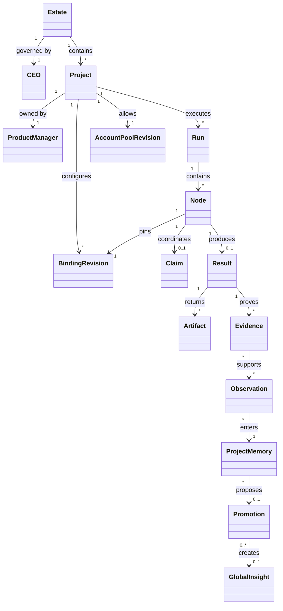

# Fabric Agent Contract 0.1.0

> Normative terms **MUST**, **MUST NOT**, **SHOULD**, **SHOULD NOT** and **MAY**
> express conformance obligations. Examples are non-normative.

`covers: REQ-001, REQ-002, REQ-003, REQ-006, REQ-013`

## Purpose

The Fabric Agent Contract lets an independently implemented provider participate
in a Fabric estate without sharing its internal agent loop, model, storage or
deployment. It defines a common description, admission, binding, execution,
evidence and governance layer over existing transports.

The contract version is `0.1.0`. All canonical JSON Schema identifiers begin
with `https://fabric.passioncode.ai/agent-contract/0.1.0/`.

## Using the schemas

**A schema's `$id` is a name, not a location.** Nothing is served at
`https://fabric.passioncode.ai/agent-contract/0.1.0/schemas/…`, and a validator that tries to fetch a `$ref` from there
fails. The same `$id` also names a different text at another commit, because additive changes stay under `0.1.0`
(DEC-0016): what a `$id` means is the file at the commit you pin ([one contract pin](versioning.md#one-contract-pin)).

To validate a document, load the files of [`schemas/`](../../schemas/) from your pinned checkout and register each
under its own `$id`, so that every `$ref` resolves locally:

- with ajv (JavaScript), compile against `Ajv2020` and call `addSchema` for every file, as
  [`src/validator.ts`](../../src/validator.ts) does;
- with Python's `jsonschema`, build a `referencing.Registry` from the files, keyed by `$id`;
- in an editor, map the document to the local schema file (VS Code: `json.schemas` with a `fileMatch` and a `url` that
  is a path in your checkout), never to the `$id` URL.

**`format` must be asserted.** Draft 2020-12 treats `format` as an annotation unless the validator is told to check it,
and the contract's schemas rely on it for `uri`, `date-time` and other members. With ajv add
`ajv-formats` (this repository uses its version 3, [`package.json`](../../package.json)); with `jsonschema` pass a `FormatChecker`. A validator
that skips `format` accepts documents this repository's checker refuses. This repository's validator,
[`src/validator.ts`](../../src/validator.ts), asserts it.

## Conformance subjects

| Subject | Conforms when |
|---|---|
| Provider declaration | its manifest and referenced objects validate and its declared profile is internally consistent |
| Provider implementation | wire negotiation and mandatory semantic probes pass for an exact declared revision |
| Host | it enforces admission, binding, coordination, governance and evidence rules without relying on provider internals |
| Project configuration | all mutable choices are immutable revisions, references resolve, and role cardinality holds |
| Result | envelope shape validates and every proof or artifact URI resolves under the caller's authorization |

Shape conformance is necessary but not sufficient for implementation admission.

## Common identity and references

- Object IDs MUST be absolute URIs.
- Revisioned objects MUST carry `revision`, `contentHash`, `createdAt` and
  `createdBy`.
- `contentHash` MUST use `sha256:<64 lowercase hexadecimal digits>` over the
  RFC 8785 canonical JSON of the object with `contentHash` omitted
  ([canonical forms](conformance.md#canonical-forms), DEC-0043). Fabric's hub-call references write a
  `contentHash` over a joined string (`apps/desktop/src/main/hubCall.ts:311`, `:323` at `487ef5b0`) and do not
  conform; Fabric's board row is CT-26.
- References MUST name an immutable object ID and revision. A moving alias MAY be
  used for discovery but MUST resolve before a run starts.
- Times use RFC 3339 UTC strings.
- Provider-private chain-of-thought is never a contract field.

## Object relationships

## Profiles

- **MCP capability profile:** a host invokes declared MCP tools or reads declared
  resources. The provider does not own the overall project task.
- **A2A peer profile:** an autonomous peer advertises an A2A Agent Card and owns
  an opaque task lifecycle that returns messages and artifacts.
- **Local runner profile:** a project-approved terminal adapter starts a local
  agent command in a constrained execution context.

The provider chooses the model, within the model classes the project allows. Model profiles, runner profiles and
the model catalogue are contract objects since DEC-0046 ([runners](runners.md#runner-and-model-profiles)); other
model metadata a provider exposes is an extension, and hosts MUST NOT depend on it for base conformance.

## Base role invariants

- An estate MUST have exactly one active `ceo` assignment.
- Each project MUST have exactly one active `product-manager` assignment.
- Each project MUST have at least one active `developer` assignment before a
  development node can become runnable.
- All other roles are optional registry values and MUST NOT alter the three base
  cardinality rules.

## Extension rule

Extension properties use an absolute-URI key under `extensions`. A host MUST
preserve unknown extensions it stores or forwards and MUST NOT treat an unknown
extension as satisfying a normative field. Breaking base-schema changes require a
new major contract version.
