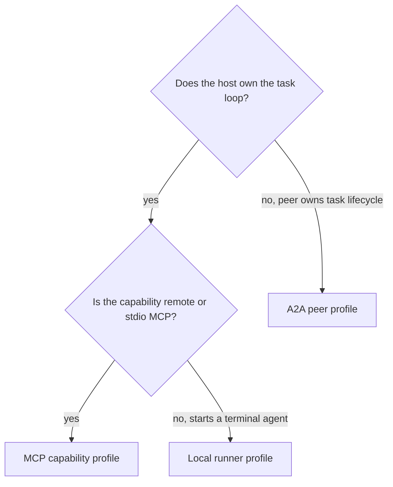

# Compatibility profiles

`covers: REQ-003, REQ-004, REQ-012, REQ-015`

Pinned upstream sources are listed in [the external source ledger](../evidence/sources.md).
The author path is SCN-001 and SCN-002.

## Common declaration

Every manifest declares one provider, one or more capabilities, and exactly one
profile per capability. A capability has a stable semantic name, input and output
schema references, side-effect class, idempotency declaration and required data
classifications.

## MCP capability profile

The profile MUST declare:

- MCP revision `2026-07-28` for contract 0.1.0, in the member `protocolRevision`;
- connection mode `streamable-http` or `stdio`;
- server identity and discovery endpoint or command reference;
- required MCP tools/resources/prompts by exact name;
- Fabric semantic probes, each with bounded input and a result assertion.

The host performs MCP initialization and capability negotiation before probes.
Missing negotiated capability or declared tool is `protocol-incompatible`.
Semantic probe failure is `probe-failed`, not a transport failure.

OAuth browser consent remains client-local and MUST NOT be converted into a
static gateway credential. Stdio environment values use secret references only.

**Where a stdio server is declared (DEC-0044, LC-19).** A stdio connection MAY carry a `scope`, and a
[provider entry's](provider.md) `run.mcp.stdio` the same field:

- `project`: a host starts the server for the sessions of a project that binds the capability, from that project's
  MCP configuration (for Claude Code, the project's `.mcp.json`);
- `on-demand`, the default when `scope` is absent: a host starts it for the run that binds the capability and stops
  it when that run ends — a [session handoff's](session-handoff.md) `mcp.json` is one such run;
- `session` means every session the host starts, and `FAC-SEM-056` refuses it. A host MUST NOT write a declared stdio
  server into a runtime's user-wide MCP configuration, whatever the scope says.

A server that holds no per-session state SHOULD NOT be a stdio server at all: it runs once on the machine as a
[service](service.md) whose MCP surface is `streamable-http`, under its supervisor and the machine's lifecycle broker,
with its well-known document as the health check. One copy per session is right only for a server that holds that
session's state, such as a browser or a project index. On 2026-10-11 about 35 sessions each held their own copies of
five stdio servers, about 10 GB of memory (fabric-workspace `knowledge/lifecycle.md` LC-19). Claude Code plugin
configurations are not contract documents; the adapter checks them.

## A2A peer profile

The profile MUST declare:

- A2A version `1.0` for contract 0.1.0, in the member `protocolVersion`;
- an HTTPS Agent Card URL, normally `/.well-known/agent-card.json`;
- the exact Agent Card skill IDs used to satisfy Fabric capabilities;
- supported binding (`REST`, `JSON-RPC` or `gRPC`) and optional streaming/push;
- task-state mapping and cancellation behavior — a host-side expectation of the A2A peer, not a manifest field (DEC-0064);
- Fabric semantic probes.

The A2A task is opaque to Fabric except for protocol-visible messages, artifacts,
status and evidence explicitly returned. A provider MUST NOT be required to
expose internal planning or model reasoning.

## Local runner profile

The profile MUST declare:

- profile revision `fabric-local-runner/0.1`, in the member `profileVersion`;
- runner kind (`runnerKind`): one of the shared kind names of [runners](runners.md), such as `claude-code`, `codex`,
  `cursor-agent` or `gemini-cli`, which are also the ids of
  [`catalogue/coding-agents.json`](../../catalogue/coding-agents.json); a runner not listed there takes a new name on
  the runners page before a host ships it;
- executable reference and argument template with typed placeholders;
- input mode and result-envelope location;
- supported cancellation and heartbeat behavior;
- required execution-context capabilities — a host-side expectation the host checks against the execution context, not
  a manifest field (DEC-0064).

The project chooses a default local runner. An agent binding MAY override it only
with a provider admitted to that project. The provider chooses the model within the project's allowed classes:
the model profile comes from the request, else the agent, else the binding or project, else the estate default, and
the project's spend policy restricts it and never chooses ([runners](runners.md#runner-and-model-profiles),
DEC-0046).

A project MAY pin an ordered runner route per capability served by this
profile (see [Runner routes](runners.md#runner-routes)): the host tries each
admitted terminal runner in preference order — attaching to a session it
already holds before spawning a new one, never to a process it did not start —
and falls back to the next candidate when one is unavailable. A binding MAY pin
a route revision (`runnerRoute`) to override the project default for one agent;
its `provider` is then one of the route's candidates (`FAC-SEM-032`). A route
changes which runner serves a request, never the capability semantics, the
profile, the write scope or the provider's model choice.

Commands MUST be represented as an executable plus an argument array. Shell
strings are non-conforming because quoting and command substitution cannot be
validated safely.

## No secret in a command line

`DEC-0044`, LC-21. A key reaches a process through its environment (a secret reference the host resolves at start,
DEC-0013), a `0600` file or the vault — never its arguments, which `ps` and every process listing show to the whole
user, and never a URL, which lands in logs and configuration files. On 2026-10-11 a plugin's MCP passed its bearer
key to `mcp-remote` in argv (fabric-workspace `knowledge/lifecycle.md` LC-21).

`FAC-SEM-057` applies the shared detector, [`src/secret-shape.ts`](../../src/secret-shape.ts), to every launch argument
and MCP entry a contract document declares ([connections](connections.md) use a variant of it; CT-73 holds whether
the two become one):

| Document | Read |
|---|---|
| manifest, `mcp` profile | `connection.args`, `connection.executableRef`, `connection.url` |
| manifest, `local-runner` profile | `args`, `executableRef` |
| [provider entry](provider.md) | `run.mcp.stdio.command`, `run.mcp.url` |
| [runner catalogue](runners.md) | each runner's `version.argv`, `auth.argv` and every drive's `argv` |
| [service descriptor](service.md#descriptor) | every `commands` entry |

An argument is refused when it holds a JWT, a provider key's shape, `Bearer <token>` anywhere in it, or a run of 40
or more base64 characters mixing upper case, lower case and digits; a path's separators split such a run, so a folder
named by a session id passes. A URL is refused for the same, for a password in its user information, and for a query
or fragment parameter whose name can only carry a credential (DEC-0041's whole-word names: `api_key`, `token`) and
has a value. An argument is also refused for its name: `--token=…`, `API_KEY=…`, or a credential-named flag followed
by a value (`--api-key x`). The finding names the place, never the value. Known limits: DEC-0041's single words
alone in a query (`?code={code}`, `?session=1`, `?key=v`) and a mixed-case id of 40 or more characters in a path
segment are refused although harmless; a token in a URL's user name alone is not found. [Session handoff](session-handoff.md) SH-10 applies the
same detector to a launch's arguments.

## Profile selection

A provider exposing both MCP tools and an A2A peer declares two capabilities and
two profiles. One capability MUST NOT switch transport at runtime without a new
binding revision.

## Degradation

- Unreachable discovery endpoint: provider stays `discovered` with a transient
  finding; exponential retry is bounded by host policy.
- Unsupported protocol revision: reject before credentials or project context.
- Partial advertised features: admit only capabilities whose required probe set
  passes; never silently weaken the capability.
- Lost heartbeat: stop issuing new work, request cancellation where supported,
  expire the coordination claim, then reconcile residue.

## Semantic rules

| Code | Kind | Rule |
|---|---|---|
| `FAC-SEM-056` | `manifest`, `provider-entry` | a stdio MCP server is declared for a project or on demand, never for every session (`scope: session`) |
| `FAC-SEM-057` | `manifest`, `provider-entry`, `runner`, `runner-catalogue`, `service-descriptor` | no declared launch argument or MCP entry carries a credential |

Fixtures: `fixtures/semantic/stdio-scope-*.json`, `fixtures/semantic/command-line-*.json`; tests:
[`test/service-hygiene.test.ts`](../../test/service-hygiene.test.ts).
