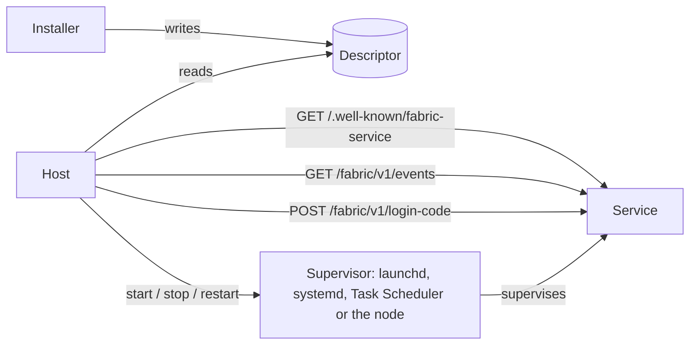

# Service extension `fabric-service/0.1`

`covers: REQ-S01, REQ-S02, REQ-S03, REQ-S04, REQ-S05` — see the
[run brief](../evidence/specs/2026-09-28-fabric-service-brief.md) · DEC-0015;
`covers: REQ-R01…REQ-R05` — [remote placement brief](../evidence/specs/2026-10-02-remote-service-brief.md) · DEC-0019;
settings backup and the feed client's token header · DEC-0025; one copy under every supervisor, the lifecycle per
system and the Windows token-file reader · DEC-0057; the descriptor for listings — a service offered to others, the
kind of its runner's sign-in, who installed it, and Project Observatory's node as supervisor · DEC-0061

A **service** is a long-running agent process — on the operator's own computer (a **local**
placement) or online at an `https` origin (a **remote** placement, [below](#remote-placement)): it keeps
state, answers other agents, and usually shows a dashboard. This extension says how a
service is found, how it reports that it is alive, how it is started and stopped, how
an operator is let into its dashboard, and how it reports what it did. It lets a host
such as Fabric Dashboards watch every service on a machine without knowing any of them
in advance.

The extension key is `https://fabric.passioncode.ai/agent-contract/extensions/service/0.1`.
A provider that is also a service MAY carry that key under `provider.extensions` in its
manifest with the value `{ "descriptor": "<id>.<instance>" }`. A service with no
capabilities needs no manifest.

When the descriptor names a manifest (`fabricManifest`), the two MUST name each other:
that manifest carries the service key with `descriptor` equal to the descriptor's
`<id>.<instance>` (`FAC-SEM-020`, G-07). The key's one spelling is the constant in
[`src/extensions.ts`](../../src/extensions.ts); the manifest schema validates the
block's shape.

**Discovery grants nothing.** A descriptor makes a service visible to the operator who
installed it; it grants no Project access and does not replace admission or binding
([registry](registry.md)).

The key words MUST, MUST NOT, SHOULD and MAY are used as in RFC 2119.



## Descriptor

Schema: [`service-descriptor.schema.json`](../../schemas/service-descriptor.schema.json).

### Minimal local descriptor

The smallest descriptor a local service installs, here for a service supervised by launchd on macOS:

<!-- example: service-descriptor.schema.json kind=service-descriptor -->

```json
{
  "protocol": "fabric-service/0.1",
  "id": "example-agent",
  "instance": "default",
  "name": "Example Agent",
  "origin": "http://127.0.0.1:47195",
  "auth": { "tokenFile": "~/.config/example-agent/service.token" },
  "lifecycle": {
    "manager": "launchd",
    "label": "com.example.example-agent",
    "plist": "~/Library/LaunchAgents/com.example.example-agent.plist"
  },
  "paths": {
    "data": "~/Library/Application Support/example-agent",
    "logs": ["~/Library/Logs/example-agent/service.log"]
  },
  "installedAt": "2026-10-21T09:00:00Z",
  "installedBy": "example-agent service install 0.1.0"
}
```

<!-- required-members: service-descriptor.schema.json -->

| Member | Required | What it holds |
|---|---|---|
| `protocol` | yes | `"fabric-service/0.1"` |
| `id` | yes | the service's slug, `^[a-z][a-z0-9-]{1,62}$`, the same on every machine |
| `instance` | yes | which copy on this machine, `default` for the first |
| `name` | yes | what a host shows, at most 80 characters |
| `auth` | yes | `tokenFile`, where the token is; optionally the `header` it travels in and its `scheme` (below) |
| `lifecycle` | yes | the one supervisor (`manager`) and its own names: launchd's `label` and `plist`, systemd's `unit`, the Task Scheduler's `task`, an app's `app` |
| `installedAt` | yes | when it was installed, RFC 3339 |
| `installedBy` | yes | the installer and its version, or `{by, role?, tool}` |
| `origin` | local placement | `http://127.0.0.1:<port>`; an app's descriptor may leave it out |
| `paths` | local placement | `data` and `logs` |

**The token's header.** `auth.header` names the header the token travels in. Absent, it is `Authorization` with
`auth.scheme: "Bearer"`. A custom header, any other name, MUST carry `auth.scheme: "none"`: the token is then the
header's whole value, with no `Bearer` before it (schema).

An installer MUST write one descriptor per installed service instance, and its
uninstaller MUST remove it. The running service MUST NOT write its own descriptor: the
descriptor describes an installation, not a run. The one exception is an app, below.

<a id="an-apps-descriptor"></a>

**An app's descriptor (DEC-0069).** An app a person installs and starts — a desktop app such as Fabric — has no
supervisor to write its descriptor. It carries `lifecycle.manager: "person"` with `lifecycle.app`, the installed app
(a bundle or an executable), and no `label`, `plist`, `unit` or `task` (schema). Its installer writes the descriptor;
when the installer cannot (a macOS app dragged into Applications), the app writes it on a start where none exists,
where its own version differs from `installedBy.tool` (an update is a reinstall) or where it runs from another path
than `lifecycle.app` (a moved app), and rewrites nothing on any other start ([`appDescriptorAction`](../../src/app-descriptor.ts)).
An app running from a translocated copy (macOS App Translocation runs a quarantined app from a randomised read-only
path) never records that path. Only an app that writes its own descriptor runs this; a descriptor an installer wrote is
the installer's to update. `installedBy` is the object form
`{by: "person", role, tool}`, `tool` naming the installer, or the app and its version (schema). It is removed at
uninstall when it can be; a reader that does not find `lifecycle.app` treats the descriptor as stale
(`appDescriptorStale`). **The descriptor says the app is installed, never that it runs.** `origin` is optional for an
app, because its live origin changes from start to start: the app keeps its own liveness file, rewritten on every start
and removed on quit, with its origin and process id. A kit that shows an "Open in <app>" button reads the descriptor;
a caller that sends anything reads the liveness file and checks the process. An app's descriptor without an origin
claims no port (`FAC-SEM-010`). Vectors: [`fixtures/vectors/app-descriptor.json`](../../fixtures/vectors/app-descriptor.json).

| Platform | Services directory |
|---|---|
| macOS | `~/Library/Application Support/ai.passioncode.fabric/services/` |
| Linux | `${XDG_DATA_HOME:-~/.local/share}/passioncode-fabric/services/` |
| Windows | `%LOCALAPPDATA%\passioncode-fabric\services\` (DEC-0032; LOCALAPPDATA, so token files never roam) |
| any | the value of `FABRIC_SERVICES_DIR` when set |

- The file name MUST be `<id>.<instance>.json`, written atomically (temporary file,
  `fsync`, rename) with mode `0600`.
- `channels.local` MAY name where a client reaches the service's local channel (`{protocol, path | pipe}`; Project
  Observatory's node, [local channel](local-channel.md), DEC-0075); a client never computes that path.
- `id` and `instance` together MUST be unique on the machine. A second copy of the same
  service (a preview, a branch build) MUST be a second `instance`, never a second `id`.
- `placement` is `local` (the default when absent) or `remote`. Every rule in this document
  applies to a local placement; [Remote placement](#remote-placement) states what changes for a
  remote one.
- For a local placement `origin` MUST be `http://127.0.0.1:<port>`; only an app's descriptor may omit it (above). **A port is a claim:**
  before writing, an installer MUST read every descriptor in the directory and refuse a port
  that another local `id.instance` already declares. Semantic rule `FAC-SEM-010` checks a
  directory; a remote origin claims no port here.
- Paths MAY start with `~/`, and on Windows with `~\`, `C:\` or `C:/` (DEC-0032); a command's executable
  follows the same grammar (`FAC-SEM-012`). Commands MUST be argument arrays; a shell string is
  invalid, as for the local runner ([profiles](profiles.md)). No argument carries a credential
  ([profiles](profiles.md#no-secret-in-a-command-line), `FAC-SEM-057`).
- Only two commands are defined: `doctor` and `update`. A host MUST NOT run any other
  command a descriptor lists.
- A host MUST preserve and ignore unknown `extensions`.
- `installedBy` says who installed the instance (DEC-0061): the installer and its version as a string, as before, or
  `{by, role?, tool}`. `by` is `person` — a person ran the installer or had their coding agent run it — with `role`
  `operator` (the person who uses this machine) or `administrator` (an organization's administrator); `node` — Project
  Observatory's node installed it from a placement in the person's [estate record](estate-record.md); or
  `organization` — the node installed it from an organization's listing. `role` is a person's only. `tool` is the
  installer and its version. It names a role, never a person: no name, address or account. A host shows it as where
  the service came from.
- `runner` says how the service's model calls are signed in (DEC-0061): `credentialKind` is `subscription` (the
  operator's own vendor login), `key` (an issued key), `platform-metered` (the hosting platform's own metered models,
  under the deployment's account) or `none` (no model calls). `kind` names a shared runner kind
  ([runners](runners.md)) and is required for a subscription, which runs only in its vendor's runner: `claude-code`,
  `kimi-code` or `codex` (DEC-0046). It is the kind of a credential, never the credential: `FAC-SEM-086` refuses a value
  shaped like one anywhere in `runner` or `installedBy`, with the shared detector
  ([profiles](profiles.md#no-secret-in-a-command-line)), naming the place and never the value.
- `peer` says the service is offered to others ([Offered to others](#offered-to-others)).

## Well-known document

Schema: [`service-well-known.schema.json`](../../schemas/service-well-known.schema.json).

### Minimal well-known document

The smallest answer to `GET /.well-known/fabric-service`, for the descriptor above:

<!-- example: service-well-known.schema.json kind=service-well-known -->

```json
{
  "protocol": "fabric-service/0.1",
  "service": {
    "id": "example-agent",
    "instance": "default",
    "name": "Example Agent",
    "version": "0.1.0",
    "build": { "commit": "8b80be9" }
  },
  "process": { "pid": 51234, "startedAt": "2026-10-21T09:00:05Z" },
  "status": "ready",
  "degraded": [],
  "surfaces": { "events": { "path": "/fabric/v1/events" } }
}
```

<!-- required-members: service-well-known.schema.json -->

| Member | Required | What it holds |
|---|---|---|
| `protocol` | yes | `"fabric-service/0.1"` |
| `service` | yes | `id` and `instance`, equal to the descriptor's (`FAC-SEM-009`); `name`; `version`; `build` with a `commit` or a `digest` |
| `process` | yes | the live process: `pid` and `startedAt` |
| `status` | yes | `starting`, `ready`, `degraded` or `stopping` |
| `degraded` | yes | the sources that do not work now; an empty list asserts full health |
| `surfaces` | yes | at least `events`; `dashboard`, `mcp` and `usage` when the service has them |

`GET /.well-known/fabric-service` MUST answer without authentication, from memory, in
under 100 ms, for a local placement. Host and Origin checks (below) still apply. A remote
placement requires the token here too ([Remote placement](#remote-placement)).

- `protocols` MAY list the protocol revisions the service accepts, N and N−1 per protocol; a request in another
  revision is refused with `schema-unsupported` ([versioning](versioning.md#protocol-revisions), DEC-0067).
- `service.id` and `service.instance` MUST equal the descriptor's. A different answer
  means another program holds the port; a host MUST report it as `foreign` and MUST NOT
  send it the descriptor's token (`FAC-SEM-009`).
- `service.build` MUST carry a commit or a package digest, so a host can tell a restart
  onto new code from one onto old code.
- `process.pid` and `process.startedAt` are the live process. A host compares the pid
  with its supervisor's to detect a second copy.
- `status` is `starting`, `ready`, `degraded` or `stopping`. A process that cannot
  serve does not answer; the host derives `down`.
- `degraded` MUST always be present. An empty list asserts full health. `status: ready`
  with a non-empty list is inconsistent (`FAC-SEM-011`).
- A `degraded` entry with `setup: true` is a **setup state**: the source waits for a person to finish setting it
  up — a key not entered, a model not chosen — and is not an outage (DEC-0044). It still names `source` and
  `reason`, the reason says what the person does, and it still makes the service `degraded`. A watcher MUST NOT open
  an outage alert for it; it shows the entry as waiting for a person. An entry without `setup`, or with `false`, is
  a failure. Fabric Dashboards' watcher messages the operator when a source stays degraded for more than 5 minutes
  (fabric-workspace `knowledge/authority.md`, *Telling the operator about outages*, 2026-10-11).
- `summary` carries at most six tiles for a host card; a tile with `attention: true`
  asks for the operator.
- `update.available` is a newer version the service knows about, or `null`.
- `surfaces.mcp.capabilities` MAY list the capability names the MCP surface serves, so
  a host can show them without the token; the manifest remains the authority
  ([interop C3.6](interop.md#c36-discovery-surface)).
- `surfaces.usage` MAY name the path of the service's usage report
  ([Usage report](#usage-report), DEC-0021).
- `extensions` MAY carry the [embedded dashboard](embedded-dashboard.md) declaration under
  `https://fabric.passioncode.ai/agent-contract/extensions/dashboard/0.1`: the page's floor width,
  the appearance it applies, its themes and its kit (ED-9, DEC-0036). How the page behaves inside a
  host (width, navigation, scrolling, appearance) is that profile's, not this one's. It MAY also carry what the
  agent uses under `https://fabric.passioncode.ai/agent-contract/extensions/connections/0.1`
  ([connections](connections.md), DEC-0096), and, for a service that queues, its load under
  `https://fabric.passioncode.ai/agent-contract/extensions/load/0.1` ([Load](#load), DEC-0104).
- `surfaces.operatorChannel` MAY name the path of the service's operator-channel status, which
  requires the service token ([operator channel](operator-channel.md) OC-9, DEC-0034). The
  channel's state never changes the service's `status` or `degraded` list.
- `configuration` MAY name what the operator can configure for this agent (`slots`: `runner`, `model`) and the
  profiles that apply now (`resolved`), read-only: a change is made in Fabric and reaches the agent through its
  binding ([runners](runners.md#what-an-agent-declares), DEC-0046).
- `auth.delegation` MAY say that the service accepts the estate's delegation tokens: the issuer it
  trusts and where it reads the estate's keys ([delegation](delegation.md) DL-16, DEC-0039). It is
  public: an issuer and a key-set location, never a key or a token.

## Events feed

Schema: [`service-events-page.schema.json`](../../schemas/service-events-page.schema.json).

`GET /fabric/v1/events?after=<cursor>&limit=<n>` MUST require the service token.

- `id` is opaque and MUST increase within one service instance. `cursor` is the last
  `id` returned, or `null` when the page is empty. Without `after`, the newest `limit`
  events are returned. `limit` defaults to 50 and MUST NOT exceed 200.
- A service MUST retain at least seven days or 1000 events, whichever is more.
- `text` MUST be one sentence a person can read without the service's source code.
- <a id="event-data"></a>`data` MAY carry the event's machine-readable fields (DEC-0070): `schema`, the absolute URI of
  a payload schema the service publishes (under its origin or its repository), and `value`, an object of at most 32
  members, each a scalar (a string of at most 500 characters, a number, a boolean, null), a list of at most 32 scalars
  or an object of at most 32 scalar members — two levels at most (schema). A host that ignores `data` loses nothing:
  `text` stays the sentence. A host validates `value` against `schema` when it knows that schema and otherwise treats
  it as opaque, and never fails the event for it. `data` never carries a secret or personal data: no string sits under
  a credential's name (a list's items and an object's members count under the outer name too) or has a credential's
  shape, a URL with a credential included (`FAC-SEM-101`, the shared detector); personal data is the service's
  duty, since no check can tell a name from another string.
- `notify: true` asks a host to raise an operator notification; `link` is a path under
  the service origin that the notification opens. The host MAY suppress it by the
  operator's settings.
- A service SHOULD implement the feed as a view over the log it already keeps rather
  than a second store.
- A service MAY offer `GET /fabric/v1/events/stream` (Server-Sent Events carrying the
  same event objects) and declare it in `surfaces.events.stream`.
- An event about work that was traced carries `traceId` and `spanId` together
  ([interop C3.4](interop.md#c34-trace)); an event about untraced work MUST NOT invent
  them (DEC-0017).

<a id="feed-client"></a>

**The feed client (DEC-0025).** A client of `GET /fabric/v1/events` MUST send the token in the
header that the descriptor's `auth.header` names (default `Authorization`), in the form that
`auth.scheme` names (default `Bearer`): with `none` the header carries the raw token, with `Bearer`
it carries `Bearer <token>`. It MUST NOT assume `Authorization: Bearer`, MUST NOT send the token
in any other header or in the URL, and reads the header name case-insensitively
(`FAC-SEM-036`; [`src/service-feed.ts`](../../src/service-feed.ts) `tokenHeader`). A client that
ignored a custom header was refused on every poll and silently dropped every `notify: true`
event, so a client SHOULD also report a refused poll as the service refusing its token rather
than as an empty feed. The same rule holds for every route that requires the service token.

## Usage report

Schema: [`service-usage.schema.json`](../../schemas/service-usage.schema.json). Optional; a
service that calls paid models or tools SHOULD offer it (DEC-0021).

`GET <surfaces.usage.path>` (conventionally `/fabric/v1/usage`) MUST require the service token
and answers what the service spent, self-reported from its own usage receipts, so a host can
show every agent's spend beside its health without knowing any provider.

- `days` covers at most the last 31 UTC days, oldest first, one entry per date, today last if
  there was activity today. A day without calls MAY be omitted. There is no paging and no query. Every date exists,
  is not after the UTC date of `generatedAt` and is at most 30 days before it (`FAC-SEM-025`, DEC-0065).
- Each day carries totals and `byModel` rows (`provider`, `model`); the totals are the sums of
  the rows, and a day without rows has no calls, tokens or cost (`FAC-SEM-025`). Tokens follow the interop `usage` block
  ([interop C3.2](interop.md#c32-jobs), `common.schema.json#/$defs/usage`): the same call reported in a job
  result and here is counted with the same measured numbers. A count a job result reported as `null` (DEC-0087)
  adds the lower bound the service measured, so the day's token totals are a lower bound. `unmeasuredCalls` (optional
  on the day and on each model row, absent meaning 0, DEC-0091) counts every call whose token count the service did not measure in full, whatever it wrote to its caller: a `null` to a fabric-interop/0.2 reader, the measured lower bound to a 0.1 reader, a number beside `partial: true`, or a call made outside a job. A host MUST show the tokens as a
  lower bound while it is above 0, as it shows a cost beside `unpricedCalls`. It is at most `calls`, and a day's is the
  sum of its rows' (`FAC-SEM-025`).
- **An unknown cost is `null`, never `0`.** `unpricedCalls` counts calls whose cost the service
  could not establish. A row whose calls are all unpriced has `costUsd: null`; a row with some
  priced calls carries the known part, and a host MUST show it as a lower bound while
  `unpricedCalls > 0` (`FAC-SEM-025`).
- `costBasis` says where a row's cost came from: `provider` (the provider reported the charge),
  `price-list` (computed from a published price list), `mixed`, or `unknown`.
- `route` MAY say how a row's calls were paid for: `subscription` (the operator's own login in its vendor's runner,
  not metered), `key` (an issued key, metered) or `platform-metered` (the hosting platform's own metered models,
  billed to the deployment's account, DEC-0061); calls of one model on two routes are two rows
  ([runners](runners.md#routes), DEC-0046). Absent, the route is not stated. A row's route SHOULD match the descriptor's
  `runner.credentialKind` of the same name, and a service whose kind is `none` makes no model calls to report; no rule
  checks this yet beyond FAC-SEM-087's refusal of `subscription` rows on an offered service (DEC-0061).
- `budget` MAY state the service's own spending limit for the current day or UTC month and what
  it has spent against it; the service enforces its limit, the host only shows it.
- `budgets` MAY list every spending limit the service applies, enforced or not ([Limits](#limits),
  DEC-0027).
- The report is the provider-side cost of running the service. It is not a customer's bill: a
  commercial agent's quotes and settlements are a separate ledger.
- A service SHOULD compute the report from the log it already keeps rather than a second store,
  and MUST NOT put prompts, outputs or caller identities in it. `byGrant` names a grant only by its
  opaque reference — the `grant` claim of the delegation token the call carried — and never the
  person or the chain of agents behind it ([delegation](delegation.md) DL-22, DEC-0039).
- `byProject` MAY attribute the window's calls to the project the service ran them for, and within a project to the
  service's own task runs (`taskRuns[]`, `taskRunId`), DEC-0065. It is the service's run attribution: it names no
  caller, session or person, so a session id is not a field (DL-22). Each project is one row — two spellings of one
  `projectId` are one project, compared by normal form ([identifiers](identifiers.md), DEC-0076), and a service SHOULD
  write each `projectId` in its normal form — and each task run one row within its project; a project holds at least its task runs' calls, all projects together no more than the days, and
  the known costs add up the same way — a project costs at least its task runs (when its own cost is known) and all
  projects together no more than the days, a `null` cost counting as none, and a project holds at least its task runs'
  priced calls (CT-40). The sums are checked within 0.000001, so a service writes each row's `costUsd` unrounded; an
  unknown cost is `null` as in a day's rows (`FAC-SEM-025`). A call the service ran for no project is in no row.
- **For a service offered to others** (a listing, [Offered to others](#offered-to-others)) the report is this same
  object, with nothing added (DEC-0061): its rows are per model and route, `byGrant` attributes spend to each grant that
  authorized it — a share grant or a listing's grant, by its opaque reference — and no row, total or grant names a
  caller, a member or a guest. A per-member sum is never in it: per-member totals come from lease returns inside the
  organization record (v4 Path 5 step 3), outside this report. Its rows MUST NOT carry `route: "subscription"`, because
  such a service never runs on one (`FAC-SEM-087` reads the report beside the descriptor).

### Limits

`budgets` (DEC-0027) lists every spending limit the service applies — up to 64 entries, each
`{id, scope, subject?, kind, period? | windowSeconds? | since?, limitUsd, spentUsd, enforced,
tripped?}` — so a host can show all of them, not one. The service enforces its limits; the host
only shows them.

- `id` is unique in the report (`FAC-SEM-031`) and stable across reports, so a host can follow
  one limit over time.
- `scope` is closed: `machine` (every subject the service serves), `project`, `pool`, `job`.
  `subject` names the project or pool and is required exactly for those two scopes; a `machine`
  or `job` limit has none (`FAC-SEM-031`).
- `kind` is an open vocabulary. Known kinds:

  | kind | what it bounds | window |
  |---|---|---|
  | `per_job` | the cost of one order | none — `spentUsd` is `null` |
  | `approval` | a threshold above which an order waits for a person; **not a ceiling** | none — `spentUsd` is `null` |
  | `daily` | spend in a day | `period: "day"` (the current UTC day) or `windowSeconds: 86400` (the last 24 hours) |
  | `monthly` | spend in a month | `period: "month"` (the current UTC month) or a rolling `windowSeconds` of 28–31 days |
  | `velocity` | spend rate in a short rolling window | `windowSeconds`, required; `limitUsd` MAY be `null` when the line is relative (for example a multiple of the recent rate) |
  | `pool` | a named allowance shared by several projects | one of `period`, `windowSeconds`, `since` |
  | `emergency` | a stop that halts all work when spend crosses it | one of `period`, `windowSeconds`, `since` |

  A host shows an unknown `kind` generically — limit, spent, window, enforced — and never
  rejects the report for it. A limit across every project is `scope: "machine"`, not a kind of
  its own; a cumulative allowance counts from `since`.
- A limit has at most one window: `period` is a calendar UTC day or month, `windowSeconds` a
  rolling window ending at `generatedAt`, `since` a cumulative count from that instant. The window
  agrees with the kind as in the table (`FAC-SEM-031`).
- `limitUsd` is a positive dollar amount; only a relative limit (`velocity`, or an unknown kind)
  may leave it `null`. `spentUsd` is what was spent in the window, `null` when unknown — never
  `0` for unknown, as in the rest of the report.
- `enforced: false` means the operator chose not to apply this limit; a host still shows it,
  marked "not enforced". `tripped: true` means the limit has stopped work right now and requires
  `enforced: true` (`FAC-SEM-031`). Only spend-triggered stops belong here; a stop with no dollar
  line (an operator switch, an empty account) is reported in `degraded`, not in `budgets`.
- **A breach is shown, not refused.** An enforced ceiling (every known kind except `approval`)
  whose `spentUsd` exceeds `limitUsd` is a breach; a host lists breaches first. Crossing an
  `approval` threshold means orders wait for a person, not a breach.
- **`budget` and `budgets` never disagree.** When both are present, `budget` repeats one
  `budgets` entry with `scope: "machine"`, `enforced: true`, kind `daily` or `monthly`, the same
  `period`, `limitUsd` and `spentUsd` (`FAC-SEM-031`). A service whose machine limit counts a
  rolling window, not a calendar period, omits `budget`.

### Load

A service that queues calls to its agents (DEC-0104) carries the extension key
`https://fabric.passioncode.ai/agent-contract/extensions/load/0.1` in its well-known document, `{path, windowSeconds,
limits}`, where it declares the queue's limits, and serves at `path`, under the same `auth.tokenFile` as this report, a `service-load/1` report: queued,
running, completed and failed jobs per window and context, with p50 and p95 wait and run time, and no person, caller or
prompt. A service that does not queue carries neither. The [agent network](agent-network.md#load) defines both, `FAC-SEM-132` and `FAC-SEM-133`; the usage report is unchanged.

## Operator login

Schema: [`service-login-code.schema.json`](../../schemas/service-login-code.schema.json).

When `surfaces.dashboard.login` is `true`, the dashboard requires an operator session.

- `POST /fabric/v1/login-code` with the service token returns a single-use URL that
  MUST expire within 120 seconds. The service MUST record the code as used before it
  honours it, so a restart cannot replay it.
- `GET /fabric/v1/login?code=` MUST set an `HttpOnly`, `SameSite=Strict` cookie and
  redirect to `surfaces.dashboard.path`.
- A host MUST read the token in a privileged process and MUST NOT expose it to a page,
  a URL or a log.
- **An ended session is answered on the page.** When the operator session has ended, a request
  for a dashboard page (a top-level navigation under `surfaces.dashboard.path`) SHOULD answer
  `401`. The body can be a page that explains the state. A host that sees `401` on a page it
  embeds MAY sign in again with a new login code and reopen the same page, at most once a minute
  per page, so a service that refuses every code cannot loop. A `401` on the page's own API calls
  does not tell a host to reload the page: that would discard what the operator is doing. A
  single-page dashboard whose shell answers `200` therefore also answers `401` for the page itself
  once its session is gone.

<a id="operator-session-lifetime"></a>

**The session's lifetime (DEC-0039, DEC-0045).** An operator session ends 12 hours after it was last used, and
never later than 7 days after the login code was redeemed, however often it is used. It also ends on
logout and when the descriptor token rotates: a session begun under the old token is refused under
the new one. The descriptor token **rotates** when the value in `auth.tokenFile` changes, whoever changed it
and why: each new value is a new revision. A service records with each session the revision it began under,
as an opaque value that changes with the token (a counter or the time the file was written), never the token
itself. These are the kit's defaults and the longest a service may keep a session; a service
MAY shorten either bound and MUST NOT lengthen one. A request that arrives within the bounds refreshes
the 12 hours. This tightened the rule before it (DEC-0039 as annotated, DEC-0045): a kit whose cookie lives
longer stops conforming at its next pin. [`src/operator-session.ts`](../../src/operator-session.ts)
`operatorSessionExpiresAt` is the rule.

## Authentication and network

These rules are the local placement's; a remote one replaces the first two
([Remote placement](#remote-placement)).

- A service MUST bind `127.0.0.1` only.
- It MUST reject a `Host` header other than `127.0.0.1:<port>`, `localhost:<port>` or
  `[::1]:<port>`, an `Origin` other than its own, and `Sec-Fetch-Site: cross-site`.
- The token lives in the file named by `auth.tokenFile`, mode `0600` (on Windows, the ACL of
  [Windows token files](#windows-token-files)), and travels only in the declared header — never in a
  query string, an argument vector or a supervisor's file (plist, unit, task).
- Browser writes that rely on the session cookie MUST also require a custom request
  header, which forces a CORS preflight the service never answers.

Loopback reachability is not authorization: any process running as the same user can
read the token file. This extension protects against a web page and against a mistake,
not against a hostile process of the same user.

## Remote placement

A **remote** service is an online agent or dashboard that runs outside the operator's computer
— on a platform, a server, a hosted app — and is shown by a host beside the local ones. It is the
same protocol: the well-known document, the events feed and the login code are the same objects
at the same paths. Only reachability, supervision and the trust anchor change (DEC-0019).

| | Local placement | Remote placement |
|---|---|---|
| `origin` | `http://127.0.0.1:<port>` | `https://<dns-name>[:<port>]` |
| Trust anchor | loopback and the Host/Origin guard | the origin's TLS certificate and the service token |
| Supervisor | launchd (macOS), systemd (Linux), Task Scheduler (Windows), Project Observatory's node (any system), or `lifecycle.manager: "none"` | its platform; `lifecycle.manager: "none"` |
| Well-known document | unauthenticated, under 100 ms | the token is required |
| Port claim (`FAC-SEM-010`) | yes | no; `id.instance` stays unique |
| Commands | `doctor`, `update` | `doctor` only |
| Session cookie | `HttpOnly; SameSite=Strict` | `__Host-` name, `Secure; HttpOnly; SameSite=Strict; Path=/` |

**Descriptor.** A remote descriptor MUST carry `placement: "remote"`. Its `origin` MUST be
`https://` followed by a DNS name and an optional port — no path, query, fragment or userinfo,
and never an IP literal. The name MUST NOT be a reserved one (`localhost`, `*.local`,
`*.internal`, `*.home.arpa`, `*.lan`, `*.localdomain`; `FAC-SEM-024`). `lifecycle.manager` MUST be
`none` and the descriptor MUST NOT carry `label`, `plist`, `unit` or `task`. `paths` is optional. `commands`
MAY carry `doctor` (a local executable, `FAC-SEM-012`) and MUST NOT carry `update`. The token
file is local, as for every placement: the installer writes it on the operator's computer with
mode `0600`, and the same value lives on the hosting platform as a secret.

**The service.**

- It MUST be reachable only over `https` at its origin. Behind a platform that ends TLS before
  the process, it MUST refuse a request whose platform-set forwarded scheme is not `https`.
- It MUST refuse a `Host` other than its origin's host (and port, where the origin names one),
  a foreign `Origin`, and `Sec-Fetch-Site: cross-site` on every protocol route.
- `GET /.well-known/fabric-service` MUST require the service token. Without it — or with a
  wrong one, compared in constant time — the answer MUST be `401` with an empty body: no build,
  pid, status or tiles. With it, the document is the one this extension defines.
- The events feed, the login code and the login redirect are as for a local placement. The
  session cookie's name MUST start with `__Host-`, and it MUST carry `Secure`, `HttpOnly`,
  `SameSite=Strict` and `Path=/` and no `Domain`.
- `process.pid` and `process.startedAt` describe the answering process; on a platform with
  several processes behind one origin they MAY differ between answers, and a host MUST NOT read
  a changed pid as a second copy for a remote placement.

**The host.**

- A host MUST send the token only to the descriptor's own `https` origin, MUST verify the
  certificate against the system trust store, and MUST NOT follow a redirect from any protocol
  route; a redirect is reported as the service's state, never followed.
- A host MUST NOT offer start, stop or restart, and MUST NOT run `update`, for a remote
  placement. It MAY run `doctor`.
- A `401` is reported as the service refusing the token — not as `foreign`, because nothing was
  disclosed. A well-known answer naming another `id.instance` is `foreign`, and the host MUST NOT
  send the token again until the descriptor changes (`FAC-SEM-009`).
- The 100 ms budget is a local rule. A host SHOULD give a remote probe several seconds and MUST
  NOT report one missed probe as an outage.
- A host that does not implement this section MUST treat a remote descriptor as invalid rather
  than contact it — which hosts written against the local text already do, because the origin
  does not match `http://127.0.0.1:<port>`.

Discovery still grants nothing: a remote descriptor makes an online service visible to the
operator who installed it, on that operator's computer only.

## Offered to others

<a id="offered-to-others"></a>

A service MAY be offered to others beside its operator — a colleague, an organization's members, a guest: a node-hosted
listing on a machine, or a cloud-hosted one such as an agent in an organization's own cloud account (the first
organization server's target architecture v4 at `9c6a780`, §12 and §13). The descriptor says so with `peer`
(DEC-0061). An offer is not a third placement: the service still runs on this computer under a supervisor (a local
placement, usually under the node) or online under its platform (a remote one), and every rule of that placement
stays. `peer` adds where others reach it and what it may receive.

| Member | Meaning | Values |
|---|---|---|
| `endpoint` | where others reach the service | `https://<dns-name>[:<port>][/<path>]`: no query, fragment or userinfo, never an IP literal, never a reserved name (`FAC-SEM-085`, the list of `FAC-SEM-024`) |
| `custody` | who controls the machine or the account it runs on | `organization-managed` (an organization's managed machine or its own cloud account), `personal` (a person's own machine or account), or `processor-hosted` (a processor runs it for an organization under a processing agreement, such as the organization's cloud on PassionCode's hosting: the organization controls the data, the processor the machine; DEC-0099) |
| `residency` | where it runs and keeps what it receives | 1–32 distinct ISO 3166-1 alpha-2 codes in upper case; `EU`, which ISO 3166-1 reserves for the European Union, is admitted; the user-assigned `AA`, `QM`–`QZ`, `XA`–`XZ` and `ZZ` are refused ([sources](../evidence/sources.md)) |
| `maxDataClass` | the most sensitive data it may receive | the organization edition's classes, least sensitive first: `public`, `internal`, `confidential`, `restricted` — the classes of device policy (DEC-0053) |

All four are required. A data class is a property of the service, custody of the machine or account, and residency
of where it runs; nothing in `peer` names or describes a person (J10).

**The runner.** A service offered to others MUST carry `runner.credentialKind`, and it MUST NOT be `subscription`: a
subscription serves only its owner's own sessions (v4 §2 rule 8; [runners](runners.md#routes)). The schema refuses
both. A node placing the service checks the runner (`FAC-SEM-087`): its `kind`, when named, is an entry of the node's
runner catalogue; a subscription names its vendor's runner; and the declared kind equals the kind the node derived from
where the credential came from (v4 §8), so a descriptor that says `key` while its runner is signed in with its
operator's subscription is refused. Read beside its usage report, a service offered to others reports no row on the
`subscription` route.

**The host.**

- A host routes a request from anyone but the service's operator only to a service whose descriptor declares `peer`,
  and only when the request's data class ranks at or below `maxDataClass` (`FAC-SEM-088`). Classes are compared
  exactly as written: a class that is not one of the four — `Confidential`, the contract's own `project-internal`,
  `personal` (a scope, not a class), an index — is refused before any comparison, and so is a peer whose
  `maxDataClass` is not one of them. [`src/descriptor-rules.ts`](../../src/descriptor-rules.ts) `peerRefusal` is the
  rule, with vectors a port runs ([`fixtures/vectors/service-peer.json`](../../fixtures/vectors/service-peer.json)).
- **An offer grants nothing.** `peer` grants nobody access: a share grant in the person's estate record or an
  organization's listing does ([estate record](estate-record.md), DEC-0055), and the caller presents its own
  credential at `endpoint` — a delegation token ([delegation](delegation.md), DEC-0039) or a guest's through the relay.
  The descriptor's token stays the host's: others never receive it ([MCP credentials](#mcp-credentials), DEC-0024).
- `custody` and `residency` are shown beside the service. Which data an organization lets reach a `personal` host, and
  whether a caller's residency requirement admits a service's, are the organization's placement policy and the
  caller's, not this descriptor's rules (DEC-0061, *Not decided*).

## Windows token files

<a id="windows-token-files"></a>

Windows has no POSIX owner or mode in a file's metadata, so a token file's privacy is its ACL
(DEC-0032). A reader MUST refuse a token file unless all of these hold, and a refusal names the
offending SID or reason — never the file's contents:

1. It is a regular file — not a reparse point (a symlink or a junction) — and its real path lies
   inside the user's profile.
2. Its owner SID is the current user, `S-1-5-18` (SYSTEM) or `S-1-5-32-544` (BUILTIN\Administrators,
   which owns a file an elevated administrator creates) — DEC-0033.
3. Every ACE that grants any right names the current user, `S-1-5-18` (SYSTEM) or `S-1-5-32-544`
   (BUILTIN\Administrators) — the same trust as root reading a `0600` file on POSIX. Any other SID with
   any right is a refusal: `S-1-1-0` (Everyone), `S-1-5-11` (Authenticated Users), `S-1-5-32-545`
   (BUILTIN\Users), another user, a left-behind CREATOR OWNER. Deny ACEs do not change the decision.

The mask is the ACE's unsigned 32-bit access mask: a reader that reads it signed converts it first (.NET
`FileSystemRights` is an `int`, so `GENERIC_READ`, 0x80000000, arrives negative: `>>> 0`, `(uint)`). An `allow` ACE
whose mask is 0 grants nothing. An ACE of a readable type other than allow and deny — an object or callback ACE among
them — is refused, and so is a flag, an ACE type, a SID or a mask the reader cannot read. A SID is compared
case-insensitively on its `S`, and each of its sub-authorities is at most 4294967295 (DEC-0057). [`src/windows-token.ts`](../../src/windows-token.ts)
`windowsTokenAclProblem` is the rule over what a reader has read — the file's flags, its owner SID and its ACEs — and
[`fixtures/vectors/windows-token.json`](../../fixtures/vectors/windows-token.json) holds the cases a port runs
(`FAC-SEM-079`; [conformance](conformance.md#clients-and-readers)).

A writer sets the ACL explicitly and protected (inheritance off): the current user, SYSTEM and
Administrators, full control — so a file it writes passes whatever its folder inherits.
A reader reads the ACL without loading a PowerShell module (`[System.IO.File]::GetAccessControl`),
with `PSModulePath` removed from a Windows PowerShell 5.1 child's environment, and never synchronously
on a UI or main thread: a cold PowerShell can take more than 15 s (DEC-0033). Descriptor
paths and command executables (`FAC-SEM-012`) on Windows are drive-absolute (`C:\…` or `C:/…`) or under `~\`; a network share (`\\server\…`,
`\\?\…`, and `//server/…` or `/\server\…`, which Windows reads as a share too: DEC-0057) is never a local path.

## Lifecycle

These rules are a local placement's; a remote one is supervised by its platform ([Remote placement](#remote-placement)).

| Rule | Requirement |
|---|---|
| One copy | Before any side effect (binding its port, resuming jobs, starting a scheduler, migrating a store), a service MUST take an exclusive lock on `service.lock` in its data directory. A copy that does not hold the lock MUST NOT perform a side effect; when it does not get the lock it prints one sentence naming the holder's pid and exits with status 75. A copy its supervisor started, and marked so, MAY wait for the lock first, at most 300 s ([One copy](#one-copy), DEC-0057). Binding a port is not a lock. |
| Supervisor | One per operating system (DEC-0032), named by `lifecycle.manager`; the file a writer writes for it carries the supervisor marker ([One copy](#one-copy), DEC-0057). **macOS — `launchd`** (`label`, `plist`): `RunAtLoad` true, `KeepAlive` true, `ThrottleInterval` 10, `ExitTimeOut` above the drain time; the marker `FABRIC_SERVICE_SUPERVISOR=launchd` in `EnvironmentVariables`. **Linux — `systemd`** (`unit`): a user unit under `~/.config/systemd/user/`, run with `systemctl --user`, `Restart=always`, `RestartSec=10`, `TimeoutStopSec` above the drain time, `WantedBy=default.target`; the marker `Environment=FABRIC_SERVICE_SUPERVISOR=systemd`. **Windows — `task-scheduler`** (`task`, a full task path such as `\PassionCode\example-agent.default`): a per-user Scheduled Task created without administrator rights, a logon trigger, restart on failure every minute, no execution time limit, run only when the user is logged on, `MultipleInstancesPolicy` `IgnoreNew` (recommended); the marker `--fabric-supervisor task-scheduler` in the action's `Arguments`, because a task's action carries no environment. **Any system — `node`**: Project Observatory's node (`node.lifecycle`) supervises the services it starts as its children and honours the same wait and exit; the marker `FABRIC_SERVICE_SUPERVISOR=node` or `--fabric-supervisor node`, which the node sets when it starts a child. The descriptor names it `lifecycle.manager: "node"` and nothing else: the node keeps its children in its own record, so there is no supervisor file and no `label`, `plist`, `unit` or `task` (DEC-0061). The node restarts a child that exits, no sooner than 10 s after the child's last start, as `ThrottleInterval` and `RestartSec` do. **No supervisor — `person`**: an app a person installs and starts ([an app's descriptor](#an-apps-descriptor), DEC-0069); no supervisor file and no marker. A descriptor names one supervisor: `label` and `plist` are refused beside `systemd`, `task-scheduler`, `node` and `person`, `unit` and `task` beside any other manager (DEC-0032, DEC-0057, DEC-0061, DEC-0069). No supervisor file carries a secret. |
| Install | Write the supervisor file and the descriptor, start the service through its supervisor, then poll the well-known document until `service.id` matches, for at most 40 seconds. launchd: write the plist, `bootout` and wait until the job is unloaded, `bootstrap` (retrying the transient I/O error). systemd: write the unit, `systemctl --user daemon-reload`, `enable --now`. Task Scheduler: register the per-user task with the Supervisor row's settings, then run it. Node: the node installs the package (v4 §6 Path 2: the publisher signature against the pinned key, the digest, no network at install), writes the descriptor with `lifecycle.manager: "node"`, starts the service as its child with the marker and polls as above (DEC-0061). |
| Stop | `SIGTERM` drains in-flight work and exits; interrupted work resumes on the next start. |
| Off | A host stops a service so that it stays off across logins, and starts it so that it comes back after one: launchd `bootout` then `disable`, start `enable` then `bootstrap`; systemd `systemctl --user disable --now`, start `enable --now`, restart `restart`; Task Scheduler end then disable the task, start enable then run it, restart end then run. Node: a host asks the node to start (`node.lifecycle.ensure_running`), to stop so that the service stays off until it is started again, and to restart (DEC-0061). A host reads state from the supervisor (`launchctl print`, `systemctl --user show -p ActiveState,SubState,MainPID,UnitFileState`, the task's state and last run; from the node, whether the child is kept on, whether it runs and its pid, which a host compares with the well-known `process.pid` as it compares systemd's `MainPID`). A host MUST NOT start a service process itself, and MUST NOT stop or signal a node's child or write a supervisor file for it. The node's operations' names and schemas are Project Observatory's (its row OBS-79); this row fixes what each does. |
| Code | Code runs from an immutable release directory. An upgrade writes the new release, rewrites the supervisor file (plist, unit or task) to run it, and restarts the service through its supervisor: launchd reinstalls as the Install row does (`bootout`, wait, `bootstrap`); systemd `systemctl --user daemon-reload`, then `restart`; Task Scheduler re-registers the task, then ends and runs it; the node points its record of the child at the new release and restarts the child. |
| State | Data and configuration, logs and cache live in the service's own directories for its system ([below](#directories-per-system)) — never inside the service's own code checkout or a release directory. A repository that exists to version the data itself (a registry, a plan) is a store, not code, and is allowed; the descriptor's `source.repository` tells the two apart. Writes are atomic; logs rotate. |
| Uninstall | A service that keeps settings backups takes the final one first ([below](#settings-backup)). Then remove its supervision: launchd `bootout` (waiting until the job is gone) and delete the plist; systemd `systemctl --user disable --now`, delete the unit, `daemon-reload`; Task Scheduler end and delete the task; the node stops the child and removes it from its record, so it never starts again. Then delete the descriptor. Data stays unless the operator asks to purge it. |
| Settings | A service whose store holds operator decisions SHOULD keep settings backups outside its data directory ([Settings backup](#settings-backup), DEC-0025). |

### Directories per system

The descriptor's `paths` names the directories a service uses; these are where a writer puts them (DEC-0057). On Linux
data, logs (state) and cache follow the XDG Base Directory Specification's `XDG_DATA_HOME`, `XDG_STATE_HOME` and
`XDG_CACHE_HOME`; configuration stays beside data on every system, by choice, as on macOS and in the adapter's kits,
not in `XDG_CONFIG_HOME`. On Windows everything is under `%LOCALAPPDATA%`, which does not roam, as the services folder
is (DEC-0032).

| What | macOS | Linux | Windows |
|---|---|---|---|
| data and configuration (holds `service.lock`) | `~/Library/Application Support/<id>/` | `${XDG_DATA_HOME:-~/.local/share}/<id>/` | `%LOCALAPPDATA%\<id>\` |
| logs | `~/Library/Logs/<id>/` | `${XDG_STATE_HOME:-~/.local/state}/<id>/logs/` | `%LOCALAPPDATA%\<id>\Logs\` |
| cache (rebuilt when deleted) | `~/Library/Caches/<id>/` | `${XDG_CACHE_HOME:-~/.cache}/<id>/` | `%LOCALAPPDATA%\<id>\Cache\` |

### One copy

A copy that does not hold `service.lock` touches nothing: it binds no port, writes no file, resumes no job and starts
no scheduler; it may read the lock to learn the holder's pid (DEC-0015, DEC-0057).

- **Started by hand,** a copy that finds the lock held tries once and exits 75 at once, printing one sentence naming
  the holder's pid. When it cannot learn the pid (the lock records none yet, or cannot be read), the sentence says the
  holder is unknown, with the word `unknown`.
- **Started by its supervisor and marked so,** a copy MAY wait for the lock in-process for at most 300 s, touching
  nothing, and take it if the holder leaves; when the wait runs out it exits 75 naming the holder. An immediate exit
  under launchd's `KeepAlive` or systemd's `Restart=always` is a restart every 10 s, forever. The Task Scheduler restarts
  a failed task a finite number of times (`RestartCount`, [sources](../evidence/sources.md)), but an exit 75 does not
  count as such a failure: measured on 2026-10-12 (the adapter's Windows CI run 38318280259, `windows-latest`; its report
  `docs/reports/2026-10-13-faa-38-windows-exit75/` at fabric-agent-adapter `e335d39`), a task written as the kit writes
  it — logon trigger, `InteractiveToken`, `RestartOnFailure` every minute up to 999 times, `IgnoreNew` — whose action
  exits 75 started once in 260 s and stayed `Ready` with Last Result 75. Under the Task Scheduler the in-process wait is
  therefore the only recovery, and a copy that still exits 75 after it stays down until the task's next trigger (the
  next logon). The `S4U` and `SYSTEM` principals were not measured. How the copy spaces its tries is its own; the
  adapter's kits back off from 0.5 s, doubling to 30 s.
- **The supervisor marker** is `FABRIC_SERVICE_SUPERVISOR=<manager>` in the copy's environment or
  `--fabric-supervisor <manager>` (also `--fabric-supervisor=<manager>`) in its argument vector, after the executable and
  before any `--`. `<manager>` is exactly `launchd`, `systemd`, `task-scheduler` or `node`. The writer of the supervisor
  file writes the marker ([Supervisor](#lifecycle)); a host or node that starts a service as its supervisor sets it,
  and a start by hand never does. A copy never infers supervision from its parent process. Only an empty variable
  counts as no marker. An argument with no value — followed by nothing, by `--` or by another `--…` flag, none of which
  it consumes, so `--` still ends the scan — or with an empty value is a marker that names no manager: alone it leaves
  the copy unsupervised, beside a variable it disagrees. Any other value that names no manager leaves the copy
  unsupervised. A service's own argument parser accepts `--fabric-supervisor <manager>` and
  `--fabric-supervisor=<manager>` and does nothing with them beyond reading the marker, so a parser that refuses
  unknown flags does not exit on it.
- **Markers that disagree** — both forms with different values, or the argument twice with different values — leave
  the copy unsupervised: it exits 75 at once, before it takes the lock and whether or not the lock is held, with one
  sentence naming the markers.
- **The holder keeps answering** its well-known document for the whole wait, so the wait is never an outage: Fabric
  Dashboards derives `down` only after 15 s without a health answer from a local placement (60 s from a remote one)
  (FD-37). What a host shows of the waiting copy depends on the supervisor's pid. Under launchd the supervisor's pid is
  the waiting copy's, not the holder's, so the host shows `duplicate` (Fabric Dashboards at `e1fdd64`). Under systemd a
  host can do the same once it compares the unit's `MainPID` with the well-known `process.pid`. Under the Task
  Scheduler there is no supervisor pid to compare: the waiting copy is not visible and the holder shows `ready`.

[`src/service-supervisor.ts`](../../src/service-supervisor.ts) `supervisorMarker` and `lockWaitBudgetMs` read the
marker, run over [`fixtures/vectors/service-supervisor.json`](../../fixtures/vectors/service-supervisor.json);
`FAC-SEM-078` checks what a copy did when the lock was held, as a kit's test records it. Two installs that share one
data directory remain a defect: the wait only stops the restart loop from costing the machine.

## Settings backup

Schema: [`settings-backup.schema.json`](../../schemas/settings-backup.schema.json) · format
`fabric-settings-backup/1` · DEC-0025 · `FAC-SEM-035`.

A service whose store holds what the operator decided — which projects it serves, how each is
bound, which secret slot each binding uses, the operator's overrides — SHOULD keep settings
backups. A lost, purged or wrongly migrated data directory then costs the operator nothing they
decided. A service that keeps them MUST follow this section.

### Where

```text
<root>/settings-backups/<service-id>/<instance>/settings-<UTC %Y%m%dT%H%M%S%fZ>.json
```

| Platform | `<root>` |
|---|---|
| macOS | `~/Library/Application Support/PassionCode` |
| Windows | `%APPDATA%\PassionCode` |
| Linux | `$XDG_CONFIG_HOME/PassionCode`, default `~/.config/PassionCode` |

- The directory is outside the service's data directory, so removing or replacing the data
  directory leaves the backups in place.
- `<service-id>` and `<instance>` are the descriptor's `id` and `instance`. The time stamp is UTC
  with microseconds (`settings-20261005T020000123456Z.json`), so the names sort in time order.
- Directories are created with mode `0700` and files with mode `0600`. A file is written
  atomically: a temporary file in the same directory, `fsync`, then rename. A temporary file
  left by an interrupted write is removed before the next write.
- A service MAY offer an environment variable that replaces the instance directory, for example
  `EXAMPLE_AGENT_SETTINGS_BACKUP_DIR`. It then sets the permissions only of that leaf directory,
  never of its parents.

### The file

```json
{
  "format": "fabric-settings-backup/1",
  "service": { "id": "example-agent", "instance": "default", "version": "0.4.0", "schema": 7 },
  "created_at": "2026-10-05T02:00:00.123456Z",
  "reason": "daily",
  "sha256": "<64 lowercase hex>",
  "counts": { "<table>": 2 },
  "tables": { "<table>": { "columns": ["id", "name"], "rows": [["p-001", "Quarterly report"]] } }
}
```

- `service.version` is the release that wrote the file; `service.schema` is the version of the
  database schema the rows were read from. `reason` is `start`, `daily`, `uninstall`, `manual` or
  another lowercase word.
- `counts` names exactly the tables in `tables`, each with its number of rows. Every row has one
  value per column, and every value is a JSON scalar: a string, an integer within ±(2^53 − 1),
  `true`, `false` or `null`. Binary data is never stored. A fraction is stored as its decimal
  string, because the checksum must come out the same in every language.
- **The checksum.** `sha256` is the SHA-256, in lowercase hex, of the UTF-8 bytes of the
  *canonical JSON* of `tables`. In canonical JSON, object keys are sorted by Unicode code point
  at every level. Members and elements are separated by a comma and one space, and a key is
  followed by a colon and one space (`{"a": [1, 2]}`). A string is escaped as JSON requires (`"`, `\` and the control
  characters, these as `\b \f \n \r \t` or `\u00xx`) and nothing else; every other character is
  written as itself. Integers are written in decimal. This is the output of Python's
  `json.dumps(tables, sort_keys=True, ensure_ascii=False)`, and of `canonicalJson` in
  [`src/settings-backup.ts`](../../src/settings-backup.ts). The positive fixture's checksum was
  computed by the former and is checked against the latter.
- **A reader MUST refuse a file** whose checksum does not match, whose counts or row widths
  disagree with its tables, or which carries a value with no canonical form (`FAC-SEM-035`). It
  also refuses a file whose `format` it does not know.

### What it holds

- Operator decisions and bindings only.
- It MUST NOT hold a secret value, a token, an operator session or login code, or a draft of
  an account connection. A secret appears only by its **name**: the slot a binding uses, never
  what the slot holds.
- The schema refuses table names that can only hold such things (`account_connections`,
  `operator_sessions`, `login_codes`, `*_tokens`, `*_credentials`, …). It also refuses column
  names that can only hold a credential value (`access_token`, `password`, `client_secret`, …).
  `secret_name` and `token_slot` pass. The schema cannot see values, so a service backs up the
  tables on an explicit allow-list rather than everything except a deny-list.

### When

- At least once a day, and at service start when the newest snapshot is older than 24 hours.
- On uninstall, a final snapshot. It is taken read-only: the uninstaller opens the store without
  migrating it and without writing to it.
- A snapshot whose checksum equals the newest file's is not written again.
- At least the 14 newest snapshots are kept; older ones MAY be removed after a successful write.

### Restore

Restore adds and never overwrites.

- A row whose primary key is missing from the database is inserted. A row that already exists is
  never modified.
- Columns are the intersection of the snapshot's and the current schema's. The restore report
  names the snapshot columns it dropped, the current columns it left to their defaults, and the
  required columns the snapshot lacks; a row that needs one of these is refused.
- Every row the database refuses (a constraint, a missing parent, a missing required column) is
  named in the report with its key and reason, and is not counted as inserted.

**Automatic restore** runs only on a *fresh* database: one with no domain records **and** on which
the service has never started. Removing the last record does not make a database fresh, so a
restart never undoes a deletion. The source is the newest intact snapshot that has content.
Damaged snapshots are skipped and named in the report. A fresh, empty database writes no snapshot,
because that snapshot would become the newest and hide the good one before it is restored.

**Manual restore** shows a preview first: what each table would gain, and what would be dropped,
defaulted or refused. Applying it is an operator action, never an agent's.

## Surfaces

A tool that holds no per-session state is offered as a service's MCP surface, one copy on the machine under its
supervisor, rather than as a stdio server each session starts (LC-19, [profiles](profiles.md#where-a-stdio-server-is-declared)).

| Caller | Surface |
|---|---|
| Another agent on the same machine | MCP `2026-07-28`, `streamable-http`, at `surfaces.mcp.path` on the service origin, token in the declared header — unless `surfaces.mcp.auth` is `own` or `delegation` ([below](#mcp-credentials)); an agent of the estate presents a delegation token ([delegation](delegation.md), DEC-0039) |
| The operator, a script | the service's CLI, delegating start, stop and restart to the supervisor |
| A remote agent | A2A `1.0` over HTTPS, or MCP behind an authenticated gateway |
| The dashboard page | same-origin requests with the session cookie and the custom request header; its layout and appearance inside a host follow [`fabric-dashboard/0.1`](embedded-dashboard.md) (DEC-0036) |

<a id="mcp-credentials"></a>

### MCP credentials (DEC-0024)

The descriptor's token is the **host's** credential: the well-known document of a remote
placement, the events feed, the usage report, the load report (DEC-0104) and the operator login code. By default
(`surfaces.mcp.auth` absent or `descriptor`) the MCP surface takes the same token in the declared
header.

A service MAY declare `surfaces.mcp.auth: "own"` when its MCP surface authenticates callers with
credentials of its own. Examples are a token per calling agent, or a gateway's caller identity.
The reason is that an MCP credential sits in every client's configuration, and such a credential
must not be able to mint an operator login code. When a service declares `own`:

- a host and a probe MUST NOT call the MCP surface with the descriptor's token, and MUST NOT
  report its refusal (`401`/`403`) as nonconformance;
- the MCP surface MUST NOT accept the descriptor's token either, so the two roles stay apart;
- the capability list in `surfaces.mcp.capabilities` is still what a host shows without any token.

**Delegation tokens (DEC-0039).** A service that declares `auth.delegation` accepts the estate's
delegation tokens on its MCP surface in `Authorization: Bearer`, beside what `surfaces.mcp.auth` names,
and checks each as [delegation](delegation.md#the-verifier) says. `surfaces.mcp.auth: "delegation"`
means the surface accepts delegation tokens only; the rules for `own` above then apply to the
descriptor's token. The descriptor's token stays the host's: once a caller can mint a delegation
token, it never presents a service's own descriptor token to call that service's capabilities
([delegation](delegation.md) DL-12). A host creating a sign-in for the dashboard it shows
(`POST /fabric/v1/login-code`) is the host's operation and keeps using the descriptor's token.

## Semantic rules

| Code | Kind | Rule |
|---|---|---|
| <a id="fac-sem-009"></a>`FAC-SEM-009` | `service-observation` | the well-known identity matches the descriptor |
| <a id="fac-sem-010"></a>`FAC-SEM-010` | `service-directory` | no two local descriptors claim one port (an app's descriptor without an origin claims none, DEC-0069); no two descriptors claim one `id.instance` |
| <a id="fac-sem-011"></a>`FAC-SEM-011` | `service-well-known` | `ready` carries no degraded source |
| <a id="fac-sem-012"></a>`FAC-SEM-012` | `service-descriptor` | every command starts with an absolute or home-relative executable path in `localPath`'s grammar: `/…` or `~/…`, and on Windows `C:\…`, `C:/…` or `~\…` (DEC-0032); never a network share |
| <a id="fac-sem-024"></a>`FAC-SEM-024` | `service-descriptor` | a remote placement lives on a public DNS name and carries no local supervisor field (`label`, `plist`, `unit`, `task`) |
| <a id="fac-sem-025"></a>`FAC-SEM-025` | `service-usage` | a day's totals are the sums of its models; a row has no more unpriced or unmeasured calls than calls (DEC-0091); an all-unpriced row costs `null`, a priced row a number; days run forward without a repeat; every date exists and lies in the 31 UTC days ending with `generatedAt`'s date; `byProject` names each project once (by the normal form of `projectId`, DEC-0076) and each task run once within it, a project holds at least its task runs' calls and priced calls and, when its own cost is known, at least their known costs; all projects no more than the days' calls and known costs, a `null` cost counting as none, with the same unknown-cost rule (DEC-0065, CT-40; `src/usage-rules.ts`) |
| <a id="fac-sem-031"></a>`FAC-SEM-031` | `service-usage` | limit ids are unique; a subject exactly for project and pool scope; one window that agrees with the kind; per-order limits have no window and no spend; only a relative limit leaves `limitUsd` null; a tripped limit is enforced; `budget` repeats one enforced machine `budgets` entry |
| <a id="fac-sem-020"></a>`FAC-SEM-020` | `service-manifest` | a descriptor's `fabricManifest` and that manifest's service key name each other |
| <a id="fac-sem-035"></a>`FAC-SEM-035` | `settings-backup` | the checksum is the digest of the canonical tables; counts and row widths agree; every value has a canonical form |
| <a id="fac-sem-036"></a>`FAC-SEM-036` | `service-feed-request` | a feed client sends the token only in the declared header, in the declared scheme |
| <a id="fac-sem-078"></a>`FAC-SEM-078` | `service-lock-outcome` | a copy without the lock touches nothing; an unmarked copy tries once and does not wait, a marked one waits at most 300 s, markers that disagree never reach the lock; a copy that does not get the lock exits 75 naming the holder's pid, saying the holder is unknown when it has no pid, or naming the markers |
| <a id="fac-sem-079"></a>`FAC-SEM-079` | `windows-token-file` | a Windows token file is a regular file in the profile, owned by the user, SYSTEM or Administrators, and every granting ACE names one of them (`windowsTokenAclProblem`) |
| <a id="fac-sem-085"></a>`FAC-SEM-085` | `service-descriptor` | a service offered to others is reached at a public DNS name: `peer.endpoint` is not a reserved name |
| <a id="fac-sem-086"></a>`FAC-SEM-086` | `service-descriptor` | `runner` and `installedBy` carry no value shaped like a credential (the shared detector); the finding names the place, never the value |
| <a id="fac-sem-087"></a>`FAC-SEM-087` | `service-runner` | the runner's kind is in the node's catalogue; a subscription names its vendor's runner; the declared credential kind is one of the four and equals the one the node derived; a service offered to others runs on no subscription, declared, derived or in its usage report |
| <a id="fac-sem-088"></a>`FAC-SEM-088` | `service-peer-request` | a host sends another's request only to a service that declares `peer`, and only at or below its `maxDataClass` (`peerRefusal`) |
| <a id="fac-sem-101"></a>`FAC-SEM-101` | `service-events-page` | no string in an event's `data.value`, at either level, sits under a credential's name or has a credential's shape; a finding names the place, never the value (DEC-0070) |
