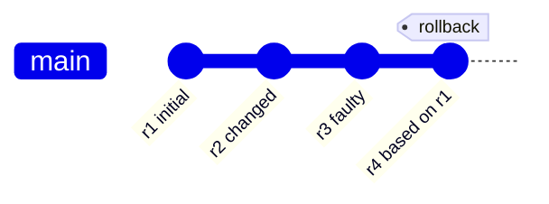

# Immutable configuration versioning

`covers: REQ-009, REQ-012`

## Versioned surfaces

Prompts, pipelines, policies, bindings, execution contexts, account pools,
runner routes, schedules, grants and checker rules are immutable revisioned
objects. A run MUST pin every revision it can observe before its first node
becomes runnable. The one revision a run may create later is a runner route's
derived execution context: its parent is the pinned context, and its content is
fixed by that context and the pinned route ([Runner routes](runners.md#the-walk)).

## Revision shape

A revision contains object URI, monotonically increasing revision number within
that object, parent revision references, canonical content hash ([canonical forms](conformance.md#canonical-forms)), author, creation
time, reason and payload. A merge revision MAY have multiple parents. Payload
validation is selected by `kind` and schema URI.

## Diff

A diff is derived from two immutable payloads and MUST NOT be the only record of a
change. Human summaries are advisory; content hashes and payloads are normative.

## Rollback

Rollback creates a new revision whose payload is based on an earlier revision and
whose `rollbackBasis` points to it — the same setting's `id` and an earlier revision; every parent is an earlier
revision too (`FAC-SEM-096`, DEC-0064). It does not delete, reactivate or edit the old
revision. New runs MAY select the rollback revision after approval; existing runs
remain pinned.

## Activation

An alias such as `active` MAY point to a revision for operator convenience. Run
creation resolves it once. Alias movement is an audited event and does not alter
the revision. A provider or host MUST NOT fetch `active` again mid-run.

## One contract pin

A repository that builds against this contract pins it **once**, in
`fabric-contract.lock.json` at its root
([`contract-pin.schema.json`](../../schemas/contract-pin.schema.json)): contract name,
version, repository and the full 40-character commit. Every other place that names the
contract revision — a README line, skill metadata, a constant in code — MUST equal that
commit, in full or abbreviated to at least seven characters (G-11). Dated records
(retrospectives, handoffs, changelog entries) name the revision of their day and are
excluded by the consumer.

`pnpm pin:check <repository> [--pin <file>] [--exclude <path>]…` runs the reference
check ([`src/pin-check.ts`](../../src/pin-check.ts)): a commit-like hash on a line that
mentions the contract and differs from the pin fails, with its file and line. A
consumer MAY carry an equivalent check in its own language; the Fabric Agent Adapter's
`test/validate.py` does.

Moving the pin is a compatibility change: the consumer reviews what changed between the
two commits, updates the lock and every mention in one change, and releases.

## Protocol revisions

Every document of the contract names its protocol revision, `<name>/<revision>` (`fabric-service/0.1`,
`estate-record/1`), and DEC-0009 makes that revision an explicit input: a host rejects an unsupported revision before
any other check and never translates one revision into another. DEC-0067 (CON-OE-07; the first organization server's
target architecture v4 §12 at `9c6a780`, "`protocols[]` with N and N−1, `schema-unsupported`") adds how two parties
on different releases still talk:

- **The register.** [`src/protocol-revisions.ts`](../../src/protocol-revisions.ts) `PROTOCOL_REVISIONS` lists each
  contract protocol's published revisions, oldest first; a test keeps it equal to the revisions the schemas pin. A
  decision that publishes a new revision appends it there.
- **N and N−1.** A receiver accepts the newest revision of a protocol it implements (N) and the one before it in the
  register (N−1), and no other (`acceptedRevisions`). A protocol with one published revision has no N−1.
- **`protocols`.** A party says which revisions it reads in a list of at most N and N−1 per protocol
  (`common.schema.json#/$defs/protocols`): a service in its well-known document (what it accepts), a node in its
  check-in (what records and policy it can be sent), a receiver in its enrollment response (what it accepts from the
  device). A sender writes each document in the newest revision both lists name. Absent, the party reads only the
  revision its own documents name.
- **`schema-unsupported`.** A document in a revision the receiver does not accept is refused before it is read further
  ([`schema-unsupported.schema.json`](../../schemas/schema-unsupported.schema.json); `negotiateRevision`): the
  refusal names the revision received (at most 80 characters) and the accepted revisions of that protocol, or all of
  them when the received value names no protocol the receiver reads. An HTTP route answers it as the JSON body of a
  400, an MCP tool as `structuredContent` of an `isError` result. Revisions compare as exact strings:
  `fabric-device/0.10` is not `fabric-device/0.1`.
- The relay keeps `protocol-unsupported` on its own frames (DEC-0047); it answers the same condition inside a
  WebSocket session, where there is no HTTP body.

Vectors: [`fixtures/vectors/protocol-revisions.json`](../../fixtures/vectors/protocol-revisions.json).

## Semantic rules

| Code | Kind | Rule |
|---|---|---|
| `FAC-SEM-096` | `versioned-setting` | `rollbackBasis` names the same setting's `id` and an earlier revision; every parent's revision is earlier than the setting's own (DEC-0007, DEC-0064) |
| `FAC-SEM-099` | `protocols` | a protocols list (`{protocols}`) names each `<name>/<revision>` once, at most two revisions of one protocol, a contract protocol only in revisions the register publishes, and two of them consecutive in the register: N and N−1 (DEC-0067) |
