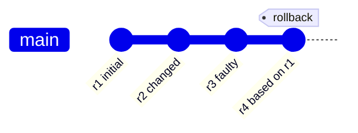

# Immutable configuration versioning

`covers: REQ-009, REQ-012`

## Versioned surfaces

Prompts, pipelines, policies, bindings, execution contexts, account pools,
runner routes, schedules, grants and checker rules are immutable revisioned
objects. A run MUST pin every revision it can observe before its first node
becomes runnable. The one revision a run may create later is a runner route's
derived execution context: its parent is the pinned context, and its content is
fixed by that context and the pinned route ([Runner routes](runners.md#the-walk)).

## Revision shape

A revision contains object URI, monotonically increasing revision number within
that object, parent revision references, canonical content hash ([canonical forms](conformance.md#canonical-forms)), author, creation
time, reason and payload. A merge revision MAY have multiple parents. Payload
validation is selected by `kind` and schema URI.

## Diff

A diff is derived from two immutable payloads and MUST NOT be the only record of a
change. Human summaries are advisory; content hashes and payloads are normative.

## Rollback

Rollback creates a new revision whose payload is based on an earlier revision and
whose `rollbackBasis` points to it — the same setting's `id` (compared by normal form, [identifiers](identifiers.md),
DEC-0076) and an earlier revision; every parent is an earlier revision too (`FAC-SEM-096`, DEC-0064). It does not delete, reactivate or edit the old
revision. New runs MAY select the rollback revision after approval; existing runs
remain pinned.

## Activation

An alias such as `active` MAY point to a revision for operator convenience. Run
creation resolves it once. Alias movement is an audited event and does not alter
the revision. A provider or host MUST NOT fetch `active` again mid-run.

## One contract pin

A repository that builds against this contract pins it **once**, in
`fabric-contract.lock.json` at its root
([`contract-pin.schema.json`](../../schemas/contract-pin.schema.json)): contract name,
version, repository and the full 40-character commit. Every other place that names the
contract revision — a README line, skill metadata, a constant in code — MUST equal that
commit, in full or abbreviated to at least seven characters (G-11). Dated records
(retrospectives, handoffs, changelog entries) name the revision of their day and are
excluded by the consumer.

`pnpm pin:check <repository> [--pin <file>] [--exclude <path>]… [--include-dated]` runs the reference
check; under `pnpm --dir <contract checkout> pin:check .` a relative path is read from where pnpm ran ([`src/pin-check.ts`](../../src/pin-check.ts)). It reads the lock and validates it against
[`contract-pin.schema.json`](../../schemas/contract-pin.schema.json): a missing lock, a lock that is not JSON and a lock
the schema refuses each print what is wrong and exit 2, as does a repository folder it cannot list and a usage error. A member the schema does not define
(one consumer's lock carries `adapter` and `kit`, which are not pin members, DEC-0120) is printed as a note and does not fail the check. A commit that is not the full
40-character lower-case hex id is its own state, `malformed`, with its own message, and git is not asked about it.
Then a commit-like hash on a line that mentions the contract and differs from the pin fails, with its file and line,
and so does a pin that is not a commit of the contract's history (`pinHistory`: an ancestor of `origin/main` in this
checkout, else of `HEAD`), such as a commit a history rewrite left behind; a pin this checkout does not hold and a
checkout git cannot read fail too; each of these exits 1. The dated records are excluded by default: a file whose
name starts with `CHANGELOG`, and everything under `docs/handoffs/`, `docs/evidence/` and `.task-pipeline/`;
`--exclude` adds paths and `--include-dated` scans the dated records as well. The success line, which names the
history the pin was found on, is printed only when the exit code is 0. A consumer MAY carry its own check in its own
language; the Fabric Agent Adapter's `test/validate.py` is one, and it is not this command: it excludes `test/` as
well as the dated records, scans only some file types, allows the adapter's list of supported earlier revisions and
does not look the pin up in the contract's history, so the two can disagree on one checkout.

### Releases

A **release** names a commit of `main` for people and for consumers that read releases rather than commits (DEC-0108):
an annotated tag `v<contractVersion>+<YYYY-MM-DD>` on a commit whose gate (`pnpm run check`) and `pnpm vectors:check`
passed, with a GitHub release whose notes list the decisions since the previous release. The version part is the
`contractVersion` the schemas carry (`$id` prefix and the manifest member), so an additive release keeps `0.1.0`
(DEC-0016) and the build metadata after `+` tells two releases of one version apart by day; SemVer gives build
metadata no precedence (SemVer 2.0.0 §10), so a reader orders releases by the date, and more than one release on a day
takes `.2`, `.3` after the date. A release changes no pin by itself: a consumer still pins the release's full commit in
`fabric-contract.lock.json`. The first release is `v0.1.0+2026-10-23`; the second, `v0.1.0+2026-10-24`, carries DEC-0112 to DEC-0119 and lists
what narrows in its notes, as DEC-0119 asks of a change to a revision nobody had adopted.

Moving the pin is a compatibility change: the consumer reviews what changed between the
two commits, updates the lock and every mention in one change, and releases. A consumer that vendors schemas copies
the `$ref` closure of the ones it reads ([`src/schema-closure.ts`](../../src/schema-closure.ts)), not a list picked
by hand: a schema may start to reference `common.schema.json` or a new definition in it at any commit.

## Protocol revisions

Every protocol of the contract has a revision, `<name>/<revision>` (`fabric-service/0.1`, `estate-record/1`), and the
documents that pin one carry it (most in `protocol`, `type` or `format`). DEC-0009 makes the revision an explicit input:
hosts "reject unsupported revisions before semantic probes and never silently translate them". DEC-0067 (CON-OE-07; the first organization server's
target architecture v4 §12 at `9c6a780`, "`protocols[]` with N and N−1, `schema-unsupported`") adds how two parties
on different releases still talk:

- **The register.** [`src/protocol-revisions.ts`](../../src/protocol-revisions.ts) `PROTOCOL_REVISIONS` lists each
  contract protocol's published revisions, oldest first; a test keeps it equal to the revisions the schemas pin with
  `const` plus `NAMED_ONLY` (`approval/1`, `fabric-actions/0.1` (the actions extension, DEC-0121), `fabric-connections/0.1` (the connections extension), `fabric-dashboard/0.1`, `fabric-delegation/0.1`, `fabric-interop/0.1` and `/0.2` (DEC-0087),
  `fabric-load/0.1` (the load extension, DEC-0104), `fabric-local-channel/0.1`, `pipeline/0.1`, which a specification names and no schema pins). A decision that publishes a new revision appends it
  there and widens each module's own constant, which a test keeps at the newest revision (`RELAY_PROTOCOL`,
  `DELTA_TYPE`, `HEARTBEAT_TYPE`, `ENVELOPE_TYPE`, `ESTATE_RECORD_SCHEMA`, `HANDOFF_FORMAT`, `SETTINGS_BACKUP_FORMAT`,
  `WINDOW_LEASE_TYPE`, `COMMS_PROTOCOL`, `AGENT_CALL_TYPE` for `fabric-agent-call/1`, DEC-0106;
  `CREDENTIAL_ENVELOPE_TYPE` for `fabric-credential-envelope/1`, DEC-0111).
- **N and N−1.** A receiver accepts the newest revision of a protocol it implements (N) and the one before it in the
  register (N−1), and no other (`acceptedRevisions`). A protocol with one published revision has no N−1.
- **`protocols`.** A party says which revisions it reads in a list of at most N and N−1 per protocol
  (`common.schema.json#/$defs/protocols`): a service in its well-known document (what it accepts), a node in its
  check-in (what records and policy it can be sent), a receiver in its enrollment response and, from DEC-0094, its check-in response (what it accepts
  from the device; the latest list the node received counts). A sender writes each document in the newest revision the reader's list names and its own writer produces (DEC-0117). A check-in response without `protocols` leaves the latest list the node received
  unchanged. Absent everywhere, the party reads only the
  revision its own documents name. `FAC-SEM-099` checks the list wherever it appears (kinds `service-well-known`,
  `device-check-in`, `device-enrollment`, and `protocols` alone). A party sends `protocols` only to a reader pinned at
  or after DEC-0067 (for the check-in response, at or after DEC-0094), or one that ignores unknown members: the four
  carrying objects are closed, so an older pinned
  copy refuses the new member.
- **`schema-unsupported`.** A document in a revision the receiver does not accept is refused after the request is
  authenticated (a device's signature, [devices](devices.md#transport) steps 0–8; a delegated call's DL-13 order) and
  before its body is read further, so an unauthenticated caller never learns the accepted list
  ([`schema-unsupported.schema.json`](../../schemas/schema-unsupported.schema.json); `negotiateRevision`): the
  refusal names the revision received (at most 80 characters, never splitting one) and the accepted revisions of that
  protocol, or all of them when the received value names no protocol the receiver reads. The accepted list is read as
  a `protocols` list — malformed entries and repeats dropped, at most 64 kept — so the refusal is always a valid
  document; a receiver left accepting nothing is misconfigured and answers its own fault (`no-accepted-revisions`),
  not a refusal. An HTTP route answers it as the JSON body of a
  400, an MCP tool as `structuredContent` of an `isError` result. Revisions compare as exact strings:
  `fabric-device/0.10` is not `fabric-device/0.1`.
- The relay keeps `protocol-unsupported` on its own frames (DEC-0047); it answers the same condition inside a
  WebSocket session, where there is no HTTP body.

Vectors: [`fixtures/vectors/protocol-revisions.json`](../../fixtures/vectors/protocol-revisions.json).

## Semantic rules

| Code | Kind | Rule |
|---|---|---|
| `FAC-SEM-096` | `versioned-setting` | `rollbackBasis` names the same setting's `id` (compared by normal form, [identifiers](identifiers.md)) and an earlier revision; every parent's revision is earlier than the setting's own (DEC-0007, DEC-0064, DEC-0076) |
| `FAC-SEM-099` | `protocols`, `service-well-known`, `device-check-in`, `device-enrollment` | a protocols list (`{protocols}`) has 1 to 64 entries and names each `<name>/<revision>` once, at most two revisions of one protocol, a contract protocol only in revisions the register publishes (an unpublished one is refused and not counted toward the two), and two of them consecutive in the register: N and N−1 (DEC-0067) |
