<!-- Managed with super-ux (ux-contract v4). The HOW layer: task analysis and user flows scenarios trace to. -->

# User flows

No reference-flow server was available in this session. The flows derive from
the approved brief and foundation. Diagrams describe user-observable contract
states, not a promised runtime UI.

### FLW-01: Author proves compatibility

- **Traces:** ST-001 (JTBD-01, JRN-01/#2, JRN-01/#3, JRN-01/#4)
- **Goal:** author has an admission-ready provider declaration or a precise correction list
- **Entry points:** README profile chooser; direct profile specification link
- **Success exit:** conformance report says shape, protocol and semantic gates passed
- **Task analysis:**
  1. Choose MCP, A2A or local profile.
  2. Copy the minimal profile fixture and replace identities and capabilities.
  3. Run conformance and follow the first failed gate.
  4. Expose the profile's discovery mechanism and inspect admission outcome.
- **Rejected shape:** a universal setup wizard that hides profile differences — rejected because it would imply an executable UI and conceal transport-specific proof.
- **Flow:**

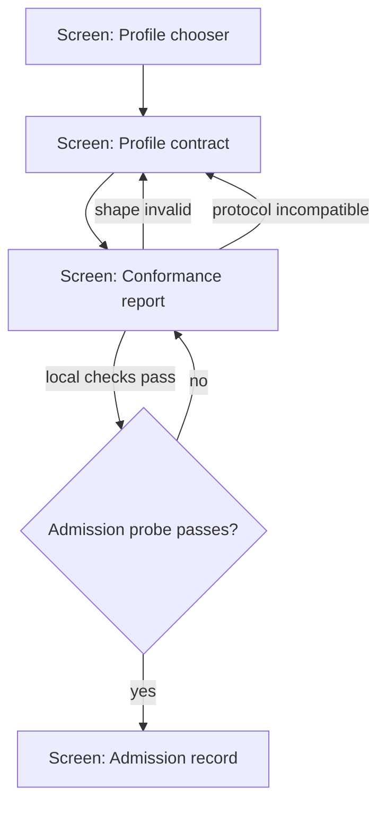

- **Screens traversed:**

  | Screen | States used here |
  |---|---|
  | SCR-01 Profile chooser | success |
  | SCR-02 Profile contract | success |
  | SCR-03 Conformance report | loading, error, success |
  | SCR-04 Admission record | error, success |

### FLW-02: Operator binds a provider to a project

- **Traces:** ST-002, ST-003 (JTBD-02, JRN-02/#1, JRN-02/#2)
- **Goal:** a project has a safe immutable capability binding
- **Entry points:** admitted provider record; project capability gap
- **Success exit:** binding revision pins admitted capability, execution context and policies
- **Task analysis:** compare admission evidence → select project pool/context →
  declare grant and checker → validate and record binding.
- **Rejected shape:** binding directly from discovery — rejected because discovery must not grant project access.
- **Flow:**

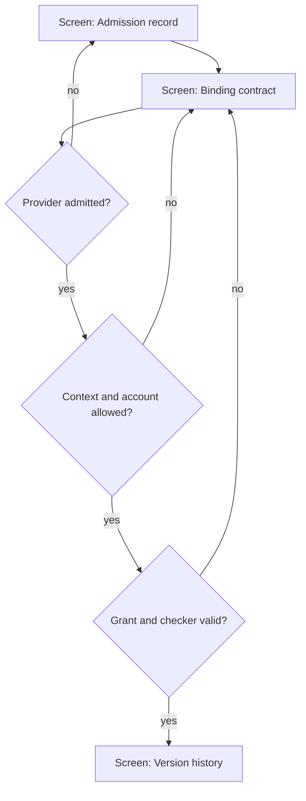

- **Screens traversed:** SCR-04 error/success; SCR-05 error/success; SCR-06 success.

### FLW-03: Operator recovers without rewriting history

- **Traces:** ST-004 (JTBD-03, JRN-02/#4, JRN-02/#5)
- **Goal:** new work uses a known-good configuration while prior runs remain reproducible
- **Entry points:** failed result; suspended provider; configuration history
- **Success exit:** new immutable binding or setting revision is active for new runs
- **Task analysis:** inspect evidence → choose replace, fallback or rollback →
  validate policy → create revision → verify old run pins.
- **Rejected shape:** mutate the current binding in place — rejected because it erases provenance.
- **Flow:**

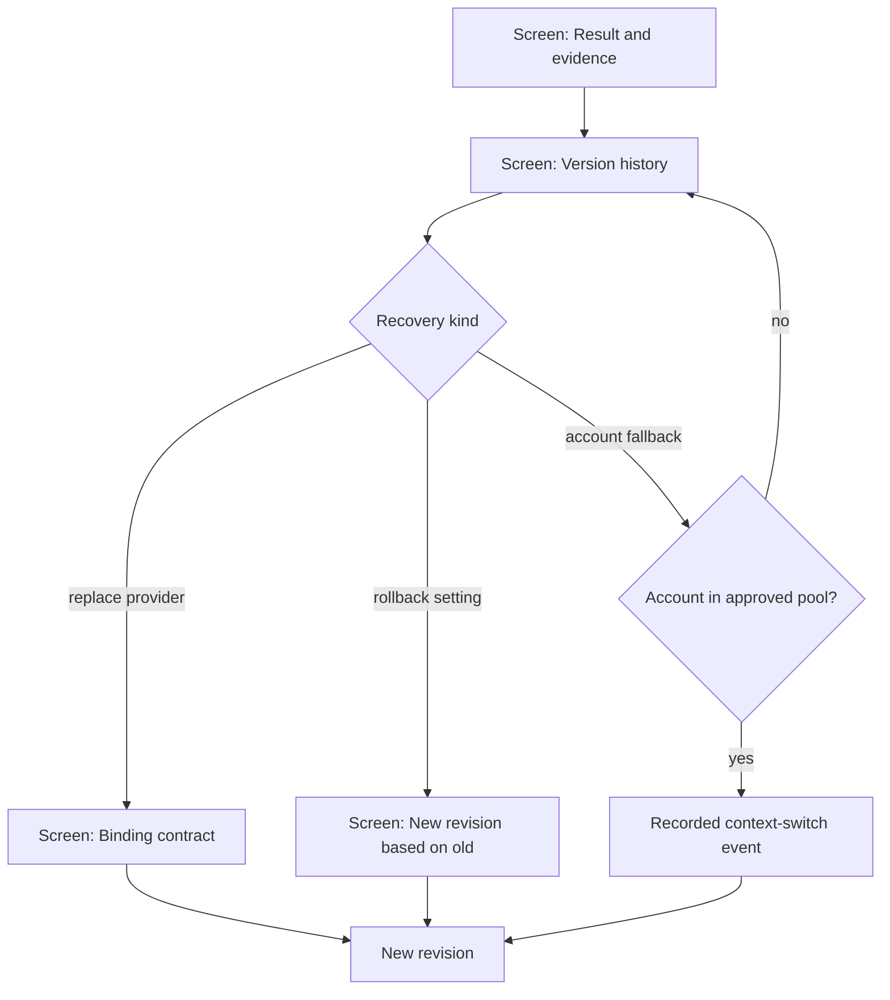

- **Screens traversed:** SCR-06 success; SCR-07 partial/error/success; SCR-05 error/success.

### FLW-04: Operator turns a failure into governed learning

- **Traces:** ST-005 (JTBD-03, JRN-02/#6)
- **Goal:** a verified correction becomes an approved future revision without self-mutation
- **Entry points:** checker failure; repeated-stage loop guard
- **Success exit:** project learning approved, or global insight promoted with independent evidence
- **Task analysis:** compare failed attempt and correction → record scope and
  proof → propose change → PM approves project change or CEO considers global
  promotion → create a new revision.
- **Rejected shape:** allow the failing agent to patch its active prompt — rejected because the evaluator and causal record would change mid-run.
- **Flow:**

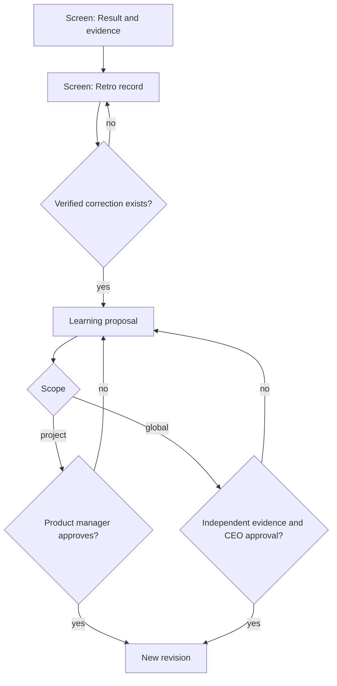

- **Screens traversed:** SCR-07 error/success; SCR-08 empty/error/success; SCR-06 success.

### FLW-05: Host serves a request through a runner route

- **Traces:** ST-006 (JTBD-02, JTBD-03, JRN-02/#2, JRN-02/#5)
- **Goal:** the first runner that can serve a request serves it, and every pass-over is explained
- **Entry points:** agent chat; managed task start; unattended routine or chain
- **Success exit:** `runner-selected` or `runner-switched` recorded with the derived execution context
- **Task analysis:** read pinned route → probe candidate → attach held session or spawn → record
  pass-over and try next → answer capability-unavailable when exhausted.
- **Rejected shape:** attach to whatever terminal is running the runner — rejected because the
  host would inject work into a session it does not own and cannot scope to the project.
- **Flow:**

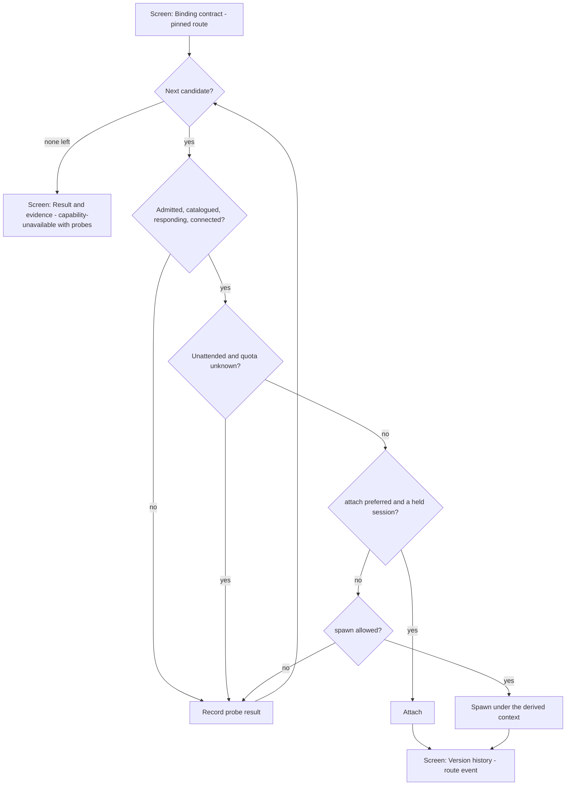

- **Screens traversed:** SCR-05 success; SCR-06 success; SCR-07 error.

### FLW-06: Member reads their access log

- **Traces:** ST-007 (JTBD-04, JRN-03/#3)
- **Goal:** every read of the member's data is visible with its purpose
- **Entry points:** the organization's member page; a link in the notice
- **Success exit:** the access log lists reads of raw events and of devices bound to the member, and a partner
  organization's reads of usage sums that include the member (DEC-0090)
- **Task analysis:** sign in → the receiver resolves the member's `user.id` and bound devices → list `access-log/1` entries newest first.
- **Rejected shape:** log only reads keyed by `user.id` — rejected because device health and check-ins reveal a person's device state too.
- **Flow:**

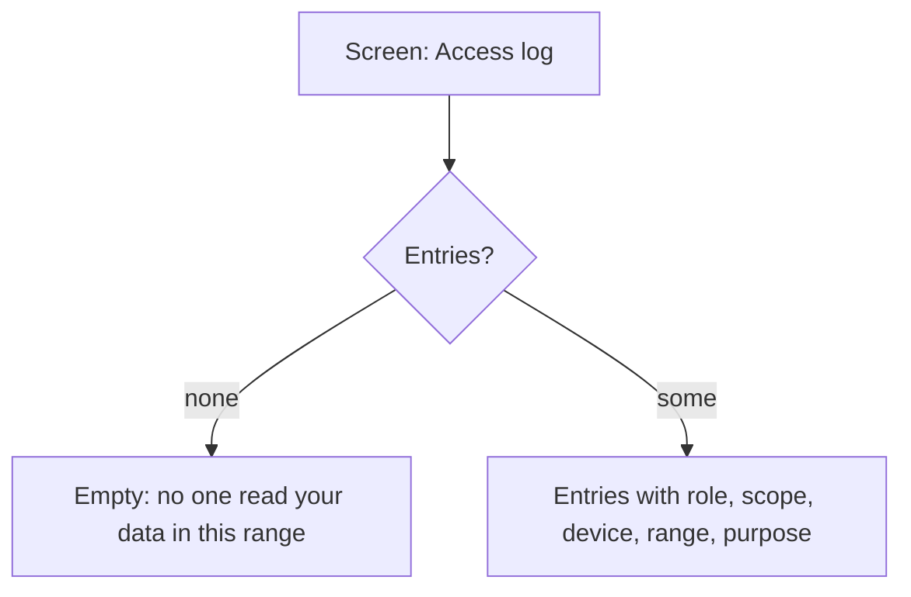

- **Screens traversed:** SCR-09 empty; SCR-09 success.

### FLW-07: Device applies policy layers

- **Traces:** ST-008 (JTBD-04, JRN-03/#2)
- **Goal:** the effective setting is the resolution of signed layers, and a locked key is never overridden locally
- **Entry points:** a policy in a check-in response; a local settings change; a 410 `organization-closed` answer (DEC-0103)
- **Success exit:** effective settings shown with the layer each came from and its lock; for a closed organization, its sentence and date with its server locks lifted
- **Task analysis:** verify signature and revision → resolve lock, then the user's value (never for `harness.baseline` or `repair.packages`, DEC-0102), then the highest default → show each key's source → refuse a local change to a locked key.
- **Rejected shape:** let the highest layer always win — rejected because an unlocked default would leave the person no choice at all.
- **Flow:**

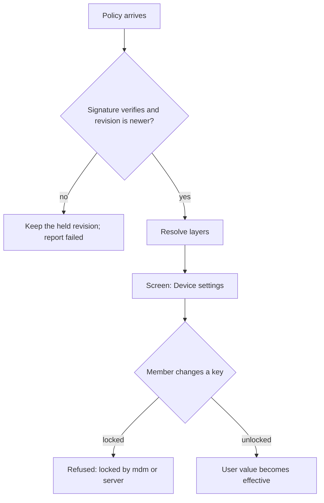

- **Screens traversed:** SCR-10 success; SCR-10 error; SCR-10 closed.

### FLW-08: Operator answers an agent's stop in the messenger

- **Traces:** ST-009, ST-010 (JTBD-05, JRN-04/#2, JRN-04/#3, JRN-04/#4)
- **Goal:** a stop is decided from the chat by the same operation the dashboard runs, and money never moves on one press
- **Entry points:** the proposal of the channel; a stop sent with buttons
- **Success exit:** the decision recorded and audited; the keyboard removed
- **Task analysis:** link by a local code → receive a stop with buttons → check the sender's numeric id and the token → for money, confirm with the amount → run the agent's own operation → answer the callback.
- **Rejected shape:** a chat command that performs the action directly — rejected because it is a second path that skips the agent's authorization (DEC-0034 OC-5).
- **Flow:**

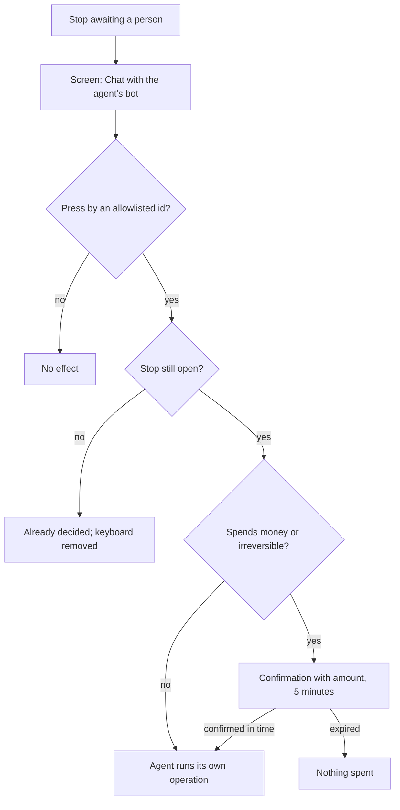

- **Screens traversed:** SCR-11 empty; SCR-11 success; SCR-11 error.

### FLW-09: Operator opens Fabric from a product

- **Traces:** ST-011 (JTBD-06, JRN-05/#1, JRN-05/#2, JRN-05/#4)
- **Goal:** Fabric opens on the product's service and project in one press, and nothing runs until the person acts
- **Entry points:** Fabric's button on a service dashboard
- **Success exit:** the conversation or the session view open in Fabric on the right service and project
- **Task analysis:** press the button → choose chat or session → the page follows a `fabric://` link built by the kit → Fabric validates the ids and opens the view → the person types or starts the runner.
- **Rejected shape:** a link that carries a prompt or starts the runner — rejected because any page can emit a link (DEC-0040 FB-8, FL-4).
- **Flow:**

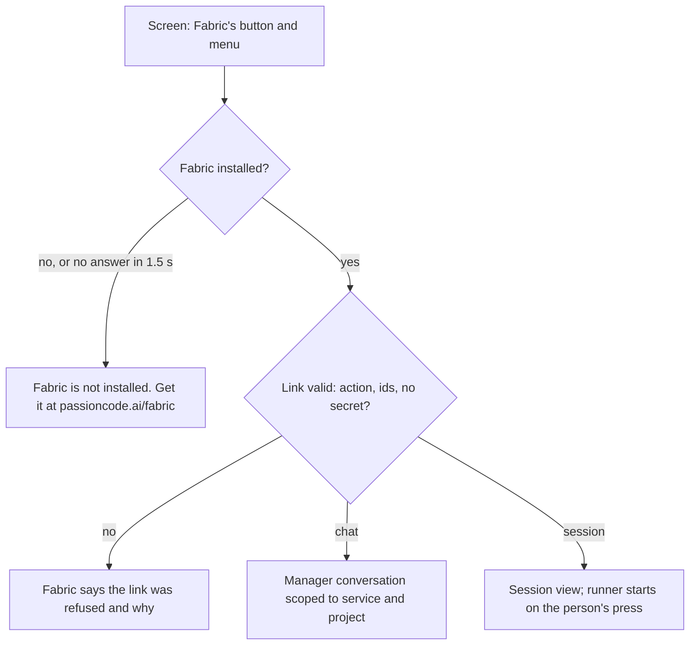

- **Screens traversed:** SCR-12 success; SCR-12 empty; SCR-12 error.

### FLW-10: Operator sets a spend limit and answers what exceeds it

- **Traces:** ST-012, ST-013 (JTBD-07, JRN-06/#1, JRN-06/#2)
- **Goal:** a project spends within a limit the operator chose once, and a spend above the threshold waits for one answer
- **Entry points:** the first run of a project that would spend money; a grant check above `autoApproveUsd`
- **Success exit:** the policy recorded with its inputs; the request answered and the spend allowed or not
- **Task analysis:** the launcher computes options → the operator picks one (one is preselected) → the meter checks each spend against the levels → above the threshold it denies with one filed request → the operator confirms the amount in the operator channel → the agent asks again and is allowed.
- **Rejected shape:** a fixed list of budgets, or an approval in a chat message — rejected because the options must come from the project (spend policy) and a chat message is never the approval (spend policy rule 3).
- **Flow:**

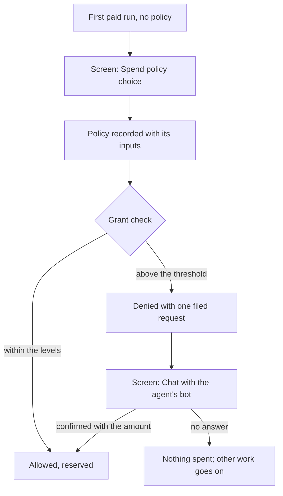

- **Screens traversed:** SCR-13 success; SCR-13 empty; SCR-13 unknown; SCR-11 success; SCR-11 error.

### FLW-11: Operator approves one action for an outside caller

- **Traces:** ST-014 (JTBD-07, JRN-06/#3)
- **Goal:** an effect asked for across the machine boundary happens only once, after an approval of exactly that action
- **Entry points:** a callee's `approval-required` refusal to a T2 caller
- **Success exit:** the action taken once; the approval's `jti` consumed
- **Task analysis:** the callee refuses with the action's digest → the caller asks the hub → Fabric shows the operator the action → the operator approves → the hub signs `approval/1` (`method: prompt`) → the caller repeats the call → the callee checks the token, the grant, then the approval, and acts.
- **Rejected shape:** a standing approval for a kind of action — rejected because an approval binds one action's digest, one callee and one use (DL-17, DL-18).
- **Flow:**

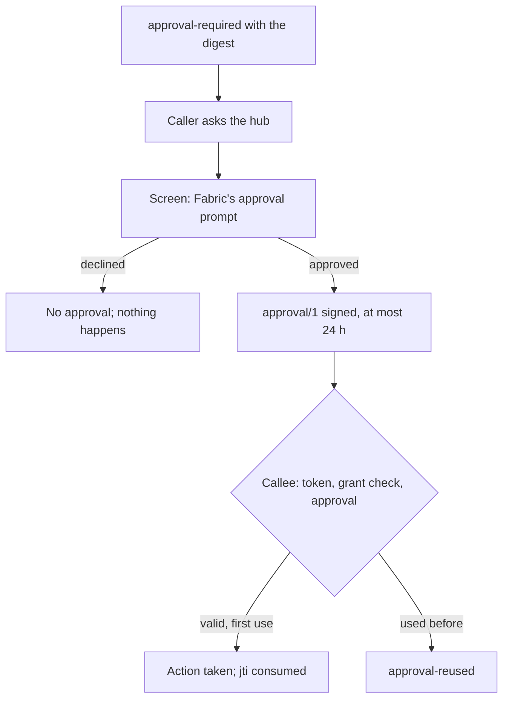

- **Screens traversed:** SCR-14 success; SCR-14 error.

### FLW-12: The host signs in again after a dashboard session ends

- **Traces:** ST-015 (JTBD-06, JRN-05/#3)
- **Goal:** an ended session is visible on the page and recovered by the host without a loop
- **Entry points:** a dashboard page requested after the session ended
- **Success exit:** the same page open again under a new session
- **Task analysis:** the page answers `401` with an explanation → the host asks for a new login code with the descriptor token → it reopens the same page → it does so at most once a minute per page.
- **Rejected shape:** reloading the page on any `401` from its API — rejected because it would discard what the operator is doing (service, Operator login).
- **Flow:**

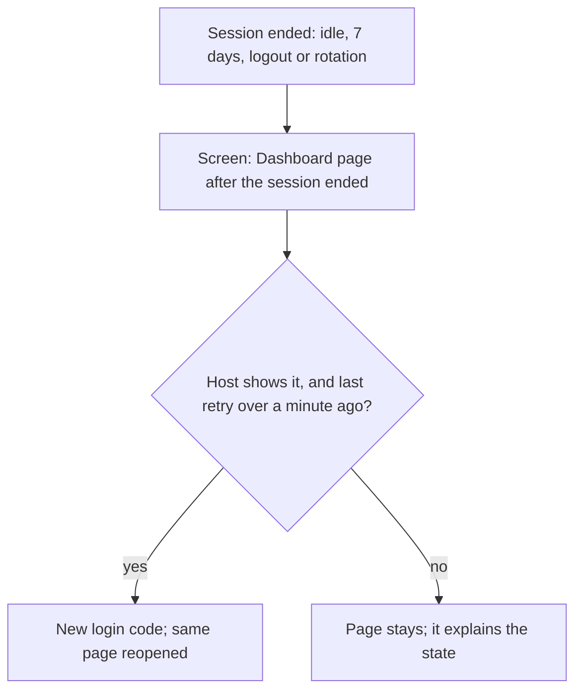

- **Screens traversed:** SCR-15 error; SCR-15 success.

### FLW-13: Operator works in a dashboard beside the console

- **Traces:** ST-016, ST-017 (JTBD-08, JRN-07/#1, JRN-07/#2, JRN-07/#3, JRN-07/#4)
- **Goal:** the page stays usable at every console width the host allows, and shows the appearance the operator chose for the fields it declared
- **Entry points:** an agent's dashboard opened in a host pane beside the console
- **Success exit:** the operator works in the page with the console as wide as the host allows, every destination reachable
- **Task analysis:** the host reads the page's declaration and validates it → it keeps `max(480, minWidth)` CSS pixels for the page (480 when nothing valid is declared) → the operator drags the console → the console stops at the host floor → the operator picks a scheme and a theme → the host rewrites `fabric_appearance` → the page applies the fields it declared and hides only those controls.
- **Rejected shape:** zooming the page to fit, or a sideways-scrolling tab strip — rejected because zoom changes what the page measured and a hidden scrollbar hides destinations (ED-3, ED-7).
- **Flow:**

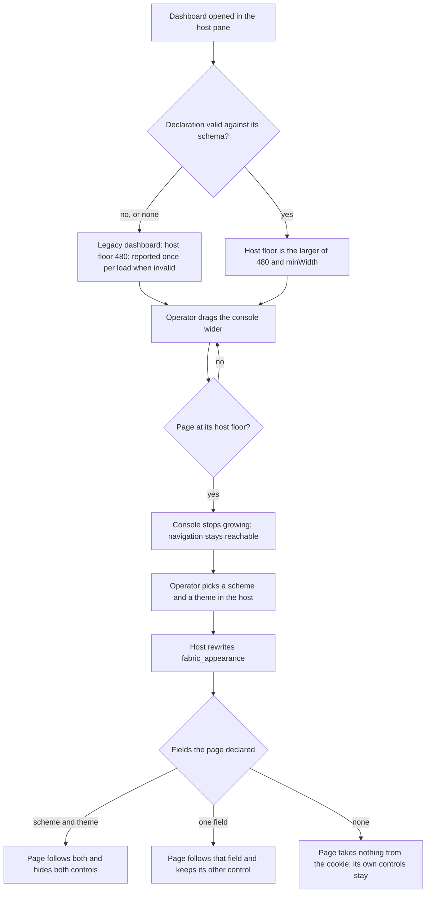

- **Screens traversed:** SCR-16 success; SCR-16 narrow; SCR-16 legacy.

### FLW-14: An agent proceeds under a standing grant

- **Traces:** ST-018 (JTBD-07, JRN-06/#4)
- **Goal:** a spend a standing grant allows goes ahead on the record, without a question to the operator
- **Entry points:** an agent about to spend within a project that has a standing grant with `spend`
- **Success exit:** the spend settled against the receipt, visible under the grant in the usage report
- **Task analysis:** the agent asks the meter with the amount → the meter reads the grant and the levels → `allowed` with a receipt and a reservation → the agent spends → the usage report lists the receipt under the grant.
- **Rejected shape:** asking the operator in a chat whether the spend is fine — rejected because a record that exists is the proof, and a chat message is never the approval (spend policy rule 3).
- **Flow:**

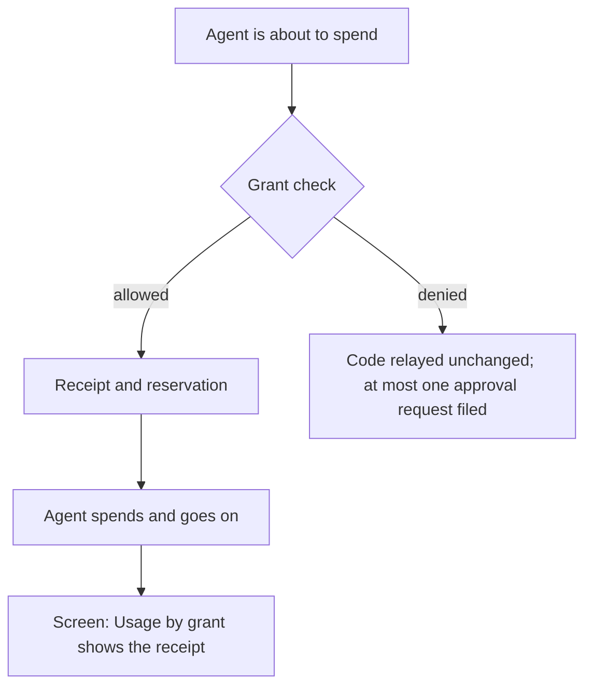

- **Screens traversed:** SCR-17 success; SCR-17 error.

### FLW-15: Operator restores settings

- **Traces:** ST-019 (JTBD-03, JRN-02/#5)
- **Goal:** what the operator decided comes back after a lost or wrongly migrated data directory, and nothing that exists is overwritten
- **Entry points:** a service starting on a fresh database; the operator choosing a snapshot by hand
- **Success exit:** the restore report: rows inserted, rows refused with their reasons, snapshots skipped
- **Task analysis:** the service finds its snapshots → on a fresh database it restores the newest intact one with content → otherwise the operator opens a preview → the operator applies it → the report names what was inserted, dropped, defaulted and refused.
- **Rejected shape:** a restore that replaces existing rows, or an agent applying a manual restore on its own account: rejected, because restore adds and never overwrites, and applying it is the operator's decision, taken on the page or relayed by their agent (service, Settings backup and Actions AP-2, DEC-0121).
- **Flow:**

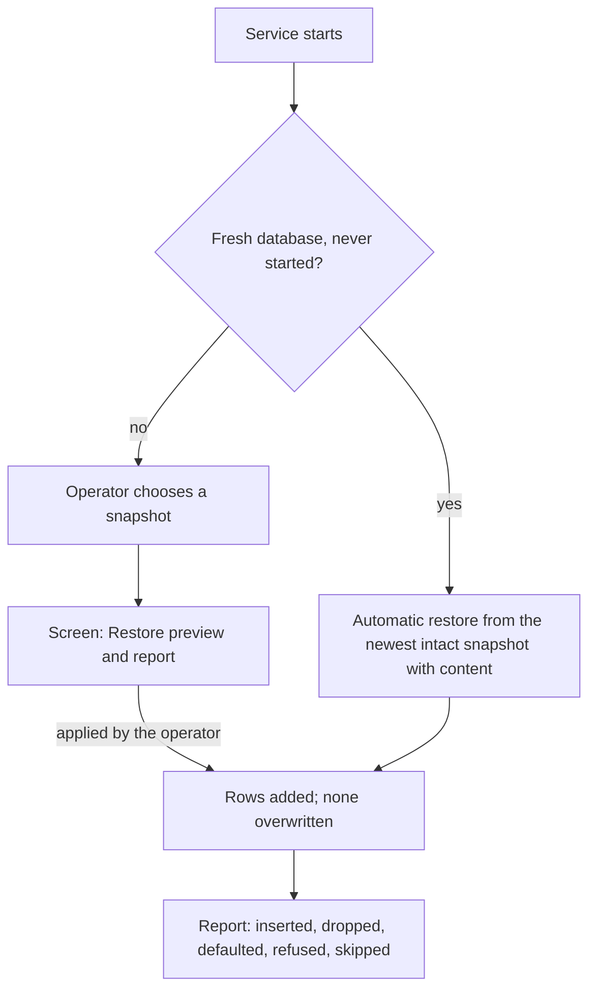

- **Screens traversed:** SCR-18 preview; SCR-18 success; SCR-18 error.

### FLW-16: Operator follows a request on the Project board

- **Traces:** ST-020 (JTBD-09, JRN-08/#1, JRN-08/#2, JRN-08/#3)
- **Goal:** the operator reads each request between Projects with its request state and its effect state, and a lost result stays visible
- **Entry points:** a request submitted to a Project's capability on the board
- **Success exit:** the request terminal with an observed result, or `outcome_unknown` until reconciled by the responder or, when none holds the slot, by the estate owner, or `answered` when the target's participant replied to it while it was queued, or while it was claimed and it returned to queued (DEC-0098, DEC-0102)
- **Task analysis:** an agent submits a request → a responder claims and accepts it → it begins the effect → it completes with an observed result, or the result is lost → the operator reads the state in the thread.
- **Rejected shape:** inferring completion from a delivery, a read mark or a live process — rejected because request state and effect state are separate facts (project comms, Request lifecycle).
- **Flow:**

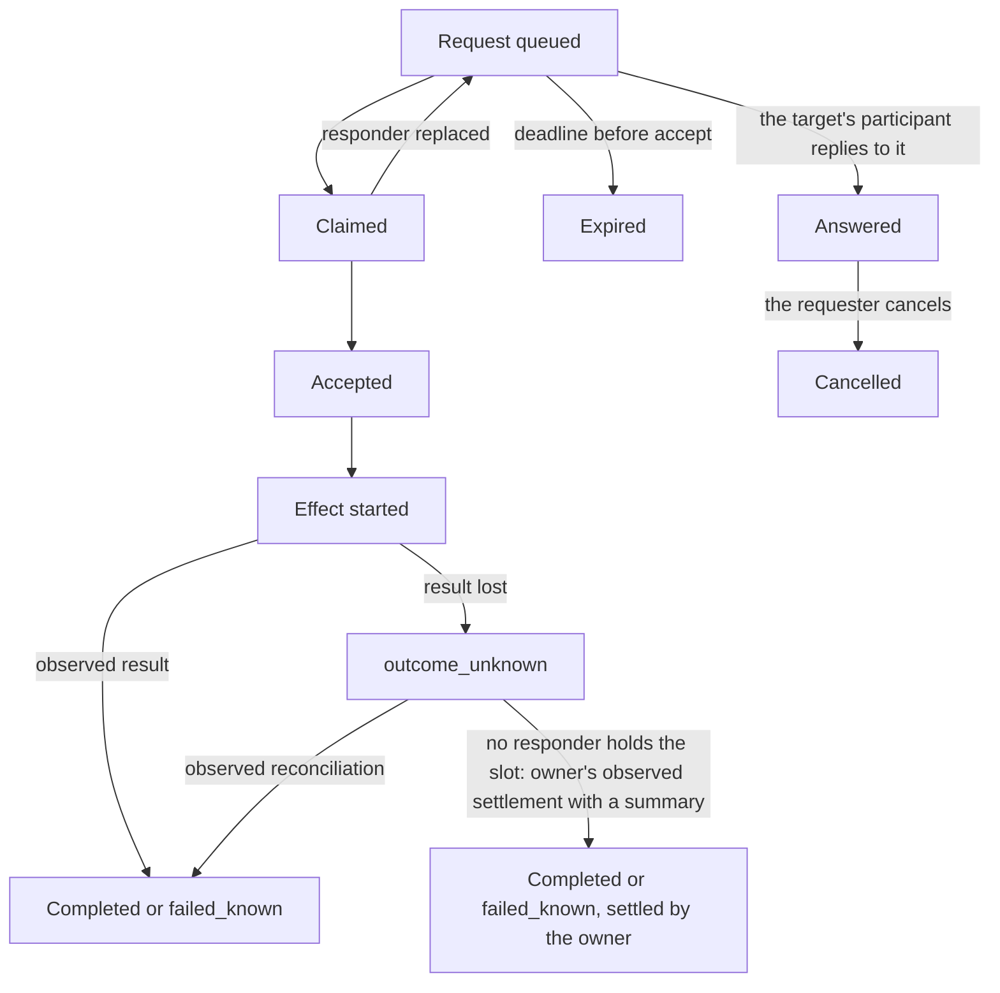

- **Screens traversed:** SCR-19 success; SCR-19 unknown; SCR-19 expired; SCR-19 answered.

### FLW-17: A second copy of a service starts while one runs

- **Traces:** ST-021 (JTBD-03, JRN-02/#3)
- **Goal:** a second copy changes nothing, and what the operator sees says what happened, never an outage
- **Entry points:** the operator runs the service by hand; its supervisor starts it again
- **Success exit:** one copy runs and answers; the second has exited 75 or taken over after the first left
- **Task analysis:** the second copy reads the supervisor marker → by hand it tries the lock once and exits 75 naming the holder → marked, it waits up to 300 s touching nothing and exits 75, or takes the lock if the holder leaves → markers that disagree exit 75 at once → the host keeps showing the holder's health.
- **Rejected shape:** exiting at once under a supervisor — rejected because launchd and systemd restart it every 10 s, forever (service, One copy).
- **Flow:**

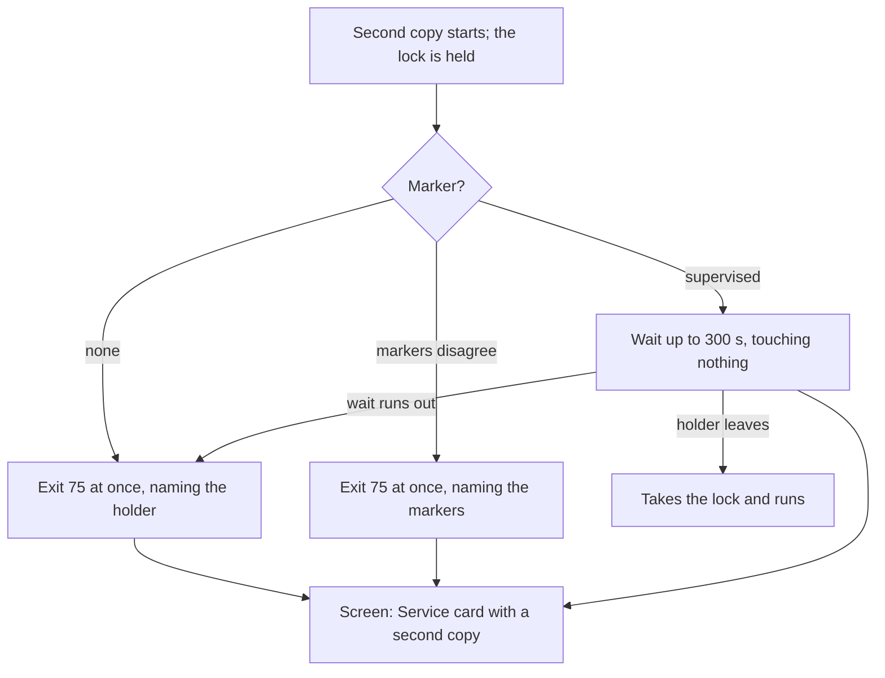

- **Screens traversed:** SCR-20 loading (the wait); SCR-20 error (exit 75); SCR-20 success (one copy runs).

### FLW-18: Operator unlists a Project

- **Traces:** ST-022 (JTBD-09, JRN-08/#4)
- **Goal:** a Project the operator keeps to itself is absent from the project directory and still reachable by a sender that knows its id
- **Entry points:** the host's Project settings (in Fabric, per Project); the operator's agent relaying their decision to the host's unlist action (DEC-0121)
- **Success exit:** the Project absent from every directory page and capability filter; a request addressed to its id is queued as before
- **Task analysis:** the operator turns the Project's listing off in the host → the next `com.directory` page of every session of the estate omits it → a sender that already knows its id submits a request → the board queues it as for any Project.
- **Rejected shape:** unlisting as a block list that refuses messages — rejected because a listing is discovery, not authority (project comms, Project directory).
- **Flow:**

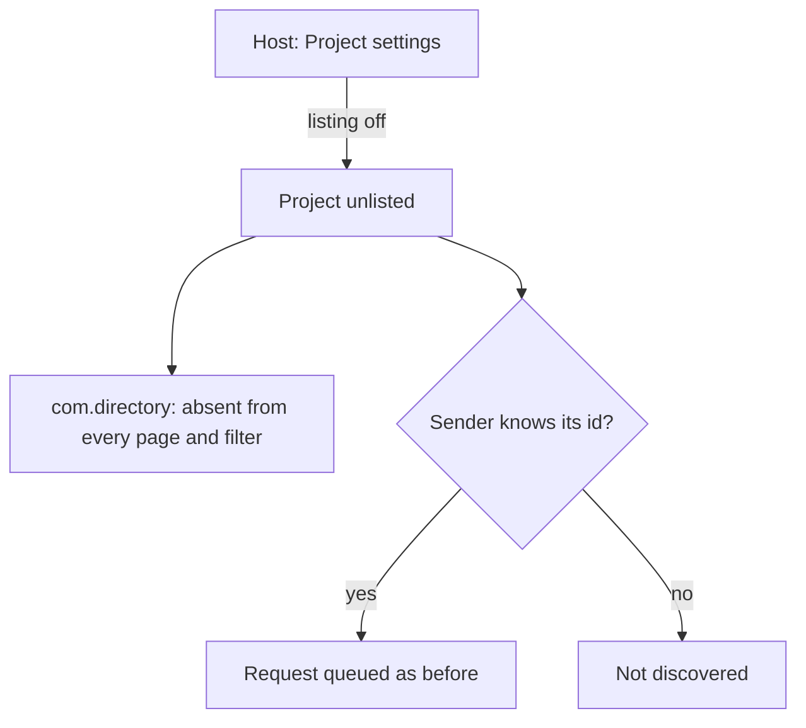

- **Screens traversed:** SCR-21 success (unlisted); SCR-21 error (the host could not save the change and says so).

### FLW-19: Operator adds a machine to their network

- **Traces:** ST-023 (JTBD-10, JRN-09/#2)
- **Goal:** the new machine is in the network, listed with the keys it generated, and has pinned the person's network
- **Entry points:** Fabric's "Add a machine" on a trusted machine; the new machine's node (its own screen, or a terminal for a headless server)
- **Success exit:** a passkey-signed revision lists the new machine; the new machine applied it offline
- **Task analysis:** the new machine makes its keys → nearby, it shows a code; from afar, the trusted machine opens a one-time rendezvous (at most 10 minutes) → both commit, then reveal → both screens show the same six-digit code and the network's fingerprint → the person confirms and signs with the passkey on the trusted machine → the new machine checks the chain starts at the revealed network and lists its keys, and applies it.
- **Rejected shape:** a code taken from one key's fingerprint — rejected because 20 bits are brute-forced offline (DV-REL-01); the commitment leaves one guess per rendezvous.
- **Flow:**

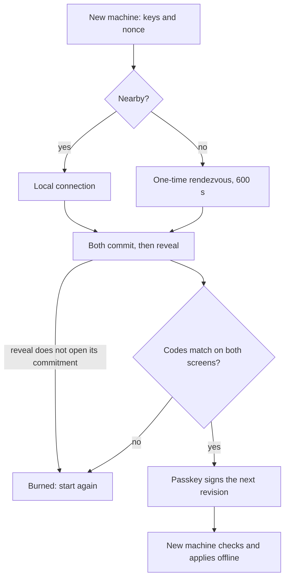

- **Screens traversed:** SCR-22 loading (waiting for the other side), error (codes differ, rendezvous expired), success (joined).

### FLW-20: Operator creates the network, removes or re-keys a machine

- **Traces:** ST-024, ST-025 (JTBD-10, JRN-09/#1, JRN-09/#3)
- **Goal:** a signed revision that creates the network, drops a machine, or replaces a machine's keys, revoking what it drops
- **Entry points:** Fabric's "Create my network", and the network's machine list with "Remove" and "Replace key" per machine
- **Success exit:** the person signed; machines apply the revision, and the delta carries each revocation within seconds
- **Task analysis:** create: the first machine makes its keys → Fabric asks for a second passkey on another authenticator (or tells what one costs) → Fabric drafts revision 1 → the passkey signs → the machine pins it and shows the fingerprint. Remove: choose the machine → Fabric drafts the revision that revokes it (the hub's machine: "Move the hub" instead, FLW-27; a retired one stays in the network until a later "Remove"; during a move, Fabric first warns as FLW-27 says for a machine that has not reported the revoking revision) → the passkey signs. Re-key: the machine pairs again under its id (or, alone in its network, makes new keys) → on the machine that holds the hub key Fabric says first that running approvals and tokens the old hub kid signed must be issued again → Fabric drafts the revision with the new keys and the old ones revoked by reference → the passkey signs.
- **Rejected shape:** dropping a machine or a key without revoking it — rejected because a revision that drops without revoking leaves caches and deltas without the revocation (`FAC-SEM-114`).
- **Flow:**

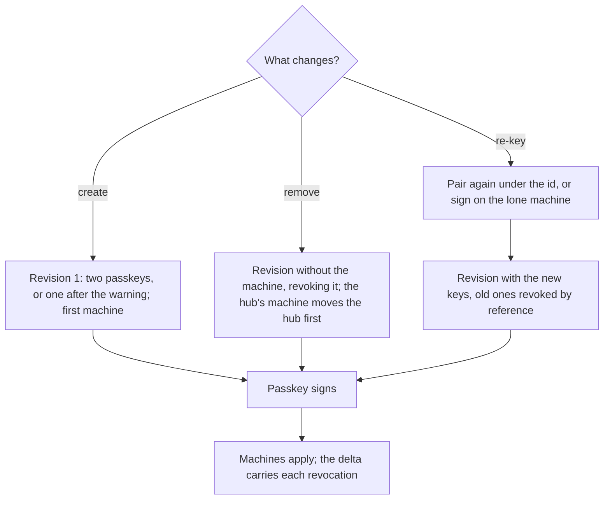

- **Screens traversed:** SCR-23 success (signed), error (the passkey ceremony failed; nothing changed); after re-keying the hub's machine, the setup note on its own row while the revision listing its new key is unsigned (DEC-0146).

### FLW-21: Operator reads what an agent uses

- **Traces:** ST-026 (JTBD-11, JRN-10/#1, JRN-10/#2, JRN-10/#3)
- **Goal:** the operator sees an agent's connections with the failing ones marked, or learns that its declaration is invalid and why
- **Entry points:** an agent's Connections tab in the host
- **Success exit:** the operator names the failing connection and the agent or connector behind it
- **Task analysis:** the host reads the agent's well-known document → it validates the value under the connections extension key → it checks each id is named once and no member carries a credential → it marks each connection whose id a `degraded[].source` names → the operator follows a failing connection to its target.
- **Rejected shape:** showing the valid part of an invalid declaration, rejected because a partial map reads as complete, and a declaration that carried a credential would put it on screen (DEC-0096).
- **Flow:**

```mermaid
flowchart TD
  O[Host reads the well-known document] --> K{Connections key present?}
  K -->|no| N[Nothing declared]
  K -->|yes| V{Valid, each id once, no credential?}
  V -->|no| R[Reported: none of it shown, the reasons are]
  V -->|yes| D[Each connection shown with kind, target and state]
  D --> F{A degraded source equals its id?}
  F -->|yes| X[Connection marked failing]
  F -->|no| Y[Connection shown as declared]
```

- **Screens traversed:** SCR-24 success; SCR-24 failing; SCR-24 invalid.

### FLW-22: Operator finds an agent to call

- **Traces:** ST-027 (JTBD-12, JRN-11/#1)
- **Goal:** the operator finds an agent in their estate or their organization
- **Entry points:** the hub's directory (the owner's sessions); the organization's directory (its members and administrator)
- **Success exit:** the operator names the agent and its context; a call then goes through the hub, which resolves the agent and checks the grant that already allows it
- **Task analysis:** the hub or the organization server derives the directory from placements or from active share registrations and its own machines → it drops what the reader may not see → the reader picks an entry → a call goes through the hub's resolution and the grant as before.
- **Rejected shape:** a directory that grants access, rejected because who may call an agent stays its grant (DEC-0104).
- **Flow:**

```mermaid
flowchart TD
  R[Reader asks for a directory] --> S{Source}
  S -->|estate, the owner| E[Every placement once per context, unlisted marked]
  S -->|organization| O{Reader}
  O -->|administrator| A[Every entry, unlisted marked]
  O -->|member| M[Listed entries only]
  E --> C[Call through the grant]
  A --> C
  M --> C
```

- **Screens traversed:** SCR-25 success; SCR-25 empty.

### FLW-23: A call waits in a busy agent's queue

- **Traces:** ST-028 (JTBD-12, JRN-11/#2)
- **Goal:** the caller's job runs once, after waiting in line or starting again after a refusal
- **Entry points:** a call to a job-backed capability of a busy agent
- **Success exit:** the job completes once
- **Task analysis:** the node checks whether the job would start at once → if not, whether fewer than `queueMax` wait → it admits the job as `queued <position> of <length>`, or refuses with `queue-full` → it starts the job of the caller running fewest when a slot frees → the caller polls, or starts again after `retryAfterSeconds` under the same key.
- **Rejected shape:** a new job state for a queued job, rejected because the job's states are the MCP Task states and a new one would cost a protocol revision (DEC-0104).
- **Flow:**

```mermaid
flowchart TD
  C[Caller starts a job] --> N{Would it start at once?}
  N -->|yes| D
  N -->|no| Q{Fewer than queueMax waiting?}
  Q -->|no| F[queue-full, retryAfterSeconds; nothing stored]
  F --> W[Caller starts again later under the same key]
  W --> N
  Q -->|yes| P[working, queued position of length]
  P --> S[Slot frees: caller running fewest starts]
  S --> D[Job completes once]
```

- **Screens traversed:** SCR-27 queued; SCR-27 refused; SCR-27 success.

### FLW-24: Operator reads an agent's load

- **Traces:** ST-029 (JTBD-12, JRN-11/#3)
- **Goal:** the operator sees waiting, running and finished jobs per window and context
- **Entry points:** an agent's load panel in the host
- **Success exit:** the operator names the context and window where jobs wait
- **Task analysis:** the host reads the load key in the well-known document → it validates it → it reads the report at its path with the descriptor token → it draws each window per context.
- **Rejected shape:** load inside the usage report, rejected because usage is money and load is time, and their readers differ (DEC-0104).
- **Flow:**

```mermaid
flowchart TD
  H[Host reads the well-known document] --> K{Load key present?}
  K -->|no| N[No load declared]
  K -->|yes| V{Valid?}
  V -->|no| R[Not declared, the reasons shown]
  V -->|yes| L[Report read with the descriptor token]
  L --> P[Windows drawn per context]
```

- **Screens traversed:** SCR-26 success; SCR-26 empty; SCR-26 invalid.

### FLW-25: An agent calls an agent on another of the owner's machines

- **Traces:** ST-030 (JTBD-13, JRN-12/#1)
- **Goal:** the call runs on the other machine once, and its answer reaches the caller
- **Entry points:** a call from an agent on one machine to an agent on another machine of the same estate
- **Success exit:** the caller reads the sealed answer
- **Task analysis:** the caller's node seals the call to the target's `#kem` → the relay carries the signed body → the target's node verifies the body and its replay window → places the sender (`relayCallerTier`) → opens the call → judges it (`machineCallVerdict`) → runs it → seals the answer to the caller's `#kem`.
- **Rejected shape:** the hub's token on every call between one person's machines, rejected because DL-26 needs none inside the boundary and a token in the relay's sight would leak it (DEC-0106).
- **Flow:**

```mermaid
flowchart TD
  S[Caller seals the call to the target's kem] --> R[Relay delivers the signed body]
  R --> V{Body verified, not a replay?}
  V -->|no| X[Dropped by the relay rules]
  V -->|yes| T{relayCallerTier}
  T -->|unknown-state or not T1| L[Logged, acknowledged, not answered]
  T -->|T1| O{openAgentCall}
  O -->|refused| L
  O -->|opens| J{machineCallVerdict, then a token if carried}
  J -->|profile-forbids or a token refused| U[A sealed isError answer to the caller's kem]
  J -->|admitted| Run[The call runs; the answer is sealed to the caller's kem]
  L --> E[The caller has no answer by the body's exp: the call failed]
```

- **Screens traversed:** SCR-27 success; SCR-27 refused; SCR-27 unanswered.

### FLW-26: Operator changes a machine's profile

- **Traces:** ST-031 (JTBD-13, JRN-12/#2)
- **Goal:** the machine does only what its new profile allows
- **Entry points:** My network's machines
- **Success exit:** the signed revision lists the machine under its new profile, and its nodes apply it
- **Task analysis:** the person picks a profile → the drafter removes what the profile forbids (placements, secrets, the hub key) in the same revision → the person signs it with a passkey → every node applies it and judges the next call by it.
- **Rejected shape:** a node's own setting for its profile, rejected because a machine could then widen itself; the profile is the signed record's (DEC-0106).
- **Flow:**

```mermaid
flowchart TD
  P[Person picks a profile] --> D[Drafter removes what it forbids]
  D --> G{Passkey signs?}
  G -->|no| N[Nothing changed]
  G -->|yes| A[Nodes apply the revision; the next call is judged by it]
```

- **Screens traversed:** SCR-23 success (signed); SCR-23 error (the passkey ceremony failed; nothing changed).

### FLW-27: Operator moves the hub, or recovers from a lost passkey

- **Traces:** ST-032 (JTBD-10, JRN-09/#4)
- **Goal:** the network keeps a hub and a passkey that can sign its next revision
- **Entry points:** "Move the hub" on the hub machine's own row (a planned move); "Remove" on the hub's machine (a lost one: the one-revision move, whatever the alert says); a machine's alert that it has not heard from the hub (an unplanned move, while the record certifies a hub key); the network's passkeys in My network's machines
- **Success exit:** the signed revisions with the new hub key (the old one revoked, the delta anchored once every reader is pinned at or after DEC-0107) or the new passkey (the lost one revoked, or a second one added)
- **Task analysis:** planned move: the person chooses "Move the hub" on the hub machine's row → picks a `full` machine that stays on → two revisions (DL-15), the switch once every machine's report shows the first applied (a machine that has not reported keeps the move waiting: My network's machines names each one, since when and why when known, and the person brings it back, updates it or removes it, relay.md MR-6; a hub that cannot read reports says so on its own row, DEC-0146) → from the switch, new leases of the windows the old hub divided wait until every machine listed since each window began reports revision 2 (MR-5; a machine removed since a window began keeps it paused until it ends, and "Remove" during a move and "Move the hub" say so first). Unplanned move: a machine reads `hubSilence` → it reconnects to the estate's relay and reads it again → still silent: the person picks an always-on `full` machine caught up with the relay → its node makes a new hub key → a lost hub: Fabric drafts one revision (new key, old key and machine revoked, the delta anchored); a reachable hub: two (DL-15) → the passkey signs → the new hub signs a heartbeat. Recover: the person signs with a passkey left → the revision removes and revokes the lost one and adds a new one (`recoveryReady`). Add later: a network with one passkey → "Add a passkey" → a revision adds the second, signed by the first.
- **Rejected shape:** copying the hub's private key to the new machine, rejected because a copy left on a lost disk would keep signing; a move is always a new key (DEC-0107).
- **Flow:**

```mermaid
flowchart TD
  A{What happened?} -->|the hub's machine is retired, replaced or changing profile| L[Move the hub on its row; pick a full machine]
  A -->|Remove on the hub's machine| K{Lost or retired?}
  K -->|retired, still reachable| L
  K -->|lost| M
  L --> T1[Revision 1, DL-15: the new hub key certified; the passkey signs]
  T1 --> W{Has every machine reported revision 1?}
  W -->|not yet| V[Waiting: each machine named; bring it back, update it or remove it; removing it keeps the old hub's windows paused until they end; the hub's own machine only by updating it]
  V --> W
  W -->|yes| T[The switch: the new hub signs; new leases of the windows the old hub divided wait from here until every machine listed since each window began reports revision 2, or until each window instance ends]
  T --> T2[Fabric asks for revision 2 at once: the old key revoked, the delta anchored; the leases stay paused until the person signs it and every machine reports it]
  T2 --> S2{Passkey signs revision 2?}
  S2 -->|no| X2[Revision 2 not signed: the new hub signs; the old hub's windows stay paused until it is signed and reported, or they end; SCR-23 waiting offers Sign revision 2]
  X2 -->|Sign revision 2| T2
  S2 -->|yes| D
  A -->|this machine has not heard the hub for 24 h| C{Still silent after reconnecting?}
  C -->|no| Z[The alert clears; no move]
  C -->|yes, but the hub still answers elsewhere| L
  C -->|yes| M[Pick an always-on full machine; it makes a new hub key]
  M --> R[Revision: new hubKey, old hub-key revoked, the delta anchored once readers are pinned; the windows the lost hub divided stay paused until each ends]
  A -->|a passkey lost| P{Another passkey left?}
  P -->|yes| Q[Revision signed by it: lost one removed and revoked, a new one added]
  P -->|no| N[No revision can be signed: create a new network]
  R --> S{Passkey signs?}
  Q --> S
  S -->|no| X[Nothing changed]
  S -->|yes| D[Machines apply it; the new hub's heartbeat follows; a retired hub machine stays in the network, removing it is a later Remove, SCR-23]
```

- **Screens traversed:** SCR-23 success (signed); SCR-23 error (the passkey ceremony failed; nothing changed); SCR-23 alert (the hub silent); SCR-23 waiting (a machine has not reported, MR-6, or revision 2 is unsigned after the switch); SCR-23 error on the hub's own row (it cannot read its machines' reports, DEC-0146).

### FLW-28: An agent's narrow credential, from request to revocation

- **Traces:** ST-033, ST-034 (JTBD-14, JRN-13/#1, JRN-13/#2, JRN-13/#3, JRN-13/#4)
- **Goal:** the agent holds the credential it asked for, sealed in its organization's context, for no longer than issued
- **Entry points:** an agent's need for a credential; the organization's credential queue; a member leaving
- **Success exit:** the value in the organization instance's vault slot with its mark, the ledger naming it, and it deleted at its end or on revocation
- **Task analysis:** the node sends `credential-request/1` at check-in → the server queues it → the policy or the administrator decides → the issuer issues at the provider and seals `fabric-credential-envelope/1` to the machine's `#kem` under the organization's policy key → the server hands the decision and the envelope back at check-in → the node checks it (`checkCredentialEnvelope`) and opens it into the context's slot → at `credentialExpiresAt`, on a signed revocation that names the request the held credential answers (the mark kept as revoked, DEC-0113), or when its organization answers `certificate-revoked` or `organization-closed`, the node deletes it.
- **Rejected shape:** the value pasted into the agent's settings, or delivered into the person's own vault, rejected because it outlives its purpose and crosses the boundary between the person's and the organization's context (DEC-0111).
- **Flow:**

```mermaid
flowchart TD
  R[Node sends credential-request] --> D{Decision}
  D -->|refused| X[The agent is told the reason]
  D -->|pending| W[The node asks again at the next check-in]
  C -->|expired in transit| W
  D -->|issued| E[Sealed envelope in the check-in response]
  E --> C{checkCredentialEnvelope}
  C -->|refused| L[Logged by its refusal; nothing stored; the request stays open unless a revocation named it]
  L --> W
  C -->|ok| O[Opened into the organization instance's slot]
  O --> T{Ends or revoked?}
  T -->|credentialExpiresAt| Z[Deleted]
  T -->|a signed revocation naming the held request| Z
  T -->|certificate-revoked or organization-closed| Z
  O --> V{A revocation naming another request?}
  V -->|it stands| Y[That request ends; the held credential stays; a reissue is never deleted]
```

- **Screens traversed:** SCR-28 queue, issued, refused, revoked; SCR-29 the calls between agents.

### FLW-29: The operator's word, relayed by their agent, to a service's action

- **Traces:** ST-035 (JTBD-07, JRN-06/#3)
- **Goal:** a step the operator would take on a dashboard happens when they tell their agent, recorded as their decision
- **Entry points:** the operator's chat with their agent; a service's `operator-decision-required`; a job waiting for a choice
- **Success exit:** the service took the action as the operator's decision, and its audit names the agent that relayed it
- **Task analysis:** the operator tells the agent → the agent calls the action's tool with `_meta.decision` (the action, the object when the operator named one, the quoted sentence, the time) → the service runs `actionDecision` → it acts as its page would and records the decision.
- **Rejected shape:** the agent approving without the operator's words, or a service sending the operator to its page for a step its agent was told to take: rejected, because the decision is the operator's and parity is the rule (DEC-0121).
- **Flow:**

```mermaid
flowchart TD
  O[Operator tells the agent] --> C[Agent calls the tool with the decision]
  C --> G{gate}
  G -->|human| H[human-step-required with the link; the agent hands it over]
  G -->|relayed| T{tier}
  T -->|T2 without approval| A[approval-required with the digest]
  T -->|T0 or T1| D{decision}
  D -->|none| Q[operator-decision-required; the agent asks the operator]
  Q --> O
  D -->|invalid| I[decision-invalid; the agent asks again]
  D -->|valid| R[Taken as the operator's; audited with the agent]
```

- **Screens traversed:** SCR-30 the operator's agent and the service's audit row.

### FLW-30: A service's page, from the link to the host

- **Traces:** ST-036 (JTBD-06, JRN-05/#3)
- **Goal:** the operator opens a service's page inside Fabric Dashboards, signed in by it
- **Entry points:** an agent's answer, a tool answer's `open_link`, a completion message, an event's notification, Fabric's link back (FL-7)
- **Success exit:** the page shows in Fabric Dashboards; where the host cannot run, at the service's own address
- **Task analysis:** the service or agent builds the `open_link` from the service's own `id.instance` and the page's path → the agent opens it through Fabric Dashboards with no browser fallback → the host shows the page and signs in.
- **Rejected shape:** handing the operator `http://127.0.0.1:<port>/…` as the action, or an agent opening a browser because the host did not open the page: rejected, because a browser has no session and shows the page outside the host (DEC-0123).
- **Flow:**

```mermaid
flowchart TD
  L[Service or agent builds the open_link] --> S{Fabric Dashboards on this computer}
  S -->|available| O[Opened through the host]
  O --> P{page shown}
  P -->|yes| D[Page in Fabric Dashboards, signed in]
  P -->|no| F[Failure reported; no browser]
  S -->|not_installed or unsupported| B[Service's own address from its descriptor, in the browser]
```

- **Screens traversed:** SCR-30 the operator's agent; the service's page in Fabric Dashboards.

### FLW-31: The operator's task, from one agent to the agents it engages

- **Traces:** ST-037 (JTBD-07, JRN-06/#3)
- **Goal:** the operator gives a task once; every agent the task reaches acts on their words within what the words cover
- **Entry points:** the operator's chat with their agent; a board request from one of the operator's projects; a callee's `operator-decision-required` naming `outside-mandate`; a relay of the operator's approval from another of their agents (DEC-0126 OA-2)
- **Success exit:** the callee took the call as the operator's decision, recorded `via: mandate` with the task and the chain, or, for an approval relayed for one action, `via: relayed-instruction`; a relayed approval also records `source`, where the operator said it (DEC-0126)
- **Task analysis:** the operator tells the leading agent → it states the mandate from their words → it calls the next agent with the mandate, narrowed to what it hands on → the callee runs `mandateCovers` and acts, or refuses the part not covered → the leading agent asks the operator for that part alone. An approval the operator gave another of their agents reaches the agent that acts by a relay from one of their own Projects or sessions → that agent states the decision or its own mandate from the relayed words with `source` and acts (DEC-0126 OA-2).
- **Rejected shape:** the callee asking the operator for a step their words already cover, or an agent passing another agent's paraphrase as the operator's decision: rejected, because the first asks twice and the second removes the prompt-injection boundary (DEC-0125).
- **Flow:**

```mermaid
flowchart TD
  O[Operator gives the task] --> L[Leading agent states the mandate]
  R[Approval relayed from another of the operator's agents, from their own Project or session] --> L
  R --> D[For one action: the receiver states a decision with source]
  D --> S[Service takes it; recorded via relayed-instruction, with source where it lists operator-source/1, else in the receiver's own record]
  L --> C[Calls the next agent with it, narrowed]
  C --> T{caller's tier}
  T -->|T2| X[mandate ignored: the whole profile applies]
  T -->|T0 or T1| V{mandate valid}
  V -->|no| I[decision-invalid with the reason]
  V -->|yes| K{covers the call}
  K -->|yes| A[Taken as the operator's; recorded via mandate]
  K -->|no| Q[operator-decision-required: the part not covered]
  Q --> P[Leading agent asks the operator for that part]
  P --> C
```

- **Screens traversed:** SCR-30 the operator's agent and the service's audit row.

### FLW-32: Joining an organization, and the membership a reader trusts

- **Traces:** ST-038 (JTBD-04, JRN-03/#1)
- **Goal:** the member joins by their own act; their Fabric trusts the membership only from what the organization's pinned root vouches for
- **Entry points:** the member's join in Fabric; an organization server's attestation; a refresh due 15 minutes before expiry; an `ended` attestation or `organization-closed`; the member's own leave
- **Success exit:** the organization pinned in the estate record, a verified attestation held per subject, the role read from it
- **Task analysis:** the member starts a join → Fabric reads the organization's root from its server and shows it → the member compares its fingerprint with the administrator's invitation (a mismatch pins nothing) → the member's passkey signs the estate revision that pins it → Fabric applies the organization's key set under the pin → it verifies each attestation for its own organization and audience → it refreshes before expiry; the member brings work in by an adaptation plan (items by reference, requests to the administrators, DEC-0138) and withdraws it before unpinning; an end revokes the context's share grants and stops what leaves; an expiry only suspends.
- **Rejected shape:** an administrator admitting the member, or a reader trusting a server's key fetched on each request: rejected, because R1-D12 keeps the admission the person's, and a pin makes a new root the person's act rather than a silent re-key (DEC-0127). The organization's relay is a separate matter: who it delivers to is a member list an administrator signs (DEC-0129 OL-2, ADR-0178 point 2), which never decides the membership.
- **Flow:**

```mermaid
flowchart TD
  J[Member joins] --> P[Fabric shows the server and its root]
  P --> C{fingerprint matches the invitation}
  C -->|no| N[Nothing pinned, reason shown]
  C -->|yes| S[Passkey signs the revision that pins it]
  S --> K[Key set applied under the pin]
  K --> A{attestation verifies for this org and audience}
  A -->|no| R[Refused with the reason]
  A -->|yes, active| T[Membership trusted, role read]
  A -->|yes, ended| E[Revision for the passkey: grants revoked, pin dropped; enrollment ends, nothing more leaves]
  T --> F{refresh due or expired}
  F -->|refreshed| A
  F -->|expired| U[Suspended: nothing new authorised]
  U --> H[Plan held: no PUT until a fresh attestation shows it active]
  H -->|fresh attestation| A
  U --> L
  T --> D[Adaptation plan sent: references, typed text, requests]
  T --> L{member leaves, a plan was sent}
  L -->|no plan| E
  L -->|yes| W[Withdrawal sent as an empty revision, bounded wait]
  W -->|receipt confirms it| E
  W -->|no receipt: no answer or a refusal| M[Person told the plan may remain, withdrawable there where the server offers a page]
  M --> E
```

- **Screens traversed:** SCR-31 joining an organization.

### FLW-33: A key shared with another person's machine, from the link to taking it back

- **Traces:** ST-039 (JTBD-15, JRN-14/#1, JRN-14/#2, JRN-14/#3)
- **Goal:** the recipient's node holds the value sealed to its share key, the sender reads its use, and the sender can end it
- **Entry points:** the sender's "Share" on a vault slot; the recipient's "Open a share"; the sender's "Take back"
- **Success exit:** the value opens only on the recipient's machine for the share's key (once the codes were compared; a share sealed without comparing may be held by whoever claimed first); reports arrive; after "Take back" the mailbox refuses and the provider has revoked or rotated the key
- **Task analysis:** the sender's node makes the share's keys and the link → the person sends the link → the recipient accepts and its node claims (keys, MAC, commitment) → the sender's node checks the MAC and commits → both reveal → both apps show the code and the people compare it → the sender confirms, or chooses to share without comparing (recorded `confirmed: false`), and its node seals the envelope → the recipient's node renews its lease and opens the value at each use, sending reports → the sender takes it back: a signed revocation, the mailbox refusing, the recipient's deletion receipt, the provider's revocation or rotation.
- **Rejected shape:** the value pasted into a chat, or held by the cloud under a key the cloud also holds, rejected because the sender could stop neither and a breach of the cloud would be a breach of the key (DEC-0142).
- **Flow:**

```mermaid
flowchart TD
  L[Sender's node writes the link] --> A{Recipient accepts}
  A -->|no| N[Nothing is claimed]
  A -->|yes| C[Claim: keys, MAC, commitment]
  C --> M{The first claim, and its MAC holds?}
  M -->|no| B[The link is spent or burns; a new share is needed]
  M -->|yes| K[Sender commits; both reveal]
  K --> V{peerExchangeVerdict}
  V -->|burnt| B
  V -->|complete| S{The codes match?}
  S -->|no, an abort| B
  E -.->|a burn reaches the mailbox before storage| B
  F -.->|a burn reaches the mailbox before storage| B
  S -->|yes, the sender confirms| E[Envelope sealed to the recipient's share key]
  S -->|not compared, the sender shares anyway| F[Sealed, recorded confirmed: false]
  F --> U
  U -.->|a claim after a share sealed without comparing| WN[A warning beside the share: take it back]
  U -.->|the recipient says they differ after storage| WN
  E --> U[Recipient opens it at each use under a live lease and sends reports]
  U --> T{Take back}
  T --> R[Revocation: the mailbox refuses; the recipient deletes and sends a receipt]
  R --> P[The provider revokes or rotates: taken back]
```

- **Screens traversed:** SCR-33 the share's link, its code, its use and taking it back.

### FLW-34: An agent asks the person for a secret, and the signed app stores it

- **Traces:** ST-040 (JTBD-15, JRN-14/#4)
- **Goal:** the value is in the vault slot and the agent knows it is there, without having seen it
- **Entry points:** an agent's request to the node for a slot it lacks
- **Success exit:** the slot holds the value the person typed, and the agent is told `stored`
- **Task analysis:** the agent asks the node → the node names the agent from its own binding → the node finds one connected client it verified as its signed app that declared `secret.ui` → it sends `secret.prompt` → the app shows the window → the person types or declines → the app writes the slot itself and answers → the node confirms the write in its own vault record → the agent learns the outcome.
- **Rejected shape:** the agent asking in a chat, or a scripted dialog any program of the user can draw, rejected because the agent would see the value or a lookalike could collect it (DEC-0143).
- **Flow:**

```mermaid
flowchart TD
  Q[Agent asks the node for a slot] --> C{A signed app with secret.ui connected?}
  C -->|no| L{The node starts its signed app through its broker; admitted before the deadline?}
  L -->|yes| P
  L -->|no, or no desktop| X[no-client: the person's step is to put the value in their own shell]
  C -->|yes| P[secret.prompt to that one app]
  P --> W{The person answers before the deadline?}
  W -->|no, or the agent withdrew it| Z[no-answer]
  W -->|declines| D[declined]
  W -->|stores| S{The node sees the slot written after the prompt?}
  S -->|yes| O[stored]
  S -->|no| U[unconfirmed]
```

- **Screens traversed:** SCR-34 the agent's secret request.

## Practice compliance

| Practice | Verdict | How / why not |
|---|---|---|
| PRN-01..24 | adapted (band) | each gate has visible state, plain-language recovery and checkable claims; no graphical interaction exists |
| BP-001 | applied | every flow traces to a confirmed job and story |
| BP-207 | adapted | README leads with the minimal contract objects and check command rather than a screenshot |
| BP-208 | applied | overview, profiles and reference pages have separate canonical homes rather than one long page |
| BP-209 | rejected | no executable setup checklist ships in v0.1; the ordered author path is documentation only |
| BP-210 | applied | each profile page answers one compatibility question and points to its schema |
| BP-235 | adapted | an unavailable optional provider remains an explicit capability gap rather than disappearing |
| BP-004, BP-012 | adapted (band) | empty and recovery states name the next action; there is no onboarding screen |
| BP-182, BP-185, BP-189 | applied (band) | normative language uses one glossary and separates obligations from examples |
| BP-186..188 | applied (band) | errors name gate, consequence and recovery without exposing secrets |
| BP-079..181 | rejected (band) | no graphical UI, forms, motion, navigation shell or public web surface ships in v0.1 |
