<!-- Managed with super-ux (ux-contract v4). The HOW layer: task analysis and user flows scenarios trace to. -->

# User flows

No reference-flow server was available in this session. The flows derive from
the approved brief and foundation. Diagrams describe user-observable contract
states, not a promised runtime UI.

### FLW-01: Author proves compatibility

- **Traces:** ST-001 (JTBD-01, JRN-01/#2, JRN-01/#3, JRN-01/#4)
- **Goal:** author has an admission-ready provider declaration or a precise correction list
- **Entry points:** README profile chooser; direct profile specification link
- **Success exit:** conformance report says shape, protocol and semantic gates passed
- **Task analysis:**
  1. Choose MCP, A2A or local profile.
  2. Copy the minimal profile fixture and replace identities and capabilities.
  3. Run conformance and follow the first failed gate.
  4. Expose the profile's discovery mechanism and inspect admission outcome.
- **Rejected shape:** a universal setup wizard that hides profile differences — rejected because it would imply an executable UI and conceal transport-specific proof.
- **Flow:**

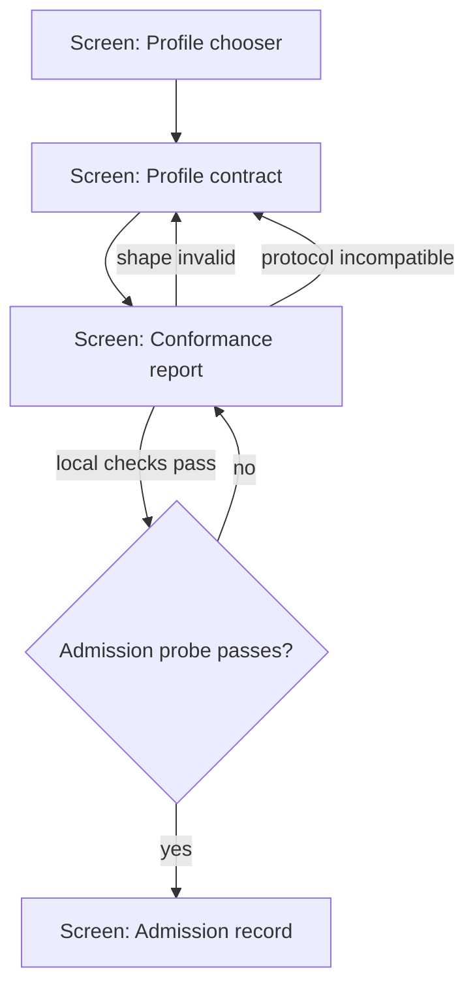

- **Screens traversed:**

  | Screen | States used here |
  |---|---|
  | SCR-01 Profile chooser | success |
  | SCR-02 Profile contract | success |
  | SCR-03 Conformance report | loading, error, success |
  | SCR-04 Admission record | error, success |

### FLW-02: Operator binds a provider to a project

- **Traces:** ST-002, ST-003 (JTBD-02, JRN-02/#1, JRN-02/#2)
- **Goal:** a project has a safe immutable capability binding
- **Entry points:** admitted provider record; project capability gap
- **Success exit:** binding revision pins admitted capability, execution context and policies
- **Task analysis:** compare admission evidence → select project pool/context →
  declare grant and checker → validate and record binding.
- **Rejected shape:** binding directly from discovery — rejected because discovery must not grant project access.
- **Flow:**

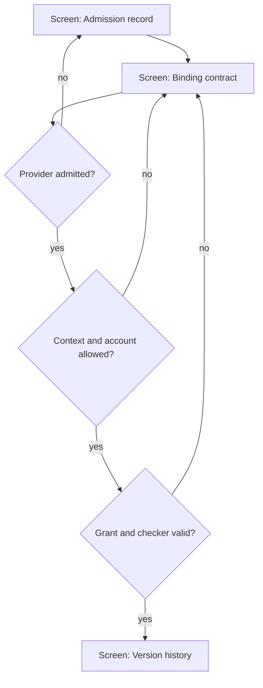

- **Screens traversed:** SCR-04 error/success; SCR-05 error/success; SCR-06 success.

### FLW-03: Operator recovers without rewriting history

- **Traces:** ST-004 (JTBD-03, JRN-02/#4, JRN-02/#5)
- **Goal:** new work uses a known-good configuration while prior runs remain reproducible
- **Entry points:** failed result; suspended provider; configuration history
- **Success exit:** new immutable binding or setting revision is active for new runs
- **Task analysis:** inspect evidence → choose replace, fallback or rollback →
  validate policy → create revision → verify old run pins.
- **Rejected shape:** mutate the current binding in place — rejected because it erases provenance.
- **Flow:**

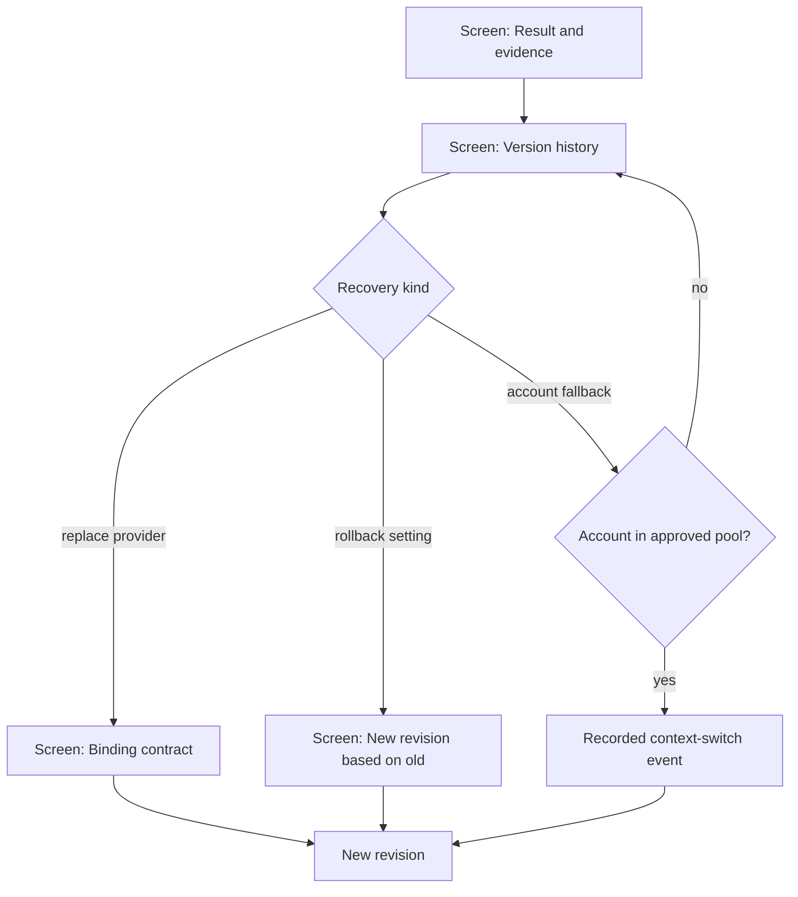

- **Screens traversed:** SCR-06 success; SCR-07 partial/error/success; SCR-05 error/success.

### FLW-04: Operator turns a failure into governed learning

- **Traces:** ST-005 (JTBD-03, JRN-02/#6)
- **Goal:** a verified correction becomes an approved future revision without self-mutation
- **Entry points:** checker failure; repeated-stage loop guard
- **Success exit:** project learning approved, or global insight promoted with independent evidence
- **Task analysis:** compare failed attempt and correction → record scope and
  proof → propose change → PM approves project change or CEO considers global
  promotion → create a new revision.
- **Rejected shape:** allow the failing agent to patch its active prompt — rejected because the evaluator and causal record would change mid-run.
- **Flow:**

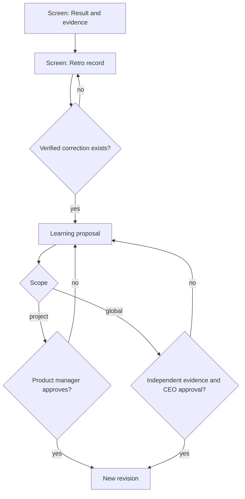

- **Screens traversed:** SCR-07 error/success; SCR-08 empty/error/success; SCR-06 success.

### FLW-05: Host serves a request through a runner route

- **Traces:** ST-006 (JTBD-02, JTBD-03, JRN-02/#2, JRN-02/#5)
- **Goal:** the first runner that can serve a request serves it, and every pass-over is explained
- **Entry points:** agent chat; managed task start; unattended routine or chain
- **Success exit:** `runner-selected` or `runner-switched` recorded with the derived execution context
- **Task analysis:** read pinned route → probe candidate → attach held session or spawn → record
  pass-over and try next → answer capability-unavailable when exhausted.
- **Rejected shape:** attach to whatever terminal is running the runner — rejected because the
  host would inject work into a session it does not own and cannot scope to the project.
- **Flow:**

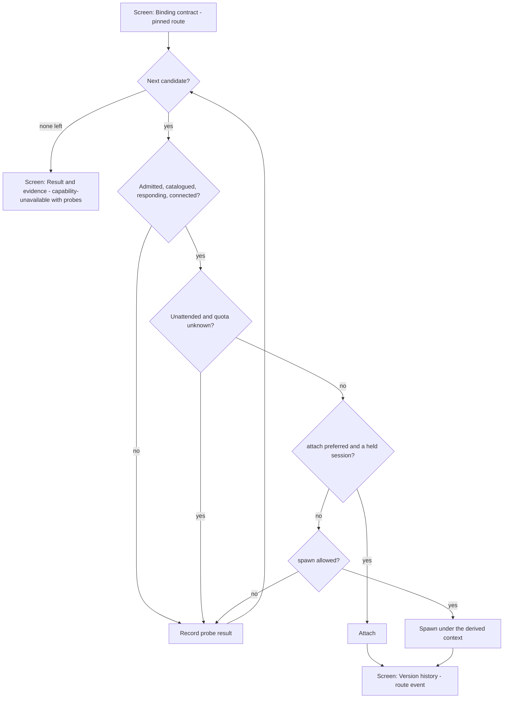

- **Screens traversed:** SCR-05 success; SCR-06 success; SCR-07 error.

### FLW-06: Member reads their access log

- **Traces:** ST-007 (JTBD-04, JRN-03/#3)
- **Goal:** every read of the member's data is visible with its purpose
- **Entry points:** the organization's member page; a link in the notice
- **Success exit:** the access log lists reads of raw events and of devices bound to the member
- **Task analysis:** sign in → the receiver resolves the member's `user.id` and bound devices → list `access-log/1` entries newest first.
- **Rejected shape:** log only reads keyed by `user.id` — rejected because device health and check-ins reveal a person's device state too.
- **Flow:**

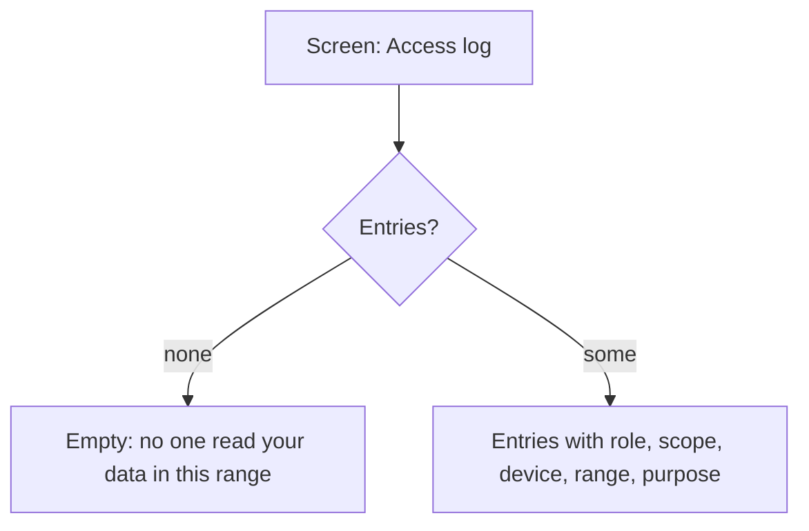

- **Screens traversed:** SCR-09 empty; SCR-09 success.

### FLW-07: Device applies policy layers

- **Traces:** ST-008 (JTBD-04, JRN-03/#2)
- **Goal:** the effective setting is the resolution of signed layers, and a locked key is never overridden locally
- **Entry points:** a policy in a check-in response; a local settings change
- **Success exit:** effective settings shown with the layer each came from and its lock
- **Task analysis:** verify signature and revision → resolve lock, then the user's value, then the highest default → show each key's source → refuse a local change to a locked key.
- **Rejected shape:** let the highest layer always win — rejected because an unlocked default would leave the person no choice at all.
- **Flow:**

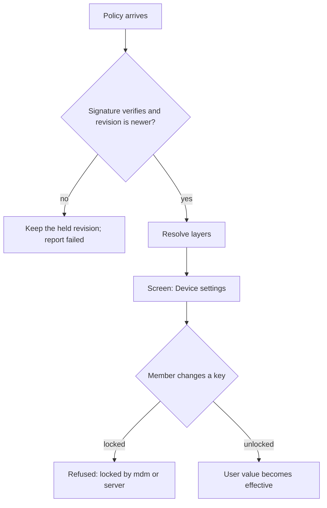

- **Screens traversed:** SCR-10 success; SCR-10 error.

### FLW-08: Operator answers an agent's stop in the messenger

- **Traces:** ST-009, ST-010 (JTBD-05, JRN-04/#2, JRN-04/#3, JRN-04/#4)
- **Goal:** a stop is decided from the chat by the same operation the dashboard runs, and money never moves on one press
- **Entry points:** the proposal of the channel; a stop sent with buttons
- **Success exit:** the decision recorded and audited; the keyboard removed
- **Task analysis:** link by a local code → receive a stop with buttons → check the sender's numeric id and the token → for money, confirm with the amount → run the agent's own operation → answer the callback.
- **Rejected shape:** a chat command that performs the action directly — rejected because it is a second path that skips the agent's authorization (DEC-0034 OC-5).
- **Flow:**

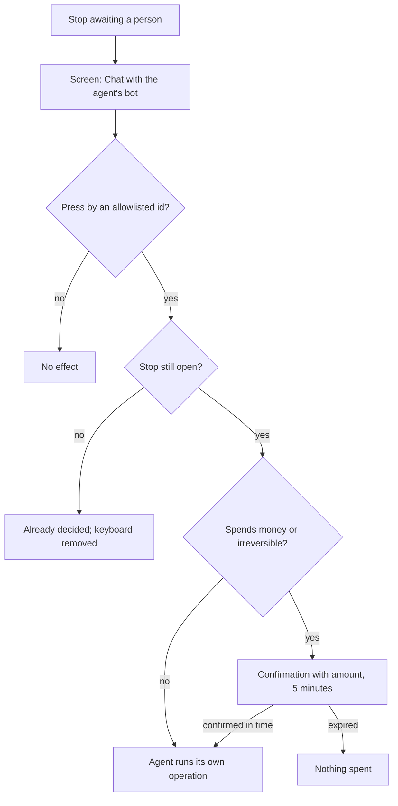

- **Screens traversed:** SCR-11 empty; SCR-11 success; SCR-11 error.

### FLW-09: Operator opens Fabric from a product

- **Traces:** ST-011 (JTBD-06, JRN-05/#1, JRN-05/#2, JRN-05/#4)
- **Goal:** Fabric opens on the product's service and project in one press, and nothing runs until the person acts
- **Entry points:** Fabric's button on a service dashboard
- **Success exit:** the conversation or the session view open in Fabric on the right service and project
- **Task analysis:** press the button → choose chat or session → the page follows a `fabric://` link built by the kit → Fabric validates the ids and opens the view → the person types or starts the runner.
- **Rejected shape:** a link that carries a prompt or starts the runner — rejected because any page can emit a link (DEC-0040 FB-8, FL-4).
- **Flow:**

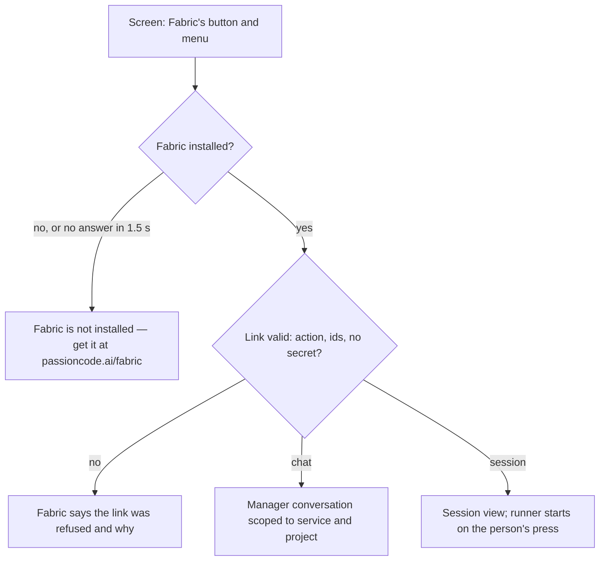

- **Screens traversed:** SCR-12 success; SCR-12 empty; SCR-12 error.

### FLW-10: Operator sets a spend limit and answers what exceeds it

- **Traces:** ST-012, ST-013 (JTBD-07, JRN-06/#1, JRN-06/#2)
- **Goal:** a project spends within a limit the operator chose once, and a spend above the threshold waits for one answer
- **Entry points:** the first run of a project that would spend money; a grant check above `autoApproveUsd`
- **Success exit:** the policy recorded with its inputs; the request answered and the spend allowed or not
- **Task analysis:** the launcher computes options → the operator picks one (one is preselected) → the meter checks each spend against the levels → above the threshold it denies with one filed request → the operator confirms the amount in the operator channel → the agent asks again and is allowed.
- **Rejected shape:** a fixed list of budgets, or an approval in a chat message — rejected because the options must come from the project (spend policy) and a chat message is never the approval (spend policy rule 3).
- **Flow:**

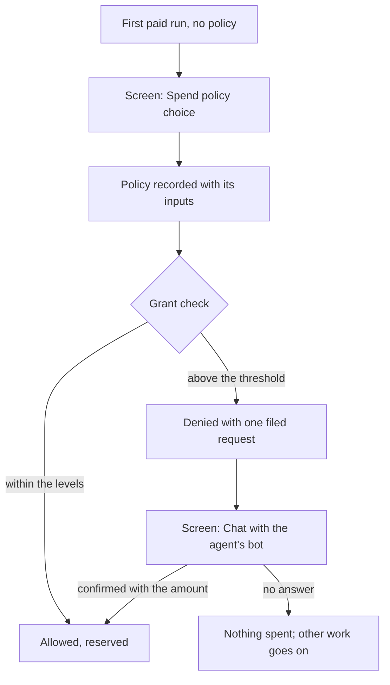

- **Screens traversed:** SCR-13 success; SCR-13 empty; SCR-11 success; SCR-11 error.

### FLW-11: Operator approves one action for an outside caller

- **Traces:** ST-014 (JTBD-07, JRN-06/#3)
- **Goal:** an effect asked for across the machine boundary happens only once, after an approval of exactly that action
- **Entry points:** a callee's `approval-required` refusal to a T2 caller
- **Success exit:** the action taken once; the approval's `jti` consumed
- **Task analysis:** the callee refuses with the action's digest → the caller asks the hub → Fabric shows the operator the action → the operator approves → the hub signs `approval/1` (`method: prompt`) → the caller repeats the call → the callee checks the token, the grant, then the approval, and acts.
- **Rejected shape:** a standing approval for a kind of action — rejected because an approval binds one action's digest, one callee and one use (DL-17, DL-18).
- **Flow:**

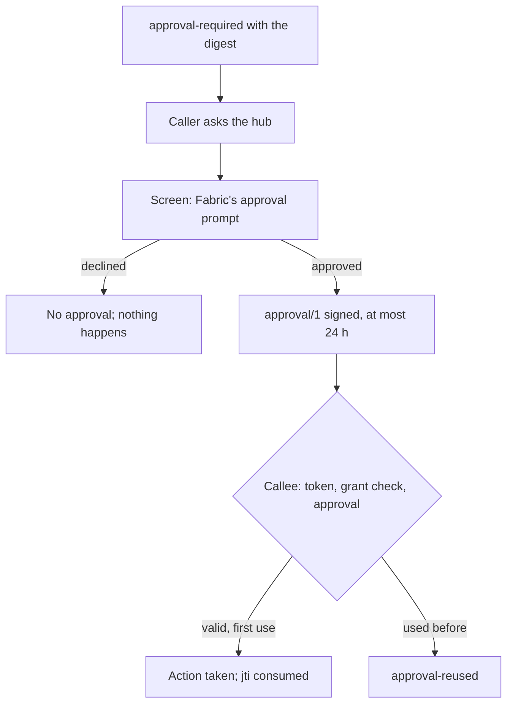

- **Screens traversed:** SCR-14 success; SCR-14 error.

### FLW-12: The host signs in again after a dashboard session ends

- **Traces:** ST-015 (JTBD-06, JRN-05/#3)
- **Goal:** an ended session is visible on the page and recovered by the host without a loop
- **Entry points:** a dashboard page requested after the session ended
- **Success exit:** the same page open again under a new session
- **Task analysis:** the page answers `401` with an explanation → the host asks for a new login code with the descriptor token → it reopens the same page → it does so at most once a minute per page.
- **Rejected shape:** reloading the page on any `401` from its API — rejected because it would discard what the operator is doing (service, Operator login).
- **Flow:**

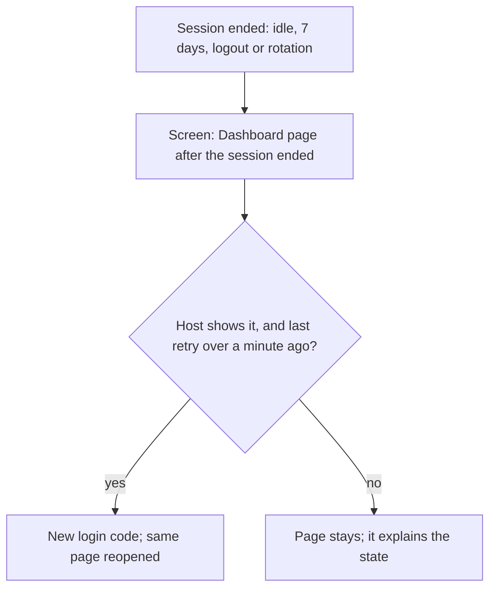

- **Screens traversed:** SCR-15 error; SCR-15 success.

### FLW-17: A second copy of a service starts while one runs

- **Traces:** ST-021 (JTBD-03, JRN-02/#3)
- **Goal:** a second copy changes nothing, and what the operator sees says what happened, never an outage
- **Entry points:** the operator runs the service by hand; its supervisor starts it again
- **Success exit:** one copy runs and answers; the second has exited 75 or taken over after the first left
- **Task analysis:** the second copy reads the supervisor marker → by hand it tries the lock once and exits 75 naming the holder → marked, it waits up to 300 s touching nothing and exits 75, or takes the lock if the holder leaves → markers that disagree exit 75 at once → the host keeps showing the holder's health.
- **Rejected shape:** exiting at once under a supervisor — rejected because launchd and systemd restart it every 10 s, forever (service, One copy).
- **Flow:**

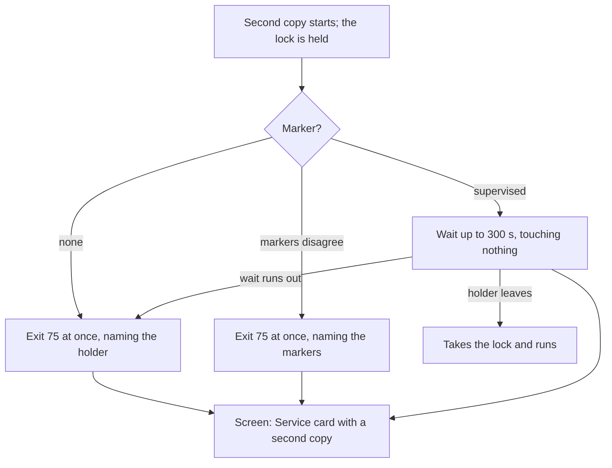

- **Screens traversed:** SCR-20 loading (the wait); SCR-20 error (exit 75); SCR-20 success (one copy runs).

## Practice compliance

| Practice | Verdict | How / why not |
|---|---|---|
| PRN-01..24 | adapted (band) | each gate has visible state, plain-language recovery and checkable claims; no graphical interaction exists |
| BP-001 | applied | every flow traces to a confirmed job and story |
| BP-207 | adapted | README leads with the minimal contract objects and check command rather than a screenshot |
| BP-208 | applied | overview, profiles and reference pages have separate canonical homes rather than one long page |
| BP-209 | rejected | no executable setup checklist ships in v0.1; the ordered author path is documentation only |
| BP-210 | applied | each profile page answers one compatibility question and points to its schema |
| BP-235 | adapted | an unavailable optional provider remains an explicit capability gap rather than disappearing |
| BP-004, BP-012 | adapted (band) | empty and recovery states name the next action; there is no onboarding screen |
| BP-182, BP-185, BP-189 | applied (band) | normative language uses one glossary and separates obligations from examples |
| BP-186..188 | applied (band) | errors name gate, consequence and recovery without exposing secrets |
| BP-079..181 | rejected (band) | no graphical UI, forms, motion, navigation shell or public web surface ships in v0.1 |
